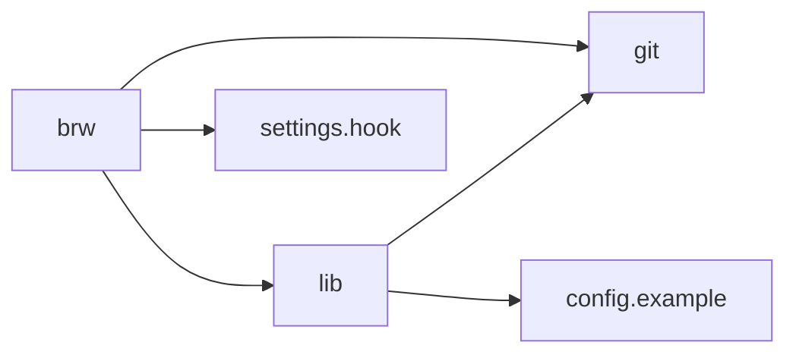
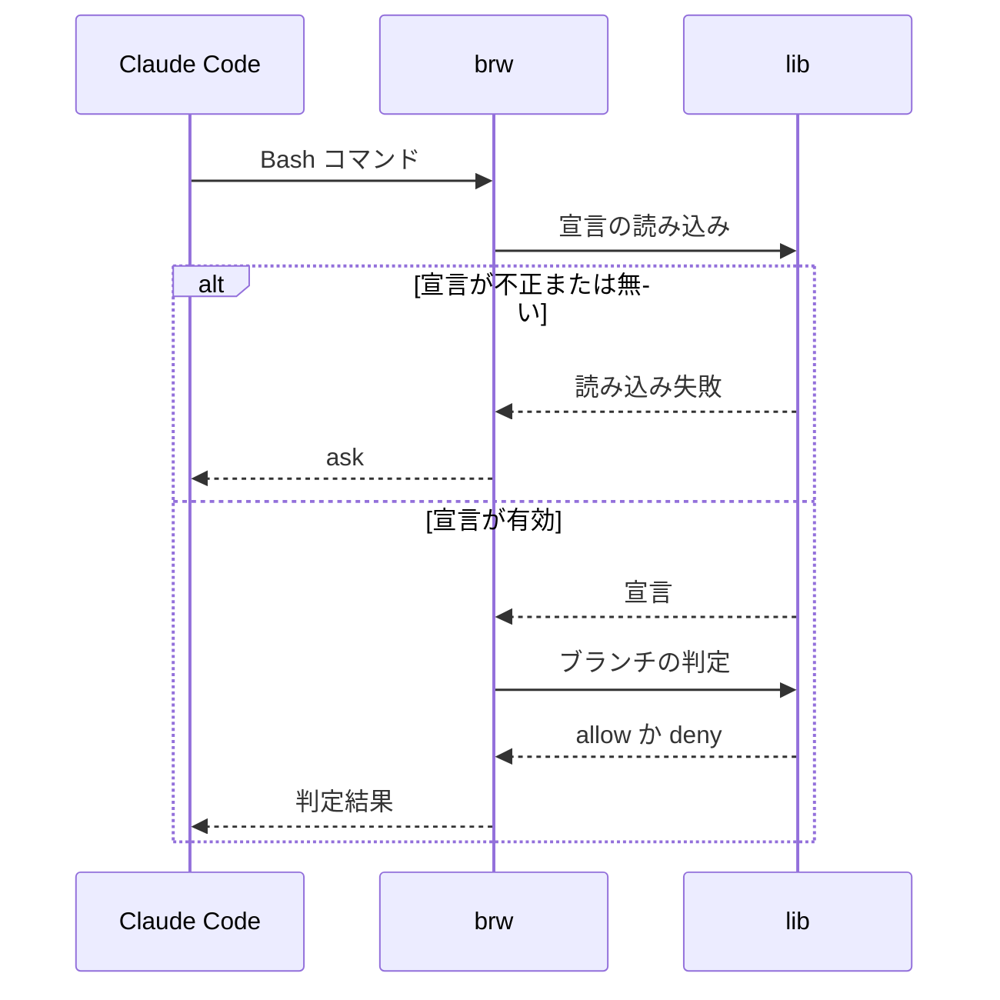

# ブランチ運用の強制 設計書

## 1. 構成

| パス                            | 責務                                 |
| ------------------------------- | ------------------------------------ |
| `scripts/lib.mjs`               | 宣言の読み込み・検証とブランチの判定 |
| `scripts/brw.mjs`               | フック・作成・自己更新のサブコマンド |
| `templates/config.example.json` | 宣言ファイルの記入例                 |
| `templates/settings.hook.json`  | フックを有効にする設定の案           |

## 2. 関係図・ワークフロー

呼び出しと読み込みの依存方向を示す。



フックが git コマンドを判定し、結果を返すまでの流れを示す。



## 3. 設計項目

### D-1: 宣言ファイルの読み込みと検証 (FR-1, NFR-2)

宣言は `.claude/branch-release-workflow.json` に置く。

| キー              | 型           | 検証                         |
| ----------------- | ------------ | ---------------------------- |
| workBranches      | 文字列の配列 | 必須。1 件以上               |
| protectedBranches | 文字列の配列 | 必須                         |
| baseBranch        | 文字列       | 省略時は develop             |
| namePattern       | 正規表現     | 正規表現として解釈できること |
| maxNameLength     | 整数         | 省略時は 54                  |

スクリプトの import は Node 標準モジュールと相対パスに限る。

### D-2: ブランチの判定 (FR-2, FR-3, NFR-1)

```json
{
  "protectedBranches に一致": "deny",
  "workBranches に一致": "allow",
  "どちらにも一致しない": "deny",
  "宣言ファイルがない": "ask",
  "宣言が不正": "ask",
  "ブランチを特定できない": "ask"
}
```

保護ブランチの判定を先に行う。glob の `*` は斜線を除く任意の文字列、`**` は斜線を含む任意の文字列に一致する。判定は子プロセスの git を 1 回だけ呼ぶため、1 秒以内に終わる。

### D-3: push の送り先の解釈 (FR-4)

| 引数                            | 判定対象のブランチ       |
| ------------------------------- | ------------------------ |
| 送り先の指定なし                | 現在のブランチ           |
| `HEAD`                          | 現在のブランチ           |
| `<元>:<先>`                     | 先（refs/heads/ は除く） |
| `refs/tags/` で始まる、`--tags` | 判定しない               |
| `--all`、`--mirror`             | 特定できないため ask     |

連結したコマンド（`&&`、`;`、`|`）と `git -C <dir>`、`cd <dir> &&` を解釈し、最も厳しい判定を返す。

### D-4: 作業ブランチの作成 (FR-5)

```json
{
  "接頭辞": "workBranches の最初の 'xxx/*' の xxx/",
  "検証": ["namePattern", "maxNameLength", "保護ブランチでないこと", "未存在"],
  "分岐元": "--base、省略時は baseBranch（origin を優先）",
  "既定の作成物": "ブランチと worktree（.claude/worktrees/<alias>）"
}
```

検証に失敗したときは何も作らず、終了コード 1 で終わる。

### D-5: スキルの自己更新 (FR-6)

| 状況                           | 結果の 1 行                                |
| ------------------------------ | ------------------------------------------ |
| git の作業ツリーの最上位でない | 更新できない旨と clone による導入方法      |
| pull に失敗                    | 更新できない旨と失敗の理由（強制はしない） |
| 履歴が進んだ                   | 更新した旨と SKILL.md の読み直しの指示     |
| 履歴が同じ                     | 最新である旨                               |

更新は `git pull --ff-only` だけで行い、reset・stash・force を使わない。どの結果でも終了コードは 0 とし、現在の版で作業を続けられるようにする。

## 4. エラー処理

| 事象                       | 処理                                       |
| -------------------------- | ------------------------------------------ |
| フックの入力が JSON でない | 何も出力せず、判定しない                   |
| 宣言が不正                 | 不正な箇所を示して ask を返す              |
| 命名規則への違反           | 理由と規則を表示し、終了コード 1 で終わる  |
| 自己更新の失敗             | 理由を 1 行で表示し、終了コード 0 で終わる |
