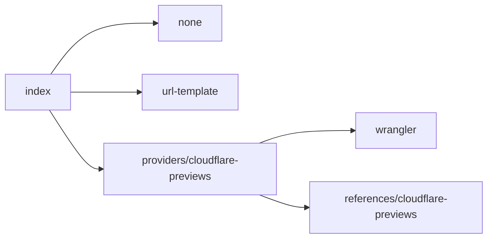
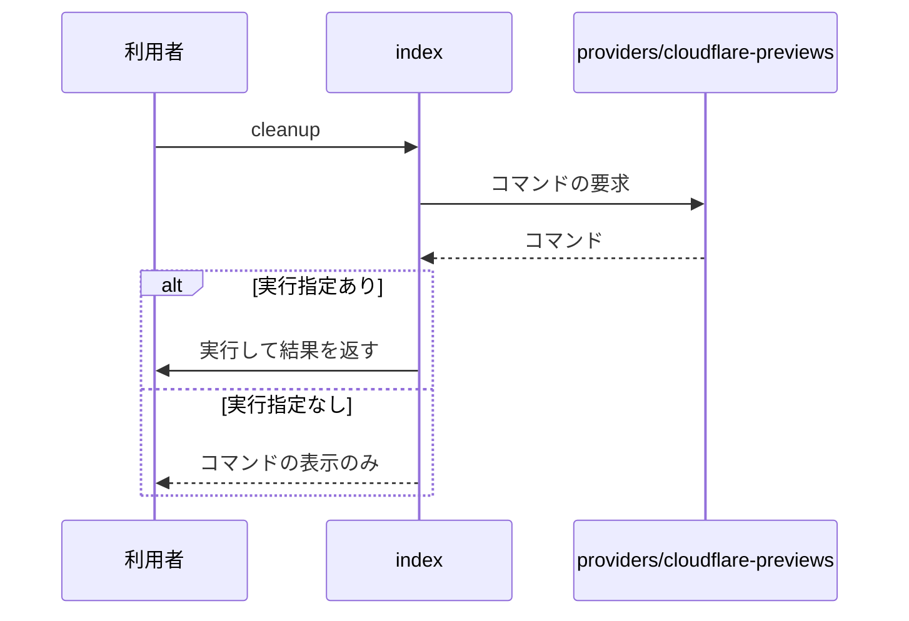

# プレビュー運用 設計書

## 1. 構成

| パス                                | 責務                                 |
| ----------------------------------- | ------------------------------------ |
| `providers/index.mjs`               | provider の選択とプレビューURLの算出 |
| `providers/none.mjs`                | プレビューを行わない provider        |
| `providers/url-template.mjs`        | URL の算出だけを行う provider        |
| `providers/cloudflare-previews.mjs` | Cloudflare の検査・雛形・後始末      |
| `references/cloudflare-previews.md` | Cloudflare Previews の前提と注意点   |

## 2. 関係図・ワークフロー

provider の選択と各 provider の依存方向を示す。



後始末のコマンドを提示し、指定があるときだけ実行する流れを示す。



## 3. 設計項目

### D-1: プレビューURLの算出 (FR-1, FR-9)

| 入力                 | 出力                   |
| -------------------- | ---------------------- |
| ブランチ dev/foo-bar | alias は dev-foo-bar   |
| 接頭辞 dev/ の指定あり | alias は foo-bar       |
| URL 雛形の {alias}   | alias で置き換える     |
| URL 雛形の {branch}  | ブランチ名で置き換える |

### D-2: provider の切り替え (FR-2, FR-5, FR-6)

| provider            | 検査                     | 雛形     | 後始末                  |
| ------------------- | ------------------------ | -------- | ----------------------- |
| none                | なし                     | なし     | なし                    |
| url-template        | なし                     | なし     | なし                    |
| cloudflare-previews | 有効化設定・版・workflow | workflow | wrangler preview delete |

雛形の書き込みは、同名のファイルがあるとき何も書かずに終了コード 1 で終わる。後始末は実行指定がなければコマンドを表示するだけにする。

### D-3: 宣言外の CI の警告 (FR-3)

```json
{
  "走査対象": ".github/workflows の *.yml と *.yaml",
  "取り出す値": "on の push の branches",
  "警告する条件": "workBranches と protectedBranches のどちらにも含まれない指定",
  "branches がない push": "全ブランチ対象として警告",
  "tags だけの push": "ブランチ対象ではないため警告しない"
}
```

### D-4: Cloudflare の検査 (FR-4, FR-8)

| 検査                                    | 結果の水準 |
| --------------------------------------- | ---------- |
| 有効化設定が wrangler 設定にない        | 誤り       |
| wrangler が 4.135.0 未満                | 誤り       |
| wrangler preview を使う workflow がない | 誤り       |
| 旧方式の preview alias が残っている     | 警告       |
| 独自ドメインの有効状況と workers.dev 関連キーが食い違う | 警告       |

### D-5: workers.dev 関連キーの設定 (FR-7, FR-8)

`brw wrangler-config [ファイル] [--write]` が行う。ファイルの既定は `wrangler.jsonc`。形式は JSONC（コメントと末尾のカンマを許す）だけを扱う。

| 判定               | 条件                                                                                              |
| ------------------ | ------------------------------------------------------------------------------------------------- |
| 独自ドメインが有効 | `routes` の要素か `route` に、`custom_domain` が `true` で `enabled` が `false` でない項目がある |
| 独自ドメインが無効 | 上記以外（`routes` がない・文字列だけ・`enabled: false` のみ）                                    |

| 判定               | `workers_dev` | `preview_urls` |
| ------------------ | ------------- | -------------- |
| 独自ドメインが有効 | `false`       | `false`        |
| 独自ドメインが無効 | `true`        | `true`         |

- 書き込みを指示するまで、設定ファイルは変えない。
- 両キーは省略せず、明示して書く。実機の確認（wrangler 4.147.0）では、独自ドメインがある設定で省略しても `wrangler deploy` の結果は `false` と同じだが、毎回警告が出て wrangler の既定値に依存する。`wrangler versions upload` と `wrangler preview` は、どちらの書き方でも workers.dev の状態を変えない。
- 変更はトップレベルのキーだけに行う。`previews` 内の入れ子のキーは変えない。
- 書き込みを指示しないときは、設定した結果の内容を標準出力へ出し、ファイルを変えない。
- 設定した結果が JSONC として読めないときは、何も書かずに終了コード 1 で終わる。
- 検査は、同じ判定で期待値と食い違うキーを警告する。取り除く期待のキーが無ければ食い違いとしない。

## 4. エラー処理

| 事象                  | 処理                                |
| --------------------- | ----------------------------------- |
| 宣言の preview が不正 | 宣言の検証で誤りとして報告する      |
| provider に雛形がない | 理由を表示し、終了コード 1 で終わる |
| 後始末の実行が失敗    | コマンドの終了コードをそのまま返す  |
| wrangler 設定が JSONC として読めない・存在しない・toml | 理由を表示し、終了コード 1 で終わる |
