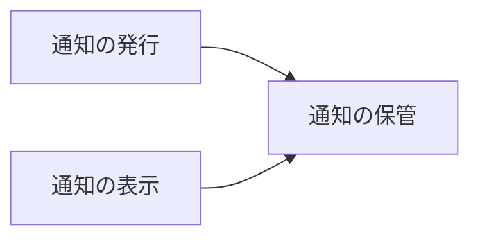
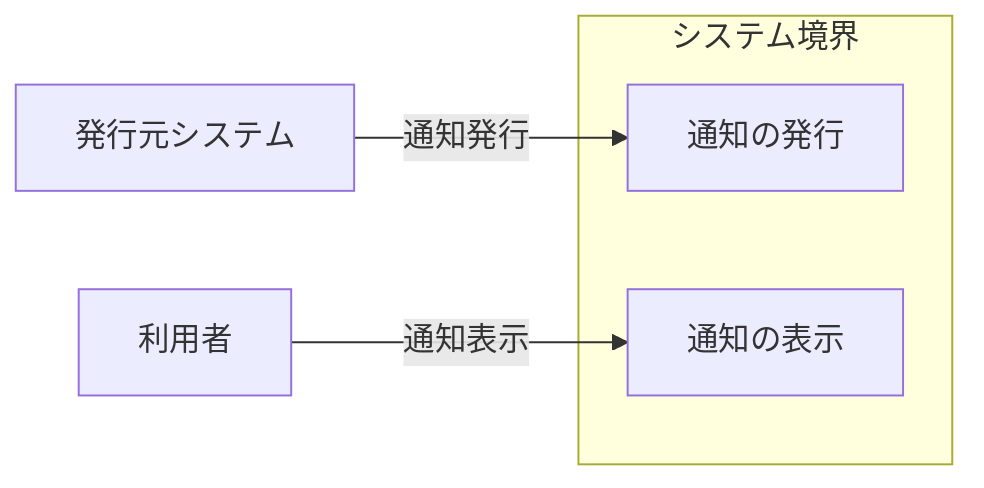
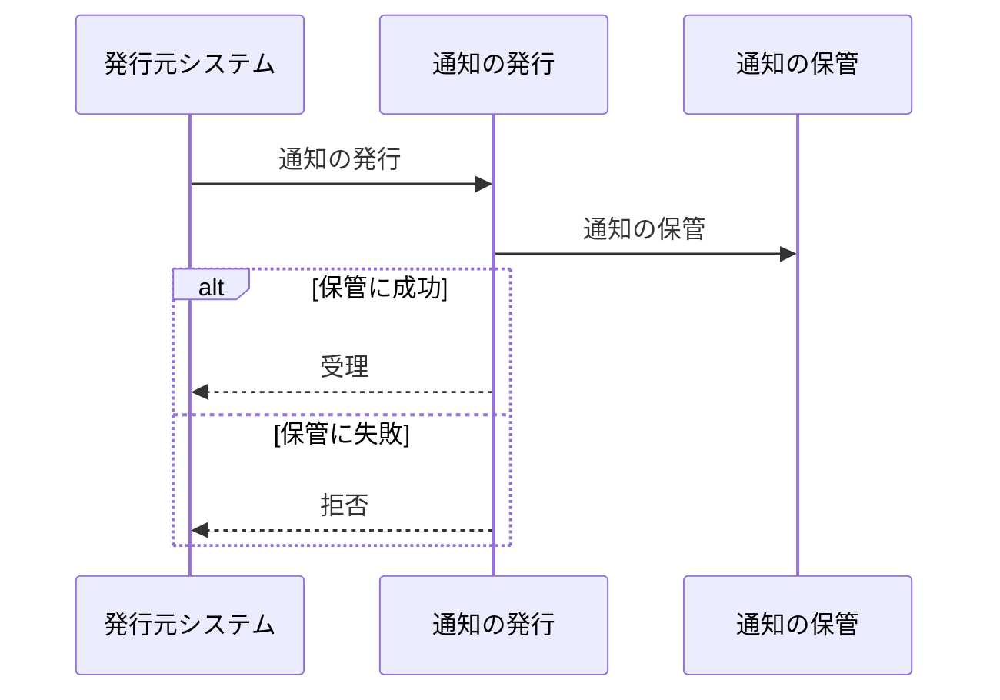

# 通知配信サービス アーキテクチャ

## 1. 目的と範囲

通知配信サービスは、利用者の画面へ未読件数と通知の一覧を届ける。
通知の発行元システムは、このサービスの対象外である。

## 2. 構成要素

| 構成要素       | 種別 | 責務                                                 | 詳細                                  |
| -------------- | ---- | ---------------------------------------------------- | ------------------------------------- |
| 利用者         | 外部 | 画面で未読件数と通知の一覧を確認する                 | -                                     |
| 発行元システム | 外部 | 通知の内容と宛先を送信する                           | -                                     |
| 通知の発行     | 内部 | 発行元システムの要求を検証して通知を受け付ける       | [通知の発行](architecture/publish.md) |
| 通知の保管     | 内部 | 通知を宛先ごとに振り分けて保管し、既読位置を管理する | [通知の保管](architecture/store.md)   |
| 通知の表示     | 内部 | 未読件数と通知の一覧を利用者の画面へ届ける           | [通知の表示](architecture/display.md) |

## 3. システム構成

機能のくくりの依存は、発行と表示から保管へ一方向に進む。

## 4. 外部インターフェース

| IF       | 方向 | 外部の要素     | 内部の要素 |
| -------- | ---- | -------------- | ---------- |
| 通知表示 | 提供 | 利用者         | 通知の表示 |
| 通知発行 | 提供 | 発行元システム | 通知の発行 |

システム境界の内側のくくりと外部の要素は、IF の名前を付けた辺で結ぶ。

## 5. 機能

### 通知の受理と保管

- 関与: 発行元システム、通知の発行、通知の保管

通知の受理と保管は、保管の成否で発行元システムへの応答が分岐する。

## 6. データ

- なし

## 7. 信頼と検証

- なし

## 8. 技術基盤

| 領域     | 採用             | 理由                                   | 根拠                              |
| -------- | ---------------- | -------------------------------------- | --------------------------------- |
| 実行基盤 | サーバーレス関数 | 配信量の変動に合わせて自動で拡縮できる | delivery-worker、notification-api |

## 9. 横断的制約

| 制約                   | 値      | 根拠                         |
| ---------------------- | ------- | ---------------------------- |
| 1 宛先あたりの保管件数 | 1000 件 | publish-api、delivery-worker |
