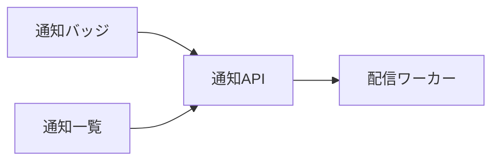
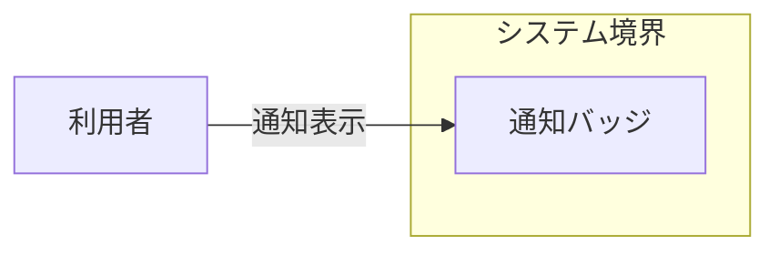
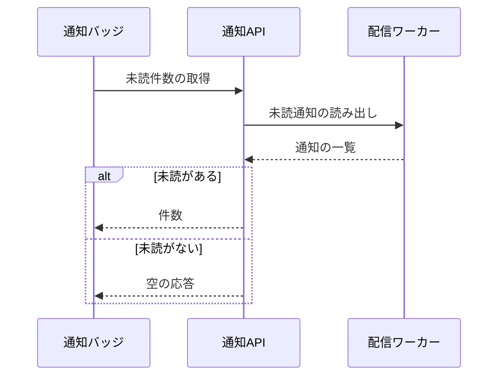

# 通知の表示 アーキテクチャ

## 1. 目的と範囲

通知の表示は、利用者の画面へ未読件数と通知の一覧を届ける。
通知の保管は、別の機能のくくりの対象である。

## 2. 構成要素

| 構成要素     | 種別   | 責務                                   | 実装spec           |
| ------------ | ------ | -------------------------------------- | ------------------ |
| 利用者       | 外部   | 画面を開いて未読件数と一覧を読む       | -                  |
| 通知バッジ   | 内部   | 未読件数をヘッダーに描画する           | notification-badge |
| 通知API      | 内部   | 未読件数を集計して返す                 | notification-api   |
| 通知一覧     | 内部   | 通知を新しい順に並べて画面に描画する   | notification-list  |
| 配信ワーカー | 他機能 | 保管した通知を宛先ごとに読み出して返す | -                  |

## 3. システム構成

画面の要素は通知APIを呼び、通知APIは配信ワーカーから通知を読み出す。

## 4. 外部インターフェース

| IF       | 方向 | 外部の要素 | 内部の要素 | 方式         | 認証              |
| -------- | ---- | ---------- | ---------- | ------------ | ----------------- |
| 通知表示 | 提供 | 利用者     | 通知バッジ | HTTPS の画面 | セッション Cookie |

利用者は、通知表示の辺で通知バッジにつながる。

## 5. 機能

### 未読件数の表示

- 関与: 通知バッジ、通知API、配信ワーカー

未読件数の表示は、未読の有無でバッジの描画が分岐する。

## 6. データ

- なし

## 7. 信頼と検証

- なし

## 8. 技術基盤

- なし

## 9. 横断的制約

| 制約           | 値                  | 根拠             |
| -------------- | ------------------- | ---------------- |
| 未読件数の取得 | 応答 500 ミリ秒以内 | notification-api |
