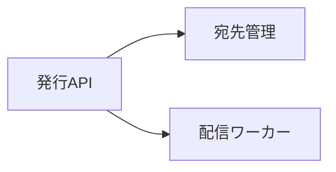
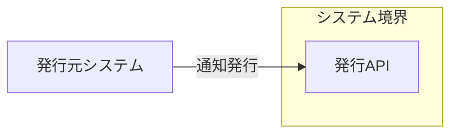
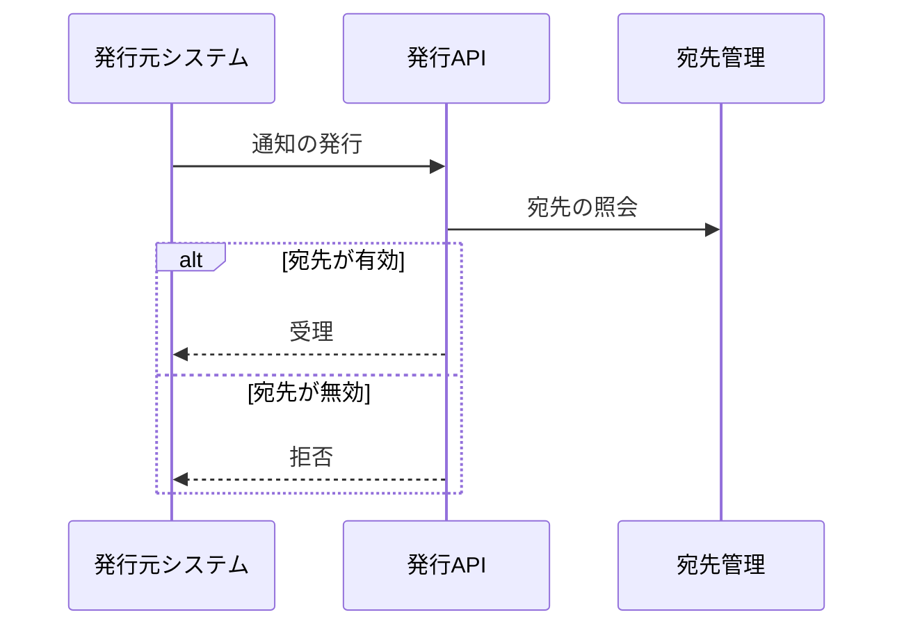

# 通知の発行 アーキテクチャ

## 1. 目的と範囲

通知の発行は、発行元システムの要求を検証して通知を受け付ける。
通知の保管と表示は、別の機能のくくりの対象である。

## 2. 構成要素

| 構成要素       | 種別   | 責務                                               | 実装spec           |
| -------------- | ------ | -------------------------------------------------- | ------------------ |
| 発行元システム | 外部   | 通知の内容と宛先を送り、受理か拒否の応答を受け取る | -                  |
| 発行API        | 内部   | 要求の API キーと宛先を確認して受け付ける          | publish-api        |
| 宛先管理       | 内部   | 宛先の有効と無効を保持して照会に答える             | recipient-registry |
| 配信ワーカー   | 他機能 | 受け付けた通知を宛先ごとに保管する                 | -                  |

## 3. システム構成

通知の受け付けは、宛先の確認と保管の依頼に分かれる。

## 4. 外部インターフェース

| IF       | 方向 | 外部の要素     | 内部の要素 | 方式          | 認証     |
| -------- | ---- | -------------- | ---------- | ------------- | -------- |
| 通知発行 | 提供 | 発行元システム | 発行API    | HTTPS（JSON） | API キー |

発行元システムは、通知発行の辺で発行APIにつながる。

## 5. 機能

### 通知の受付

- 関与: 発行元システム、発行API、宛先管理

通知の受付は、宛先が無効な場合に拒否する分岐を持つ。

## 6. データ

- なし

## 7. 信頼と検証

| 対象                 | 信頼する前提                               | 検証手段                           | 根拠        |
| -------------------- | ------------------------------------------ | ---------------------------------- | ----------- |
| 発行元システムの要求 | API キーを持つ発行元だけが通知を発行できる | 発行APIが API キーの一致を確認する | publish-api |

## 8. 技術基盤

- なし

## 9. 横断的制約

- なし
