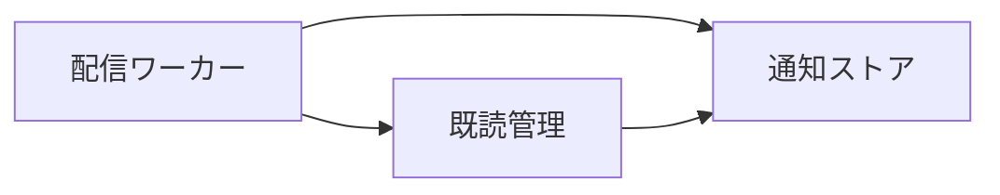
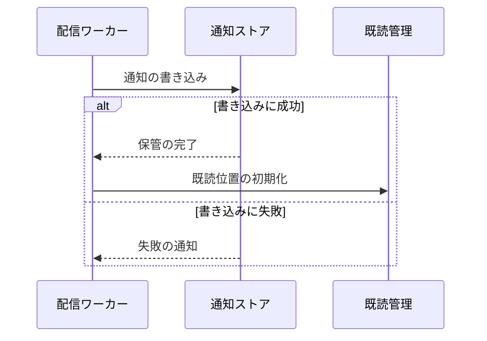

# 通知の保管 アーキテクチャ

## 1. 目的と範囲

通知の保管は、受け付けた通知を宛先ごとに振り分けて保管し、既読位置を管理する。
通知の受け付けと画面への表示は、別の機能のくくりの対象である。

## 2. 構成要素

| 構成要素     | 種別 | 責務                                         | 実装spec           |
| ------------ | ---- | -------------------------------------------- | ------------------ |
| 配信ワーカー | 内部 | 通知を宛先ごとに振り分けて保管する           | delivery-worker    |
| 通知ストア   | 内部 | 通知と既読位置をデータベースに書き込んで返す | notification-store |
| 既読管理     | 内部 | 宛先ごとの既読位置を初期化して更新する       | read-position      |

## 3. システム構成

通知の保管は、書き込みと既読位置の記録に分かれる。

## 4. 外部インターフェース

- なし

## 5. 機能

### 通知の保管と既読の初期化

- 関与: 配信ワーカー、通知ストア、既読管理

通知の保管は、書き込みの成否で既読位置の初期化に進むかが分岐する。

## 6. データ

| データ   | 保管場所                 | 書き込み主体 |
| -------- | ------------------------ | ------------ |
| 通知     | 通知ストアのデータベース | 配信ワーカー |
| 既読位置 | 通知ストアのデータベース | 既読管理     |

## 7. 信頼と検証

- なし

## 8. 技術基盤

| 領域       | 採用                       | 理由                                    | 根拠               |
| ---------- | -------------------------- | --------------------------------------- | ------------------ |
| データ保管 | リレーショナルデータベース | 宛先ごとの集計を1回の問い合わせで行える | notification-store |

## 9. 横断的制約

- なし
