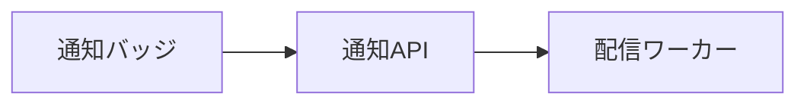
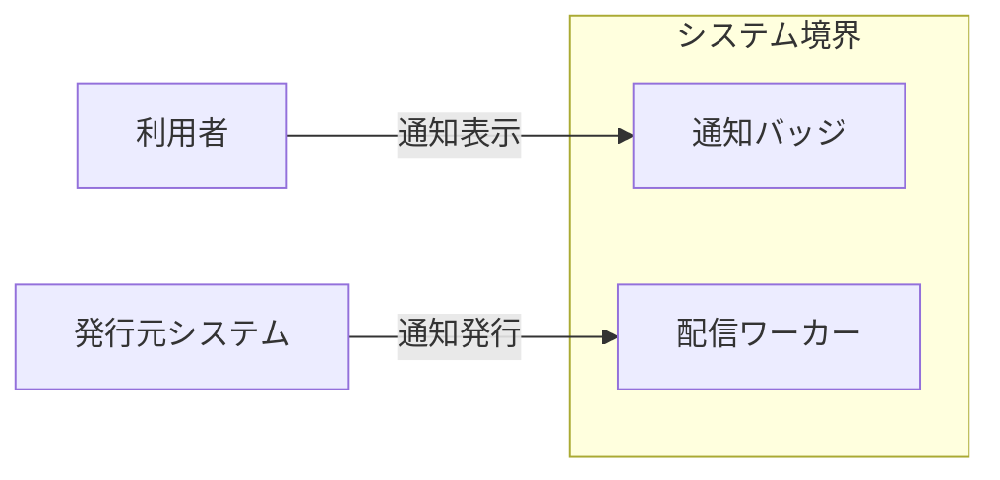
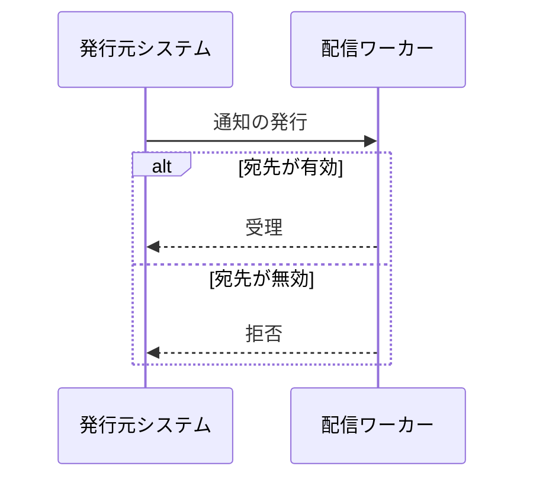
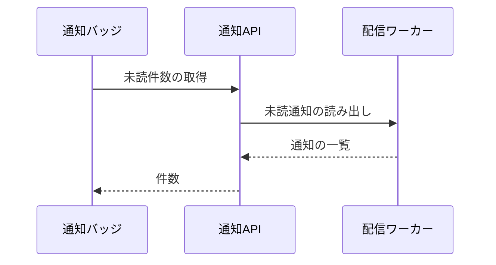

# 通知配信サービス アーキテクチャ

## 1. 目的と範囲

通知配信サービスは、利用者の画面へ未読通知の件数を届ける。
通知の発行元システムは、このサービスの対象外である。

## 2. 構成要素

| 構成要素       | 種別 | 責務                               | 実装spec           |
| -------------- | ---- | ---------------------------------- | ------------------ |
| 利用者         | 外部 | 画面で未読件数を確認する           | -                  |
| 発行元システム | 外部 | 通知の内容と宛先を送信する         | -                  |
| 通知バッジ     | 内部 | 未読件数をヘッダーに描画する       | notification-badge |
| 通知API        | 内部 | 未読件数を集計して返す             | notification-api   |
| 配信ワーカー   | 内部 | 通知を宛先ごとに振り分けて保管する | delivery-worker    |

## 3. システム構成

内部の要素どうしの呼び出しは、画面から基盤へ一方向に進む。

## 4. 外部インターフェース

| IF       | 方向 | 外部の要素     | 内部の要素   | 方式          | 認証              |
| -------- | ---- | -------------- | ------------ | ------------- | ----------------- |
| 通知表示 | 提供 | 利用者         | 通知バッジ   | HTTPS の画面  | セッション Cookie |
| 通知発行 | 提供 | 発行元システム | 配信ワーカー | HTTPS（JSON） | API キー          |

システム境界の内側の要素と外部の要素は、IF の名前を付けた辺で結ぶ。

## 5. 機能

### 通知の発行

- 関与: 発行元システム、配信ワーカー

通知の発行は、宛先が無効な場合に拒否する分岐を持つ。

### 未読件数の表示

- 関与: 通知バッジ、通知API、配信ワーカー

未読件数の表示は、バッジから基盤まで順に問い合わせて行う。

## 6. データ

| データ   | 保管場所                   | 書き込み主体 |
| -------- | -------------------------- | ------------ |
| 通知     | 配信ワーカーのデータベース | 配信ワーカー |
| 既読位置 | 配信ワーカーのデータベース | 配信ワーカー |

## 7. 信頼と検証

| 対象                 | 信頼する前提                               | 検証手段                                | 根拠            |
| -------------------- | ------------------------------------------ | --------------------------------------- | --------------- |
| 発行元システムの要求 | API キーを持つ発行元だけが通知を発行できる | 配信ワーカーが API キーの一致を確認する | delivery-worker |

## 8. 技術基盤

| 領域       | 採用                       | 理由                                    | 根拠             |
| ---------- | -------------------------- | --------------------------------------- | ---------------- |
| 実行基盤   | サーバーレス関数           | 配信量の変動に合わせて自動で拡縮できる  | delivery-worker  |
| データ保管 | リレーショナルデータベース | 宛先ごとの集計を1回の問い合わせで行える | poc/storage-cost |

## 9. 横断的制約

| 制約                   | 値                  | 根拠             |
| ---------------------- | ------------------- | ---------------- |
| 未読件数の取得         | 応答 500 ミリ秒以内 | notification-api |
| 1 宛先あたりの保管件数 | 1000 件             | poc/storage-cost |
