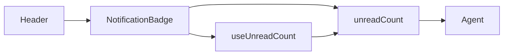
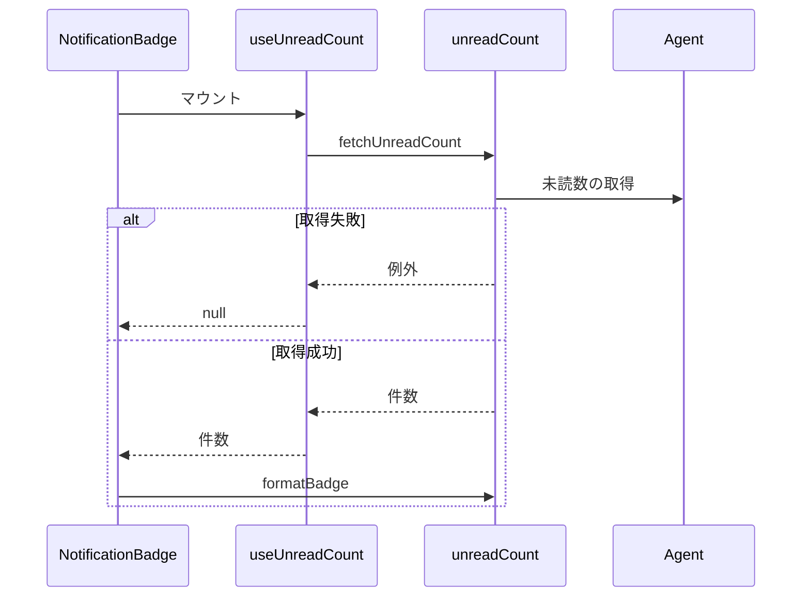

# 通知バッジ 設計書

## 1. 構成

| パス                                                | 責務                         |
| --------------------------------------------------- | ---------------------------- |
| `src/lib/notification/unreadCount.ts`               | 未読件数の取得と表示文字列化 |
| `src/lib/notification/useUnreadCount.ts`            | 件数取得の開始と結果の保持   |
| `src/components/notification/NotificationBadge.tsx` | 件数バッジの描画             |
| `src/components/layout/Header.tsx`                  | ヘッダーへのバッジの配置     |

## 2. 関係図・ワークフロー

呼び出しの依存方向を示す。



件数の取得から描画までの流れと、取得失敗時の分岐を示す。



## 3. 設計項目

### D-1: 未読件数の取得と表示文字列化 (FR-1, FR-2)

```ts
export async function fetchUnreadCount(agent: Agent): Promise<number>

// 0件のとき null を返し、呼び出し側は null のときバッジを描画しない
export function formatBadge(count: number): string | null {
  if (count <= 0) return null
  return count > 99 ? "99+" : String(count)
}
```

### D-2: 表示タイミング (NFR-1)

```ts
// 取得中と失敗のとき null を返す
export function useUnreadCount(agent: Agent): number | null
```

| 段階                     | 時間予算  |
| ------------------------ | --------- |
| 初回描画（バッジ枠のみ） | 300ミリ秒 |
| 件数取得                 | 500ミリ秒 |
| 件数反映                 | 200ミリ秒 |

件数取得はヘッダーのマウント時に1回だけ開始し、取得完了まで枠を描画しない。

## 4. エラー処理

| 事象             | 処理                                   |
| ---------------- | -------------------------------------- |
| 件数取得の失敗   | バッジを描画せず、コンソールへ記録する |
| 応答が数値でない | 件数取得の失敗として扱う               |
