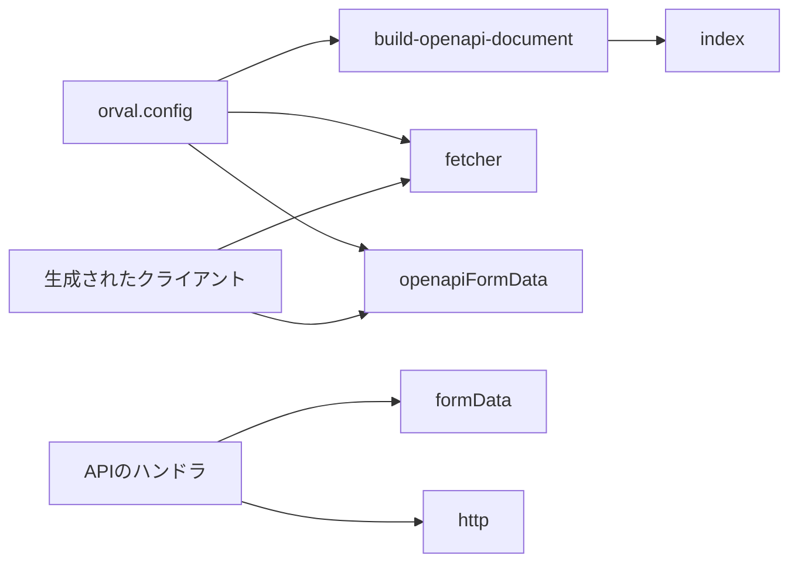
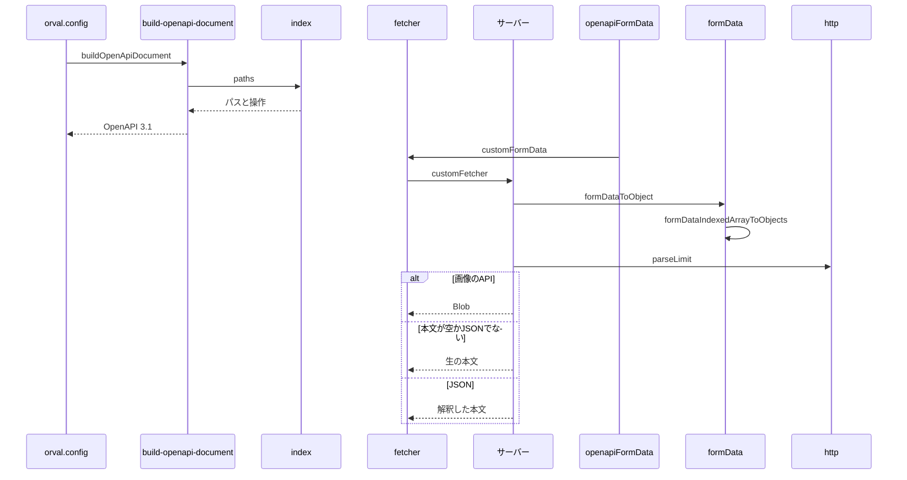

# Design Document

## Overview

**Purpose**: APIの入出力の定義を1か所に保ち、そこからOpenAPIのドキュメントとフロントエンド用のクライアントを生成して、サーバーとクライアントの食い違いを防ぐ。
**Users**: API を実装・利用する開発者
**Impact**: スキーマを唯一の定義とし、OpenAPI ドキュメントとクライアントを生成して、サーバーとクライアントの食い違いを防ぐ。

### Goals

- APIのスキーマの登録と、OpenAPIドキュメントの組み立て。
- 生成したクライアントが通信に使う取得処理とフォームデータの組み立て。
- サーバー側でのフォームデータの復元と、リクエストの補助処理。

### Non-Goals

- 個々のAPIのスキーマの内容。
- 生成されたクライアントのコードそのもの。

## Boundary Commitments

### This Spec Owns

- APIのスキーマの登録と、OpenAPIドキュメントの組み立て。
- 生成したクライアントが通信に使う取得処理とフォームデータの組み立て。
- サーバー側でのフォームデータの復元と、リクエストの補助処理。

### Out of Boundary

- 個々のAPIのスキーマの内容。
- 生成されたクライアントのコードそのもの。

### Allowed Dependencies

- Zod と OpenAPI の登録の仕組み（スキーマの登録）
- orval（クライアントの生成）
- 個々の API のスキーマ（`src/lib/api/schema/` 配下。内容は各 API の仕様が持つ）

### Revalidation Triggers

- 登録の方式（パスの形・操作の識別子の付け方）を変えるとき
- クライアントの取得処理が書き換えるパスの対応（抽出 API・旧ページ）を変えるとき
- フォームデータの展開規則（配列・添字付きのフィールド名）を変えるとき

## Architecture

### Architecture Pattern & Boundary Map

生成とその実行時の部品の依存方向を示す。



## File Structure Plan

| パス                                 | 責務                                           |
| ------------------------------------ | ---------------------------------------------- |
| `src/lib/api/schema/index.ts`        | APIのパスと操作の登録                          |
| `hack/build-openapi-document.ts`     | OpenAPIドキュメントの組み立て                  |
| `orval.config.ts`                    | クライアントの生成の設定                       |
| `src/lib/codegen/fetcher.ts`         | 生成したクライアントの取得処理                 |
| `src/lib/codegen/openapiFormData.ts` | 生成したクライアントのフォームデータの組み立て |
| `src/util/formData.ts`               | サーバー側のフォームデータの復元               |
| `src/util/http.ts`                   | リクエストの補助処理                           |

## System Flows

生成から通信までの流れと、取得処理の分岐を示す。



## Requirements Traceability

| Requirement             | Summary                        | Components |
| ----------------------- | ------------------------------ | ---------- |
| 1.1, 1.2                | OpenAPI ドキュメントの組み立て | D-1        |
| 2.1, 2.2, 2.3, 2.4      | クライアントの取得処理         | D-2        |
| 3.1, 3.2, 3.3, 3.4, 3.5 | フォームデータの組み立てと復元 | D-2, D-3   |
| 4.1, 4.2, 4.3, 4.4      | リクエストの補助処理           | D-3        |

## Components and Interfaces

#### D-1: ドキュメントの組み立て

**Requirements**: 1.1, 1.2

```ts
// "/v2/entry/": { post, put, delete } のように、パスごとに操作を登録する
export const paths: ZodOpenApiPathsObject
export const buildOpenApiDocument = () =>
  createDocument({
    openapi: "3.1.0",
    info: { title, version, description },
    paths,
  })
```

- 各操作は、スキーマのファイルが公開する `operation`（`operationId`・要求・応答）を持つ。
- ドキュメントはファイルへ書き出さず、`orval.config.ts` から直接渡す。確認用に `npm run apigen:doc` で `openapi/generated.json` へ書き出せる。
- クライアントは単一のファイルとモデルへ生成し、取得処理に `customFetcher`、フォームデータに `customFormData` を使う。

#### D-2: クライアントの取得処理とフォームデータ

**Requirements**: 2.1, 2.2, 2.3, 2.4, 3.1, 3.2, 3.3

```ts
export const customFetcher = async <T>(url: string, options: RequestInit): Promise<T>
export const customFormData = <T extends Record<string, unknown>>(body: T): FormData
```

| 入力                                                                             | 出力                                                                                                                            |
| -------------------------------------------------------------------------------- | ------------------------------------------------------------------------------------------------------------------------------- |
| `/v1/extract` で始まる URL                                                       | `<抽出サービス>` + 末尾のスラッシュを外したパス                                                                                 |
| `/v1/page` で始まる URL                                                          | `<旧バックエンド>` + `/v1` を除いて末尾のスラッシュを外したパス                                                                 |
| `/v2/bsky/images` で始まる URL、または応答の `content-type` が `image/` で始まる | `{ data: Blob, status, headers }`                                                                                               |
| その他                                                                           | 本文を文字列で読み、JSON として解釈できる場合は解釈した値、できない場合は生の値（空なら `undefined`）                           |
| `text`・`heading`・`caption` の `string` のフィールド                            | `JSON.stringify` した文字列（それ以外の文字列・数値・真偽値は `String` にしてそのまま積む）                                     |
| Blob / Blob の配列                                                               | そのまま積む / 同名のフィールドへ展開する                                                                                       |
| `posts`（オブジェクトの配列）                                                    | `posts[i][key]` の添字付きフィールド名へ展開する（各値は上の規則に従い、`text`・`heading`・`caption` だけが JSON 文字列になる） |

#### D-3: サーバー側の復元と補助

**Requirements**: 3.4, 3.5, 4.1, 4.2, 4.3, 4.4

```ts
export type FormDataFieldKind = "text" | "texts" | "file" | "files" | "json" | { kind: "items"; itemFieldKinds: Record<string, FormDataFieldKind> }
export const formDataToObject = (formData: FormData, kinds: Record<string, FormDataFieldKind>): Record<string, unknown>
export const formDataIndexedArrayToObjects = (formData: FormData, name: string, kinds: Record<string, FormDataFieldKind>): Record<string, unknown>[]
export const parseLimit = (value: string | null): number | null | undefined
```

| 関数                  | 内容                                                                     |
| --------------------- | ------------------------------------------------------------------------ |
| `parseLimit`          | 未指定と空文字は `undefined`、1〜100 の整数はその数値、それ以外は `null` |
| `hasCookieHeader`     | `cookie` ヘッダがあれば真                                                |
| `isMultipartFormData` | 内容種別に `multipart/form-data` を含めば真                              |
| `convertHeaderToObj`  | `Headers` をプレーンなオブジェクトへ変換する                             |

- `json` 種別の値は JSON として解釈し、失敗したときは生の文字列を残す。添字が飛んでいるときは、欠けた添字を空のオブジェクトで埋める。

## Error Handling

| 事象                        | 処理                                     |
| --------------------------- | ---------------------------------------- |
| 応答の本文が JSON でない    | 生の文字列をデータとして返す             |
| JSON フィールドの解釈の失敗 | 生の値を残し、スキーマの検証で拒否させる |

## Testing Strategy

- Unit / Build Tests:
  - `npx vitest run tests/lib/api/schema/openapiDocument.test.ts`
  - `npx vitest run tests/lib/codegen/fetcher.test.ts tests/lib/codegen/openapiFormData.test.ts`
  - `npx vitest run tests/util/formData.test.ts tests/util/http.test.ts`
- テストの名前には、対応する基準 ID を `[api-codegen/<ID>]` の形で付ける（例: `[api-codegen/1.1]`）
