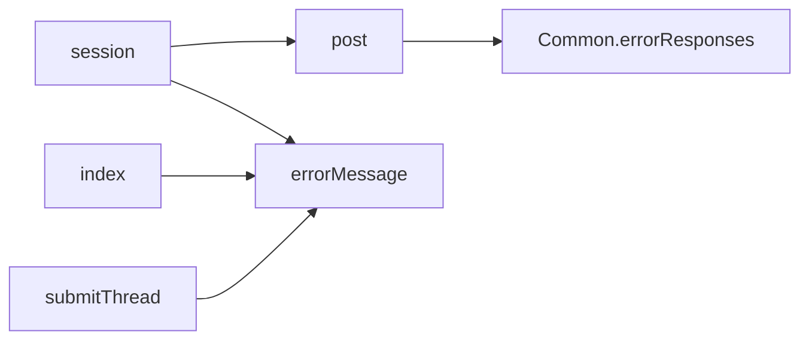
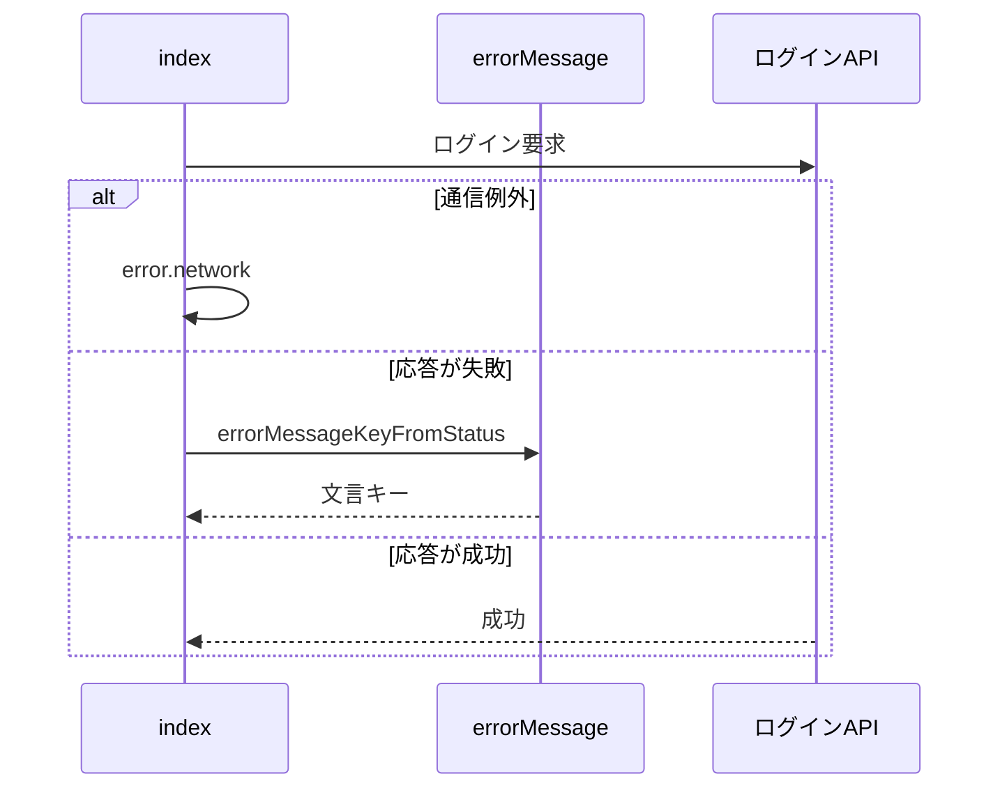

# Design Document

## Overview

**Purpose**: APIのエラーを表示言語の文言で利用者へ伝え、APIの応答から利用者向けの文言を取り除いて言語に依存しない形に統一する。
**Users**: ログインや投稿などの操作で API のエラーに遭遇する利用者
**Impact**: API の応答から利用者向けの文言を取り除き、言語に依存しない形へ統一する。文言は画面側が表示言語に合わせて決める。

### Goals

- APIのエラー応答の形式。
- HTTPステータスとエラーコードからの文言の決定。
- 通信自体の失敗の文言。

### Non-Goals

- 文言の辞書と翻訳の規則。
- API固有のエラー条件そのもの。

## Boundary Commitments

### This Spec Owns

- APIのエラー応答の形式。
- HTTPステータスとエラーコードからの文言の決定。
- 通信自体の失敗の文言。

### Out of Boundary

- 文言の辞書と翻訳の規則。
- API固有のエラー条件そのもの。

### Allowed Dependencies

- 文言の辞書と表示言語の切り替え（i18n-messages）
- 各 API 固有のエラー条件（各 API の仕様が持つ）

### Revalidation Triggers

- エラー応答の形（ステータスと固定文字列）を変えるとき
- ステータスと文言キーの対応表を変えるとき
- 投稿の失敗の判別（`resolveEntryErrorMessage` の変換表）を追加・変更するとき、またはサーバーがエラーコードを返すようにするとき

## Architecture

### Architecture Pattern & Boundary Map

エラー応答から画面の文言までの依存方向を示す。



## File Structure Plan

| パス                                                 | 責務                                      |
| ---------------------------------------------------- | ----------------------------------------- |
| `src/lib/i18n/errorMessage.ts`                       | HTTPステータスから文言キーへの変換        |
| `src/pages/v2/bsky/session.ts`                       | ログインAPIのエラー応答                   |
| `src/lib/api/schema/v2/bsky/session/post.ts`         | ログインAPIのエラー応答のスキーマ         |
| `src/components/account/LoginForm/index.tsx`         | ログイン失敗の文言の表示                  |
| `src/components/post/ThreadComposer/submitThread.ts` | 投稿APIのエラーコードから文言キーへの変換 |

## System Flows

ログイン失敗時の文言キー決定の流れを示す。



## Requirements Traceability

| Requirement        | Summary                      | Components |
| ------------------ | ---------------------------- | ---------- |
| 1.1                | 言語に依存しないエラー応答   | D-1        |
| 2.1, 2.2, 2.3, 2.4 | ステータスに応じた文言の表示 | D-1, D-2   |
| 3.1                | ログインの上限到達           | D-2        |
| 4.1, 4.2, 4.3      | 処理固有の文言とエラーコード | D-3        |

## Components and Interfaces

#### D-1: エラー応答とステータスの対応

**Requirements**: 1.1, 2.1, 2.2, 2.3

```ts
// サーバー: 全エンドポイントが errorResponseFromStatus(status) で { error: "<英語の固定文字列>" } を返す
// クライアント:
export type ErrorContext = "login"
export const errorMessageKeyFromStatus = (status: number, context?: ErrorContext): MessageKey
```

| ステータス | 汎用                 | `context === "login"`       |
| ---------- | -------------------- | --------------------------- |
| 400        | `error.badRequest`   | ログイン失敗                |
| 401        | `error.unauthorized` | ログイン失敗                |
| 403        | `error.forbidden`    | ログイン失敗                |
| 404        | `error.notFound`     | ログイン失敗                |
| 409        | `error.conflict`     | `error.accountLimitReached` |
| 429        | `error.rateLimited`  | `error.rateLimited`         |
| その他     | `error.generic`      | ログイン失敗                |

画面はキーをstateに保持し、描画時に `t()` で文言にする。サーバーの `error` 文字列は表示に使わない。

#### D-2: ログインの上限到達

**Requirements**: 2.4, 3.1

- `POST /v2/bsky/session` はアカウント数の上限到達を `errorResponseFromStatus(409)` で返す。スキーマの `responses` に `Common.errorResponses` で409を加え、409が上限到達を表すことはスキーマのコメントに記す。
- `LoginForm` は `errorMessageKeyFromStatus(res.status, "login")` のキーを表示する。`fetch` が例外を投げた場合は `error.network` を表示する。

```ts
try {
  const res = await fetch(...)
  if (!res.ok) setMessageKey(errorMessageKeyFromStatus(res.status, "login"))
} catch {
  setMessageKey("error.network")
}
```

#### D-3: 処理固有の文言とエラーコード

**Requirements**: 4.1, 4.2, 4.3

| 呼び出し元               | 失敗時の文言キー                                                                                                                                                                                                                                                                                                                                                                   |
| ------------------------ | ---------------------------------------------------------------------------------------------------------------------------------------------------------------------------------------------------------------------------------------------------------------------------------------------------------------------------------------------------------------------------------- |
| `Timeline`               | `post.timeline.loadFailed`                                                                                                                                                                                                                                                                                                                                                         |
| `EntryList`              | 一覧の読み込み失敗のキー                                                                                                                                                                                                                                                                                                                                                           |
| `OgpFetchButton`         | リンクカードの取得失敗のキー                                                                                                                                                                                                                                                                                                                                                       |
| `submitThread`           | 応答が200以外のときは、サーバーの固定文字列（`{ error: "Bad Request" }` 等）を表示に使わず `post.submit.failed` を返す。クライアント内部で判別した失敗（entry 作成に必要なアカウント名を取得できない等）だけが `post.submit.*` の個別のキーになる。応答の `error` の文字列は変換表（`resolveEntryErrorMessage`）に通すが、サーバーはコードを返さないため、実際には常に汎用に落ちる |
| ステータスを持たない失敗 | `error.network`                                                                                                                                                                                                                                                                                                                                                                    |

## Error Handling

| 事象                 | 処理                               |
| -------------------- | ---------------------------------- |
| 応答本文がJSONでない | ステータスだけから文言キーを決める |

## Testing Strategy

- Unit / Build Tests:
  - `npx vitest run tests/lib/i18n/errorMessage.test.ts`
  - `npm run codegen`
  - `npx vitest run tests/components/post/ThreadComposer/submitThread.test.ts`
- E2E/UI Tests:
  - `tests/e2e/i18n.spec.ts` ログインAPIが409と500を返すようにしてログインする → 上限到達と汎用のログイン失敗の文言がそれぞれ表示される
  - `tests/e2e/apiErrorMessage.spec.ts` ログインAPIの通信を失敗させてログインする → 接続できない旨の文言が表示される
  - `tests/e2e/apiErrorMessage.spec.ts` タイムラインの取得APIが500を返すようにして開く → 読み込み失敗の文言が表示される
- テストの名前には、対応する基準 ID を `[api-error-message/<ID>]` の形で付ける（例: `[api-error-message/1.1]`）
