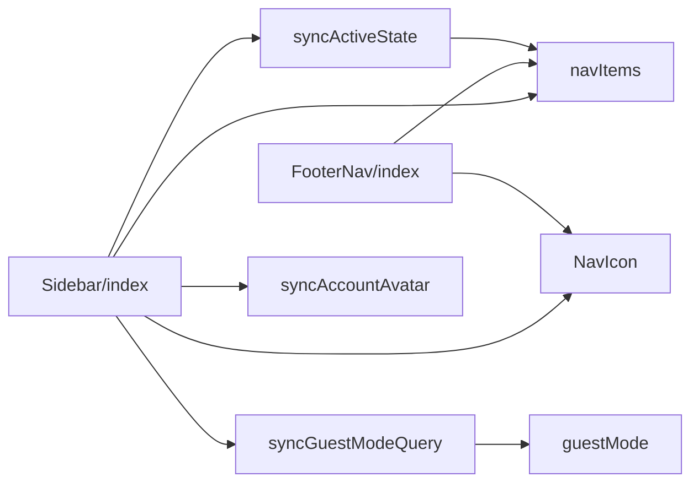
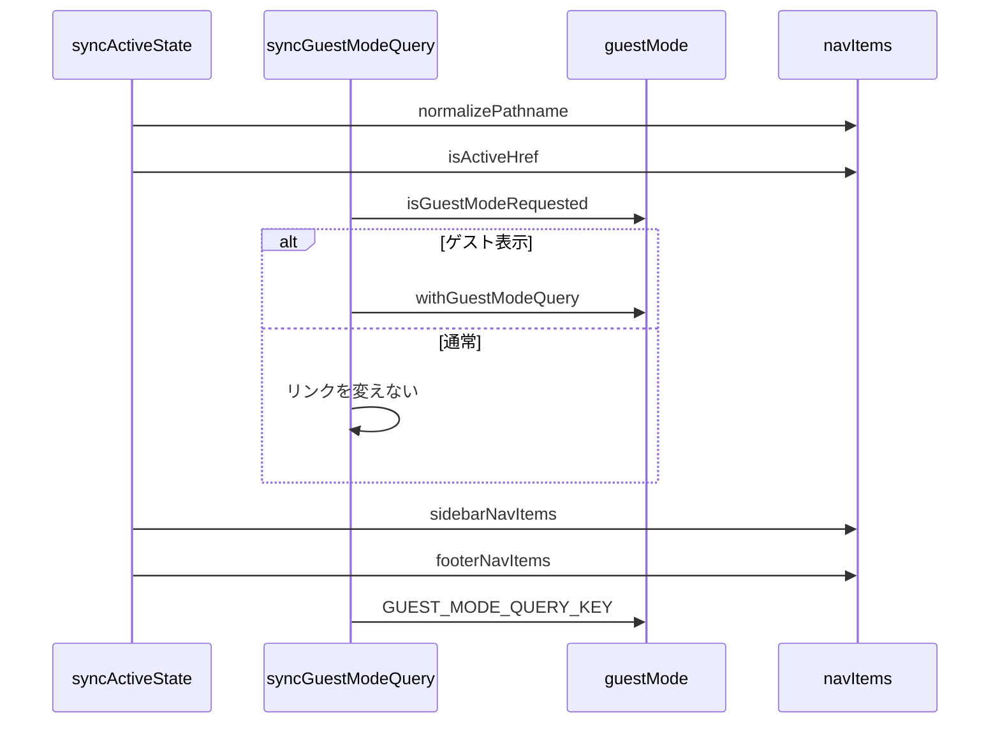

# Design Document

## Overview

**Purpose**: 利用者が、画面の幅に合ったナビゲーションで主要なページへ移動でき、現在地とゲスト表示の状態を見失わないようにする。
**Users**: デスクトップとモバイルで主要なページを行き来する利用者と、ゲスト表示で画面を確認する開発者
**Impact**: 画面の幅ごとにナビゲーションを切り替え、現在地とゲスト表示の状態を保つ。

### Goals

- 主要なページへのリンクの一覧と並び順。
- デスクトップ幅のサイドバーと、モバイル幅のフッターのナビゲーション。
- 現在地の表示と、ゲスト表示の引き継ぎ。
- ログイン中のアカウントのアイコンの表示。

### Non-Goals

- 新規投稿のボタンの描画。
- ページ自体の内容。

## Boundary Commitments

### This Spec Owns

- 主要なページへのリンクの一覧と並び順。
- デスクトップ幅のサイドバーと、モバイル幅のフッターのナビゲーション。
- 現在地の表示と、ゲスト表示の引き継ぎ。
- ログイン中のアカウントのアイコンの表示。

### Out of Boundary

- 新規投稿のボタンの描画。
- ページ自体の内容。

### Allowed Dependencies

- ゲスト表示の判定（`src/lib/guestMode.ts`）
- ログイン中のアカウント情報の取得（account-session）

### Revalidation Triggers

- 主要なページの項目と並び順を変えるとき
- ゲスト表示のクエリの形を変えるとき
- 画面幅の切り替えの境界を変えるとき

## Architecture

### Architecture Pattern & Boundary Map

ナビゲーションの構成要素の依存方向を示す。



## File Structure Plan

| パス                                              | 責務                                 |
| ------------------------------------------------- | ------------------------------------ |
| `src/lib/guestMode.ts`                            | ゲスト表示の判定とリンクへの引き継ぎ |
| `src/components/layout/nav/navItems.ts`           | 項目の定義と現在地の判定             |
| `src/components/layout/nav/syncActiveState.ts`    | 現在地を示す印の再計算               |
| `src/components/layout/nav/syncGuestModeQuery.ts` | リンクへのゲスト表示のクエリの同期   |
| `src/components/layout/nav/syncAccountAvatar.ts`  | アカウントのアイコンの補完           |
| `src/components/layout/nav/NavIcon.astro`         | 項目のアイコンの描画                 |
| `src/components/layout/Sidebar/index.astro`       | デスクトップ幅のナビゲーション       |
| `src/components/layout/FooterNav/index.astro`     | モバイル幅のナビゲーション           |

## System Flows

ページの読み込みごとの同期と、ゲスト表示による分岐を示す。



## Requirements Traceability

| Requirement             | Summary              | Components |
| ----------------------- | -------------------- | ---------- |
| 1.1, 1.2, 1.3, 1.4, 1.5 | ゲスト表示の引き継ぎ | D-1, D-3   |
| 2.1, 2.2, 2.3, 2.4      | 項目と現在地         | D-2        |
| 3.1, 3.2                | 画面幅に応じた表示   | D-3        |
| 4.1                     | アカウントのアイコン | D-3        |

## Components and Interfaces

#### D-1: ゲスト表示の判定

**Requirements**: 1.1, 1.2, 1.3, 1.4

```ts
export const GUEST_MODE_QUERY_KEY = "guest"
// window が無ければ false。URLのクエリに guest があれば true
export const isGuestModeRequested = (): boolean
// guestModeActive が偽なら href のまま。真なら ? か & で guest=1 を付ける
export const withGuestModeQuery = (href: string, guestModeActive: boolean): string
```

#### D-2: 項目と現在地

**Requirements**: 2.1, 2.2, 2.3, 2.4

```ts
type NavItem = { href: string; labelKey: PlainMessageKey; ariaLabelKey: PlainMessageKey; key: "entries" | "post" | "accounts" | "settings" }
export const sidebarNavItems: NavItem[] // accounts, post, entries, settings
export const footerNavItems: NavItem[] // entries, post, settings, accounts
export const normalizePathname = (pathname: string): string // "/" 以外の末尾のスラッシュを除く
export const isActiveHref = (href: string, currentPathname: string): boolean
```

- `isActiveHref` は、ルート（`/`）のときだけ完全一致、それ以外は完全一致か配下（`<href>/` で始まる）のとき真とする。
- 現在地の印は、サーバー側で計算したものを `transition:persist` で保たれた DOM に対してクライアントが再計算する。

#### D-3: 表示と同期

**Requirements**: 1.5, 3.1, 3.2, 4.1

| 要素                 | 内容                                                                                                     |
| -------------------- | -------------------------------------------------------------------------------------------------------- |
| サイドバー           | 640px 以上で表示する。640〜847px はアイコンだけ、848px 以上はアイコンとラベル。`data-nav="sidebar"`      |
| フッター             | 640px 未満で表示する。画面の下端に固定する。`data-nav="footer"`                                          |
| 現在地の同期         | ページの読み込みと遷移（`astro:page-load`）のたびに、`[data-nav] a[href]` の `aria-current` を再計算する |
| ゲスト表示の同期     | 同じ契機で、リンクのクエリを取り除いたうえで `withGuestModeQuery` を適用する                             |
| アカウントのアイコン | 同じ契機でアクティブなアカウントの画像を取得し、`[data-account-avatar-img]` の `src` に設定して表示する  |

アイコンの色の切り替え（`opacity` のクロスフェード）やラベルの表示のように見た目の要素を出し入れする `:hover` は、`@media (hover: hover)` の中にだけ書く。iOS Safari はタップで `:hover` を適用し、それで要素の表示が変わると1回目のタップをホバーとして扱い、リンクへ遷移しないため。

## Error Handling

| 事象                   | 処理                                                 |
| ---------------------- | ---------------------------------------------------- |
| アカウントの取得の失敗 | コンソールへ記録し、プレースホルダの画像のままにする |
| 未ログイン             | アイコンを差し替えない                               |

## Testing Strategy

- Unit / Build Tests:
  - `npx vitest run tests/lib/guestMode.test.ts tests/components/layout/nav/navItems.test.ts`
  - `npx tsc --noEmit`
- E2E/UI Tests:
  - `tests/e2e/appNavigation.spec.ts` デスクトップ幅とモバイル幅でページを開き、ゲスト表示とアカウントの取得を差し替える → サイドバーとフッターが幅で切り替わり、現在地の印とゲスト表示のクエリとアカウントのアイコンが反映される
- テストの名前には、対応する基準 ID を `[app-navigation/<ID>]` の形で付ける（例: `[app-navigation/1.1]`）
