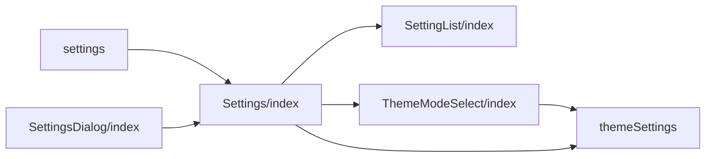
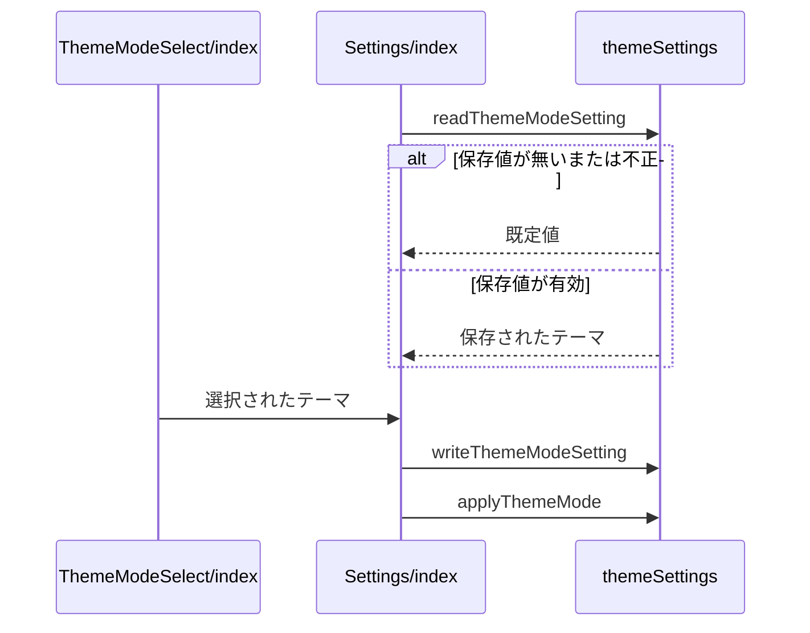

# Design Document

## Overview

**Purpose**: 端末ごとの設定を一覧で確認・変更できるようにし、表示テーマを利用者の好みに合わせて切り替えられるようにする。
**Users**: 端末ごとの表示や投稿の設定を確認・変更する利用者
**Impact**: 設定を一覧で扱う共通の部品を提供し、表示テーマの切り替えを端末へ保存して適用する。

### Goals

- 表示テーマ（システム設定に従う・ライト・ダーク）の保存と適用。
- 設定項目を一覧で表示する共通の部品。
- 設定ページと、同じ内容を表示する設定ダイアログ。

### Non-Goals

- 共有に関する個別の設定項目の保存と連動。
- 返信可否の既定値の編集。

## Boundary Commitments

### This Spec Owns

- 表示テーマ（システム設定に従う・ライト・ダーク）の保存と適用。
- 設定項目を一覧で表示する共通の部品。
- 設定ページと、同じ内容を表示する設定ダイアログ。

### Out of Boundary

- 共有に関する個別の設定項目の保存と連動。
- 返信可否の既定値の編集。

### Allowed Dependencies

- ブラウザの保存領域とドキュメントのテーマ指定
- 共通のスイッチ・プルダウンの部品（common-ui）

### Revalidation Triggers

- テーマの保存値の形や既定値を変えるとき
- 設定項目の一覧の部品の入力（項目の指定の形）を変えるとき
- 設定のグループの構成を変えるとき

## Architecture

### Architecture Pattern & Boundary Map

設定ページの構成要素の依存方向を示す。



## File Structure Plan

| パス                                               | 責務                     |
| -------------------------------------------------- | ------------------------ |
| `src/lib/settings/themeSettings.ts`                | 表示テーマの保存と適用   |
| `src/components/settings/SettingList/index.tsx`    | 設定項目の一覧の描画     |
| `src/components/settings/Settings/index.tsx`       | 設定のグループの組み立て |
| `src/components/settings/SettingsDialog/index.tsx` | 設定のダイアログ表示     |
| `src/components/common/ThemeModeSelect/index.tsx`  | 表示テーマの選択欄       |
| `src/pages/settings.astro`                         | 設定ページ               |

## System Flows

テーマの選択から適用までの流れと、保存値が不正な場合の分岐を示す。



## Requirements Traceability

| Requirement                       | Summary                | Components |
| --------------------------------- | ---------------------- | ---------- |
| 1.1, 1.2, 1.3, 1.4                | 表示テーマの保存と適用 | D-1, D-3   |
| 2.1, 2.2, 2.3, 2.4, 2.5, 2.6, 2.7 | 設定項目の一覧の表示   | D-2        |
| 3.1                               | 設定ページとダイアログ | D-3        |

## Components and Interfaces

#### D-1: 表示テーマ

**Requirements**: 1.1, 1.2, 1.3, 1.4

```ts
export type ThemeMode = "system" | "light" | "dark"
// 保存キーは themeMode。window が無い・保存値が無い・不正な値・例外のときは defaultValue
export const readThemeModeSetting = (defaultValue: ThemeMode): ThemeMode
export const writeThemeModeSetting = (value: ThemeMode): void // 例外は握りつぶす
// system は documentElement の data-theme を取り除く。light と dark は dataset.theme に設定する
export const applyThemeMode = (mode: ThemeMode): void
```

- 初回描画前のインラインスクリプトが、保存値が `light` か `dark` のときだけ `data-theme` を設定し、ちらつきを防ぐ。
- 選択欄は `system`・`light`・`dark` の3つの選択肢を持ち、共通のプルダウンを使う。

#### D-2: 設定項目の一覧

**Requirements**: 2.1, 2.2, 2.3, 2.4, 2.5, 2.6, 2.7

```ts
type SettingListItem = {
  key: string // 行の識別子。コントロールの id は setting-<key>
  label: React.ReactNode
  description?: React.ReactNode
  checked?: boolean
  disabled?: boolean
  onCheckedChange?: (next: boolean) => void
  renderControl?: (ctx: {
    id: string
    ariaLabel?: string
    disabled?: boolean
  }) => React.ReactNode
  textInput?: boolean
  textInputValue?: string
  onTextInputChange?: (next: string) => void
  textInputValidate?: (value: string) => boolean
  textInputErrorMessage?: string
}
```

| 条件                             | 表示                    |
| -------------------------------- | ----------------------- |
| `renderControl` が無い           | スイッチ                |
| `renderControl` がある           | 独自のコントロール      |
| 文字入力が空でなく検証を通る     | 確認の印                |
| 文字入力が空でなく検証を通らない | `textInputErrorMessage` |

ラベルと説明文は `<label>` にせず `<div>` に置き、押してもコントロールに伝えない。スイッチのアクセシブルネームは、ラベルが文字列なら `aria-label`、文字列でなければラベルの要素（id は `setting-<key>-label`）を指す `aria-labelledby` で与える。

#### D-3: ページとダイアログ

**Requirements**: 1.4, 3.1

```tsx
// 設定ページ（prerender）と SettingsDialog の双方が同じ Settings を描画する
type SettingsDialogProps = { open: boolean; onClose: () => void }
```

- ページは静的に生成し、`Settings` を `client:load` で描画する。ダイアログは `Overlay` の中に同じ `Settings` を置く。
- 設定値は `localStorage` に保存し、アカウントに依存しない。ページ遷移のたびに保存値を読み直す。
- 各設定の初期値はサーバー描画と同じ既定値とし、保存値はマウント後に反映する。初回描画で保存値を読むと、スイッチの状態がサーバー描画のまま補正されず、保存値と食い違う。

## Error Handling

| 事象                     | 処理                           |
| ------------------------ | ------------------------------ |
| 保存領域の読み取りの例外 | 既定値を使う                   |
| 保存領域の書き込みの例外 | 書き込みを諦め、表示は維持する |

## Testing Strategy

- Unit / Build Tests:
  - `npx vitest run tests/lib/settings/themeSettings.test.ts`
  - `npx vitest run tests/components/settings/SettingList.test.ts`
  - `npx tsc --noEmit`
- E2E/UI Tests:
  - `tests/e2e/settingsPage.spec.ts` ゲスト表示の設定ページを開く → 表示・投稿・クロスポストの3つの見出しが表示される
  - `tests/e2e/settingsPage.spec.ts` ゲスト表示の設定ページでラベルと説明文を押し、次にスイッチを押す → ラベルと説明文では状態が変わらず、スイッチで状態が変わる
  - `tests/e2e/settingsTheme.spec.ts` ゲスト表示の設定ページで表示テーマをダークに切り替えて再読み込みする → 文書のテーマ指定がダークになり、再読み込み後も保たれる
- テストの名前には、対応する基準 ID を `[app-settings/<ID>]` の形で付ける（例: `[app-settings/1.1]`）
