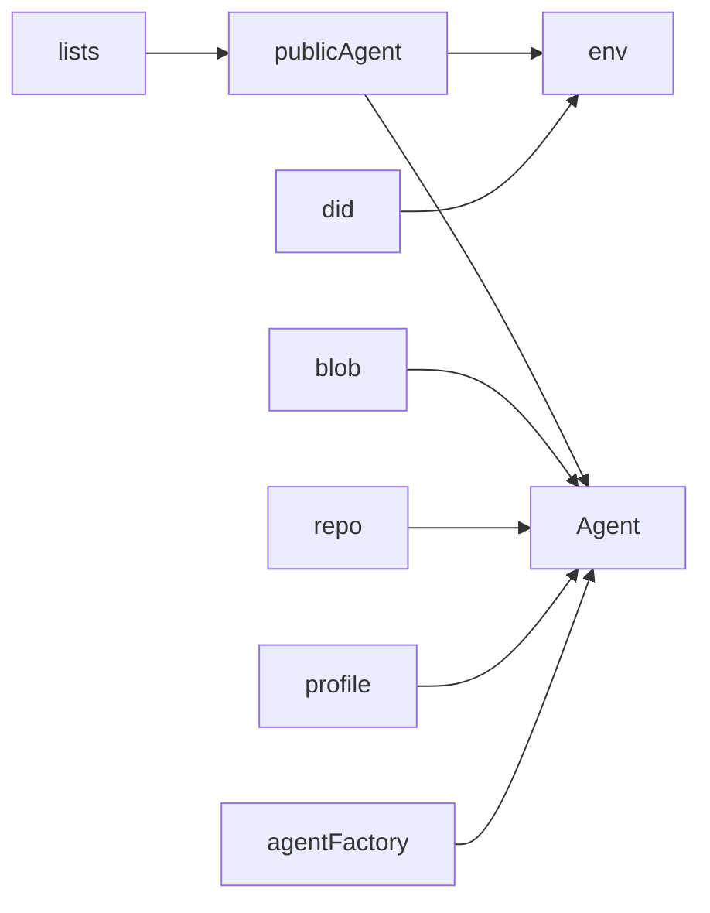
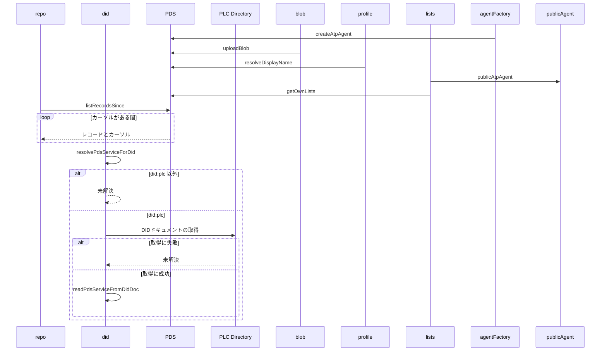

# Design Document

## Overview

**Purpose**: Bluesky（atproto）のPDSやAppViewに対する、認証済みエージェントの生成、blobのアップロード、レコードの全件取得、プロフィールとリストの参照、DIDからのPDS解決を、機能ごとに重複させず共通の部品として提供する。
**Users**: Bluesky の PDS や AppView を呼び出す、skyshare の各機能の実装者
**Impact**: 機能ごとに重複していた atproto の呼び出しを共通の部品へ集約する。

### Goals

- 指定サービスに接続するエージェントの生成と、認証不要の公開エージェントの共有。
- blobのアップロード。
- コレクション内のレコードの全件取得。
- 表示名の取得と、自分が所有するリストの取得。
- DIDドキュメントからのPDSのURLの取り出しと、DIDからのPDSの解決。

### Non-Goals

- 投稿レコードの組み立て。
- 動画サービスのトークン発行。

## Boundary Commitments

### This Spec Owns

- 指定サービスに接続するエージェントの生成と、認証不要の公開エージェントの共有。
- blobのアップロード。
- コレクション内のレコードの全件取得。
- 表示名の取得と、自分が所有するリストの取得。
- DIDドキュメントからのPDSのURLの取り出しと、DIDからのPDSの解決。

### Out of Boundary

- 投稿レコードの組み立て。
- 動画サービスのトークン発行。

### Allowed Dependencies

- `@atproto/api`（エージェントと PDS・AppView の API）
- PLC Directory（DID の解決）

### Revalidation Triggers

- 部品の呼び出し契約（引数・戻り値・未解決の扱い）を変えるとき
- `@atproto/*` の読み込み方を変えるとき（Workers の CPU 制約により、`src/middleware.ts` から静的に辿れる範囲では動的 import を保つ）
- 対応する DID の方式（PLC 以外）を増やすとき

## Architecture

### Architecture Pattern & Boundary Map

共通処理のあいだの依存方向を示す。



## File Structure Plan

| パス                              | 責務                                     |
| --------------------------------- | ---------------------------------------- |
| `src/lib/atproto/agentFactory.ts` | 指定サービスに接続するエージェントの生成 |
| `src/lib/atproto/publicAgent.ts`  | 認証不要の公開エージェントの共有         |
| `src/lib/atproto/blob.ts`         | blobのアップロード                       |
| `src/lib/atproto/repo.ts`         | コレクション内のレコードの全件取得       |
| `src/lib/atproto/profile.ts`      | 表示名の取得                             |
| `src/lib/atproto/lists.ts`        | 自分が所有するリストの取得               |
| `src/lib/atproto/did.ts`          | DIDドキュメントからのPDSの取り出しと解決 |

## System Flows

レコードの全件取得と、PDSの解決の分岐を示す。



## Requirements Traceability

| Requirement        | Summary                    | Components |
| ------------------ | -------------------------- | ---------- |
| 1.1, 1.2           | blob のアップロード        | D-1        |
| 2.1                | レコードの全件取得         | D-2        |
| 3.1, 3.2, 3.3      | プロフィールとリストの参照 | D-2        |
| 4.1, 4.2, 4.3, 4.4 | PDS の解決                 | D-3        |

## Components and Interfaces

#### D-1: エージェントとblob

**Requirements**: 1.1, 1.2

```ts
export const createAtpAgent = (service: string): AtpAgent =>
  new AtpAgent({ service })
// 認証不要の公開 AppView 用。セッションの cookie は扱わない
export const publicAtpAgent = new AtpAgent({ service: atpService })
export const uploadBlob = async (
  agent: Pick<Agent, "uploadBlob">,
  blob: Blob,
) => {
  const mime = blob.type || "application/octet-stream"
  const res = await agent.uploadBlob(new Uint8Array(await blob.arrayBuffer()), {
    encoding: mime,
  })
  return res.data.blob
}
```

エージェントの生成を関数に分けるのは、テストでモジュールを差し替えて偽のエージェントを注入できるようにするためである。

#### D-2: 範囲取得と参照

**Requirements**: 2.1, 3.1, 3.2, 3.3

```ts
export const listRecordsSince = async (agent, params: { repo: string; collection: string }, sinceMs: number) =>
  // reverse: true・limit 100 でカーソルを辿り、records を結合する。ページ内が全件 sinceMs より古ければ打ち切る（古いレコードも結果に含みうる）
export const resolveDisplayName = async (agent, did: string, fallbackHandle: string): Promise<string> =>
  (await agent.getProfile({ actor: did })).data.displayName || fallbackHandle
export type OwnedList = { uri: string; name: string }
// purpose が app.bsky.graph.defs#curatelist のものだけを { uri, name } にする。limit は 100
export const getOwnLists = async (did: string): Promise<OwnedList[]>
```

#### D-3: PDSの解決

**Requirements**: 4.1, 4.2, 4.3, 4.4

```ts
// id が #atproto_pds、type が AtprotoPersonalDataServer、serviceEndpoint が空でない文字列の最初のサービス
export const readPdsServiceFromDidDoc = (didDoc: unknown): string | undefined
// did:plc: で始まらなければ undefined。PLC Directory へ GET し、ok でなければ undefined
export const resolvePdsServiceForDid = async (did: string): Promise<string | undefined>
```

## Error Handling

| 事象                        | 処理                     |
| --------------------------- | ------------------------ |
| リストの取得の失敗          | 例外を呼び出し元へ伝える |
| PLC Directory の応答が失敗  | 未解決として扱う         |
| DIDドキュメントの形式が不正 | 未解決として扱う         |

## Testing Strategy

- Unit / Build Tests:
  - `npx vitest run tests/lib/atproto/blob.test.ts`
  - `npx vitest run tests/lib/atproto/repo.test.ts tests/lib/atproto/profile.test.ts tests/lib/atproto/lists.test.ts`
  - `npx vitest run tests/lib/atproto/did.test.ts`
- テストの名前には、対応する基準 ID を `[atproto-access/<ID>]` の形で付ける（例: `[atproto-access/1.1]`）
