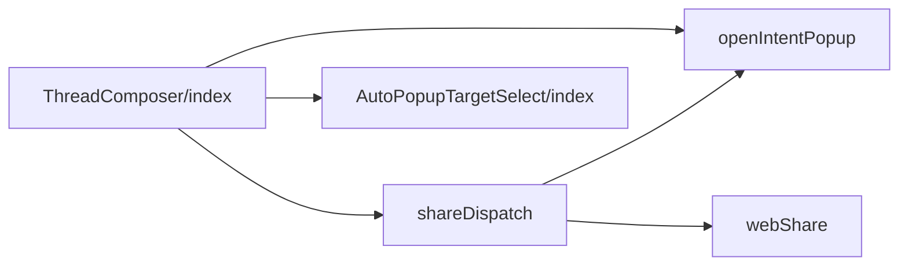
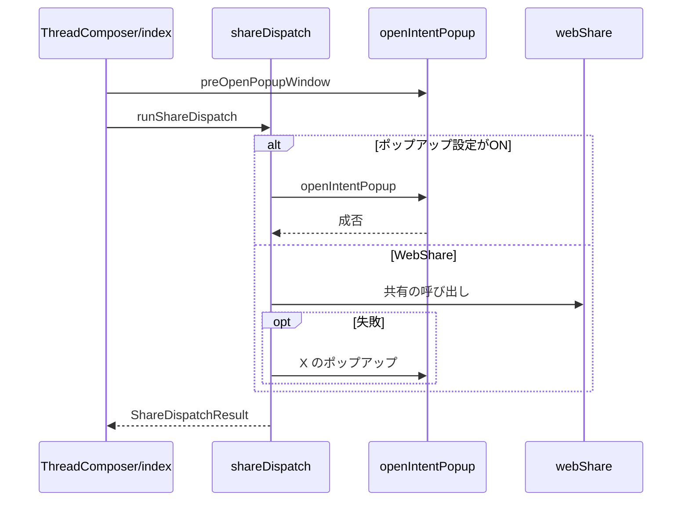

# Design Document

## Overview

**Purpose**: Blueskyへの投稿が成功した直後に、利用者が選んだSNSの投稿画面を開き、他SNSへの共有を1操作で始められるようにする。
**Users**: 投稿後に他 SNS へ共有したい利用者
**Impact**: 投稿の成功直後に共有の導線を自動で開く。共有設定そのものの保持は別の仕様（share-settings）が担う。

### Goals

- 自動ポップアップするSNSの選択プルダウン。
- 投稿成功後のポップアップ・WebShare・投稿先選択ダイアログの切り替え。
- 共有の結果に応じた共有設定の自動変更。

### Non-Goals

- 共有設定の保持。
- 投稿先選択ダイアログの内部の動作。
- 共有文の組み立てと省略の規則。

## Boundary Commitments

### This Spec Owns

- 自動ポップアップするSNSの選択プルダウン。
- 投稿成功後のポップアップ・WebShare・投稿先選択ダイアログの切り替え。
- 共有の結果に応じた共有設定の自動変更。

### Out of Boundary

- 共有設定の保持。
- 投稿先選択ダイアログの内部の動作。
- 共有文の組み立てと省略の規則。

### Allowed Dependencies

- 共有設定の保持（share-settings）
- 投稿先選択ダイアログ（intent-share-dialog）
- 共有文の組み立て（share-text）
- ブラウザのポップアップと WebShare

### Revalidation Triggers

- 選択肢の種類（SNS の追加・削除）を変えるとき
- 投稿成功後の分岐の順序（ポップアップ・WebShare・ダイアログ）を変えるとき
- 事前に開いたウィンドウの扱いを変えるとき（ブラウザのポップアップ制限の影響を受ける）

## Architecture

### Architecture Pattern & Boundary Map

共有の分岐とポップアップ操作の依存方向を示す。



## File Structure Plan

| パス                                                    | 責務                                |
| ------------------------------------------------------- | ----------------------------------- |
| `src/components/common/AutoPopupTargetSelect/index.tsx` | 自動ポップアップするSNSのプルダウン |
| `src/components/post/ThreadComposer/shareDispatch.ts`   | 投稿直後の共有の分岐判断            |
| `src/util/share/openIntentPopup.ts`                     | ポップアップの事前オープンと遷移    |
| `src/util/share/webShare.ts`                            | WebShareの呼び出し                  |
| `src/components/post/ThreadComposer/index.tsx`          | 事前オープンと分岐結果の反映        |

## System Flows

投稿直後の共有先の決定と、ブロック時の分岐を示す。



## Requirements Traceability

| Requirement             | Summary                  | Components |
| ----------------------- | ------------------------ | ---------- |
| 1.1, 1.2                | 自動ポップアップ先の選択 | D-1        |
| 2.1, 2.2, 2.3, 2.4, 2.5 | 投稿成功後のポップアップ | D-2, D-3   |
| 3.1, 3.2, 3.3, 3.4      | WebShare への切り替え    | D-2        |
| 4.1, 4.2                | 共有文                   | D-2        |

## Components and Interfaces

#### D-1: プルダウン

**Requirements**: 1.1, 1.2

```ts
type Props = {
  value: AutoPopupTarget
  onChange: (next: AutoPopupTarget) => void
  disabled?: boolean
  id?: string
  ariaLabel?: string
  className?: string
}
```

- 共通の `Dropdown` を `autoWidth` 付きで使う。選択肢の `value` は `AUTO_POPUP_TARGETS`、`label` は `t("post.autoPopupTarget.<value>")` とする。
- X・タイッツー・Mastodon・Misskeyの `content` には `InlineIcon` を前置する。Xのアイコンは塗りを `#444` にする。
- `onChange` に渡す値は `isAutoPopupTarget` で検査してから渡す。ラッパーのCSSは `min-width: 0; max-width: none` とする。

#### D-2: 共有の分岐

**Requirements**: 2.1, 2.2, 2.3, 2.4, 3.1, 3.2, 3.3, 3.4, 4.1, 4.2

```ts
export type ShareDispatchResult = {
  status: MessageFormatter
  statusColor: string
  openShareDialog: boolean // 呼び出し側で投稿先選択ダイアログを開く
  forcedPopupIntentInsteadOfWebshareOn: boolean
  forcedAutoPopupTarget: AutoPopupTarget | null
}
export const runShareDispatch = async (params: ShareDispatchParams): Promise<ShareDispatchResult>
```

```
effectiveUri = manualImageAttach ? "" : skyshareUri
textFor(t)   = buildIntentText(text, effectiveUri, linkCardUrl,
                 { truncateLimit: resolveTruncateLimit(t, truncateIntentText), measure: 宛先別 })
domain       = resolveInstanceDomainFor(target, { mastodonInstanceDomain, misskeyInstanceDomain })
             // mastodon/misskey のみ保存値から解決（不正は null）、他は undefined

if popupIntentInsteadOfWebshare:
  if target == "ask" or domain == null:
    popupWindow?.close(); return { openShareDialog: true, status: chooseTarget }
  if openIntentPopupFor(target, textFor(target), { instanceDomain: domain, preOpenedWindow: popupWindow }):
    return { status: popupOpened }
  return { openShareDialog: true, forcedAutoPopupTarget: "ask", status: popupBlocked }

popupWindow?.close()
if canShareWithWebApi(省略しない共有文):
  ok → { status: webShareDone } / aborted → { status: webShareCancelled } / failed → 下へ
if openIntentPopupFor("x", textFor("x")):
  return { forcedPopupIntentInsteadOfWebshareOn: true, forcedAutoPopupTarget: "x", status: fallbackOpened }
return { openShareDialog: true, forcedPopupIntentInsteadOfWebshareOn: true,
         forcedAutoPopupTarget: "ask", status: fallbackBlocked }
```

#### D-3: ポップアップの事前オープン

**Requirements**: 2.5

```ts
export const preOpenPopupWindow = (): Window | null // window.open("/jump/", "_blank")
export const openIntentPopup = (url: string, preOpenedWindow?: Window | null): boolean
```

- ブラウザのポップアップブロックを避けるため、`window.open` は投稿ボタンのクリックと同期した呼び出しの中で行う。`ThreadComposer` は、ポップアップを開く設定がONで、選択値が投稿時に選択するでなく、不正なドメインのMastodon・Misskeyでもない場合だけ事前に開く。
- 待機画面として `/jump/` を開き、投稿完了後に `location.href` で共有先へ遷移させる。
- `opener` の切り離しは `setTimeout` で1タスク遅らせる。同期的に切り離すとSafariで遷移が中断されるため。
- `ThreadComposer` は分岐結果の `forced*` を共有設定へ反映し、`openShareDialog` が true なら投稿先選択ダイアログを開く。

## Error Handling

| 事象                               | 処理                                                       |
| ---------------------------------- | ---------------------------------------------------------- |
| ポップアップのブロック             | 投稿先選択ダイアログを開き、選択値を投稿時に選択するにする |
| 事前に開いたウィンドウが閉じられた | ポップアップを開けなかったものとして扱う                   |
| WebShareの失敗                     | Xのポップアップへ切り替える                                |
| 共有URLの組み立て失敗              | ポップアップを開けなかったものとして扱う                   |

## Testing Strategy

- Unit / Build Tests:
  - `npm run build`
  - `npx vitest run tests/components/post/ThreadComposer/shareDispatch.test.ts`
- E2E/UI Tests:
  - `tests/e2e/intentShare.spec.ts` 投稿フォームでポップアップを開く設定をONにしてプルダウンを開く → 4つの選択肢が表示され、選択に応じて横幅が変わる
  - `tests/e2e/intentShare.spec.ts` 選択値をタイッツーにして投稿する → 事前に開いたウィンドウがタイッツーの投稿画面へ遷移する
- テストの名前には、対応する基準 ID を `[auto-popup/<ID>]` の形で付ける（例: `[auto-popup/1.1]`）
