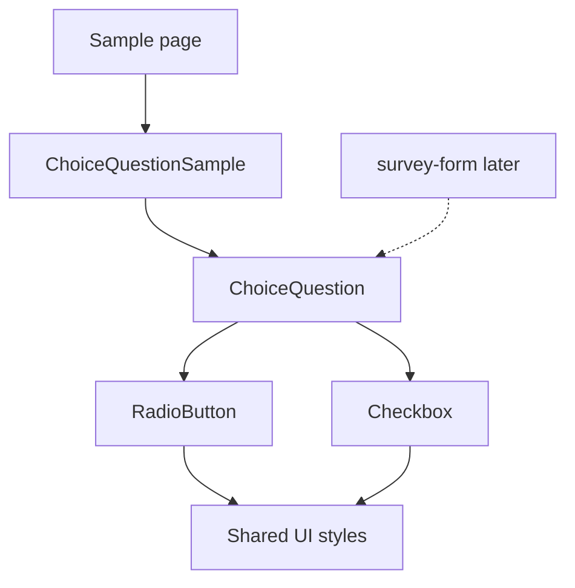
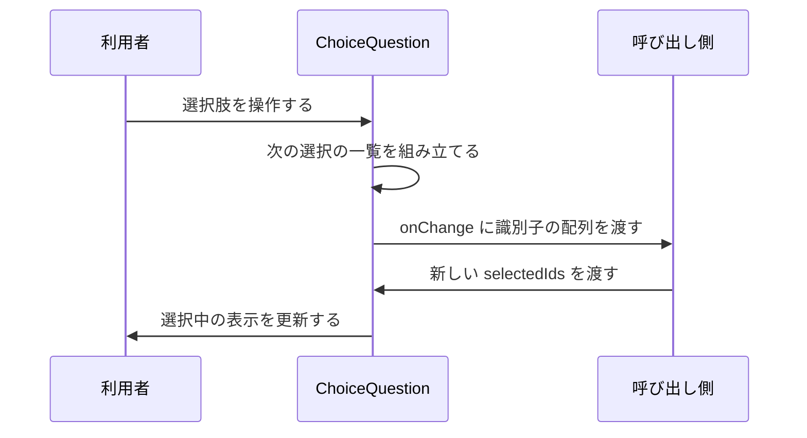

# Design Document

## Overview

選択式の質問（質問文と選択肢）を、単一選択または複数選択として描画し、選択の変化を呼び出し側へ通知する共通の画面部品 `ChoiceQuestion` を提供する。種別に応じて既存の `RadioButton`（単一）と `Checkbox`（複数、`card`）を切り替えるだけの薄い部品で、カードの見た目と操作性は既存部品から引き継ぐ。

**Purpose**: アンケートなどの画面が、種別・上限・無効状態を渡すだけで、選択式の質問を同じ見た目と操作で組み立てられるようにする。
**Users**: 画面の開発者（直近は survey-form）が使い、利用者はカード状の選択肢を選ぶ。
**Impact**: 共通部品が 1 つ増える。既存部品の外観と挙動は変えない。

### Goals

- 質問文・選択肢・種別・選択状態・上限・無効状態から質問を描画し、選択の変化を識別子の配列で通知する。
- 質問文を選択肢全体のラベルとして支援技術に伝え、キーボードだけで操作できる。
- 実ブラウザ（Playwright）で操作後の表示を確認できる状態にする。

### Non-Goals

- アンケート設定の読み込み、表示言語の選択、文言の翻訳、「回答しない」の特別扱い。
- 回答の送信、ダイアログ、必須の判定、選択状態の保持と補正。
- 選択肢ごとの無効指定、選択肢の説明文、選択肢のグルーピング。

## Boundary Commitments

### This Spec Owns

- `ChoiceQuestion` の props 契約（種別・選択肢・選択状態・上限・無効状態・通知）と、描画の構造（質問のまとまり、縦に並ぶ選択肢）。
- 選択の変化から通知する配列を組み立てる規則（単一は 1 件、複数は選択肢の並び順、上限に達した未選択の無効化）。
- 動作確認用のサンプル画面（確認用の状態を持つ部品とページ）と、その単体・実ブラウザのテスト。

### Out of Boundary

- `RadioButton`・`Checkbox` の外観と挙動（本 spec は変更しない）。
- アンケートの設定・言語・「回答しない」・回答の送信・ダイアログ（survey-definition・survey-api・survey-form）。
- 選択状態の保持、上限を超える状態の補正、識別子の妥当性の判定。

### Allowed Dependencies

- 既存の共通部品 `RadioButton`・`Checkbox`、共通 UI スタイル（`src/styles/ui.module.css`）、トークン（`src/styles/tokens.css`）。
- React（`useId` を含む）。i18n、`@/lib/*`、`@/client/*`、`@atproto/*` には依存しない。

### Revalidation Triggers

- `ChoiceQuestion` の props や通知の形の変更（survey-form の再確認が要る）。
- `RadioButton`・`Checkbox` の props・無効時の見た目・`name` の扱いの変更。
- 確認用サンプルページの URL の変更（Playwright のテストが参照する）。

## Architecture

### Existing Architecture Analysis

- `src/components/common/` は機能ドメインに依存しない汎用 UI 部品を置く。各部品は `index.tsx` と `index.module.css` だけで構成し、アロー関数とデフォルトエクスポートを守る。
- カードの外枠は `ui["base-card"]` と `ui["selectable-card"]`（`@layer ui`）が持ち、各部品の CSS はレイヤー外に書く。
- 画面を持たない部品の確認用ページは、`src/pages/entries/sample.astro` のように静的ページとして置く前例がある。

### Architecture Pattern & Boundary Map



**Architecture Integration**:

- Selected pattern: 状態を持たない制御された部品。選択状態と通知の反映を呼び出し側に置く。
- Domain boundaries: `ChoiceQuestion` は表示と通知の組み立てだけを持ち、アンケートの知識を持たない。
- Existing patterns preserved: 共通 UI の CSS モジュール（レイヤー外）、アロー関数、デフォルトエクスポート、`fieldset` と `legend` によるグループのラベル。
- New components rationale: `ChoiceQuestion` は種別の切り替えと上限の規則を 1 か所にまとめるため。サンプルは実ブラウザ確認の対象を用意するため。
- Steering compliance: `coding-conventions.md` の共通 UI の規約、`workflow.md` の UI 実装の検証。

**Dependency direction**: 共有スタイル → `RadioButton`・`Checkbox` → `ChoiceQuestion` → `ChoiceQuestionSample` → サンプルページ。各層は左（上流）だけを import し、逆向きの import は行わない。survey-form は `ChoiceQuestion` だけを import する。

### Technology Stack

| Layer    | Choice / Version           | Role in Feature        | Notes                      |
| -------- | -------------------------- | ---------------------- | -------------------------- |
| Frontend | React 19、CSS モジュール   | 部品の描画とスタイル   | 既存の共通部品と同じ       |
| Pages    | Astro 7（静的ページ）      | 確認用サンプルページ   | `client:load` のアイランド |
| Testing  | vitest（Node）、Playwright | 単体と実ブラウザの確認 | 既存の設定を使う           |

## File Structure Plan

### Directory Structure

```
src/
├── components/common/
│   ├── ChoiceQuestion/
│   │   ├── index.tsx             # 部品本体と、選択の組み立てを行う純粋関数 2 つ
│   │   └── index.module.css      # 質問のまとまりの初期化、質問文、縦に並ぶ配置
│   └── ChoiceQuestionSample/
│       └── index.tsx             # 確認用の状態を持つ部品（単一・複数・上限・無効の 4 例）
└── pages/samples/
    └── choice-question.astro     # 確認用の静的ページ（noindex）
tests/
├── components/common/
│   └── ChoiceQuestion.test.ts    # 純粋関数と描画結果の単体テスト
└── e2e/
    └── choiceQuestion.spec.ts    # サンプルページでの操作後の表示の確認
```

### Modified Files

- `src/components/common/README.md` — 部品の一覧と依存図に `ChoiceQuestion`（`RadioButton`・`Checkbox` への依存）を加える。

## System Flows



呼び出し側が `selectedIds` を更新しなければ、表示は変わらない（要件 6.2）。選択中の単一選択の再選択は、ネイティブの性質と部品の確認の両方で通知しない。

## Requirements Traceability

| Requirement | Summary                                | Components     | Interfaces               | Flows      |
| ----------- | -------------------------------------- | -------------- | ------------------------ | ---------- |
| 1.1         | 質問文と選択肢を順に縦へ表示           | ChoiceQuestion | ChoiceQuestionProps      | —          |
| 1.2         | 識別子と表示文で受け取り、そのまま表示 | ChoiceQuestion | ChoiceQuestionChoice     | —          |
| 1.3         | 言語・特別扱いを持たない               | ChoiceQuestion | ChoiceQuestionProps      | —          |
| 1.4         | 狭い幅で折り返す                       | ChoiceQuestion | スタイル                 | —          |
| 1.5         | 選択肢が空なら質問文だけ               | ChoiceQuestion | ChoiceQuestionProps      | —          |
| 2.1         | 単一選択は 1 つだけ選べる              | ChoiceQuestion | ChoiceQuestionProps      | —          |
| 2.2         | 選んだ識別子だけを通知                 | ChoiceQuestion | nextSelection            | 選択の流れ |
| 2.3         | 選択中の再選択は通知しない             | ChoiceQuestion | nextSelection            | 選択の流れ |
| 2.4         | 渡された 1 つを選択中として表示        | ChoiceQuestion | ChoiceQuestionProps      | —          |
| 2.5         | 空なら選択中なし                       | ChoiceQuestion | ChoiceQuestionProps      | —          |
| 2.6         | 単一では上限を無視                     | ChoiceQuestion | isChoiceLocked           | —          |
| 3.1         | 複数選択は独立に切り替え               | ChoiceQuestion | ChoiceQuestionProps      | —          |
| 3.2         | 選ぶと識別子を加えた一覧を通知         | ChoiceQuestion | nextSelection            | 選択の流れ |
| 3.3         | 外すと識別子を除いた一覧を通知         | ChoiceQuestion | nextSelection            | 選択の流れ |
| 3.4         | 通知は選択肢の並び順                   | ChoiceQuestion | nextSelection            | 選択の流れ |
| 3.5         | 渡された一覧の選択肢だけ選択中         | ChoiceQuestion | ChoiceQuestionProps      | —          |
| 4.1         | 上限到達で未選択を選べなくする         | ChoiceQuestion | isChoiceLocked           | —          |
| 4.2         | 到達中も選択中は外せる                 | ChoiceQuestion | isChoiceLocked           | —          |
| 4.3         | 下回れば未選択を戻す                   | ChoiceQuestion | isChoiceLocked           | —          |
| 4.4         | 上限なしなら制限しない                 | ChoiceQuestion | isChoiceLocked           | —          |
| 4.5         | 上限超過の状態は補正せず未選択を無効   | ChoiceQuestion | isChoiceLocked           | —          |
| 5.1         | 無効指定で全選択肢を選べなくする       | ChoiceQuestion | ChoiceQuestionProps      | —          |
| 5.2         | 無効でも選択状態を表示                 | ChoiceQuestion | ChoiceQuestionProps      | —          |
| 5.3         | 無効では通知しない                     | ChoiceQuestion | ChoiceQuestionProps      | —          |
| 6.1         | 選択状態を保持しない                   | ChoiceQuestion | ChoiceQuestionProps      | 選択の流れ |
| 6.2         | 反映されなければ表示を変えない         | ChoiceQuestion | ChoiceQuestionProps      | 選択の流れ |
| 6.3         | 妥当性を判定しない                     | ChoiceQuestion | nextSelection            | —          |
| 7.1         | 質問文を選択肢全体のラベルにする       | ChoiceQuestion | スタイル、構造           | —          |
| 7.2         | 選択・無効の状態を支援技術へ           | ChoiceQuestion | 構造                     | —          |
| 7.3         | キーボード操作でも同じ通知             | ChoiceQuestion | nextSelection            | —          |
| 7.4         | 現在位置を見た目で区別                 | ChoiceQuestion | 既存部品のフォーカス表示 | —          |
| 7.5         | 複数の質問が干渉しない                 | ChoiceQuestion | 質問ごとのグループ名     | —          |
| 8.1         | 既存のカード状の見た目                 | ChoiceQuestion | 既存部品の利用           | —          |
| 8.2         | ライト・ダークで読める配色             | ChoiceQuestion | トークンの利用           | —          |
| 8.3         | 外側の配置を利用側が決める             | ChoiceQuestion | ChoiceQuestionProps      | —          |

## Components and Interfaces

| Component            | Domain/Layer | Intent                                           | Req Coverage                                                           | Key Dependencies (P0/P1)                               | Contracts      |
| -------------------- | ------------ | ------------------------------------------------ | ---------------------------------------------------------------------- | ------------------------------------------------------ | -------------- |
| ChoiceQuestion       | UI 共通部品  | 種別に応じて質問を描画し、選択の変化を通知する   | 1.1–1.5、2.1–2.6、3.1–3.5、4.1–4.5、5.1–5.3、6.1–6.3、7.1–7.5、8.1–8.3 | RadioButton (P0)、Checkbox (P0)、共通 UI スタイル (P1) | Service、State |
| ChoiceQuestionSample | 確認用       | 4 例の状態を持ち、実ブラウザ確認の対象を提供する | 2.1–2.5、3.1–3.5、4.1–4.5、5.1–5.3、7.1–7.5                            | ChoiceQuestion (P0)                                    | —              |

### UI 共通部品

#### ChoiceQuestion

| Field        | Detail                                                                                             |
| ------------ | -------------------------------------------------------------------------------------------------- |
| Intent       | 質問文と選択肢を受け取り、単一選択または複数選択として描画して、選択の変化を識別子の配列で通知する |
| Requirements | 1.1–1.5、2.1–2.6、3.1–3.5、4.1–4.5、5.1–5.3、6.1–6.3、7.1–7.5、8.1–8.3                             |

**Responsibilities & Constraints**

- 種別（`single`・`multiple`）で `RadioButton` と `Checkbox`（`variant="card"`）を切り替える。
- 質問のまとまりを 1 つのグループ要素とし、質問文をそのラベルにする。選択肢は縦に 1 列で並べる。
- 選択状態を保持しない。表示は常に `selectedIds` から決め、通知は `onChange` の呼び出しだけで行う。
- アンケートの知識（言語・「回答しない」）を持たない。表示文は渡されたまま描画する。

**Dependencies**

- Inbound: ChoiceQuestionSample、survey-form（将来） — 質問の描画 (P0)
- Outbound: RadioButton — 単一選択の選択肢 (P0)、Checkbox — 複数選択の選択肢 (P0)
- External: React の `useId` — 質問ごとのグループ名の生成 (P1)

**Contracts**: Service [x] / API [ ] / Event [ ] / Batch [ ] / State [x]

##### Service Interface

```typescript
import type { ReactNode } from "react"

/** 選択肢 1 件。表示文は呼び出し側が選んだ文言をそのまま渡す。 */
export type ChoiceQuestionChoice = {
  /** 選択肢の識別子（質問の中で一意） */
  id: string
  /** 表示文 */
  label: ReactNode
}

export type ChoiceQuestionProps = {
  /** 単一選択か複数選択か */
  kind: "single" | "multiple"
  /** 質問文（選択肢全体のラベルになる） */
  legend: ReactNode
  /** 選択肢（この順に縦へ並べる） */
  choices: readonly ChoiceQuestionChoice[]
  /** 選択中の選択肢の識別子。単一は 0 または 1 件 */
  selectedIds: readonly string[]
  /** 選択が変わったときに、次の選択の一覧を渡す（無効の間は呼ばれない） */
  onChange: (nextIds: string[]) => void
  /** 複数選択で選べる数の上限（1 以上の整数）。省略は制限なし。単一では無視する */
  maxSelect?: number
  /** true で全選択肢を操作できなくする */
  disabled?: boolean
  /** 質問のまとまりへの追加クラス（外側の配置用） */
  className?: string
}

/**
 * 選択の変化から、通知する次の選択の一覧を組み立てる。
 * 単一は [changedId]（すでに選択中なら undefined で通知なし）。
 * 複数は choices の並び順で、changedId の選択を checked に合わせた識別子の一覧。
 */
export const nextSelection: (
  kind: "single" | "multiple",
  choices: readonly ChoiceQuestionChoice[],
  selectedIds: readonly string[],
  changedId: string,
  checked: boolean,
) => string[] | undefined

/**
 * 選択肢が上限のために選べない状態かを返す。
 * 複数選択で maxSelect が指定され、選択中の数が maxSelect 以上で、
 * この選択肢が未選択のときだけ true。
 */
export const isChoiceLocked: (
  kind: "single" | "multiple",
  choices: readonly ChoiceQuestionChoice[],
  selectedIds: readonly string[],
  choiceId: string,
  maxSelect: number | undefined,
) => boolean
```

- Preconditions: `choices` の `id` は質問の中で一意。`maxSelect` は 1 以上の整数。
- Postconditions: `onChange` に渡す配列は、`choices` に存在する識別子だけを `choices` の並び順で含む（単一は 1 件）。`disabled` の間は呼ばない。
- Invariants: 部品は `selectedIds` を書き換えず、補正もしない。`selectedIds` に `choices` にない識別子があっても例外を出さず、その識別子は表示にも通知にも現れない。

##### State Management

- State model: 部品内に選択の状態を持たない。グループ名だけ `useId` で質問ごとに 1 つ生成する。
- Persistence & consistency: 呼び出し側が `selectedIds` を更新して一貫させる。
- Concurrency strategy: 該当なし（同期的な描画）。

**Implementation Notes**

- Integration: グループは `fieldset` と `legend`。CSS は `fieldset` の初期化（`margin`・`padding`・`border`・`min-width`）と `legend` の文字、選択肢の並び（`display: grid`、1 列、`gap: var(--space-2)`）だけを `index.module.css` にレイヤー外で書く。既存部品の `flex: 1 1 0`（`RadioButton`）が縦並びに影響しないよう、並びは `grid` にする。色・余白はトークンのみを使う。`className` は `fieldset` へ連結する。
- Validation: 単一の選択中の再選択は `nextSelection` が `undefined` を返し、通知しない。`disabled` は各選択肢へ渡し、`RadioButton`・`Checkbox` の無効の見た目（`selectable-card` の `:has(input:disabled)`）で区別する。上限による無効も同じ経路で表示する。
- Risks: `RadioButton` が `name` で束ねる前提のため、同じ画面の複数の質問でグループ名が衝突しないこと（`useId` で保証）を単体テストで確認する。

#### ChoiceQuestionSample

確認用の部品。単一選択、複数選択、上限つきの複数選択（最大 2 件）、無効の質問の 4 例を表示し、それぞれの `selectedIds` を `useState` で保持して `ChoiceQuestion` へ渡す。選択の現在値は、確認のために各例の下へ識別子の一覧として表示する。ここは本番の利用側ではなく、Playwright が操作後の表示を確認するための対象であり、新しい契約を持たない。

## Data Models

永続化するデータはない。選択状態は呼び出し側の `string[]`（選択肢の識別子）であり、`ChoiceQuestionProps` が唯一の入出力の契約である。

## Error Handling

### Error Strategy

部品は例外を出さない。入力が前提を外れた場合は補正せず、可能な範囲でそのまま表示する。

- `selectedIds` が `choices` にない識別子を含む: その識別子は表示されず、通知にも含まれない。
- 単一選択で `selectedIds` が 2 件以上: 含まれる識別子の選択肢をすべて選択中として表示する。通知は 1 件になる。
- `selectedIds` の数が `maxSelect` を超える: 補正せず表示し、未選択の選択肢を選べなくする。
- `choices` が空: 質問文だけを表示する。

## Testing Strategy

### Unit Tests（`tests/components/common/ChoiceQuestion.test.ts`、Node 環境）

- `nextSelection`: 単一で未選択の選択肢を選ぶと 1 件の配列になり、選択中の再選択は通知なし（2.2、2.3）。複数で選択の追加と除外が選択肢の並び順の配列になり、選択した順に依存しない（3.2、3.3、3.4）。
- `isChoiceLocked`: 上限未満、上限ちょうど、上限超過（4.5）、上限なし（4.4）、単一での無視（2.6）で、未選択と選択中の別に結果が決まる（4.1、4.2、4.3）。
- 描画結果（`renderToStaticMarkup`）: 種別ごとにラジオとチェックボックスの別になる（2.1、3.1）。`legend` を含むグループになる（7.1）。選択状態が `checked` に反映される（2.4、2.5、3.5）。`disabled` で全入力が無効になり選択状態が残る（5.1、5.2）。上限到達時に未選択だけ無効になる（4.1）。選択肢が空なら入力がない（1.5）。
- 同じ画面に 2 つの質問を描画したとき、ラジオのグループ名が異なる（7.5）。表示文が渡されたとおりに現れ、「回答しない」に相当する選択肢が特別扱いされない（1.2、1.3）。

### E2E Tests（`tests/e2e/choiceQuestion.spec.ts`、Playwright、サンプルページ）

- 単一選択: 選択肢を押すとその選択肢だけが選択中になり、別の選択肢を押すと入れ替わる。選択中の値の表示が更新される（2.1、2.2、2.4）。
- 複数選択: 複数の選択肢を独立に選び、外すと値の表示が選択肢の並び順で更新される（3.1–3.4）。
- 上限: 最大 2 件の質問で 2 件選ぶと残りが無効になり、1 件外すと戻る。選択中は外せる（4.1–4.3）。
- 無効: 無効の質問は押しても値が変わらず、選択状態は表示されたまま（5.1–5.3）。
- アクセシビリティ: 質問文でグループが取得できる。キーボード（単一は矢印キー、複数はスペース）で操作でき、フォーカスの位置が見える（7.1–7.4）。
- 外観: 幅の狭い画面で長い表示文が折り返し、横にあふれない。ダークテーマでも文字が読める（1.4、8.2）。

## Security Considerations

秘匿情報を扱わない。表示文は React が文字列としてエスケープして描画する。サンプルページは固定の例文のみを含み、`noindex` を付ける。

## Performance & Scalability

選択肢は数個から十数個を想定する。部品は状態を持たず再描画は呼び出し側の更新に従うため、特別な対策は要らない。
