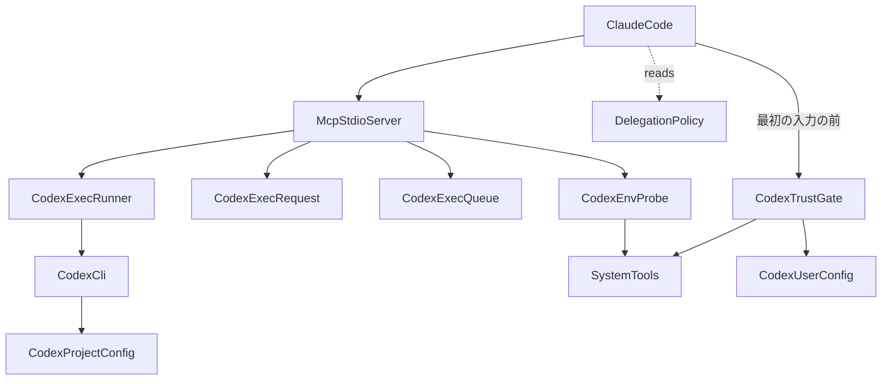
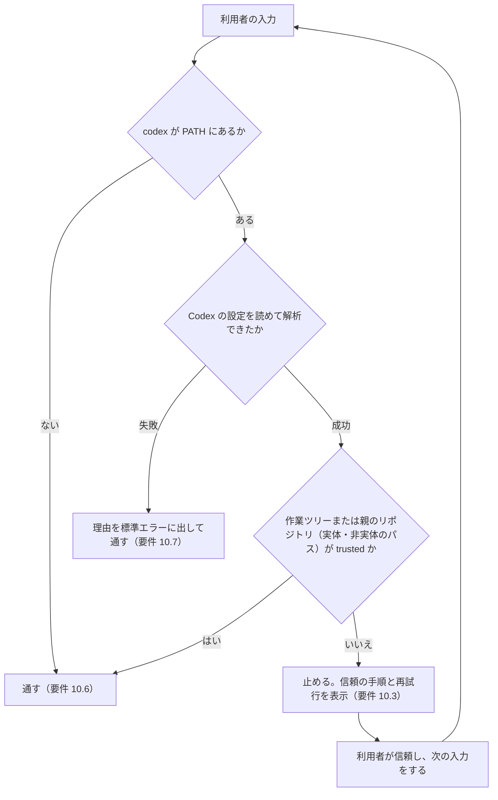
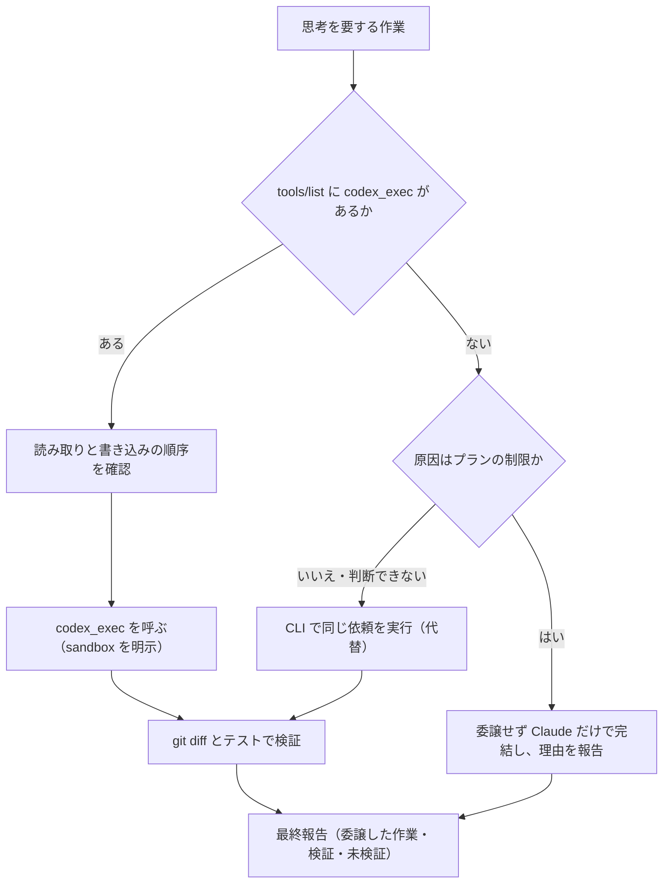
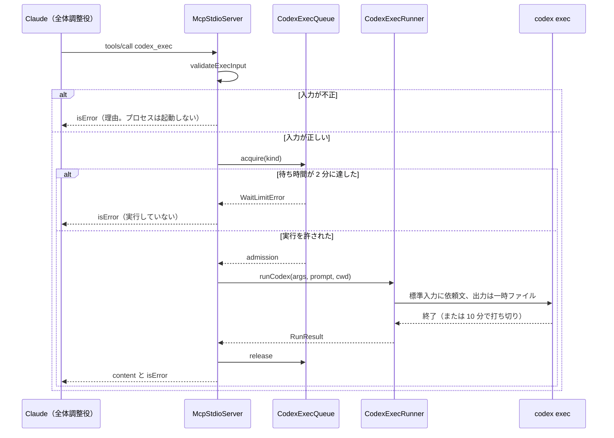

# 設計書: codex-mcp-subagent

本設計は要件書（requirements.md）を正として、全体を書き直したものである。旧版の判断の履歴は持ち込まない。実機で確かめた事実は research.md の第 26 節に記録し、この設計はその結果を根拠にする。

## Overview

Claude Code のセッション（全体調整役）が、思考を要する作業（設計・分析・要件の検討・新規実装と修正・デバッグの原因調査・独立したレビュー・広範囲の探索）を、MCP サーバー `codex` のツール `codex_exec` へ委譲できるようにする。Claude は作業の主体のまま、委譲先への指示・結果の検証・報告・承認状態の変更・利用者への確認を担う。

**Purpose**: 開発者が大きなタスクの途中で、Codex に思考を要する作業を任せられるようにする。
**Users**: skyshare で Claude Code を使う開発者と、その全体調整役の Claude。
**Impact**: Codex は cc-sdd の導入物としてだけ存在する状態から、Claude の通常のツール呼び出しで使える子エージェントに変わる。`codex` が使えない環境（クラウドセッションなど）では、`codex_exec` は公開されず、Claude だけで従来どおり作業を完結させる。

### Goals

- Claude が `codex_exec` を通常のツールとして呼べる（要件 1.1）。
- 委譲の規約を CLAUDE.md の節に置き、cc-sdd の上書きで消えないようにする（要件 9）。
- 書き込みを伴う呼び出しの同時実行を 1 件に、読み取りを 5 件に制限し、待ちを先着順の 1 本の列で扱う（要件 1.9・1.10）。
- `codex` が使えない環境では、`codex_exec` を公開せず、Claude が作業を止めずに進む（要件 1.2・7）。
- `codex` が使えて、リポジトリが Codex で信頼されていないときは、利用者の最初の入力の前に止め、信頼の手順を示す（要件 10）。

### Non-Goals

- cc-sdd の Codex 導入の取り消しと、BRW の Codex 側（`ops-agent-setup` が担う）。
- kiro-* スキル（cc-sdd の生成物）の変更。規約は CLAUDE.md に置く。
- Codex のモデルの性能評価と料金。
- 読み取りと書き込みを重ねないことのサーバーによる強制（要件 1.9 により、運用で守る）。

## Boundary Commitments

### This Spec Owns

- MCP サーバー `codex`（`scripts/agent/codex-mcp-server.mjs` と、その支援の部品）。`codex_exec` の入力の検証、起動引数、待ち列、10 分の打ち切り、結果の文面。
- `.mcp.json` への `codex` の登録（stdio の `sh -c` 経由の `node`）と、そのパスの書き方の確定。
- `.codex/config.toml` の設定値（要件 8.3・8.4）。
- 個人の承認（`.claude/settings.local.json` の `enabledMcpjsonServers`）の使い方（要件 7.3）。
- CLAUDE.md の「## Codex as a Child Agent (MCP)」節（委譲の規約）。
- リポジトリの信頼の確認（`scripts/agent/codex-trust-gate.mjs`）と、その UserPromptSubmit フックの登録（`.claude/settings.json` に 1 件）。信頼は書き込まず、判定と停止だけを行う（要件 10）。

### Out of Boundary

- cc-sdd の Codex 導入の取り消し、SessionStart の導入、BRW の Codex 側。`ops-agent-setup` が担う。
- `kiro-*` スキル（`.claude/skills/kiro-*/`）と `.kiro/settings/`。cc-sdd の生成物のため、規約をここに書かない。
- `scripts/agent/kiro-gate.mjs` の変更。`ops-agent-setup` の作業に属する。
- 秘密情報の管理（`ops-config-secrets`）。依頼文にも秘密を含めない（要件 3.4）。

### Allowed Dependencies

- Node.js の標準モジュール（`node:child_process`・`node:fs`・`node:os`・`node:path`・`node:url`・`node:readline`）のみ。npm の依存は追加しない。
- `codex` の実行ファイル（codex-cli 0.167.0 で起動形を確認済み）。
- 利用者の Codex の設定ファイル（`CODEX_HOME`、既定は `~/.codex/config.toml`）を読み取りだけで使う。書き込まない（要件 10.5）。
- `git`（リポジトリの根の確認）。`sh`（`.mcp.json` の起動経由。無ければサーバーは起動せず、要件 7.4 の扱いになる）。
- `ops-agent-setup`: CLAUDE.md を cc-sdd の導入で書き換えないこと（要件 9.2 の前提。導入スクリプトは CLAUDE.md を対象外にしている）。
- `ops-agent-setup`（`.claude/settings.json` の共有）: 同じファイルの UserPromptSubmit に、本 spec は 1 件を加える。`ops-agent-setup` の改訂（フックの取り消し）を先に済ませ、その後に本 spec の変更を入れる。並行で編集しない（検証の指摘 3）。
- `ops-config-secrets`: 秘密の扱い（依頼文に秘密を含めない）。

### Revalidation Triggers

- `codex` の起動形の変更（`--ask-for-approval`・`exec`・`--sandbox`・`--cd`・`--output-last-message`・標準入力の `-`）。
- `codex_exec` の名前、入力（`prompt`・`sandbox`・`cwd`）、既定値（`workspace-write`）、結果の形（`content` と `isError`）の変更。
- `.mcp.json` の書き方、または server 名（`codex`）の変更。
- CLAUDE.md の節の見出し（要件 9.1 が名指す）と、導入スクリプトによる CLAUDE.md の扱いの変更。
- `.codex/config.toml` の設定値の変更。
- 信頼の判定の方法（`[projects."<パス>"]` の `trust_level`）の変更、または Codex の設定ファイルの場所（`CODEX_HOME`）の扱いの変更。
- 信頼の照合の対象パス（作業ツリーの根、親のリポジトリの根、その実体パス）の変更。
- フックの種類（UserPromptSubmit）の変更。Claude Code のフックの仕様が変わったとき。

## Architecture

### Existing Architecture Analysis

- `scripts/agent/` には、Claude Code の hook と導入の補助が、Node の標準モジュールだけの平たい `.mjs` として置かれている（`kiro-gate.mjs`・`install-gate.mjs`・`brwSource.mjs`）。新しい部品も同じ形に合わせる。
- 単体試験は `tests/unit/scripts/` に置き、`spawnSync` で `scripts/agent/*.mjs` を起動して検査する形がある（`kiroGate.test.ts`）。`config/test/vitest.unit.config.ts` は `tests/unit/**/*.test.ts` を含む。
- CLAUDE.md は cc-sdd の導入の対象外で、導入で書き換えられない。
- HEAD の `.gitignore` には `.claude/settings.local.json` の行が無い。個人の承認を追跡しないため、本 spec で 1 行（と説明のコメント）を追加する。
- 作業ツリーに残る旧版の `.codex/config.toml` は、`approvals_reviewer` を含み `network_access = true` である。要件 8.3・8.4 に合わせて書き直す。

### Architecture Pattern & Boundary Map

構成は「入口（stdio の JSON-RPC）→ 検証と組み立て（純粋）→ 待ち列（純粋）→ 実行（副作用）」の層である。依存は左から右へだけ向く。純粋な部品は互いに import せず、入口だけが組み合わせる。



**Architecture Integration**:

- Selected pattern: 入口・純粋な部品・副作用の部品に分ける層構造。
- Domain boundaries: 委譲の規約（CLAUDE.md。Claude の判断を決める）と、実行の仕組み（サーバー。`codex_exec` の受け付けと実行だけを行う）を分ける。
- Existing patterns preserved: `scripts/agent/` の平たい `.mjs` 配置、Node の標準モジュールだけの実装、`spawnSync` を使う試験。
- New components rationale: 待ち列（要件 1.9・1.10）と引数の検証（要件 1.3〜1.6）を純粋な部品に分け、プロセスを起動せずに試験できるようにする。
- Steering compliance: `comments.md` の先頭ヘッダ（目的を 1〜2 行、6 行以内、日本語。spec の参照・日付・経緯を書かない）。

### Technology Stack

| Layer        | Choice / Version                                                 | Role in Feature                          | Notes                                          |
| ------------ | ---------------------------------------------------------------- | ---------------------------------------- | ---------------------------------------------- |
| MCP サーバー | Node.js 22（v22.16.0 で確認）、標準モジュールのみ                | stdio の JSON-RPC と `codex_exec` の提供 | MCP SDK は使わない（下の設計判断）             |
| 委譲先       | codex-cli 0.167.0                                                | `exec` の非対話実行                      | 起動形は実機で確認済み（research.md 第 26 節） |
| 設定         | `.mcp.json`・`.codex/config.toml`・`.claude/settings.local.json` | 登録、モデルと方針、個人の承認           | 追跡の扱いは File Structure Plan               |
| 試験         | Vitest（`tests/unit/scripts/`）                                  | 部品・設定・規約の試験                   | 外部通信と実際の Codex は使わない              |

### 設計判断

- **MCP SDK を使わず、JSON-RPC の必要な部分を手で書く**: 提供するメソッドは `initialize`・`notifications/initialized`・`tools/list`・`tools/call` の 4 つだけである。SDK は依存と版の管理を増やす。1 ツールの機能には過大である。
- **純粋な部品を 2 つに分ける**: 引数の検証と組み立て（`codex-exec-request.mjs`）と、待ち列（`codex-exec-queue.mjs`）。どちらも時計・ファイルシステム・プロセスを注入する。試験で実行を伴わずに規則を確かめられる。
- **`.mcp.json` は `sh -c` で `git rev-parse --show-toplevel` へ移動してから起動する**: 実機の確認で、リポジトリの根からも下位のディレクトリからも接続できた形はこれだけだった（第 26 節）。
- **sandbox は依頼ごとに明示する**: サーバーは既定値（`workspace-write`）を持つが、規約は呼び出しごとに値を指定させる（要件 4.4）。
- **承認は `--ask-for-approval never` を `exec` の前に置く**: `exec` の後に置くと codex 0.167.0 が拒否する（実機で確認）。
- **信頼の停止は UserPromptSubmit で行う（SessionStart ではない）**: 実機で、SessionStart のフックが終了コード 2 で終わってもセッションは進んだ（止まらない）。UserPromptSubmit のフックが `decision: "block"` を返すと、そのプロンプトへの応答は出ず、理由が表示された。Claude Code ではセッションの開始そのものは止められないため、利用者の最初の入力の前で止める（要件 10.3）。`install-gate.mjs` と同じ方式である。
- **信頼の判定は利用者の Codex の設定を読むだけにする**: 信頼の書き込みは利用者が Codex 側で行う（要件 10.5）。`codex` の起動による判定はしない（起動は時間がかかり、副作用を伴うため）。

## Verified Platform Facts

実機（2026-11-09、この環境の codex-cli 0.167.0・Claude Code 2.1.319）で確かめた事実。詳細と手順は research.md の第 26 節。

| 事実                                                                                                                                                                                                                      | 設計への影響                                                                                                                                                                   |
| ------------------------------------------------------------------------------------------------------------------------------------------------------------------------------------------------------------------------- | ------------------------------------------------------------------------------------------------------------------------------------------------------------------------------ |
| `codex -a never exec ...` は受理され、`codex exec -a never` は `unexpected argument` で拒否される                                                                                                                         | 起動引数の順序を固定する（要件 1.3）                                                                                                                                           |
| `exec` に `--output-last-message <file>` と標準入力の `-` を渡すと、最後のメッセージがファイルに入る（CLI の代替でも同じ）                                                                                                | 結果はファイルで受け取る。プロンプトは標準入力で渡す（要件 1.4）                                                                                                               |
| リポジトリの `.codex/config.toml` は、そのリポジトリが Codex で信頼（`trust_level = "trusted"`）されているときだけ効く。信頼されていなければ無視される                                                                    | 要件 8.3 の値は信頼されたリポジトリで効く。運用の前提として Risks に書く                                                                                                       |
| 信頼されたリポジトリでは、プロジェクトの `model_reasoning_effort` が利用者の既定値を上書きする                                                                                                                            | 設定値の所在は `.codex/config.toml` で足りる                                                                                                                                   |
| プロジェクトの `network_access = false` が、利用者の既定の `true` を上書きする（`curl` が名前解決で失敗）                                                                                                                 | 要件 8.3 の `network_access = false` は効く                                                                                                                                    |
| `claude -p` で `mcp__codex__codex_exec` を呼ぶと、結果は `text`（例: `OK`）で返り、`is_error` は付かない                                                                                                                  | 成功時の応答形を確定する                                                                                                                                                       |
| `codex` を PATH から外すと、サーバーは `Connected` のままで、`tools/list` は空になる                                                                                                                                      | 要件 1.2・7.1 はツールを空にすることで満たす                                                                                                                                   |
| `.mcp.json` の `sh -c` に `git rev-parse --show-toplevel` を含める形は、起動時の作業ディレクトリに関わらず、リポジトリの根で起動する                                                                                      | 採用する                                                                                                                                                                       |
| `.mcp.json` の相対パス（`node scripts/agent/...`）と `${CLAUDE_PROJECT_DIR}` の形は、下位のディレクトリでは起動先のパスが誤る                                                                                             | 採用しない                                                                                                                                                                     |
| 信頼されたリポジトリは、Codex の設定 `[projects."<パス>"]` に `trust_level = "trusted"` がある（skyshare の例で確認。キーは実体のパスだった）                                                                             | 信頼の判定はこの表の読み取りで行う（要件 10.2）                                                                                                                                |
| git worktree の作業ツリーでは、`git rev-parse --show-toplevel` は worktree のパスを返し、`git rev-parse --path-format=absolute --git-common-dir` の親は親のリポジトリのパスを返す（一時の worktree で確認。確認後に削除） | 親のリポジトリのパスで信頼を照合する（要件 10.2・利用者の決定）。Codex も、親だけが信頼された worktree で親の信頼を適用した（`reasoning effort` の確認、research.md 第 28 節） |
| UserPromptSubmit のフックが `decision: "block"` を返すと、そのプロンプトは応答されず、理由が表示される（応答の数 0 を確認）                                                                                               | 信頼が無いときの停止は、このフックで行う（要件 10.3）                                                                                                                          |
| SessionStart のフックが終了コード 2 で終わっても、セッションとプロンプトの応答は続く                                                                                                                                      | セッションの開始そのものは止められない。SessionStart では停止しない                                                                                                            |

## File Structure Plan

### Directory Structure

```
scripts/agent/
├── codex-mcp-server.mjs     # McpStdioServer: stdio の JSON-RPC と、tools/list・tools/call の結線（入口）
├── codex-env.mjs            # CodexEnvProbe: codex と git の有無、リポジトリの根の確認
├── codex-exec-request.mjs   # CodexExecRequest: 入力の検証、起動引数、失敗の文面（純粋）
├── codex-exec-queue.mjs     # CodexExecQueue: 先着順の待ち列と同時実行の上限（純粋。時計を注入）
└── codex-exec-runner.mjs    # CodexExecRunner: codex の子プロセス、標準入力、10 分の打ち切り、最後のメッセージの読み取り
tests/unit/scripts/
├── codexExecRequest.test.ts # 検証、起動引数の順序、失敗の文面
├── codexExecQueue.test.ts   # 先着順、件数の上限、待ち時間の上限
├── codexExecRunner.test.ts  # 偽の codex による起動、終了、打ち切り、一時ディレクトリの後始末
├── codexEnvProbe.test.ts    # 実行ファイルの探索、リポジトリの根の確認
├── codexMcpServer.test.ts   # JSON-RPC の応答、公開の切り替え、tools/call の結線
└── codexSetup.test.ts       # .mcp.json・.codex/config.toml・CLAUDE.md の節・個人の承認の設定
scripts/agent/
└── codex-trust-gate.mjs     # CodexTrustGate: 信頼の判定（純粋）と、UserPromptSubmit フックの入口（stdin の JSON → 判定の JSON）
tests/unit/scripts/
└── codexTrustGate.test.ts   # 設定ファイルの解析、判定の分岐、フックの出力、失敗時の扱い
```

### Modified Files

- `.mcp.json`（新規・追跡する）— McpRegistration。`codex` を `sh -c` 経由の stdio サーバーとして登録する。
- `.claude/settings.json`（追跡する）— CodexTrustGate。`UserPromptSubmit` に `node "$CLAUDE_PROJECT_DIR/scripts/agent/codex-trust-gate.mjs" user-prompt-submit`（timeout 10）を 1 件加える。他のフックは変えない。
- `.codex/config.toml`（追跡する。HEAD の版を書き直す）— CodexProjectConfig。要件 8.3 の値を持ち、`approvals_reviewer` を含まない。
- `CLAUDE.md`（追跡する。HEAD の版に節を足す）— DelegationPolicy。末尾に「## Codex as a Child Agent (MCP)」を英語で書く。既存の節は変えない。
- `.claude/settings.local.json`（追跡しない。個人の承認）— PersonalApproval。`enabledMcpjsonServers` に `codex` を入れる。他のキーは保持する。
- `.gitignore`（追加する）— `.claude/settings.local.json` の 1 行を加える（HEAD には無い。個人の承認を追跡しないため）。

## System Flows

### 信頼の確認（利用者の入力の前）



- 判定は毎回行う。止めた状態は記録しない（要件 10.4）。信頼された後の次の入力から通る。
- 信頼の書き込みは行わない（要件 10.5）。

### 委譲の判断（全体調整役の Claude の側）



- ListCheck: 委譲の最初に、ツールの一覧で `codex_exec` の有無を見る（要件 6.7）。
- Cause: 無いときの原因を、`codex` の実行の結果で確かめる（要件 6.8）。プランの制限（課金・利用枠）は委譲しない。
- Order: 書き込みを伴う呼び出しが完了するまで読み取りを指示せず、読み取りが完了するまで書き込みを開始しない（要件 2.3）。
- 委譲を省いたとき、直接対応したとき、代替を使ったときは、理由を最終報告に書く（要件 2.5・3.2・6.4・6.5）。

### codex_exec の一回の呼び出し



- 待ち時間は、列に入ってから実行を許されるまでである。実行中の時間は含まない（要件 1.10）。
- 10 分の打ち切りは、実行中の時間に対して行う（要件 1.7）。

## Requirements Traceability

| 要件 | 内容（要約）                                                                                                                                                        | Components                         | Interfaces                            | Flows      |
| ---- | ------------------------------------------------------------------------------------------------------------------------------------------------------------------- | ---------------------------------- | ------------------------------------- | ---------- |
| 1.1  | 起動時に `codex_exec` を 1 つ提供                                                                                                                                   | McpStdioServer                     | tools/list                            | 呼び出し   |
| 1.2  | `codex` が使えないとき、ツールを 1 つも出さない                                                                                                                     | McpStdioServer, CodexEnvProbe      | tools/list                            | 起動       |
| 1.3  | `--ask-for-approval never` を `exec` の前に置く                                                                                                                     | CodexExecRequest                   | buildCodexArgs                        | 呼び出し   |
| 1.4  | `prompt` を標準入力で渡す。既定は `workspace-write`                                                                                                                 | CodexExecRequest, CodexExecRunner  | validateExecInput, runCodex           | 呼び出し   |
| 1.5  | `sandbox` は 2 値のみ。他はエラー                                                                                                                                   | CodexExecRequest                   | validateExecInput                     | 呼び出し   |
| 1.6  | `cwd` がリポジトリの外ならエラー                                                                                                                                    | CodexExecRequest, CodexEnvProbe    | validateExecInput                     | 呼び出し   |
| 1.7  | 1 回の実行を 10 分で打ち切る                                                                                                                                        | CodexExecRunner                    | runCodex                              | 呼び出し   |
| 1.8  | 非ゼロ終了は、最後のメッセージと標準エラーの末尾を含むエラー                                                                                                        | CodexExecRunner, CodexExecRequest  | RunResult, formatFailure              | 呼び出し   |
| 1.9  | 1 本の先着順の列。書き込み 1・読み取り 5 を別々に数える。待機中を追い越さない。重ねないことは運用で守る                                                             | CodexExecQueue                     | acquire                               | 呼び出し   |
| 1.10 | 待ち時間（列の待ちを含む）が 2 分に達したら、実行せず `isError`。件数に上限を設けない                                                                               | CodexExecQueue, McpStdioServer     | acquire, WaitLimitError               | 呼び出し   |
| 2.1  | 思考を要する作業を、直接作業する前に委譲する（レビューに限らない）                                                                                                  | DelegationPolicy                   | 節の判断                              | 委譲の判断 |
| 2.2  | 委譲後は指示・検証・報告・承認に集中し、応答を待つ（作業を止めない）                                                                                                | DelegationPolicy                   | 節の判断                              | 委譲の判断 |
| 2.3  | 読み取りは同じターンで並べてよい。書き込みは並べず 1 つずつ。重ねない。完了まで指示も開始もしない。CLI も同じ順序。読み取りの依頼に進行中の書き込み対象の注意を書く | DelegationPolicy, CodexExecQueue   | 節の順序                              | 委譲の判断 |
| 2.4  | 独立レビューの結論は `codex_exec` に行わせる（自己レビュー禁止）                                                                                                    | DelegationPolicy                   | 節の判断                              | 委譲の判断 |
| 2.5  | 委譲を省いたら理由を報告する                                                                                                                                        | DelegationPolicy                   | 節の報告                              | 委譲の判断 |
| 2.6  | 最終報告に、委譲した作業と Claude の検証を含める                                                                                                                    | DelegationPolicy                   | 節の報告                              | 委譲の判断 |
| 3.1  | 直接対応してよい作業（機械的な小修正、判断待ち、承認フラグ、git、秘密）                                                                                             | DelegationPolicy                   | 節の例外                              | 委譲の判断 |
| 3.2  | 直接対応したら理由を報告する                                                                                                                                        | DelegationPolicy                   | 節の報告                              | 委譲の判断 |
| 3.3  | 委譲してはいけない作業（判断・承認、破壊的操作、外部への作用、秘密）                                                                                                | DelegationPolicy                   | 節の例外                              | 委譲の判断 |
| 3.4  | 依頼文にトークン・パスワード・アカウント識別子を含めない                                                                                                            | DelegationPolicy                   | 節の依頼文                            | 委譲の判断 |
| 4.1  | 依頼文は自己完結する。読んでよいディレクトリを明記する（書き込みでは書き込んでよいディレクトリも）                                                                  | DelegationPolicy                   | 節の依頼文                            | 委譲の判断 |
| 4.2  | 会話の全体を貼らない                                                                                                                                                | DelegationPolicy                   | 節の依頼文                            | 委譲の判断 |
| 4.3  | 実装の依頼はテストの実行コマンドと完了の判定を含める                                                                                                                | DelegationPolicy                   | 節の依頼文                            | 委譲の判断 |
| 4.4  | 呼び出しごとに `sandbox` を明示する。既定に任せない                                                                                                                 | DelegationPolicy, CodexExecRequest | 節の依頼文                            | 委譲の判断 |
| 4.5  | 必要な規約を依頼文に含める。AGENTS.md を読まない前提で書く                                                                                                          | DelegationPolicy                   | 節の依頼文                            | 委譲の判断 |
| 5.1  | Codex の報告は、検証するまで未確認として扱う                                                                                                                        | DelegationPolicy                   | 節の検証                              | 委譲の判断 |
| 5.2  | 完了の報告の前に `git diff` とテストを行う                                                                                                                          | DelegationPolicy                   | 節の検証                              | 委譲の判断 |
| 5.3  | 誤りや不足は、具体的に示して再依頼するか、自分で直す                                                                                                                | DelegationPolicy                   | 節の検証                              | 委譲の判断 |
| 5.4  | 報告に、Codex の作業・検証した内容・未検証を含める。`kiro-verify-completion` に従う                                                                                 | DelegationPolicy                   | 節の報告                              | 委譲の判断 |
| 5.5  | Codex に commit・push・ブランチ操作と承認状態の変更を禁じる（依頼文に書く）                                                                                         | DelegationPolicy                   | 節の依頼文                            | 委譲の判断 |
| 6.1  | `codex_exec` が失敗し、`codex` が使えるとき、CLI で同じ依頼を実行する                                                                                               | DelegationPolicy                   | 節の代替（CLI の形）                  | 委譲の判断 |
| 6.2  | CLI の代替は同じ sandbox を使い、承認の指定を `exec` の前に置く                                                                                                     | DelegationPolicy                   | 節の代替（CLI の形）                  | 委譲の判断 |
| 6.3  | プロンプトファイルは `/tmp` ではなくスクラッチパッドに置く                                                                                                          | DelegationPolicy                   | 節の代替                              | 委譲の判断 |
| 6.4  | 代替を使ったら最終報告に書く                                                                                                                                        | DelegationPolicy                   | 節の報告                              | 委譲の判断 |
| 6.5  | MCP も CLI も使えないなら、委譲を省き理由を報告する                                                                                                                 | DelegationPolicy                   | 節の代替                              | 委譲の判断 |
| 6.6  | 待ち時間の上限による失敗のときは、先行する書き込みの完了を待ってから CLI を実行する                                                                                 | DelegationPolicy, CodexExecQueue   | 節の代替                              | 委譲の判断 |
| 6.7  | 委譲の最初に、`codex_exec` の有無をツールの一覧で確かめる                                                                                                           | DelegationPolicy                   | 節の判断                              | 委譲の判断 |
| 6.8  | 無いときは原因を確かめ、プランの制限なら委譲せず、それ以外は CLI から試す（判断できないときも CLI）                                                                 | DelegationPolicy                   | 節の代替                              | 委譲の判断 |
| 7.1  | `codex` が無い環境では Codex を使わず、Claude だけで完結する                                                                                                        | McpStdioServer, CodexEnvProbe      | tools/list                            | 起動       |
| 7.2  | 環境に応じた動きを、委譲の義務より優先する                                                                                                                          | DelegationPolicy                   | 節の判断                              | 委譲の判断 |
| 7.3  | 個人の承認は `.claude/settings.local.json` に置き、追跡しない                                                                                                       | PersonalApproval                   | enabledMcpjsonServers                 | —          |
| 7.4  | サーバーが起動できないとき（`sh` や `git` が無いなど）、`codex_exec` を使わず作業を止めない                                                                         | McpStdioServer, CodexEnvProbe      | tools/list                            | 起動       |
| 8.1  | `.mcp.json` に stdio の `node` として登録し、どこから開いても解決する                                                                                               | McpRegistration                    | `.mcp.json` の形                      | —          |
| 8.2  | パスの書き方は実機で動くことを確かめてから確定する                                                                                                                  | McpRegistration                    | 第 26 節の確認                        | —          |
| 8.3  | `.codex/config.toml` の 5 つの値を持つ                                                                                                                              | CodexProjectConfig                 | 設定値                                | —          |
| 8.4  | `.codex/config.toml` は `approvals_reviewer` を含まない                                                                                                             | CodexProjectConfig                 | 設定値                                | —          |
| 9.1  | 規約は CLAUDE.md の「## Codex as a Child Agent (MCP)」節に置く                                                                                                      | DelegationPolicy                   | 見出し                                | —          |
| 9.2  | CLAUDE.md は cc-sdd の導入で上書きされない                                                                                                                          | DelegationPolicy                   | 導入の対象外（`ops-agent-setup`）     | —          |
| 9.3  | 節は 9 項目を持つ。sandbox は読み取り専用に固定しない                                                                                                               | DelegationPolicy                   | 節の内容                              | —          |
| 9.4  | 節は英語で書く。追加する文はすべて英語                                                                                                                              | DelegationPolicy                   | 節の内容                              | —          |
| 9.5  | CLAUDE.md は日本語の文を含まない                                                                                                                                    | DelegationPolicy                   | CLAUDE.md 全体                        | —          |
| 10.1 | `codex` が使えるとき、利用者の最初の入力の前に信頼を確かめる                                                                                                        | CodexTrustGate                     | UserPromptSubmit フック               | 信頼の確認 |
| 10.2 | 信頼の判断は、Codex の設定の `[projects."<パス>"]` の `trust_level = "trusted"` による。パスは作業ツリーのパス、または worktree の親のリポジトリのパス              | CodexTrustGate                     | isRepoTrusted, resolveTrustCandidates | 信頼の確認 |
| 10.3 | 信頼が無いとき、入力の受け付けを止め、手順と再試行の方法を示す。セッションは開いたまま                                                                              | CodexTrustGate                     | decideUserPromptSubmit（block）       | 信頼の確認 |
| 10.4 | 信頼が確かめられたら次の入力から受け付ける。止めた状態を記録しない                                                                                                  | CodexTrustGate                     | 毎回の判定                            | 信頼の確認 |
| 10.5 | 信頼を自動で書き込まない                                                                                                                                            | CodexTrustGate                     | 読み取りのみ                          | 信頼の確認 |
| 10.6 | `codex` が無いときは止めない                                                                                                                                        | CodexTrustGate                     | codexAvailable                        | 信頼の確認 |
| 10.7 | 判定に失敗したときは止めず、理由を標準エラーに出す                                                                                                                  | CodexTrustGate                     | decideUserPromptSubmit（null）        | 信頼の確認 |

## Components and Interfaces

| Component          | Domain/Layer   | Intent                                                        | Req Coverage                                 | Key Dependencies (P0/P1)                                                             | Contracts      |
| ------------------ | -------------- | ------------------------------------------------------------- | -------------------------------------------- | ------------------------------------------------------------------------------------ | -------------- |
| McpStdioServer     | 入口           | stdio の JSON-RPC で応答し、`codex_exec` を公開し、部品を結ぶ | 1.1, 1.2, 1.4, 1.5, 1.7, 1.8, 1.10, 7.1, 7.4 | CodexEnvProbe (P0), CodexExecRequest (P0), CodexExecQueue (P0), CodexExecRunner (P0) | Service, API   |
| CodexEnvProbe      | 環境           | `codex` と `git` の有無、リポジトリの根を求める               | 1.2, 1.6, 7.1, 7.4                           | git (P1)                                                                             | Service        |
| CodexExecRequest   | 純粋な規則     | 入力を検証し、起動引数と失敗の文面を作る                      | 1.3, 1.4, 1.5, 1.6, 1.8, 4.4                 | なし                                                                                 | Service        |
| CodexExecQueue     | 純粋な規則     | 先着順の列で、種類ごとの同時実行の上限と待ち時間を守る        | 1.9, 1.10, 2.3, 6.6                          | なし（時計を注入）                                                                   | Service, State |
| CodexExecRunner    | 副作用         | `codex` を 1 回実行し、結果を返す                             | 1.4, 1.7, 1.8                                | codex (P0), node:child_process (P0)                                                  | Service        |
| McpRegistration    | 設定           | `codex` の登録                                                | 8.1, 8.2                                     | sh (P0), git (P1)                                                                    | 設定の形       |
| CodexProjectConfig | 設定           | モデルと方針の値                                              | 8.3, 8.4                                     | —                                                                                    | 設定の値       |
| PersonalApproval   | 個人の設定     | `codex` の利用の承認                                          | 7.3                                          | —                                                                                    | 設定の値       |
| DelegationPolicy   | 規約           | 委譲の判断、依頼文、検証、代替、報告                          | 2.x, 3.x, 4.x, 5.x, 6.x, 7.2, 9.x            | —                                                                                    | 節の内容       |
| CodexTrustGate     | 入口（フック） | リポジトリの信頼を判定し、未信頼なら利用者の入力を止める      | 10.1〜10.7                                   | Codex の設定ファイル (P0), codex の有無 (P1)                                         | Service        |

### 入口

#### CodexTrustGate

| Field        | Detail                                                                                                 |
| ------------ | ------------------------------------------------------------------------------------------------------ |
| Intent       | 利用者の入力の前に、`codex` が使えるのにリポジトリが信頼されていなければ、入力を止めて信頼の手順を示す |
| Requirements | 10.1〜10.7                                                                                             |

**Responsibilities & Constraints**

- `codex` の実行ファイルが PATH に無ければ、何もしない（要件 10.6）。
- Codex の設定ファイルのパスは `CODEX_HOME`（環境変数）があればその下、無ければ `~/.codex` の下の `config.toml`。読み取りだけを行う。
- 照合する候補パスは次の 4 つ（重複を除く）: 作業ツリーの根（`git rev-parse --show-toplevel`）、親のリポジトリの根（`git rev-parse --path-format=absolute --git-common-dir` の親）、それぞれの実体パス（`realpath`）。このどれかの `[projects."..."]` テーブルに `trust_level = "trusted"` があれば信頼とみなす（Codex がキーを開いた時のパスで保存する場合と、実体で保存する場合の両方を受ける。検証の指摘 2）。
- 親のリポジトリが信頼されていれば、その worktree も信頼とみなす（利用者の決定）。
- `git` が使えない、または作業ツリーの外のときは、サーバーと同じ方法（`import.meta.url` の位置）で求めた根だけを候補にする。
- 設定ファイルが無い、または解析できない場合は、判定の失敗として扱う（要件 10.7）。ただし「ファイルが無い」は信頼されていないことと同じに扱う（Codex の既定では信頼されていない）。
- 判定の結果は、`decision: "block"` と理由（手順と再試行）、または何もしない（null）の 2 通り。
- 例外は標準エラーに出し、終了コード 0 で返す（判定ができないときに作業を止めない。`install-gate.mjs` と同じ方針）。

**Dependencies**: Codex の設定ファイル（P0。読み取りのみ）、PATH の探索（P1）

**Contracts**: Service [x]

##### Service Interface

```typescript
type TrustDecision = {
  hookSpecificOutput: {
    hookEventName: "UserPromptSubmit"
    suppressOriginalPrompt: true
  }
  decision: "block"
  reason: string
} | null
// resolveTrustCandidates(input: { worktreeRoot: string; commonDir: string | null; realpath: (p: string) => string }): string[]  // 重複を除く。commonDir が null のときは worktreeRoot だけ
// isRepoTrusted(configText: string, candidates: string[]): boolean   // 解析の失敗は throw
// codexAvailable(searchPath: string): boolean
// decideUserPromptSubmit(input: { candidates: string[]; env: Record<string, string | undefined>; homeDir: string; searchPath: string; readFile: (p: string) => string | null }): TrustDecision
```

- Preconditions: `readFile` は、ファイルが無いときに `null` を返す。
- Postconditions: `decision: "block"` のとき、`reason` は信頼の手順（Codex で開いて信頼する。または設定に `[projects."<実体のパス>"]` と `trust_level = "trusted"` を書く）と、確認後に入力し直すことを含む。
- Invariants: 設定ファイルへの書き込みは行わない。

### 入口（MCP）

#### McpStdioServer

| Field        | Detail                                                                |
| ------------ | --------------------------------------------------------------------- |
| Intent       | 改行区切りの JSON-RPC を受け、`codex_exec` の一覧と呼び出しを提供する |
| Requirements | 1.1, 1.2, 1.4, 1.5, 1.7, 1.8, 1.10, 7.1, 7.4                          |

**Responsibilities & Constraints**

- 起動時に CodexEnvProbe を一度だけ呼ぶ。`codex` か `git` が無いとき、`tools/list` は空の一覧を返す。サーバーは起動を続ける（要件 1.2・7.1）。
- `tools/list` は、利用可能なときだけ `codex_exec` の定義を 1 つ返す。入力は `prompt`（文字列、必須、空でない）、`sandbox`（`read-only` または `workspace-write`、省略時 `workspace-write`）、`cwd`（任意。リポジトリ内の絶対パス。省略時はリポジトリの根）。
- `tools/call` は、検証（CodexExecRequest）→ 待ち列（CodexExecQueue）→ 実行（CodexExecRunner）の順に行い、必ず 1 つの結果を返す。失敗は JSON-RPC のエラーにせず、`isError: true` の結果で返す。
- 対応するメソッド: `initialize`（クライアントが要求した版を返す）、`notifications/initialized`（応答しない）、`tools/list`、`tools/call`。未知のメソッドで `id` があるときは `-32601`。JSON の解析の失敗は `-32700`。
- ログは標準エラーにだけ出す。出すのは時刻・呼び出しの種類（read か write）・待ち時間・終了コードだけで、プロンプトと結果の本文は出さない（要件 3.4 の趣旨）。

**Contracts**: Service [x] / API [x]

##### Service Interface

```typescript
// 入口の内部。`.mjs` のため型は JSDoc で示す。
type CodexExecArgs = {
  prompt: string
  sandbox?: "read-only" | "workspace-write"
  cwd?: string
}
type ToolResult = {
  content: Array<{ type: "text"; text: string }>
  isError: boolean
}
// tools/call: unknown の引数 → CodexExecArgs（検証）→ ToolResult
```

- Preconditions: 起動時の確認が終わっている。
- Postconditions: `tools/call` は必ず一つの `ToolResult` を返す（プロセスを起動しない失敗も含む）。成功時は `isError: false`。
- Invariants: `tools/list` が空のとき、`codex_exec` の呼び出しは未知のツールとして `isError: true` を返す。

##### API Contract

| Method     | Endpoint | Request                                            | Response                                    | Errors                                                             |
| ---------- | -------- | -------------------------------------------------- | ------------------------------------------- | ------------------------------------------------------------------ |
| tools/list | stdio    | —                                                  | `codex_exec` の定義（利用不可なら空の一覧） | -32601                                                             |
| tools/call | stdio    | `{ name: "codex_exec", arguments: CodexExecArgs }` | `ToolResult`                                | 検証の失敗・待ち時間の上限・非ゼロ終了・打ち切りは `isError: true` |

**Implementation Notes**

- リポジトリの根は、サーバーのファイルの位置（`import.meta.url` から `../..`）を基準に CodexEnvProbe が求める。
- クライアントの版との対応は、実機の Claude Code（2.1.319）で接続と `tools/list` が通ることを確かめる（第 26 節）。

#### CodexEnvProbe

| Field        | Detail                                                      |
| ------------ | ----------------------------------------------------------- |
| Intent       | 起動時に、`codex` と `git` の有無と、リポジトリの根を求める |
| Requirements | 1.2, 1.6, 7.1, 7.4                                          |

**Responsibilities & Constraints**

- PATH から `codex` と `git` を探す（実行できるファイルかを確かめる）。
- `git -C <サーバーの場所> rev-parse --show-toplevel` でリポジトリの根を求める。得られなければ利用できないものとして扱う。
- 外部への通信はしない。

**Contracts**: Service [x]

##### Service Interface

```typescript
type ProbeResult =
  | { available: true; repoRoot: string }
  | { available: false; missing: Array<"codex" | "git"> }
// probeEnvironment(options: { searchPath: string; startDir: string }): Promise<ProbeResult>
```

- Postconditions: `available` が true のとき、`repoRoot` は実在するディレクトリで、git の作業ツリーの根である。

### 純粋な規則

#### CodexExecRequest

| Field        | Detail                                                             |
| ------------ | ------------------------------------------------------------------ |
| Intent       | `codex_exec` の入力を検証し、`codex exec` の引数と失敗の文面を作る |
| Requirements | 1.3, 1.4, 1.5, 1.6, 1.8, 4.4                                       |

**Responsibilities & Constraints**

- `sandbox` は `read-only` と `workspace-write` に限る。省略時は `workspace-write`。それ以外は、プロセスを起動せずに拒否する（要件 1.5）。
- `prompt` は空でない文字列。空なら拒否する。
- `cwd` は、省略時にリポジトリの根。与えられたときは実在性を確かめ、symlink を解決した実体のパスがリポジトリの根の実体の内側にあることを確かめる。外なら拒否する（要件 1.6）。
- 引数の順序は `["--ask-for-approval", "never", "exec", "--sandbox", <sandbox>, "--cd", <cwd>, "--output-last-message", <出力ファイル>, "-"]`。承認の指定が `exec` より前にあることを保証する（要件 1.3）。
- `formatFailure` は、終了コード・シグナル・最後のメッセージ・標準エラーの末尾（4000 文字まで）から、エラーの文面を作る（要件 1.8）。

**Contracts**: Service [x]

##### Service Interface

```typescript
type Sandbox = "read-only" | "workspace-write"
type ValidatedExec = { prompt: string; sandbox: Sandbox; cwd: string }
type ValidationError =
  | { kind: "invalid_sandbox"; message: string }
  | { kind: "empty_prompt"; message: string }
  | { kind: "cwd_not_found"; message: string }
  | { kind: "cwd_outside_repo"; message: string }
// validateExecInput(raw: unknown, env: { repoRoot: string; realpath: (p: string) => string }):
//   { ok: true; value: ValidatedExec } | { ok: false; error: ValidationError }
// buildCodexArgs(v: ValidatedExec, outputFile: string): string[]
// formatFailure(input: { exitCode: number | null; signal: string | null; lastMessage: string; stderrTail: string }): string
```

- Preconditions: `raw` は未検証の値。`realpath` は注入する（試験で symlink を再現するため）。
- Postconditions: `ok: true` の `cwd` は、リポジトリの根の内側の実体のパスである。

### 待ち列

#### CodexExecQueue

| Field        | Detail                                                                            |
| ------------ | --------------------------------------------------------------------------------- |
| Intent       | 呼び出しを先着順の 1 本の列に入れ、種類ごとの同時実行の上限と待ち時間の上限を守る |
| Requirements | 1.9, 1.10, 2.3, 6.6                                                               |

**Responsibilities & Constraints**

- 同時に実行できるのは、読み取り（`read-only`）が 5 件まで、書き込み（`workspace-write`）が 1 件まで。両者は別々に数える。サーバーは両者の重なりを拒否しない（要件 1.9。運用で守る）。
- 先頭から順に実行を許す。先頭が許されなければ、後続は先頭を追い越さない（書き込みが待つと、後ろの読み取りも待つ）。
- 待ち時間は、列に入ってから実行を許されるまで。2 分に達した呼び出しは列から外し、`WaitLimitError` で拒否する（要件 1.10）。列の件数には上限を設けない。
- 実行中の時間は待ち時間に含めない。実行中の打ち切りは CodexExecRunner の責務（10 分）。
- 時計（現在時刻とタイマー）は注入する。試験は偽の時計で行う。
- 実行の解放（`release`）は一度だけ数える。二度呼ばれても害がない。

**Contracts**: Service [x] / State [x]

##### Service Interface

```typescript
type CallKind = "read" | "write"
type Admission = { release: () => void }
type Clock = {
  now: () => number
  setTimeout: (fn: () => void, ms: number) => unknown
  clearTimeout: (handle: unknown) => void
}
// createExecQueue(options: { maxConcurrent: { read: 5; write: 1 }; waitLimitMs: number; clock: Clock }):
//   { acquire(kind: CallKind): Promise<Admission> }  // 待ち時間の上限で WaitLimitError により拒否
```

- State: 待機の列（FIFO）、実行中の読み取りの件数、実行中の書き込みの件数。
- Concurrency strategy: 単一のイベントループ上で状態を更新する。

### 副作用

#### CodexExecRunner

| Field        | Detail                                                                |
| ------------ | --------------------------------------------------------------------- |
| Intent       | `codex` を子プロセスで 1 回実行し、依頼文を標準入力で渡し、結果を返す |
| Requirements | 1.4, 1.7, 1.8                                                         |

**Responsibilities & Constraints**

- 依頼文は標準入力に書いて閉じる。依頼文をファイルに書かない。
- 最後のメッセージは、`os.tmpdir()` の下に作る専用のディレクトリのファイル（`--output-last-message` の値）で受ける。実行の後にディレクトリごと削除する。これは依頼文のファイルではない。
- 作業ディレクトリは検証済みの `cwd`。
- 10 分（600000 ms）を超えたら SIGTERM を送り、猶予（5 秒）の後に終わらなければ SIGKILL を送る。結果は `timeout` とする（要件 1.7）。
- 終了コードが 0 なら `completed`（最後のメッセージを返す）。非ゼロは `failed`（終了コード・シグナル・最後のメッセージ・標準エラーの末尾）。起動の失敗（ENOENT など）は `spawn_error`。

**Contracts**: Service [x]

##### Service Interface

```typescript
type RunResult =
  | { kind: "completed"; lastMessage: string }
  | {
      kind: "failed"
      exitCode: number | null
      signal: string | null
      lastMessage: string
      stderrTail: string
    }
  | { kind: "timeout"; lastMessage: string; stderrTail: string }
  | { kind: "spawn_error"; message: string }
// runCodex(args: string[], options: { cwd: string; prompt: string; timeoutMs: number; killGraceMs: number }): Promise<RunResult>
```

- Preconditions: `args` は CodexExecRequest が組み立てたもの。`timeoutMs` の既定は 600000。
- Postconditions: 結果を返す前に子プロセスは終了している。一時ディレクトリは削除されている。

### 設定と規約

#### McpRegistration

`.mcp.json` の内容（形）:

```json
{
  "mcpServers": {
    "codex": {
      "type": "stdio",
      "command": "sh",
      "args": [
        "-c",
        "cd \"$(git rev-parse --show-toplevel)\" && exec node scripts/agent/codex-mcp-server.mjs"
      ],
      "env": {}
    }
  }
}
```

- 採用理由は第 26 節。`${CLAUDE_PROJECT_DIR}` と相対パスは、下位のディレクトリからの起動で誤ったパスを指すため採用しない。
- `.mcp.json` は追跡する。`codex` は個人の承認（PersonalApproval）が無いと接続されない。

#### CodexProjectConfig

`.codex/config.toml` の内容（値）:

```toml
model = "gpt-6-luna"
model_reasoning_effort = "medium"
approval_policy = "never"
sandbox_mode = "workspace-write"

[sandbox_workspace_write]
network_access = false
```

- `approvals_reviewer` は含めない（要件 8.4。承認が `never` のもとでは使われないため）。
- 値は、リポジトリが Codex で信頼されているときに効く（第 26 節の確認）。

#### PersonalApproval

`.claude/settings.local.json`（追跡しない。`.gitignore` の規則で無視される。個人のグローバル除外に頼らない）:

```json
{ "enabledMcpjsonServers": ["codex"] }
```

- 他のキーがあれば保持する。

#### DelegationPolicy

CLAUDE.md の「## Codex as a Child Agent (MCP)」節。

- 節は英語で書く（要件 9.4）。CLAUDE.md の全体に日本語の文を含めない（要件 9.5）。
- 節の内容（要件 9.3 の 9 項目）: (1) 思考を要する作業の委譲（レビューに限らない。対象は要件 2.1 の一覧）、(2) 積極的な委譲、(3) 独立レビューの自己実施の禁止（要件 2.4）、(4) 読み取りの並列と、書き込みの 1 件ずつ・完了まで重ねない順序（要件 2.3）、(5) 委譲の報告と直接対応の例外（要件 2.5・3.1〜3.3）、(6) MCP 失敗時の CLI の代替と、プランの制限の判断（要件 6.1〜6.8）、(7) 依頼文の書き方（要件 3.4・4.1〜4.5）、(8) 検証（要件 5.1〜5.5）、(9) 環境による扱い（要件 7.2）。
- sandbox は依頼の内容に応じて選ぶと書き、読み取り専用に固定しない（要件 9.3）。
- 規約は CLAUDE.md に置く。kiro-* スキルには書かない（要件 9.1）。

## Data Models

本 spec は永続的なデータを持たない。待ち列の状態は、サーバーのプロセスの中だけにあり、プロセスが終われば消える。

## Error Handling

### Error Strategy

| 失敗                                             | 検出する部品                      | 返す形                                                                             |
| ------------------------------------------------ | --------------------------------- | ---------------------------------------------------------------------------------- |
| `sandbox` の値が不正                             | CodexExecRequest                  | `isError`。プロセスは起動しない                                                    |
| 依頼文が空                                       | CodexExecRequest                  | `isError`。プロセスは起動しない                                                    |
| `cwd` が無い・リポジトリの外                     | CodexExecRequest                  | `isError`。プロセスは起動しない                                                    |
| 待ち時間が 2 分に達した                          | CodexExecQueue                    | `isError`。実行していない（要件 6.6 により、代替の前に書き込みの完了を待つ）       |
| 非ゼロ終了                                       | CodexExecRunner, CodexExecRequest | `isError`。終了コード・最後のメッセージの末尾・標準エラーの末尾                    |
| 10 分の打ち切り                                  | CodexExecRunner                   | `isError`。打ち切ったことと、途中までの最後のメッセージと標準エラーの末尾          |
| `codex` または `git` が無い                      | CodexEnvProbe                     | `tools/list` が空。`codex_exec` は公開されない                                     |
| サーバーが起動しない（`sh` が無いなど）          | 利用側（Claude）                  | 接続の失敗。`codex_exec` は使わず作業を続ける（要件 7.4）                          |
| JSON の解析の失敗                                | McpStdioServer                    | JSON-RPC の `-32700`                                                               |
| `codex` が無い（信頼の確認）                     | CodexTrustGate                    | 何もしない（通す。要件 10.6）                                                      |
| リポジトリが信頼されていない                     | CodexTrustGate                    | 利用者の入力を止める（`decision: "block"`）。理由に手順と再試行を書く（要件 10.3） |
| 設定ファイルの読み取り・解析の失敗（信頼の確認） | CodexTrustGate                    | 標準エラーに理由を出し、通す（要件 10.7）                                          |

### Monitoring

- 標準エラーに、呼び出しの番号・種類（read か write）・待ち時間・終了コードだけを出す。プロンプトと結果の本文は出さない。

## Testing Strategy

試験は要件の受入基準から導く。試験の題名は英語で、要件番号を含めない。外部の通信と実際の Codex は単体・統合の試験では使わない（偽の `codex` を使う）。

### Unit Tests（`tests/unit/scripts/`）

1. 既定の `sandbox` が `workspace-write` になり、`read-only` と `workspace-write` 以外は拒否される（1.4・1.5）。
2. `cwd` がリポジトリの外、または symlink で外へ出るときは拒否され、内側の実在するディレクトリは受理される（1.6）。
3. 起動引数の順序で `--ask-for-approval never` が `exec` より前にあり、標準入力を表す `-` が末尾にある（1.3）。
4. 空の依頼文は拒否される（1.4 の前提）。
5. 失敗の文面に、終了コード・最後のメッセージの末尾・標準エラーの末尾が含まれ、標準エラーは 4000 文字で切られる（1.8）。
6. 待ち列は先着順で、先頭の書き込みが待つと後ろの読み取りは追い越さない（1.9）。
7. 読み取りは同時に 5 件まで、書き込みは同時に 1 件までで、両者は別々に数えられる（1.9）。
8. 待ち時間が 2 分に達した呼び出しは実行されず拒否される。実行中の時間は待ち時間に含まれない（1.10）。試験では小さい `waitLimitMs` を注入する。
9. `tools/list` は `codex` と `git` が揃うときは `codex_exec` の 1 つだけを返し、揃わないときは空を返す（1.1・1.2・7.1・7.4）。
10. 不正な `sandbox` の `tools/call` は、プロセスを起動せずに `isError` を返す（1.5）。
11. 通知（`id` が無い）には応答しない。未知のメソッドには `-32601` を返す（1.1）。
12. 打ち切りの試験では、短い `timeoutMs` を注入し、子プロセスが残らず `timeout` の結果になる（1.7）。

### Unit Tests: 信頼の確認（`tests/unit/scripts/codexTrustGate.test.ts`）

1. `isRepoTrusted`: `[projects."<パス>"]` の `trust_level = "trusted"` で `true`。`trust_level` が無い、または別のパスのテーブルだけのときは `false`（10.2）。
2. `isRepoTrusted`: テーブルの順序が前後しても判定できる。コメント行と空行を無視する（10.2）。
3. `decideUserPromptSubmit`: `codex` が無い（PATH に無い）とき `null`（10.6）。
4. `decideUserPromptSubmit`: `codex` があり、信頼されていないとき `decision: "block"`、理由に手順と再試行を含む（10.3）。
5. `decideUserPromptSubmit`: 信頼されているとき `null`（10.4）。
6. `decideUserPromptSubmit`: `CODEX_HOME` が設定されているときはその下の `config.toml` を読む（10.2）。
   6a. `resolveTrustCandidates`: worktree の根と共通の `.git` の親を候補にし、実体パスも加える。候補の重複は除く。`commonDir` が null のときは作業ツリーの根だけ（10.2）。
   6b. `isRepoTrusted`: 親のリポジトリのパスだけが trusted のとき、worktree の候補で `true` になる（利用者の決定。10.2）。シンボリックリンク経由の実体パスの候補でも判定できる（検証の指摘 2）。
7. `decideUserPromptSubmit`: 設定ファイルが無いときは block（既定では信頼されていない扱い）。解析の例外のときは `null` と標準エラーの出力（10.7）。
8. 判定の関数は設定ファイルへ書き込まない（読み取りの関数だけを注入する）（10.5）。

### Integration Tests（偽の `codex` を使うプロセス試験）

偽の `codex` は、標準入力を読み、引数を記録し、決めた終了コードで終わる小さなスクリプトである。一時ディレクトリに置き、PATH の先頭に置く。

1. 依頼文が標準入力で渡され、引数が設計の順序で偽の `codex` に届く（1.3・1.4）。
2. 偽の `codex` が非ゼロで終わると、`failed` の結果に終了コードと標準エラーの末尾が入る（1.8）。
3. 実行の後、最後のメッセージのための一時ディレクトリが残らない。依頼文は一時ファイルに残らない。

### 設定と規約の試験（`tests/unit/scripts/codexSetup.test.ts`）

1. `.mcp.json` の `codex` は `type` が stdio、`command` が `sh`、`args` が `git rev-parse --show-toplevel` を含む形である（8.1・8.2）。
2. `.codex/config.toml` は要件 8.3 の 5 つの値を持ち、`approvals_reviewer` を含まない（8.3・8.4）。
3. `git check-ignore` が `.claude/settings.local.json` を無視として報告する（7.3）。
4. CLAUDE.md に「## Codex as a Child Agent (MCP)」の見出しがあり、節の中に 9 項目の要点（要件 9.3）が含まれる（9.1・9.3）。
5. CLAUDE.md の全体に、ひらがな・カタカナ・漢字が無い（9.4・9.5）。
6. `scripts/agent/install-cc-sdd.sh` は、CLAUDE.md を書き換える対象にしていない（9.2。`ops-agent-setup` の試験と重複する場合は、そちらを正とする）。
7. `.claude/settings.json` の `UserPromptSubmit` に `codex-trust-gate.mjs` の 1 件があり、既存のフックが消えていない（10.1）。

### 実機の確認（完了の証拠。試験の代わりにしない）

第 26 節で、次は実機で確認済みである。

- `.mcp.json` の形（`sh -c` と `git rev-parse`）が、リポジトリの根と下位のディレクトリで起動すること（8.2）。ただし、確認は `--mcp-config` で行った。`.mcp.json` の承認は未確認のリポジトリでは使えなかったため。
- `claude -p` で `mcp__codex__codex_exec` を呼び、結果が返ること（1.1・1.4）。
- `codex` を PATH から外すと、`tools/list` が空になること（1.2・7.1）。
- 代替の CLI の形（`codex -a never exec --sandbox read-only --cd <リポジトリ> --output-last-message <ファイル> -`）が動くこと（6.1・6.2）。
- `.codex/config.toml` は、信頼されたリポジトリで効くこと（8.3）。
- プロジェクトの `network_access = false` が効くこと（8.3）。

第 26 節と第 27 節で、次は実機で確認済みである。

- UserPromptSubmit の `decision: "block"` が、プロンプトへの応答を止めること（10.3）。
- SessionStart の終了コード 2 が、セッションを止めないこと（設計判断の根拠）。

実装のあとに、利用者の環境で確かめる項目:

- 信頼されていない `CODEX_HOME` で、実際のフックが入力を止め、信頼後に通ること（10.1・10.3・10.4）。
- 待ち時間の上限（2 分）の `isError` が、Claude Code に届くこと（1.10）。
- 読み取り専用の依頼が、書き込みを拒否すること（1.4・4.4）。
- プランの制限の文言（6.8）。実機では発生させていないため、判断の例は書かず、判断の仕方だけを規約に書く。

## Security Considerations

- 依頼文と結果の本文はログに出さない。秘密を依頼文に含めない（要件 3.4）。
- サーバーは承認を `never` とし、sandbox を明示して渡す。`--dangerously-bypass-approvals-and-sandbox` は使わない。
- `.codex/config.toml` の `network_access = false` を保つ。
- 最後のメッセージの一時ディレクトリは、実行の後に消す。

## Performance & Scalability

- 同時実行は、読み取り 5 件・書き込み 1 件までである（要件 1.9）。読み取りと書き込みの重なりは運用で防ぐ。
- 待ち時間は 2 分で打ち切る（要件 1.10）。待ちの件数には上限を設けない。
- 1 回の実行は 10 分で打ち切る（要件 1.7）。打ち切り後の SIGKILL の猶予は 5 秒。

## Open Questions / Risks

1. **プランの制限の文言（要件 6.8）**: 実機で発生させていない。規約には、利用枠・課金の制限を示す応答かどうかで判断すると書く。文言の具体例は、実際に観測した後に追記する。
2. **`.codex/config.toml` は信頼されたリポジトリでだけ効く（要件 8.3）**: 利用者の Codex の設定で、このリポジトリが信頼されていることが前提である。信頼されていない環境では、モデルと方針は利用者の既定値になる。サーバーは `sandbox` を毎回明示するため、書き込みの方針は崩れない。モデルの既定値の差は運用で扱う。
3. **読み取りと書き込みの重なり（要件 1.9）**: サーバーは重なりを防がない。全体調整役の順序の規則（要件 2.3）と、1 つの作業ツリーで全体調整役を 1 つだけ動かす運用に依存する。
4. **MCP のプロトコル版**: 接続は実機の Claude Code 2.1.319 で確認済み。別の版では、`initialize` の応答を確かめる。
5. **クライアントの呼び出し時間制限**: 要件 2.2 により、制限を作業を止める理由にしない。待ちの上限は 2 分、実行の上限は 10 分である（要件 1.7・1.10）。
6. **セッションの開始は止められない（要件 10.3 の解釈）**: 要件の「セッションの開始前に中断」は、Claude Code の仕様上、セッションを開かせない形では実現できない。停止は利用者の最初の入力の前に行う。セッションは開いたまま、入力だけを受け付けない。この解釈を要件の確認で承認してもらう。
7. **信頼されていないリポジトリでは、codex がある限り入力が止まる**: 意図した動作（要件 10.1）。ただし `codex` が入っている開発機で、リポジトリを信頼していないと、kiro の作業も含めてすべての入力が止まる。信頼の手順は止めた理由に書く。親のリポジトリを一度信頼すれば、brw の worktree でも止まらない（利用者の決定）。
   7a. **信頼のキーの保存形（解消。2026-11-10）**: codex-cli 0.167.0 は、シンボリックリンク経由で開いても、キーを実体のパスで保存する（research.md 第 32.1 節）。候補パスを実体と非実体の両方で照合する設計は、そのまま保つ。
8. **信頼は利用者のマシンごとの設定**: `~/.codex/config.toml` は共有されない。別のマシンでは、信頼の手順を改めて行う。クラウドセッションに `codex` が無ければ、この停止は起きない（要件 10.6）。
