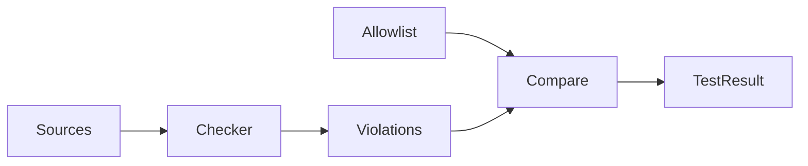

# 設計書

## Overview

**Purpose**: ソースのコメントの基準（残す・削る・判別の仕方）を `.kiro/steering/comments.md` に定め、その基準を検査する仕組み（検査の規則・テスト・許容リスト）を、以後の comments-* の作業の判断の正本として使えるようにする。

**Users**: コードを書く人・読む人（人間・AI エージェント）と、コメントを領域ごとに書き直す comments-* の担当者。

**Impact**: 基準・検査・テスト・許容リストは既に存在する（コミット 165216e）。この設計は、それらの現在の姿を記録する。実装の変更は、`tech.md` の旧の書き方（35 行目）を基準への参照に置き換える 1 件だけである。

### Goals

- 基準の内容と、検査の規則の対応を明確にする（要件 1〜4）
- 既存の違反を許容リストで管理し、新しい違反と解消済みの項目を、テストで失敗させる（要件 5）
- 検査を `npm run test:unit` で実行し、アプリケーションの振る舞いを変えない（要件 6・7）
- 規約の参照を `tech.md` の 1 箇所に集める（要件 8）

### Non-Goals

- 個々のファイルのコメントの書き換え（comments-lib・comments-components-pages・comments-tests・comments-scripts-config・comments-api-schema）
- 基準の内容の変更（別の改訂の作業で行う）
- 「旧」「以前」「移行」「経緯」の機械判定（レビューで判断する）
- 1〜2 行の目的の機械判定

## Boundary Commitments

### This Spec Owns

- 基準の文書 `.kiro/steering/comments.md` の内容（本文が正本）
- 検査の規則 `scripts/architecture/commentRules.ts`（規則の定数・判定関数・対象の列挙・所有 spec の割り当て）
- 検査のテスト `tests/unit/scripts/commentRules.test.ts`（規則の正例と負例、リポジトリ全体の照合）
- 許容リスト `config/comments/allowlist.json` の形式（`version`・`entries`・各項目の `path`・`rule`・`owner`・`reason`）
- `tech.md` の「Code Quality」の節のうち、コメントに関する 1 行（基準への参照）
- `scripts/architecture/commentRules.ts` と `tests/unit/scripts/commentRules.test.ts` は、この spec（comment-policy）が所有する。この 2 ファイル自身のコメントは、検査の違反を 0 件に保つ（検査が自分自身のファイルで通ること。許容リストには登録しない）。

### 既知の例外（所有 spec の割り当て）

- `ownerOf` は `tests/unit/scripts/commentRules.test.ts` を `comments-tests` に割り当てる。このファイルは comment-policy の所有で、`comments-tests` の対象ではない。このファイルの違反は 0 件であり、許容リストに項目を置かない。`ownerOf` の特例化（コードの変更）は comment-policy の作業で行うかを、実装の段階で決める。
- 同じく、`ownerOf` は `scripts/architecture/commentRules.ts` を `comments-scripts-config` に割り当てる。このファイルは comment-policy の所有で、`comments-scripts-config` の対象ではない。このファイルの違反は 0 件であり、許容リストに項目を置かない。この例外も、`ownerOf` の特例化と同じく実装の段階で扱いを決める。

### Out of Boundary

- 許容リストの各項目の解消（comments-* の各 spec が行う）
- 検査の対象のファイルのコメントの本文（comments-* が書き換える）
- 文字列リテラル、振る舞い、API の形、CI の挙動
- `test:e2e` の実行（この spec の完了条件に含めない。最終の統合の段階で comments-api-schema が一度だけ実行する）
- シェルスクリプト（`.githooks`・`.sh`）の自動検査（レビューで見る）
- `tech.md`・`structure.md` の他の規約（それぞれの節の所有者が管理する）

### Allowed Dependencies

- 検査の規則は Node の標準モジュール（`node:fs`・`node:path`）だけに依存する。`src/` を import しない。
- テストは検査の規則と許容リストを読む。テストの実行環境は unit 層（`config/test/vitest.unit.config.ts`）。
- 基準の文書は、規約の全体（構造・命名・import）を `tech.md`・`structure.md` に任せる。
- 後続の 5 つの comments-* spec（comments-api-schema・comments-lib・comments-components-pages・comments-tests・comments-scripts-config）は、すべてこの spec に依存する。この spec の完了が前提の順次の連鎖であり、この spec の基準と検査を使って、各 spec が担当のコメントを書き直す。

### Revalidation Triggers

次の変更は、基準の改訂と comments-* の再確認を伴う。

- 規則の定数（`HEADER_MAX_LINES`・`HEADER_MAX_BULLETS`）または禁止パターン（`FORBIDDEN_PATTERNS`）の変更
- 検査の対象（`ROOTS`・`EXTENSIONS`・`EXCLUDED_PREFIXES`）の変更
- 所有 spec の名前の変更（`commentRules.ts` の `ownerOf`、テストの `OWNERS`）
- 許容リストの形式の変更（`version` または項目の必須フィールド）
- 検査の規則の追加（許容リストの作り直しが必要になる）

## Architecture

### Existing Architecture Analysis

- 検査は、既存の依存規則の検査（`scripts/architecture/check-imports.ts`・`allowlist.ts`）と同じ作りをとる。規則の判定（純粋な関数）・許容リストの照合・テストの三つに分ける。
- 許容リストは、既存の import 検査と同じく、`reason` の記入と解消済みの項目の検出を行う。重複と未知の規則も、このテストで検査する（Open Questions 2）。
- 基準の書き方（目的 1〜2 行・6 行以内）は、`tech.md` の 35 行目の旧の書き方と食い違う。35 行目を置き換える（Modified Files）。

### Architecture Pattern & Boundary Map



- 選択したパターン: 文字列判定の検査（純粋な関数）と、データとしての許容リストを、テストで結ぶ。
- 境界: 検査は判定だけを行い、ファイルの列挙と照合はテストと `findCommentViolations` が行う。許容リストは判定の結果を変えない（違反を許容するだけ）。
- 既存のパターンの維持: 依存規則の検査と同じ「規則・許容リスト・テスト」の三つ組。
- 新しい構成要素の理由: 基準を、人が読む文書（comments.md）と、機械で確かめる規則（commentRules.ts）に分けるため。

### Technology Stack

| Layer      | Choice / Version           | Role in Feature                              | Notes                               |
| ---------- | -------------------------- | -------------------------------------------- | ----------------------------------- |
| 検査の規則 | TypeScript（`tsx` で実行） | 文字列判定、対象の列挙、所有 spec の割り当て | Node の `node:fs`・`node:path` のみ |
| テスト     | Vitest（unit 層）          | 規則の正例・負例、リポジトリ全体の照合       | `npm run test:unit` で実行          |
| 許容リスト | JSON（`version: 1`）       | 既存の違反の記録                             | `config/comments/` に置く           |

## File Structure Plan

### Directory Structure

```
.kiro/steering/
└── comments.md                 # 基準（人が読む文書。正本）
scripts/architecture/
└── commentRules.ts             # 検査の規則（判定・対象・所有 spec・CLI の作り直し）
tests/unit/scripts/
└── commentRules.test.ts        # 規則の正例・負例、リポジトリ全体の照合
config/comments/
└── allowlist.json              # 既存の違反（642 件。所有 spec ごと）
```

### Modified Files

- `.kiro/steering/tech.md` — 「Code Quality」の節の 2 つ目の箇条書き（旧の JSDoc の書き方）を、`comments.md` への参照 1 行に置き換える。参照の 1 箇所だけを持たせ、基準の内容を重複させない。

## System Flows

検査の流れは、上の Architecture の図のとおり。手順は次の 3 段階。

1. 対象のファイル（`collectSources`）を読み、規則（`checkSource`）で違反を列挙する。違反は「ファイル × 規則」の 1 件にまとめる。
2. 許容リストの項目を、`(path, rule)` の組で照合する。許容されていない違反は「新しい違反」、違反していない項目は「解消済み」として分ける。
3. テストは、新しい違反と解消済みの項目がいずれも空であることを確かめる。

## Requirements Traceability

| Requirement | Summary                                                   | Components                    | Interfaces                                      | Flows  |
| ----------- | --------------------------------------------------------- | ----------------------------- | ----------------------------------------------- | ------ |
| 1.1         | 基準の場所と対象の拡張子・ディレクトリ                    | 基準の文書                    | comments.md の「対象」の節                      | —      |
| 1.2         | 除外（生成物・`*.d.ts`・fixture・文字列・シェル）         | 基準の文書、検査の規則        | `EXCLUDED_PREFIXES`、`collectSources`           | 手順 1 |
| 1.3         | 残すもの・書かないものの列挙                              | 基準の文書                    | comments.md の「書く・書かない」の節            | —      |
| 1.4         | 良い例と悪い例                                            | 基準の文書                    | comments.md の「例」の節                        | —      |
| 1.5         | API スキーマの説明文の書式                                | 基準の文書、検査の規則        | `SCHEMA_TEXT_LINE`                              | 手順 1 |
| 1.6         | 日付はバッククォート内の入力例だけ                        | 基準の文書、検査の規則        | `DATE`、`checkSource`                           | 手順 1 |
| 2.1         | 先頭ブロックコメントが無い                                | 検査の規則                    | `headerOf`、`header-missing`                    | 手順 1 |
| 2.2         | import の後・`//` だけは違反                              | 検査の規則                    | `headerOf`                                      | 手順 1 |
| 2.3         | 内容が 6 行超で違反                                       | 検査の規則                    | `HEADER_MAX_LINES`、`header-too-long`           | 手順 1 |
| 2.4         | 箇条書きが 3 件超で違反                                   | 検査の規則                    | `HEADER_MAX_BULLETS`、`header-too-many-bullets` | 手順 1 |
| 2.5         | シェバン・フロントマターの後を認める                      | 検査の規則                    | `headerOf`                                      | 手順 1 |
| 2.6         | 1〜2 行の目的は機械で見ない                               | 検査の規則（対象外）          | —                                               | —      |
| 3.1         | `specs/` を含むコメントで違反                             | 検査の規則                    | `FORBIDDEN_PATTERNS`（spec参照）                | 手順 1 |
| 3.2         | 「要件」＋数字.数字で違反                                 | 検査の規則                    | `FORBIDDEN_PATTERNS`（要件番号）                | 手順 1 |
| 3.3         | AC/FR/NFR タグで違反                                      | 検査の規則                    | `FORBIDDEN_PATTERNS`（AC/FR/NFR）               | 手順 1 |
| 3.4         | cc-sdd で違反（大文字小文字不問）                         | 検査の規則                    | `FORBIDDEN_PATTERNS`（cc-sdd）                  | 手順 1 |
| 3.5         | kiro で始まる語で違反（大文字小文字不問）                 | 検査の規則                    | `FORBIDDEN_PATTERNS`（kiro）                    | 手順 1 |
| 3.6         | 日付は入力例の外で違反                                    | 検査の規則                    | `DATE`、`date`                                  | 手順 1 |
| 3.7         | 同じファイル・規則は 1 件にまとめる                       | 検査の規則                    | `checkSource`（`seen`）                         | 手順 1 |
| 3.8         | API スキーマの `summary`・`description` も検査            | 検査の規則                    | `SCHEMA_TEXT_LINE`                              | 手順 1 |
| 3.9         | コードの行（文字列を含む）は見ない                        | 検査の規則                    | `COMMENT_LINE`                                  | 手順 1 |
| 3.10        | 「旧」「以前」「移行」「経緯」は違反にしない              | 基準の文書（レビュー）        | —                                               | —      |
| 4.1         | 対象のディレクトリと拡張子                                | 検査の規則                    | `ROOTS`、`EXTENSIONS`、`collectSources`         | 手順 1 |
| 4.2         | 除外（生成物・fixture・`*.d.ts`・ドット・`node_modules`） | 検査の規則                    | `EXCLUDED_PREFIXES`、`collectSources`           | 手順 1 |
| 4.3         | ルートからの相対パス（`/` 区切り）で並べる                | 検査の規則                    | `collectSources`（`sort`）                      | 手順 1 |
| 5.1         | 許容リストの項目の形                                      | 許容リスト                    | `AllowEntry`                                    | 手順 2 |
| 5.2         | 許容されていない違反で失敗                                | 検査のテスト                  | `findCommentViolations`、`keyOf`                | 手順 3 |
| 5.3         | 解消済みの項目で失敗                                      | 検査のテスト                  | `keyOf`                                         | 手順 3 |
| 5.4         | 所有 spec と理由の検査                                    | 検査のテスト                  | `OWNERS`                                        | 手順 3 |
| 5.5         | 所有 spec の割り当て規則                                  | 検査の規則                    | `ownerOf`                                       | 手順 2 |
| 5.6         | 作り直しは規則の追加時だけ                                | 基準の文書、検査の規則（CLI） | `--emit-allowlist`                              | —      |
| 5.7         | `(path, rule)` の組で照合                                 | 検査の規則、検査のテスト      | `keyOf`                                         | 手順 2 |
| 6.1         | テストの配置と `npm run test:unit` での実行               | 検査のテスト                  | `config/test/vitest.unit.config.ts`             | —      |
| 6.2         | 固定の本文で正例・負例を確かめる                          | 検査のテスト                  | `checkSource`、`headerOf`                       | —      |
| 6.3         | 判定はパスと本文だけに依存する                            | 検査の規則                    | `checkSource`（純粋な関数）                     | —      |
| 6.4         | 既存の unit テストと同じ条件で通過する                    | 検査のテスト                  | —                                               | —      |
| 7.1         | 実行時の振る舞いを変えない                                | 全構成要素                    | —                                               | —      |
| 7.2         | 基準の内容をこの作業で変えない                            | 基準の文書                    | —                                               | —      |
| 8.1         | `tech.md` から基準への参照を 1 箇所だけ持つ               | `tech.md`（Modified Files）   | —                                               | —      |
| 8.2         | 規約の全体は `tech.md`・`structure.md` に任せる           | 基準の文書                    | comments.md の「関連」の節                      | —      |

## Components and Interfaces

### 検査の規則（`scripts/architecture/commentRules.ts`）

| Component    | Domain/Layer          | Intent                                       | Req Coverage                                            | Key Dependencies (P0/P1)         | Contracts |
| ------------ | --------------------- | -------------------------------------------- | ------------------------------------------------------- | -------------------------------- | --------- |
| commentRules | scripts（運用の検査） | ファイルの本文から、コメントの違反を列挙する | 1.2, 1.5, 1.6, 2.1–2.5, 3.1–3.9, 4.1–4.3, 5.5, 5.6, 6.3 | `node:fs` (P0), `node:path` (P0) | Service   |

#### commentRules

| Field        | Detail                                                           |
| ------------ | ---------------------------------------------------------------- |
| Intent       | 規則の定数・判定関数・対象の列挙・所有 spec の割り当てを提供する |
| Requirements | 1.2, 1.5, 1.6, 2.1–2.5, 3.1–3.9, 4.1–4.3, 5.5, 5.6, 6.3          |

**Responsibilities & Constraints**

- 判定は文字列だけで行う（構文木は使わない）。
- 規則の上限（`HEADER_MAX_LINES` = 6、`HEADER_MAX_BULLETS` = 3）と禁止パターン（`FORBIDDEN_PATTERNS`）を、この 1 か所に置く。
- 違反の種類（`CommentRule`）は、許容リストの `rule` と同じ文字列を使う（`header-missing`・`header-too-long`・`header-too-many-bullets`・`date`・`forbidden:<名前>`）。
- 同じファイル・同じ規則の違反は、最初の 1 件だけを返す。

**Dependencies**

- Inbound: 検査のテスト — 規則の判定と照合（P0）
- Outbound: なし（`node:fs`・`node:path` のみ）
- External: なし

**Contracts**: Service [x] / API [ ] / Event [ ] / Batch [ ] / State [ ]

##### Service Interface

```typescript
type CommentRule =
    | "header-missing"
    | "header-too-long"
    | "header-too-many-bullets"
    | "date"
    | `forbidden:${string}`

type CommentViolation = { path: string; rule: CommentRule; line: number; detail: string }
type AllowEntry = { path: string; rule: CommentRule; owner: string; reason: string }

// ファイルの本文を検査する（パスと本文だけを使う）
checkSource(rel: string, text: string): CommentViolation[]
// 先頭ヘッダを探す（シェバン・フロントマター・空行を飛ばす）。無ければ null
headerOf(lines: string[]): { start: number; content: string[] } | null
// 対象のファイルを、ルートからの相対パスで並べて返す
collectSources(root: string): string[]
// リポジトリ全体の違反（ファイルと規則の組ごとに 1 件）
findCommentViolations(root: string): CommentViolation[]
// 違反と許容項目の照合キー
keyOf(path: string, rule: CommentRule): string
// パスから所有 spec を決める（comments-api-schema・comments-lib・comments-components-pages・comments-tests・comments-scripts-config）
ownerOf(rel: string): string
```

- Preconditions: `rel` はリポジトリのルートからの `/` 区切りのパス。
- Postconditions: `checkSource` は、規則に当たった種類ごとに高々 1 件を返す。
- Invariants: 判定の結果は、引数（パスと本文）だけで決まる。

**Implementation Notes**

- Integration: `--emit-allowlist` を付けて直接実行すると、現在の違反を許容リストの形で標準出力に出す（ファイルは書き換えない）。規則を追加したときだけ使う。
- Validation: 規則の変更は、検査のテストの正例・負例を先に更新する。
- Risks: 文字列リテラルの中の行頭の `*` などを、コメントとして誤判定しうる。

### 検査のテスト（`tests/unit/scripts/commentRules.test.ts`）

| Field        | Detail                                                   |
| ------------ | -------------------------------------------------------- |
| Intent       | 規則の正例・負例と、リポジトリ全体の違反の照合を確かめる |
| Requirements | 5.2, 5.3, 5.4, 5.7, 6.1, 6.2, 6.4                        |

**Responsibilities & Constraints**

- 固定の本文で、先頭ヘッダ・禁止パターン・日付・所有 spec の割り当てを確かめる（正例と負例）。
- リポジトリ全体の違反を `findCommentViolations` で求め、許容リストと照合する（未登録の違反・解消済みの項目・所有 spec と理由）。
- 既知の所有 spec の一覧（`OWNERS`）は、このテストの中に置く。`commentRules.ts` には置かず、`ownerOf` の接頭辞の規則だけを置く。

**Dependencies**

- Inbound: `npm run test:unit`
- Outbound: commentRules（P0）、`config/comments/allowlist.json`（P0）

**Contracts**: Service [ ] / API [ ] / Event [ ] / Batch [ ] / State [ ]

**Implementation Notes**

- Integration: unit 層の設定（`tests/unit/**/*.test.ts`）に含まれる。カバレッジの閾値の対象（P0）には入らない。
- Validation: 許容リストの項目を消すと、テストは「未登録の違反」で失敗する。解消済みの項目を残すと「解消済み」で失敗する。
- Risks: 重複する項目と未知の規則は、このテストで検出する（Open Questions 2）。

### 許容リスト（`config/comments/allowlist.json`）

| Field        | Detail                                         |
| ------------ | ---------------------------------------------- |
| Intent       | 既存の違反を、所有 spec と理由を付けて記録する |
| Requirements | 5.1, 5.7                                       |

**Data Model**

```json
{
  "version": 1,
  "entries": [
    {
      "path": "config/test/stryker.config.mjs",
      "rule": "header-missing",
      "owner": "comments-tests",
      "reason": "コメントの整理（comments-* の spec）で解消する"
    }
  ]
}
```

- `path` は `/` 区切りのリポジトリ相対パス、`rule` は `CommentRule` の文字列、`owner` は 5 つの既知の spec のどれか、`reason` は空でない文字列。
- 現在の件数は 642 件（所有 spec ごとに comments-components-pages 203、comments-tests 198、comments-lib 193、comments-scripts-config 43、comments-api-schema 5）。

### 基準の文書（`.kiro/steering/comments.md`）

| Field        | Detail                                               |
| ------------ | ---------------------------------------------------- |
| Intent       | コメントを残すか削るかの判断を、人が読める形で定める |
| Requirements | 1.1–1.6, 2.6, 3.10, 5.6, 7.2, 8.2                    |

**Responsibilities & Constraints**

- 章立て: 対象・先頭ヘッダ・書くもの書かないもの・API スキーマの説明文・検査・例・関連。
- 本文は日本語。判定の正本であり、検査の規則は、この文書の内容を機械で確かめる。
- 規約の全体（構造・命名・import）は書かず、`tech.md`・`structure.md` を参照する。

## Data Models

許容リストの項目（上の「許容リスト」）が唯一のデータである。ドメインモデルと論理データモデルは持たない。

## Error Handling

- 検査の規則は例外を投げず、違反を配列で返す。ファイルが読めない場合は、テストの実行が失敗する（`readFileSync` の例外）。
- 許容リストが存在しない場合、既存の違反はすべて「未登録の違反」として失敗する。
- 所有 spec が未知、または理由が空の項目は、テストの「不正な項目」として失敗する。

## Testing Strategy

- **Unit（規則の正例・負例）**: 先頭ヘッダの有無・`//` の扱い・行数の上限・箇条書きの上限・シェバンとフロントマター・禁止パターン 5 種・日付のバッククォート・API スキーマの説明文・コードの行を見ないこと・1 件へのまとめ（要件 2.1–2.5、3.1–3.9）。
- **Unit（所有 spec の割り当て）**: `ownerOf` の接頭辞の規則（要件 5.5）。
- **Unit（リポジトリ全体の照合）**: 未登録の違反が無いこと、解消済みの項目が無いこと、所有 spec と理由を持つこと（要件 5.2–5.4、5.7）。
- **非機能**: 判定が引数だけに依存すること（要件 6.3）は、規則の関数が純粋であることの確認で足りる（専用のテストは置かない）。
- **統合**: `npm run test:unit` の通過（要件 6.1・6.4）と、アプリケーションの振る舞いが変わらないこと（要件 7.1）。後者は `test:type`・`test:imports`・`test:unit`・`test:component`・`test:route`・`test:render` で確かめる。`test:e2e` はこの spec の完了条件に含めず、最終の統合の段階（comments-api-schema が担当）で一度だけ実行する。

## Optional Sections

### Security Considerations

該当しない（検査は文字列だけを扱い、秘密情報を読まない）。

### Performance & Scalability

対象は約 1,000 ファイル規模。全体の走査は数秒で終わる想定とし、性能の目標は置かない。

## Open Questions / Risks

1. **`owner` と `ownerOf(path)` の一致**: テストで検査する（要件 5.5、タスク 3.2）。現状は 642 件すべて一致している。
2. **重複と未知の規則**: 許容リストの `(path, rule)` の重複は、テストで検査する（タスク 3.2）。未知の規則は、テストの `rule` の検査で扱う。現状は重複 0 件、未知の規則 0 件。
3. **1〜2 行の目的**: 機械で見ない（要件 2.6）。レビューで判断する。
4. **`tech.md` の旧の書き方**: Modified Files で置き換える。置き換えの位置は「Code Quality」の節とする（brief の「コードの規約」の節は現在の `tech.md` に無いため）。
5. **テストの題名の言語**: テストの題名の言語（英語か、既存の混在を残すか）は、ユーザーの判断待ち。
