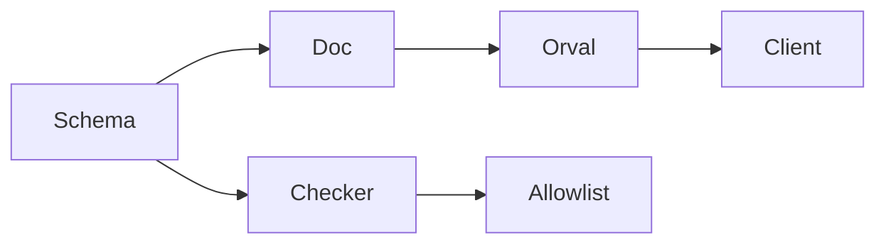
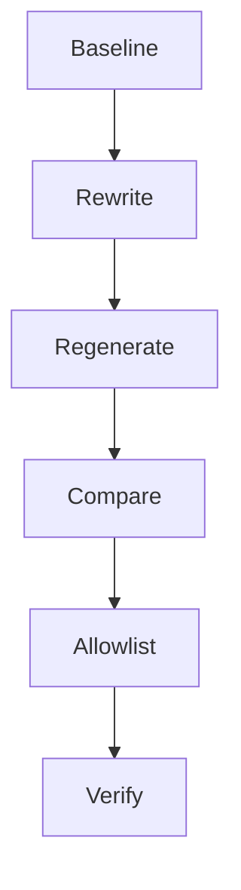

# Design Document

## Overview

**Purpose**: API スキーマ（`src/lib/api/schema`）の説明文と、その中のコメントを、現在の振る舞いと `.kiro/steering/comments.md` の基準に合わせる。直したあとに生成物（`src/client/openapi`）を作り直し、変わったのが説明文だけであることを確かめる。

**Users**: 生成物を読む開発者と AI エージェント。API の使い方を、古い経緯を読まずに判断する。

**Impact**: 生成元の説明文とコメントを直す。生成物のコメントが変わる。型・関数・API の形・バリデーションは変わらない。許容リストから本 spec の 5 件を消す。

**実装可否**: `spec.json` の `ready_for_implementation` は `false`。理由は、前提の comments-lib が未実装のため。comments-lib の完了後、許容リストに所有者 `comments-lib` の項目が残らないことを確かめてから `true` にする。

### Goals

- route の `summary` と zod の `description` が、現在の振る舞いを 1 行で述べる。
- 生成物の差分が、コメント行だけになる。
- 検査（`commentRules`）が `src/lib/api/schema` の違反を報告しなくなり、許容リストの本 spec の 5 件が消える。

### Non-Goals

- API の入出力の形・経路・認可・バリデーションの変更（zod の制約の追加・削除・変更を含む）。
- 生成ツール（`scripts/build/build-openapi-document.ts`、`config/orval.config.ts`）の変更。
- 説明文の言語の変更（英語と日本語の切り替え）。英語の summary は動詞句の文体を保つ（research.md の判断）。
- 生成物（`src/client/openapi`）の手編集。
- `src/lib/api/schema` 以外のコメント（comments-lib などが扱う）。
- 検査の規則の変更（comment-policy の所有）。

## Boundary Commitments

### This Spec Owns

- `src/lib/api/schema/**` のコメント、route の `summary`、zod の `description`、応答の `description` の文言。
- 再生成後の生成物の差分の確認（三つの比較。Requirement 2）。
- 許容リスト（`config/comments/allowlist.json`）の、所有 spec が `comments-api-schema` の項目の削除。

### Out of Boundary

- API の形（経路・リクエストとレスポンスの形・状態コード・認証）と、zod のバリデーション制約。
- `scripts/build/build-openapi-document.ts`、`config/orval.config.ts`、`src/lib/codegen/**`（生成の仕組み）。
- `src/lib/api/schema` 以外のコメント（`src/lib` の他の部分は comments-lib、画面は comments-components-pages）。comments-lib の G1（`api/` 領域）は `src/lib/api/schema` を明示して除外しており、そのディレクトリは本 spec の所有である。
- 検査の規則（`scripts/architecture/commentRules.ts` の `FORBIDDEN_PATTERNS` と `headerOf`）。規則を変えるのは comment-policy。
- 生成物 `src/client/**`（gitignore 対象。再生成の結果だけを扱う）。

### Allowed Dependencies

- **実行の順序（逐次）**: comment-policy → comments-lib → 本 spec のタスク 1（基準の保存：変更前の生成物と OpenAPI の JSON を保存する）→ comments-components-pages / comments-tests / comments-scripts-config → 本 spec の残りのタスク（説明文とコメントの書き換え、再生成と比較、許容リスト、検証）→ 全 comments-* の完了後の e2e（タスク 5.1）。並行しない。`config/orval.config.ts` と `scripts/build/build-openapi-document.ts` は、タスク 1 の基準の保存の後に comments-scripts-config が変える。本 spec の再生成（タスク 3.1）は comments-lib の後に行い、比較はタスク 1 で保存した基準と行う。
- **comment-policy**（前提・完了していること）: 基準の正本（`.kiro/steering/comments.md`）と検査の規則（`scripts/architecture/commentRules.ts`）。本 spec は読むだけ。共通の語の一覧の正本も `comments.md` で、本 spec は spec 固有の語を追加しない。
- **comments-lib**（前提・完了していること）: 順序の依存。`src/lib` の整理の後に行う。`src/lib/api/schema` は comments-lib の対象外（G1 の除外）なので、コードの依存はない。
- **既存の生成パイプライン**: `npm run codegen`（`apigen:doc` と `apigen:client`）。オフラインで動く。
- **zod v4 と zod-openapi**: 説明文の出どころ（`.meta({ description })` と route の `summary`）。

### Revalidation Triggers

- 説明文の変更が、API の形またはバリデーションの変更を必要とする場合（本 spec の範囲外。Requirement 2.4 で報告に挙げる）。
- 生成パイプライン（生成ツールの設定や `buildOpenApiDocument`）の変更。
- 検査の規則の変更（comment-policy の改訂）。
- `src/lib/api/schema` のファイルの追加・移動・削除。

## Architecture

### Existing Architecture Analysis

- 生成の流れ: `src/lib/api/schema`（zod）→ `buildOpenApiDocument()`（OpenAPI の JSON を作る）→ orval（TypeScript の生成）→ `src/client/openapi`。
- 生成物に出る文字列は二つだけ。route の `summary` は `client.ts` の `@summary`（35 件）に、zod の `description` は `model/*.ts` の JSDoc に出る。
- 応答の `description`、schema ファイルの JSDoc や `//` コメントは、生成物に出ない。
- 検査（`commentRules`）は `src/lib/api/schema` を、ファイル単位の規則（ヘッダ・日付・禁止パターン）で見る。`summary:` と `description:` の行は、引用符が同じ行にあるものだけ見る。

### Architecture Pattern & Boundary Map

本 spec は新しい構成要素を作らない。文字列の変更と、既存の生成・検査の再実行だけである。

- **Schema**: `src/lib/api/schema`（本 spec が直す）。
- **Doc**: `buildOpenApiDocument()` の出力（OpenAPI の JSON）。比較に使う。
- **Client**: `src/client/openapi`（再生成の結果。比較に使う）。
- **Checker** と **Allowlist**: 検査と許容リスト。本 spec は許容リストの 5 件を消す。

**Architecture Integration**:

- Selected pattern: 生成元の文字列を直して再生成する（既存の流れのまま）。
- Existing patterns preserved: 生成物を手で編集しない。生成ツールを変えない。
- New components rationale: なし。

### Technology Stack

| Layer      | Choice / Version                              | Role in Feature                  | Notes          |
| ---------- | --------------------------------------------- | -------------------------------- | -------------- |
| Schema     | zod v4（`zod/v4`）、zod-openapi               | 説明文と制約の出どころ           | 制約は変えない |
| Generation | orval v8.32.0、tsx                            | `npm run codegen` で生成物を作る | 既存のまま     |
| Test       | vitest（unit・component・route・render）、tsc | 検証                             | 既存のまま     |

## File Structure Plan

### Modified Files

- `src/lib/api/schema/` 配下の 36 ファイル — `summary`・`description` の文言とコメントを直す。対象は、`summary` または `description` を持つ全ファイル（一覧は tasks に示す）。`src/lib/api/schema` の全 38 ファイルのうち、残る 2 ファイルは `index.ts`（経路の割り当て表）と `v2/surveys/[surveyId]/path.ts`（契約の再エクスポート）で、`summary`・`description` を持たず、生成物にも出ない。文言の対象からは外すが、コメントは検査の対象に含む（先頭ヘッダと禁止パターンは検査が通ることを確かめている）。
- `src/lib/api/schema/v2/bsky/video/upload-token/post.ts`、`src/lib/api/schema/v2/entries/get.ts`、`src/lib/api/schema/v2/entry/delete.ts`、`src/lib/api/schema/v2/entry/post.ts` — 許容リストの 5 件の違反（スペック参照、AC タグ、先頭ヘッダの行数）を解消する。上の 36 ファイルに含まれる。
- `config/comments/allowlist.json` — 所有 spec が `comments-api-schema` の 5 件を消す。他の項目は変えない。

### Generated Files (regenerated, not edited)

- `src/client/openapi/**` — `npm run codegen` で作り直す。gitignore 対象で、差分には出ない。

### Work Artifacts (outside the repository)

- 変更前の生成物のコピー、変更前後の OpenAPI の JSON、比較の結果は作業ディレクトリ（scratchpad）に置く。リポジトリには追加しない。

## System Flows

- **Baseline**: 変更前に `npm run codegen` を実行し、生成物と OpenAPI の JSON を保存する（変更前の基準）。
- **Compare**: 三つの比較（Requirement 2）を行う。一つでも非コメントの差分があれば、その項目を戻すか、報告に挙げる。
- **Allowlist**: 検査が違反を報告しなくなったら、所有 spec が `comments-api-schema` の項目を消す。検査の `--emit-allowlist` で許容リストを作り直さない（既存の違反を黙って許容するため）。

## Requirements Traceability

| Requirement | Summary                                                       | Components               | Interfaces                                                      | Flows      |
| ----------- | ------------------------------------------------------------- | ------------------------ | --------------------------------------------------------------- | ---------- |
| 1.1         | 説明文が現在の振る舞いを述べる                                | 説明文の監査             | 実装の handler（`src/pages/v1`・`src/pages/v2`）                | Rewrite    |
| 1.2         | 食い違う説明文を直す                                          | 説明文の監査             | 同上                                                            | Rewrite    |
| 1.3         | 説明文は 1 行・現在形（動詞句）                               | 説明文の書式             | 生成物の `@summary`・JSDoc                                      | Compare    |
| 1.4         | 説明文に数値の上限を文章で書かず、上限は zod の制約だけで表す | zod 制約の単一の出どころ | `.max` などの zod の制約                                        | Rewrite    |
| 2.1         | `npm run codegen` が成功する                                  | 生成と比較               | `npm run codegen`                                               | Regenerate |
| 2.2         | 生成物の差分はコメント行だけ                                  | 生成と比較               | 生成物の比較（比較 1）                                          | Compare    |
| 2.3         | API の形と検証制約は変わらない                                | 生成と比較               | OpenAPI の JSON の比較（比較 2）と schema の git 差分（比較 3） | Compare    |
| 2.4         | 形の変更が必要なら、変えずに報告する                          | 説明文の監査             | 差分の報告                                                      | Rewrite    |
| 3.1         | 禁止パターンを含まない                                        | コメント基準の適用       | 検査と全行 grep                                                 | Rewrite    |
| 3.2         | 先頭ヘッダは 6 行以内・箇条書き 3 件以内                      | コメント基準の適用       | 検査（`headerOf`）                                              | Rewrite    |
| 3.3         | 現在の振る舞いと理由を述べる                                  | コメント基準の適用       | 目視の判定                                                      | Rewrite    |
| 3.4         | 判別に迷うものは残し、報告する                                | コメント基準の適用       | 差分の報告                                                      | Rewrite    |
| 4.1         | 検査は `src/lib/api/schema` の違反を報告しない                | 検証                     | `commentRules` の検査                                           | Verify     |
| 4.2         | 許容リストに本 spec の項目が残らない                          | 許容リスト               | `allowlist.json`                                                | Allowlist  |
| 4.3         | `npm run test:unit` が通る                                    | 検証                     | vitest unit                                                     | Verify     |
| 4.4         | `npm run test:type` と `npm run test:imports` が通る          | 検証                     | tsc、`check-imports.ts`                                         | Verify     |

## Components and Interfaces

本 spec は新しいコード部品を作らない。作業の単位と、その検証方法を示す。

| 作業単位                 | Intent                                                                                                                                         | Requirements  | 検証の方法                                                                | Dependencies                                      |
| ------------------------ | ---------------------------------------------------------------------------------------------------------------------------------------------- | ------------- | ------------------------------------------------------------------------- | ------------------------------------------------- |
| 説明文の監査             | route の `summary`、zod の `description`、応答の `description` が、実装と一致するかを確かめる                                                  | 1.1, 1.2, 2.4 | 各説明文の主張を、実装の handler または `src/lib` の 1 箇所以上で確かめる | 実装（`src/pages/v1`・`src/pages/v2`・`src/lib`） |
| 説明文の書式             | 生成物の説明文が 1 行で、禁止パターンを含まないことを確かめる                                                                                  | 1.3           | 生成物の `@summary` と JSDoc を検査する                                   | 生成物                                            |
| zod 制約の単一の出どころ | `summary`・`description` に数値の上限の文章が無いことを確かめ（決定を参照）、同じ項目の zod の制約（`.max`・`.min`）が残っていることを確かめる | 1.4, 2.3      | 説明文の全行の検索（数値と上限の語）と、`.max`・`.min` の残存の確認       | schema                                            |
| コメント基準の適用       | schema ファイルのコメントを基準に合わせる                                                                                                      | 3.1–3.4       | 検査、全行の grep、目視の判定                                             | `comments.md`                                     |
| 生成と比較               | 再生成し、変更が説明文に限られることを確かめる                                                                                                 | 2.1, 2.2, 2.3 | 比較 1〜3（後述）                                                         | `npm run codegen`                                 |
| 許容リスト               | 解消した本 spec の 5 件を消す                                                                                                                  | 4.2           | 検査の結果と照合する                                                      | `allowlist.json`                                  |
| 検証                     | 検査と既存のテストを実行する                                                                                                                   | 4.1, 4.3, 4.4 | 検査、`test:unit`、`test:type`、`test:imports`                            | —                                                 |

**説明文の監査の方法**: 監査は、各 route の `summary` と各 zod の `description` を対象にする。主張（対象、副作用、認証など）を、実装の 1 箇所で確かめる。数値の上限は文章に書かず、zod の制約で表す（決定を参照）。結果は、ずれたものと判断に迷うものだけを `research.md` に記録する。確かめられない主張は、残して報告する。

**比較の方法**（Requirement 2）:
生成物（`src/client/openapi`）は gitignore のため git では比べられない。基準は、変更前に作った写し（タスク 1.1）である。

1. **比較 1（生成物）**: 変更後に `npm run codegen` を実行し、写しと `diff -r` で比べる。差分の行から、コメント行（行頭が `*`、`/**`、`//`）と説明文の値の行を除く。残りが空であること（つまり、変わったのはコメントと説明文だけ）。ファイルの増減が無いこと。
2. **比較 2（OpenAPI の JSON）**: `buildOpenApiDocument()` の出力を、変更前後で保存して比べる。変わったキーの名前は、すべて `summary` または `description` であること。`maxItems` などの制約の値が変わっていないこと。
3. **比較 3（schema の差分）**: `src/lib/api/schema` の git 差分を取る。変わった行は、コメント行か、`summary` または `description` の値の行であること。

三つのうち一つでも違反すれば、その項目を戻すか、報告に挙げる（Requirement 2.4）。

## Data Models

本 spec は、データのモデルを変えない。zod の制約は、追加・削除・変更しない。

## Error Handling

### Error Strategy

- 監査で実装との食い違いが見つかり、説明文を直せない場合（直すと実装の変更が要る場合）は、説明文を残し、差分の報告に挙げる。
- 比較で非コメントの差分が出た場合は、その変更を戻す。説明文の変更で、形や制約が変わることは、設計上許さない。
- 検査が違反を報告する場合は、その箇所を直す。許容リストへ項目を足して通すことはしない。

## 決定

**選択: 案 B（数値の上限を文章に書かない）**。`summary`・`description` の文字列から、数値の上限（件数・文字数・期間・回数）の文章を取り除く。上限は zod の制約（`.max` など）だけで書く。

- **理由**: `.kiro/steering/comments.md` の「制約（最小・最大・件数など）は文章ではなく zod で書く」に従う。文章の上限は、zod の制約と食い違うと直す箇所が二つになる。
- **生成物**: zod の制約は、生成物に `@maxItems` などとして自動で出る。文章を消しても、生成物の制約は消えない。
- **clamp の理由**: サーバ側の防御的な clamp は振る舞いであり、説明文には書かない。その理由は `src/lib/atproto/gate.ts`（comments-lib の対象）に残る。
- **挙動の変更**: なし。文章を消すだけで、zod の制約・API の形・型は変えない。生成物の差分は説明文の行だけになる。
- **既知の留意点**: `listUris` の「allowMentioned/allowFollower/allowFollowing と合計」の範囲は、zod の `.max(5)`（`listUris` 単体の件数）では表せない。合計の規則は `gate.ts` に残る。`createFeedback` の「1 分 1 件」は zod の制約ではないため、説明文から消えると生成物にも出なくなる。どちらも差分の報告に挙げる。
- **対象の一覧**: research.md の「数値の上限の文章（取り除く対象）」に、ファイルと行を記録する。

基準の正本（`.kiro/steering/comments.md`）は変えない。

## Testing Strategy

- **Unit**: `tests/unit/scripts/commentRules.test.ts`（規則と許容リストの整合）と、`npm run test:unit` 全体。
- **Type and imports**: `npm run test:type`、`npm run test:imports`。
- **Component、route、render**: `npm run test:component`、`npm run test:route`、`npm run test:render`。route の層は、schema の検証を経由する API を動かすため、制約が変わっていないことの確認になる。
- **Generation comparison**: 比較 1〜3（前述）。
- **E2E**: 本 spec が所有する最終の統合工程（タスク 5.1）。`npm run test:e2e` は comments-* 全体の実装が終わった後に、一度だけ実行する（途中の spec の完了ごとには実行しない）。e2e の prettier の工程が作った整形差分のうち、comments-* の単位の外の整形差分だけを戻す（他は触らない）。
- **Schema text coverage**: 検査が見ない複数行の値のために、`src/lib/api/schema` の全行を `FORBIDDEN_PATTERNS` で grep する（検査の盲点の補い。タスク 2.6）。
