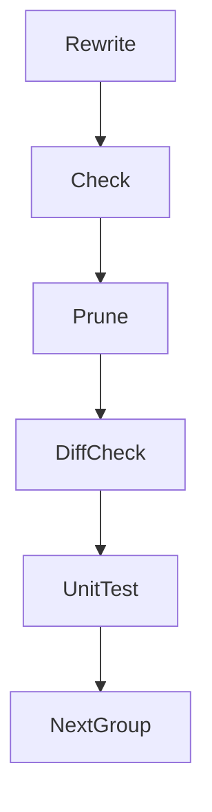

# 設計書

## Overview

`src/components`・`src/pages`・`src/` 直下・`src/types`・`src/util`・`src/styles` のコメントを、コメントの基準（`.kiro/steering/comments.md`）に従って書き直す。書き直しの単位は 9 つのグループ（G1〜G9）で、グループごとに、書き換え・検査・許容リストの項目の削除・コメントだけの変更の確認を行う。最後に全体の検証（G10）を行う。

**Purpose**: コードを読む人（人間・AI エージェント）が、各ファイルの目的・制約・理由を、経緯を読まずに判断できるようにする。
**Users**: このリポジトリで部品・画面・API を保守する開発者と、コードを読むエージェント。
**Impact**: 範囲のコメントが、旧 spec への参照・cc-sdd への言及・経緯を含まなくなる。範囲の許容リストの項目（203 件）が 0 件になる。コードの動きは変わらない。

### Goals

- 範囲の全ファイルが、先頭ヘッダの規則と禁止パターンの規則を満たす（検査が 0 件）。
- 経緯の語（「以前は」「かつて」「旧」「移行」「経緯」）を、現在の振る舞いと理由の記述に直す。
- 書き換えたコメントの主張を、対応するコードで確かめる。
- コードの行・文字列リテラル・ファイルの配置を変えない。
- 全テストが通過する。

### Non-Goals

- 基準（`comments.md`）の内容を変える。検査の規則を変える。許容リストを機械的に作り直す。
- `src/lib`・`tests`・`scripts`・`config`・`src/client` のコメント（他の comments-* spec の範囲）。
- 各 `README.md` の内容（文書であり、コメントの基準の対象ではない）。
- 部品の配置の変更（`structure-components.md` の規約のまま）。
- 機能の追加・改善・リファクタリング。

## 実装の前提と状態

- **先行 spec（comment-policy）**: この spec は、comment-policy が作る基準（`.kiro/steering/comments.md`）・検査（`scripts/architecture/commentRules.ts`）・許容リスト（`config/comments/allowlist.json`）の仕組みを前提にする。comment-policy は未実装であるため、この spec は実行しない。
- **`ready_for_implementation` は false**: 理由は、先行の comment-policy が未実装であること。comment-policy が実装された後に、true に戻す。
- **実行の順序**: この spec は comment-policy と comments-lib の後に実行する（roadmap の Phase 7 の順序）。comments-* の spec は共有の許容リスト（`config/comments/allowlist.json`）を使うため、並列にせず、直列に実行する。この spec の中のグループ（G1〜G9）も直列である。

## Boundary Commitments

### This Spec Owns

- 範囲内のファイルのコメント（`//`・`/* */`・JSDoc・HTML コメント・`{/* */}`）と、先頭ヘッダ。
- 範囲内の CSS のコメントと、`src/global.d.ts` のコメント（禁止パターンと経緯の語に限る）。
- 許容リストのうち、所有が `comments-components-pages` の項目（範囲内のパスのものだけ）。

### Out of Boundary

- `src/lib/**`・`src/lib/api/schema/**`・`src/client/**`（生成物）・`tests/**`・`config/**`・`scripts/**`・`hack/**`・`.githooks/**`。これらの許容リストの項目（所有が他の comments-* のもの）には触れない。
- 検査の規則（`scripts/architecture/commentRules.ts`）、検査のテスト、基準の文書。
- 文字列リテラル（UI 文言・エラー文言）、コードの行、ファイルの配置・名前。
- 各 `README.md`。

### Allowed Dependencies

- **comment-policy（先行 spec）**: 基準・検査・許容リストの仕組みを提供する。この spec は、その実装の後に実行する。
- 検査の本体（`scripts/architecture/commentRules.ts`）の判定を、読み取りだけに使う（検査の出力を、対象のパスで絞って見る）。
- 基準（`.kiro/steering/comments.md`）を判断の正本とする。
- コードの現在の振る舞いを確かめるための読み取り（同じ範囲と、その範囲が import する `src/lib` の読み取り）。

### Revalidation Triggers

- 基準（`comments.md`）の変更、または検査の規則の追加・変更（許容リストの作り直しが必要になるため、この spec を見直す）。
- 範囲の外のファイルへの変更の必要が生じたとき（範囲を広げる前に、担当の spec に移す）。
- 許容リストの他の所有（comments-lib など）の項目を消す必要が生じたとき。

## Architecture

### Existing Architecture Analysis

- 検査は `scripts/architecture/commentRules.ts`（文字列だけで判定）。テストは `tests/unit/scripts/commentRules.test.ts`。許容リストは `config/comments/allowlist.json` の 1 ファイル。
- 許容リストの照合は「パスと規則の組」で行う。ファイルを直すと、そのファイルの項目は解消済みになり、テストが失敗する（stale）。したがって、ファイルの修正と項目の削除は同じ段階で行う。
- 検査の対象外（CSS・`*.d.ts`）は、禁止パターンと経緯の語を grep で確かめる。CSS には先頭ヘッダを要求しない。この grep はレビューの確認であり、検査（`commentRules.ts`）の判定ではない。

### Architecture Pattern & Boundary Map

作業は直列のグループで行う（許容リストが 1 つの JSON であるため）。comments-* の spec 同士も、同じ許容リストを使うため、並列に実行せず直列に実行する。各グループの段階は次の順序で行う。



- **Rewrite**: グループのファイルのコメントを基準に従って書き直す（先頭ヘッダを含む）。
- **Check**: 検査の出力を、グループのパスで絞り、0 件であることを確かめる。
- **Prune**: グループのパスの項目を、許容リストから消す（所有が `comments-components-pages` のものだけ）。
- **DiffCheck**: グループのパスに対する `git diff` の変更行が、コメントの行と空行だけであることを確かめる。
- **UnitTest**: `commentRules.test.ts` が通過することを確かめる。

**Architecture Integration**:

- Selected pattern: グループの直列処理（段階ごとに検査と許容リストを同期）。
- Domain/feature boundaries: グループは、ディレクトリの領域（`structure-components.md` の領域）で分ける。グループ間でファイルは共有しない。
- Existing patterns preserved: 先頭ヘッダの形（`/** … */`）、部品フォルダの規約、既存の命名。
- New components rationale: 新しい部品・API・データは作らない。
- Steering compliance: `comments.md`（コメントの基準）、`structure-components.md`（配置）、`testing.md`（検証の層）。

### Technology Stack

該当なし（既存のツールだけを使う。TypeScript・Astro・CSS のコメントを書き換えるのみ）。検証は `npm run` のスクリプトと `npx tsx`・`npx vitest`・`git diff` を使う。

## File Structure Plan

### Directory Structure

作業の対象は既存のファイルだけ（新規作成・削除・移動はしない）。

```
src/
├── components/
│   ├── common/          # G1（dialog・input・list・media・section・select の部品）
│   ├── composer/        # G2（ThreadComposer の中心）・G3（ThreadComposer の子部品・PostGateDialog）
│   ├── timeline/        # G4
│   ├── account/         # G5（account・entry・image・schedule）
│   ├── entry/           # G5
│   ├── image/           # G5
│   ├── schedule/        # G5
│   ├── settings/        # G6（settings・share・feedback・help・privacy・i18n・layout）
│   ├── share/           # G6
│   ├── feedback/        # G6
│   ├── help/            # G6
│   ├── privacy/         # G6
│   ├── i18n/            # G6
│   └── layout/          # G6
├── pages/
│   ├── *.astro, entries/, posts/   # G7
│   └── oauth/, v1/, v2/            # G8
├── env.ts, vars.ts, worker.ts, middleware.ts, global.d.ts  # G9
├── types/               # G9
├── util/                # G9
└── styles/              # G9（CSS のみ）
```

### Modified Files

- 許容リストの対象のファイル（144 件）の一覧は `research.md` の「グループとファイル」に置く（グループごとの件数は次のとおり）: G1 19 件・G2 15 件・G3 18 件・G4 18 件・G5 17 件・G6 16 件・G7 9 件・G8 24 件・G9 8 件（合計 144 件）。
- 許容リストの対象外で、経緯の語・禁止パターンを確かめる対象: 各グループのディレクトリに含まれる `.css`（`src/components/**` と `src/styles/**`）・`src/global.d.ts`・`src/types/**`・`src/util/utf8Bytes.ts`（`research.md` の G9 の注記）。
- 変更するファイル: `config/comments/allowlist.json`（所有が `comments-components-pages` の項目を消すだけ）。

## Requirements Traceability

| Requirement | Summary                                                                       | Components | Interfaces                                               | Flows           |
| ----------- | ----------------------------------------------------------------------------- | ---------- | -------------------------------------------------------- | --------------- |
| 1.1         | 先頭ヘッダを持つ                                                              | G1〜G9     | 検査の出力                                               | Rewrite → Check |
| 1.2         | 先頭ヘッダの違反を解消                                                        | G1〜G9     | 検査の出力                                               | Rewrite → Check |
| 1.3         | ヘッダを 6 行以内                                                             | G1〜G9     | 検査の出力（`header-too-long`）                          | Rewrite → Check |
| 1.4         | 箇条書きを 3 件以内                                                           | G1〜G9     | 検査の出力（`header-too-many-bullets`）                  | Rewrite → Check |
| 1.5         | 逐条の説明・言い換えを書かない                                                | G1〜G9     | レビュー（基準の節）                                     | Rewrite         |
| 1.6         | import の順序を変えない                                                       | G1〜G9     | DiffCheck                                                | DiffCheck       |
| 2.1         | `specs/` の参照を含まない                                                     | G1〜G9     | 検査の出力（`forbidden:spec参照`）                       | Check           |
| 2.2         | 要件番号を含まない                                                            | G1〜G9     | 検査の出力（`forbidden:要件番号`）                       | Check           |
| 2.3         | AC/FR/NFR のタグを含まない                                                    | G1〜G9     | 検査の出力（`forbidden:AC/FR/NFRタグ`）                  | Check           |
| 2.4         | cc-sdd・kiro への言及を含まない                                               | G1〜G9     | 検査の出力（`forbidden:cc-sdd`・`forbidden:kiro`）、grep | Check           |
| 2.5         | 日付はバッククォートの中だけ                                                  | G1〜G9     | 検査の出力（`date`）、grep                               | Check           |
| 2.6         | CSS・`*.d.ts` も 2.1〜2.5 に当たらない                                        | G9         | grep                                                     | 最終検証        |
| 3.1         | 経緯を現在形の理由に直す                                                      | G1〜G9     | レビュー、grep（経緯の語）                               | Rewrite         |
| 3.2         | 決定の日付・決定者を現在の制約に直す                                          | G1〜G9     | レビュー、grep                                           | Rewrite         |
| 3.3         | 正当な用法の語は残し、報告する                                                | G1〜G9     | レビュー（報告）                                         | Rewrite         |
| 3.4         | 書き直しをコードで確かめる                                                    | G1〜G9     | レビュー（コードの読み取り）                             | Rewrite         |
| 4.1         | 非自明な理由を残す                                                            | G1〜G9     | レビュー                                                 | Rewrite         |
| 4.2         | 公開 API の使い方（シグネチャで分からないこと）を残す                         | G1〜G9     | レビュー                                                 | Rewrite         |
| 4.3         | 外部仕様への参照を残す                                                        | G1〜G9     | レビュー                                                 | Rewrite         |
| 4.4         | コードの言い換えを削る                                                        | G1〜G9     | レビュー                                                 | Rewrite         |
| 4.5         | 担当者・期限のない TODO を削る、または直す                                    | G1〜G9     | レビュー、grep（`TODO`）                                 | Rewrite         |
| 4.6         | 機械指示のコメントを変えない                                                  | G1〜G9     | DiffCheck                                                | DiffCheck       |
| 4.7         | 判別に迷うものは残し、報告する                                                | G1〜G9     | 完了の報告                                               | Rewrite         |
| 5.1         | コードの行を変えない                                                          | G1〜G9     | DiffCheck                                                | DiffCheck       |
| 5.2         | ファイルの追加・削除・移動・改名をしない                                      | G1〜G10    | `git status`                                             | 最終検証        |
| 5.3         | 文字列リテラルを変えない                                                      | G1〜G9     | DiffCheck                                                | DiffCheck       |
| 5.4         | 差分がコメントと空行だけであることを各段階で確かめる                          | G1〜G9     | DiffCheck                                                | DiffCheck       |
| 6.1         | 範囲のファイルを直したら、その項目を同じ段階で消す                            | G1〜G9     | Prune                                                    | Prune           |
| 6.2         | 所有が `comments-components-pages` の項目を 0 件にする                        | G10        | 許容リストの確認                                         | 最終検証        |
| 6.3         | 他の所有の項目に触れない                                                      | G1〜G10    | `git diff`（allowlist.json）                             | DiffCheck       |
| 6.4         | 許容リストに項目を追加しない                                                  | G1〜G10    | `git diff`（allowlist.json）                             | DiffCheck       |
| 6.5         | 許容リストを機械的に書き出さない                                              | G1〜G10    | 作業手順                                                 | Prune           |
| 7.1         | 段階ごとに、グループの違反が 0 件                                             | G1〜G9     | Check                                                    | Check           |
| 7.2         | 段階ごとに、`npm run test:unit` が通る                                        | G1〜G9     | UnitTest                                                 | UnitTest        |
| 7.3         | 全体で、型・imports・component・route・render が通る（lexicon・e2e は対象外） | G10        | 各テストのスクリプト                                     | 最終検証        |
| 7.4         | CSS・`*.d.ts` を grep で確かめる                                              | G9・G10    | grep                                                     | 最終検証        |
| 7.5         | 完了の報告の内容                                                              | G10        | 完了の報告                                               | 最終検証        |

## Components and Interfaces

新しいインターフェース・API・データ契約は作らない。以下の「コンポーネント」は、作業のグループである。

| Component                       | Domain/Layer         | Intent                                                                                   | Req Coverage                                                              | Key Dependencies    | Contracts |
| ------------------------------- | -------------------- | ---------------------------------------------------------------------------------------- | ------------------------------------------------------------------------- | ------------------- | --------- |
| G1 common                       | 基盤の部品           | 汎用部品のコメントを書き直す（19 件）                                                    | 1.1〜1.6, 2.1〜2.6, 3.1〜3.4, 4.1〜4.7, 5.1〜5.4, 6.1, 6.3〜6.5, 7.1, 7.2 | 基準（P0）          | なし      |
| G2 composer core                | 投稿フォームの中心   | `ThreadComposer` の中心と hooks・rules を書き直す（15 件）                               | 同上                                                                      | 基準（P0）・G1 の後 | なし      |
| G3 composer children            | 投稿フォームの子部品 | `ThreadComposer` の子部品と `PostGateDialog` を書き直す（18 件）                         | 同上                                                                      | 基準（P0）・G2 の後 | なし      |
| G4 timeline                     | タイムライン         | `timeline` の部品を書き直す（18 件）                                                     | 同上                                                                      | 基準（P0）・G3 の後 | なし      |
| G5 account-entry-image-schedule | 業務の部品           | `account`・`entry`・`image`・`schedule` を書き直す（17 件）                              | 同上                                                                      | 基準（P0）・G4 の後 | なし      |
| G6 settings-share-layout        | 業務の部品と骨格     | `settings`・`share`・`feedback`・`help`・`privacy`・`i18n`・`layout` を書き直す（16 件） | 同上                                                                      | 基準（P0）・G5 の後 | なし      |
| G7 pages-astro                  | 画面の入口           | `src/pages` の `.astro` を書き直す（9 件）                                               | 同上                                                                      | 基準（P0）・G6 の後 | なし      |
| G8 pages-api                    | API の入口           | `src/pages/oauth`・`v1`・`v2` を書き直す（24 件）                                        | 同上                                                                      | 基準（P0）・G7 の後 | なし      |
| G9 root-types-util-styles       | 共通の入口と型と CSS | `src/` 直下・`types`・`util`・`styles`・`global.d.ts` を書き直す（8 件 ＋ 検査外）       | 同上（2.6・7.4 を含む）                                                   | 基準（P0）・G8 の後 | なし      |
| G10 final                       | 全体                 | 全体の検証と報告                                                                         | 6.2・7.3・7.4・7.5                                                        | G1〜G9              | なし      |

### 段階の完了条件（各グループ共通）

- Check: 検査の出力のうち、グループのパス（前方一致）に当たる項目が 0 件。
- Prune: 許容リストのうち、グループのパスで所有が `comments-components-pages` の項目が 0 件。
- DiffCheck: 次の出力が空であること（グループのディレクトリを指定する）。
  `git diff -U0 -- <グループのディレクトリ> | grep -E '^[+-]' | grep -vE '^(\+\+\+|---)' | grep -vE '^[+-][[:space:]]*($|//|/\*|\*|\{/\*|<!--)'`
  - 出力が残るものは、コードの行か、機械指示の行の変更である。コメントの行なら、判断を確かめる。
- UnitTest: `npx vitest run -c config/test/vitest.unit.config.ts tests/unit/scripts/commentRules.test.ts --coverage.enabled=false` が通過する（段階ごとの確認。全体の `npm run test:unit` は各段階の終わりに行う）。
- 経緯の語の確認: グループのディレクトリで、`以前|かつて|旧|移行|経緯` を grep し、残ったものを判断する（正当な用法は残し、報告に挙げる）。

### G10（全体の検証）

- `npm run test:type`・`npm run test:imports`・`npm run test:unit`・`npm run test:component`・`npm run test:route`・`npm run test:render` が通過する。`npm run test:e2e` は含めない（最終の e2e 実行は comments-api-schema が担う）。
- 許容リストの所有が `comments-components-pages` の項目が 0 件。`git diff --stat -- config/comments/allowlist.json` で、他の所有の項目が変わっていない。
- `git status` で、範囲の外・ファイルの追加・削除・移動が無い。
- CSS と `global.d.ts` の検索（禁止パターン・経緯の語）の結果を、報告に含める。

## Testing Strategy

- **検査（unit）**: `commentRules.test.ts` が、許容リストの照合（未登録の違反・解消済みの項目）を確かめる。段階ごとに実行。
- **型（type）**: `tsc --noEmit`。コメントだけの変更のため、型は変わらないことを確かめる。
- **imports**: `check-imports.ts`。import の行は変えないが、全体で確かめる。
- **component・route・render**: 振る舞いが変わっていないことを、既存のテストで確かめる。e2e は、この spec の検証には含めない（最終の e2e 実行は comments-api-schema が担う）。
- **レビュー**: 書き換えたコメントの主張を、対応するコードで読んで確かめる（3.4）。判別に迷うものは残し、報告に挙げる（4.7）。

## Error Handling

- 検査が失敗した（未登録の違反・解消済みの項目）: その段階の修正を見直す。許容リストを機械的に書き出して直さない。
- DiffCheck で、コードの行の変更が出た: その行を元に戻す。機械指示の行が消えていれば、戻す。
- DiffCheck で、自分の単位の外の整形差分（formatter の副作用など）が出た: comments-* の単位の外の整形差分だけを戻す。自分の単位の中の書き換えは残す。
