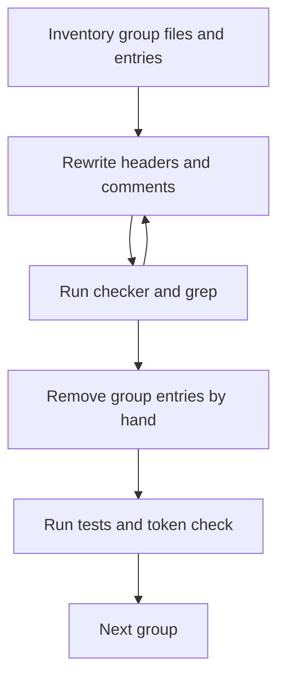

# 設計書

## Overview

`src/lib`（`api/schema` を除く）の 223 ファイルのコメントを、`.kiro/steering/comments.md` の基準に従って書き直す。書き直しの後、許容リストの所有者 `comments-lib` の項目 193 件（116 ファイル）を消し、検査（`commentRules.ts` とそのテスト）を通す。

**Purpose**: 読む人（開発者・AI エージェント）が、コメントから現在の振る舞いと理由を読み取れるようにする。
**Users**: `src/lib` を読んで変更する開発者と、そのコードを扱う AI エージェント。
**Impact**: コメントの文字だけが変わる。コードの動き、export、import、API の形、生成物は変わらない。許容リストは 642 件から 449 件になる。

### Goals

- 223 ファイルの先頭ヘッダと、コメントの行を基準に合わせる。
- `comments-lib` の許容リストの項目を 0 件にし、検査とテストを通す。
- 字句の比較で、コメント以外の行が変わっていないことを確かめる。

### Non-Goals

- `src/lib/api/schema` の説明文（comments-api-schema）。
- 基準（`comments.md`）、検査の本体、テスト、`tech.md` の記述の改訂。
- 層の規約（`structure-lib.md`）と領域の構成。
- 文字列リテラル（UI 文言・エラー文言）の変更。

## 実装の前提

- **保留の理由**: 前提の comment-policy の作業 4.1（`tech.md` の「Code Quality」を基準への参照に揃える）が未実施である。このため、この spec の実装は始めない。`spec.json` の `ready_for_implementation` は `false` とする。
- **実行の順序**: comment-policy → comments-lib（本 spec）→ comments-api-schema の作業 1（変更前の基準の記録）→ comments-components-pages・comments-tests・comments-scripts-config → comments-api-schema の残りの作業。全ての comments-* は同じ許容リスト（`config/comments/allowlist.json`）を手で編集するため、並列にせず、本 spec と直列に行う。
- **対象外の明示**: `src/lib/api/schema` は本 spec の対象外で、comments-api-schema が担当する（本 spec の後に行う）。

## Boundary Commitments

### This Spec Owns

- `src/lib/**`（`src/lib/api/schema/**` を除く）の 223 ファイルのコメント（`//`・`/* */`・JSDoc の先頭ヘッダを含む）。
- 許容リストから、所有者 `comments-lib` の項目 193 件を削除すること。
- 各グループの完了時の検証の記録（完了の報告）。

### Out of Boundary

- `src/lib/api/schema/**`（comments-api-schema）。本 spec の対象外で、G1 の `api` の 5 ファイルは `api/schema` を含まない。
- `src/components`・`src/pages`・`src/` 直下・`src/types`・`src/util`・`src/styles`（comments-components-pages）。
- `tests/`・`config/test/`（comments-tests）。`scripts`・`hack`・`config`・`.githooks`（comments-scripts-config）。
- `.kiro/steering/comments.md`、`tech.md`、`structure-lib.md`。
- `scripts/architecture/commentRules.ts` と `tests/unit/scripts/commentRules.test.ts`。
- 他の所有者の許容リストの項目。

### Allowed Dependencies

- Upstream: comment-policy（未完了。作業 4.1 が残るため、実装は保留）。`.kiro/steering/comments.md` を基準の正本として読むだけにする。
- 検査（`scripts/architecture/commentRules.ts`）は読むだけにする。実行は読み取りの確認に限る。

### Revalidation Triggers

- 基準（`comments.md`）の変更。変更があれば、完了済みのグループを読み直す。
- 検査の規則の変更（禁止パターンや先頭ヘッダの上限）。
- `src/lib` へのファイルの追加または移動。新しいファイルは基準に従って書く。
- `src/lib/api/schema` の変更（comments-api-schema の完了後に、生成物の確認をやり直す）。

## Architecture

### Existing Architecture Analysis

- 検査の本体は `checkSource` と `findCommentViolations`。行頭がコメントの記号の行だけを見る。行末のコメントは見ない。
- 報告は `(path, rule)` の組ごとに最初の 1 件。
- 許容リストは `config/comments/allowlist.json`（`{ version, entries: [{ path, rule, owner, reason }] }`）。
- テストは、許容されていない違反と、解消済みの項目（stale）の両方を失敗にする。
- 対象の拡張子は `.ts`・`.tsx`・`.astro`・`.mjs`。`src/lib` には `.astro` は無い。

### Architecture Pattern & Boundary Map

作業は、コードの構造を変えない書き直しの手順である。各グループは同じ手順を踏む。



**Architecture Integration**:

- Selected pattern: 領域ごとのグループごとに、書き直しと検証を閉じる。
- Domain boundaries: グループは `src/lib` の直下のフォルダで分ける。
- Existing patterns preserved: 基準の先頭ヘッダの形、検査の規則、許容リストの形式。
- New components rationale: 新しい部品は作らない。作業用の字句比較は一時ファイルで、リポジトリには残さない。
- Steering compliance: `comments.md` の基準に従う。`tech.md` の記述とは食い違うため、基準を優先する（Open Questions を参照）。

### Technology Stack

既存の技術のみを使う。新しい依存は加えない。

| Layer      | Choice / Version     | Role in Feature                              | Notes                                                                  |
| ---------- | -------------------- | -------------------------------------------- | ---------------------------------------------------------------------- |
| 検査       | `tsx`（既存）        | `commentRules.ts` を読み取りの確認に使う     | 引数 `--emit-allowlist` の出力だけを見る                               |
| テスト     | Vitest（既存）       | `commentRules.test.ts` と各層の検証          | 単一ファイルの実行はカバレッジの閾値で失敗するため、層の全体で実行する |
| 字句の比較 | `typescript`（既存） | `createScanner` で、旧版と新版の字句を比べる | 作業用の一時ファイルで実行                                             |

## File Structure Plan

### Directory Structure

作業の対象は既存のファイルだけである。新しいファイルは作らない。

```
src/lib/
├── atproto/ api/ codegen/ platform/ guestMode.ts   # G1（37 ファイル。`api` は `api/schema` を含まない）
├── i18n/                                           # G2（42 ファイル）
├── schedule/                                       # G3（30 ファイル）
├── entry/ timeline/                                # G4（30 ファイル）
├── survey/ settings/                               # G5（27 ファイル）
├── session/ oauth/ feedback/                       # G6（26 ファイル）
├── video/ image/ share/ site/                      # G7（31 ファイル）
└── api/schema/                                     # 対象外（comments-api-schema）
config/comments/allowlist.json                      # comments-lib の項目 193 件を削除
```

### Modified Files

- `src/lib/**/*.ts`（`api/schema` を除く）— 先頭ヘッダとコメントの行だけを書き直す。コードの行は変えない。
- `config/comments/allowlist.json` — 所有者 `comments-lib` の項目だけを削除する。他の項目は変えない。

### Work Groups

| Group | 領域                                                                           | ファイル数 | コメント行 | 許容リストの項目 |
| ----- | ------------------------------------------------------------------------------ | ---------- | ---------- | ---------------- |
| G1    | `atproto`・`api`（`api/schema` を除く）・`codegen`・`platform`・`guestMode.ts` | 37         | 1,728      | 38               |
| G2    | `i18n`                                                                         | 42         | 442        | 6                |
| G3    | `schedule`                                                                     | 30         | 913        | 30               |
| G4    | `entry`・`timeline`                                                            | 30         | 1,347      | 48               |
| G5    | `survey`・`settings`                                                           | 27         | 1,418      | 24               |
| G6    | `session`・`oauth`・`feedback`                                                 | 26         | 1,126      | 33               |
| G7    | `video`・`image`・`share`・`site`                                              | 31         | 1,160      | 14               |

合計は 223 ファイル、許容リストの 193 件。

## System Flows

各グループの手順は、上の図のとおり。判別に迷うコメントは残し、完了の報告に挙げる。検査が通らないときは、書き直しに戻る。

## Requirements Traceability

| Requirement                  | Summary                | Components                                | Interfaces                               | Flows          |
| ---------------------------- | ---------------------- | ----------------------------------------- | ---------------------------------------- | -------------- |
| 1.1, 1.2, 1.3, 1.4, 1.5, 1.6 | 先頭ヘッダの書き直し   | G1〜G7                                    | 先頭ヘッダの形（基準）                   | Rewrite        |
| 2.1, 2.2, 2.3, 2.4, 2.5, 2.6 | 禁止パターンの除去     | G1〜G7                                    | `FORBIDDEN_PATTERNS`（検査）             | Check          |
| 3.1, 3.2, 3.3, 3.4, 3.5      | 経緯と作業の記録の除去 | G1〜G7                                    | grep と読み                              | Rewrite        |
| 4.1, 4.2, 4.3, 4.4, 4.5      | 残すべき理由の保持     | G1〜G7                                    | 判断の基準（`comments.md`）              | Rewrite        |
| 5.1, 5.2, 5.3, 5.4           | 振る舞いの不変         | Verify（字句の比較）、`typescript` の検証 | `createScanner`                          | Verify         |
| 6.1, 6.2, 6.3, 6.4, 6.5      | 検査と許容リストの整合 | Remove、テスト                            | `allowlist.json`、`commentRules.test.ts` | Remove, Verify |
| 7.1, 7.2, 7.3                | 基準への一致           | Rewrite（読みの判断）、grep               | `comments.md`                            | Rewrite, Check |

## Components and Interfaces

この作業には、新しいコードの部品は無い。既存の検査を、読み取りだけで使う。

### 検査（既存、読み取りのみ）

- **Intent**: 先頭ヘッダと禁止パターンの違反を、`(path, rule)` の組で報告する。
- **Contracts**: `npx tsx scripts/architecture/commentRules.ts --emit-allowlist` の標準出力を、読み取りの確認に使う。ファイルには書き込まない。
- **Preconditions**: 作業ツリーに、他の所有者の変更が混ざっていても、対象ファイルの違反の有無だけを見る。

### 許容リストの削除（手作業）

- **Intent**: 完了したグループの `comments-lib` の項目だけを消す。
- **Contracts**: 項目（`path`・`rule`・`owner`・`reason`）のうち、`owner` が `comments-lib` で、かつ対象のグループのパスのものを削除する。
- **Invariant**: 削除後の `allowlist.json` の差分は、`comments-lib` の項目の削除だけになる。

### 字句の比較（一時ファイル）

- **Intent**: 要件 5.1 を機械で確かめる。
- **Contracts**: 入力は、対象ファイルの旧版（`git show HEAD:<path>`）と新版。出力は、字句の種類と字句の文字列が一致しなければ、差分の位置を示す。
- **Location**: 作業用のディレクトリ（スクラッチパッド）。リポジトリには追加しない。

## Testing Strategy

各グループの完了条件（roadmap の Phase 7 に従う）:

- `npm run test:type`（`tsc --noEmit`）が通る。
- `npm run test:imports` が通る。
- `tests/unit/scripts/commentRules.test.ts` が 20 件すべて通る。
- 字句の比較で、対象ファイルのコード（コメント以外）に差分が無い。
- `npm run test:unit`・`test:component`・`test:route`・`test:render` の全体が通る。
- 対象のグループのパスについて、`--emit-allowlist` の出力に違反が無い。

最終統合（G1〜G7 の後）:

- `npm run codegen` を実行し、`src/client` に差分が無いことを確かめる。
- `npm run test:e2e` は本 spec では実行しない（comments-api-schema が最終統合で 1 回実行する）。e2e は `prettier --write` を含むため、その 1 回の実行では comments-* の単位の外の整形差分だけを戻す。
- 行末のコメントを含めて、`specs/`・`要件 数字.数字`・`AC-`・`FR-`・`NFR-`・`cc-sdd`・`kiro`・`20YY-MM-DD`（バッククォート外）を grep し、`src/lib`（`api/schema` を除く）に残りが無いことを確かめる。「旧」「移行」「以前は」「かつては」の語（`comments.md` の一覧）は、残った箇所を読んで判断する。
- 許容リストの `comments-lib` の項目が 0 件であることを確かめる。

## Error Handling

- **書き直しても違反が残る**: 同じファイルを書き直す。解消するまで、許容リストの項目を消さない。
- **字句の比較で差分が出る**: その編集を戻し、原因を読む。コードの行を変えた場合は作業を止め、報告する。
- **判別に迷う**: コメントを残し、報告に挙げる（要件 4.5）。
- **他の所有者の違反でテストが失敗する**: 本グループの違反ではないことを確かめ、本グループの完了の報告に書く。他の所有者の項目は変えない。

## Open Questions / Risks

1. **`tech.md` の先頭ヘッダの記述との食い違い**: `tech.md` の「Code Quality」は「責務と処理概要」「実装上の制約」を書くとしている。基準は、目的を 1〜2 行・箇条書き 3 件までとする。本 spec は基準に従い、`tech.md` は変えない。`tech.md` の改訂は comment-policy の作業 4.1 で改訂する（未実施）。本 spec では適用しない。
2. **e2e の実行位置（解決）**: brief は e2e を完了条件に含めるが、本 spec の完了条件からは外す。e2e は comments-api-schema が最終統合で 1 回だけ実行する。
3. **検査の盲点**: 行末のコメントと、検査の対象外の語は、検査では見つからない。最終統合の grep で補う。
4. **先頭ヘッダの目的の質**: 検査は目的の行数の下限を見ない。目的が 1〜2 行で書けているかは、読みで判断する。

## 決定（2026-11-08 追補: comments-api-schema の決定 B に伴う移し先）

- comments-api-schema の決定 B で、生成物の説明から次の 2 件が消える。実装側のコメントに残す（制約を書いてよい場所）。
  - `src/lib/atproto/gate.ts`: 返信の許可ルールの合計の上限（`allowMentioned`・`allowFollower`・`allowFollowing` と `listUris` を合わせて最大 5 件、サーバー側で clamp する）。既に clamp の説明はあるため、合計の上限を明記する。
  - `src/lib/feedback`（送信の処理）: 送信の間隔（アカウントごとに 1 分 1 件）。`config/wrangler.template.jsonc` の rate limit（limit 1、period 60）との対応を書く。
- いずれも、この spec が対象とするファイルの書き換えの中で行う（新しいファイルは作らない）。
