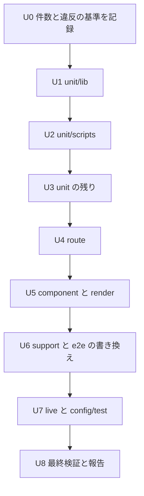

# 設計書

## Overview

`tests/`（`tests/fixtures/` を除く）と `config/test/` のコメントとテストの題名を、基準に従って書き換える。コメントは `.kiro/steering/comments.md` の先頭ヘッダと禁止パターンの規則に従う。題名は、日本語を含むものを全て英語にし（374 件・51 ファイル。範囲は「決定」の節）、要件番号・spec 名・経緯を含むものは検証している振る舞いを述べる英語の題名にする。作業の後、許容リストの `comments-tests` の項目を消す。

**Purpose**: テストを読む人が、ファイルの目的と検証している振る舞いを、要件番号や spec 名を追わずに分かるようにする。
**Users**: テストを書く人と、レビューする人、AI エージェント。
**Impact**: コメントと題名だけが変わる。テストの期待値、入力、設定の値、件数は変わらない。

### Goals

- `tests/`（fixture を除く）と `config/test/` の対象ファイルで、検査の違反と許容リストの項目が 0 件になる。
- 日本語を含む題名（374 件）を全て英語にし、要件番号・spec 名・経緯を含む英語の題名を、振る舞いを述べる英語の題名に書き換える。
- 題名の検査（日本語を含む題名が 0 件）が通る。
- 層ごとのテストの件数と結果が、作業の前後で一致する。

### Non-Goals

- テストの期待値、入力、前後処理、モックの変更。
- `config/test/` の設定の値（閾値・対象・環境）の変更。
- `src/`・`scripts/`・`hack/`・`.kiro/steering/` の変更。
- 基準（`comments.md`）と検査の規則の変更。
- 他の `comments-*` の許容リストの項目の削除。

## Boundary Commitments

### This Spec Owns

- `tests/unit/**`（`tests/unit/scripts/commentRules.test.ts` は題名だけを含み、コメントは含まない）・`tests/component/**`・`tests/route/**`・`tests/render/**`・`tests/e2e/**`・`tests/support/**`・`tests/live/**`（`*.d.ts` と `tests/e2e/.auth/` を除く）のコメントと題名。
- `config/test/**` のコメント。
- `config/comments/allowlist.json` のうち、所有者 `comments-tests` で、パスが上の範囲にある項目の削除。

### Out of Boundary

- `tests/fixtures/`（検査の対象外。要件番号・spec 参照が無いことを確かめるだけ）。
- テストの期待値と検証の内容。
- `src/`（`comments-lib`・`comments-components-pages`・`comments-api-schema` が担当）と `scripts/`・`hack/`・`config/`（`config/test/` 以外、`comments-scripts-config` が担当）。
- 基準（`.kiro/steering/comments.md`）、検査（`scripts/architecture/commentRules.ts`）、検査のテストの規則。
- `tests/unit/scripts/commentRules.test.ts` のコメント（`comment-policy` が担当。コメントは変えない。この spec の対象のコメントの違反は 0 件）。同ファイルの題名（20 件）は本 spec の対象で、英語にする（U2）。

### Allowed Dependencies

- 前提の spec: `comment-policy`（コメントの基準・検査・許容リストの項目の規則）。その完了の後に着手する。
- 作業の入力: `.kiro/steering/comments.md`・`.kiro/steering/testing.md`・`scripts/architecture/commentRules.ts`（読むだけ）。
- 検証の実行: `npm run test:type`・`test:imports`・`test:unit`・`test:component`・`test:route`・`test:render`（`npx vitest run -c config/test/...` を含む。e2e の実行は含まない）。

### Revalidation Triggers

- 検査の規則（禁止パターン・先頭ヘッダの上限）の変更: 対象の全ファイルの確認をやり直す。
- `testing.md` の題名の言語の変更、または `test-foundation` 要件 3.3 の変更: 題名の書き換えの範囲（日本語を含む題名の全件）を見直す。
- 他の `comments-*` が許容リストの同じファイルの項目を変えた場合: 読み直して照合する。

### 実装の前提（ready_for_implementation）

`spec.json` の `ready_for_implementation` は false にする。理由: 前提の spec `comment-policy` が未実装のため。検査（`scripts/architecture/commentRules.ts`）の規則と、許容リストの項目の形・所有者の規則が、この spec の完了条件（違反 0 件・項目の削除）の前提になる。`comment-policy` が完了したら true に戻す。

## Architecture

### Existing Architecture Analysis

- 検査は文字列の判定だけを行う（コメントの行と先頭ヘッダ）。題名は対象外。
- 許容リストは `(path, rule)` の組で照合する。作業で違反を直したら、項目を消さないと検査が「解消済み」として失敗する。
- 作業の単位は、テストの層（`testing.md` の Layers）に沿う。

### Architecture Pattern & Boundary Map

作業の分割だけを扱う。層ごとの単位（下の Components）を順に進め、各単位で書き換えて確かめる。単位は直列である（前の単位の完了条件を満たしてから次に進む）。直列にするのは、許容リストを単位の間で共有するため（並行にすると項目の削除が競合する）と、件数の基準（U0）を単位の前後で同じに保つため。この spec は、前提の `comment-policy` と、前の単位に依存する。この spec は `comment-policy` と `comments-lib` の完了の後に、共有の許容リストを順に変えながら直列に実行する。

- Selected pattern: 層ごとの直列の作業（U0 → U1〜U7 → U8）。
- Existing patterns preserved: 先頭ヘッダの形（`/** … */`、6 行以内）、テストの題名の書き方（`describe`・`it` の文字列）。
- New components rationale: なし（新しいファイルは作らない）。

### Technology Stack

| Layer  | Choice / Version                               | Role in Feature                            | Notes                  |
| ------ | ---------------------------------------------- | ------------------------------------------ | ---------------------- |
| 検査   | `scripts/architecture/commentRules.ts`（既存） | 違反の一覧（`--emit-allowlist`、読むだけ） | 規則は変えない         |
| テスト | vitest・Playwright（既存）                     | 件数と結果の確認                           | 設定は変えない         |
| 検索   | `grep`・`git diff`（既存）                     | 題名の確認、差分の確認                     | 新しいツールは入れない |

## File Structure Plan

### Directory Structure（作業の単位）

```
tests/
├── unit/
│   ├── lib/              # U1: 26 ファイル（題名の JP 13 ファイル・64 件。対応する src/lib の規則）
│   ├── scripts/          # U2: 23 ファイル（題名の JP 22 ファイル・241 件。importRules 55 件・commentRules 20 件（題名のみ））
│   ├── components/       # U3: 5 ファイル（題名の JP 5 ファイル・28 件。tests/unit/components/composer/ThreadComposer を含む）
│   ├── support/          # U3: 4 ファイル（題名の JP 0 件。確認のみ）
│   ├── util/             # U3: 1 ファイル（題名の JP 1 ファイル・2 件）
│   └── fixtures/         # U3: 2 ファイル（題名の JP 0 件。tests/unit/fixtures。tests/fixtures の外）
├── route/                # U4: 25 ファイル（題名の JP は pages の 7 ファイル・26 件。schedule・session・survey・support・outbound は 0 件）
├── component/            # U5: 7 ファイル（題名の JP 2 ファイル・9 件。common・composer・i18n・support）
├── render/               # U5: 1 ファイル（題名の JP 0 件。components。astro.d.ts は対象外）
├── support/              # U6: 5 ファイル（題名の JP 0 件。fakeBluesky・fakeOutbound.ts）
├── e2e/flows/            # U6: 8 ファイル（題名の JP 0 件。login・thread-posting・entry・schedule・survey・feedback・util-placement・support.ts）
└── live/                 # U7: 1 ファイル（題名の JP 1 ファイル・4 件。atprotoContract.test.ts）
config/test/              # U7: 7 ファイル（コメントのみ。題名の JP 0 件。*.ts・*.mjs。playwright・stryker・vitest 5 種）
config/comments/allowlist.json   # 各単位で、対象のパスの所有者 comments-tests の項目を消す
```

> 対象のファイルの一覧は、検査の出力（`--emit-allowlist`）を対象のパスで絞って得る。単位の表は目安で、確定は各単位の開始時に行う。
> `tests/unit/scripts/importRules.test.ts` は U2 の一覧に含めるが（トレーサビリティのため）、その書き換えと確認は tasks.md の task 3 で行う。
> 題名の件数は、`describe`・`it`・`test` の文字列引数を構文で読んで数えた値（`.each`・`skipIf` の形と、複数行の題名を含む）。U1〜U7 の合計は 374 件で、日本語を含む題名の全件を覆う（U1 64・U2 241・U3 30・U4 26・U5 9・U6 0・U7 4）。U0 で保存する一覧が正本。

### Modified Files

- `tests/**/*.ts`・`tests/**/*.tsx`・`tests/**/*.mjs`・`tests/**/*.astro`（対象の範囲）— コメントと題名（`describe`・`it`・`test` の文字列）。
- `config/test/*.ts`・`config/test/*.mjs` — コメント。
- `config/comments/allowlist.json` — 所有者 `comments-tests` で対象のパスの項目を消す（追加はしない）。

## System Flows

作業の順序（直列。各単位の完了条件を満たしてから次に進む）:



各単位の完了条件（次の単位へ進む前に満たす）:

1. 対象のパスの違反が `--emit-allowlist` の出力に無い。
2. 対象の所有者 `comments-tests` の項目が許容リストに残っていない。
3. 題名の検索（要件番号・spec 名・経緯）と題名の検査（日本語を含む題名が 0 件）で、対象のパスに該当が無い。
4. その層の対象のテストファイルを実行し、成功する。件数が U0 の記録と一致する（対象の層の件数）。
5. 差分の確認: 変更行がコメント・題名・許容リストの項目の削除に限られる。

## Requirements Traceability

| Requirement | Summary                                                           | Components             | Interfaces                   | Flows              |
| ----------- | ----------------------------------------------------------------- | ---------------------- | ---------------------------- | ------------------ |
| 1.1         | 変更をコメントと題名に限る                                        | U1〜U7                 | 差分の確認                   | 各単位の完了条件 5 |
| 1.2         | `tests/fixtures/` を変えない                                      | U1〜U7（対象外の確認） | 検索（対象外）               | —                  |
| 1.3         | 対象の外のファイルを変えない                                      | U0・U8                 | `git status` の比較          | U8                 |
| 2.1         | 期待値・入力・前後処理を変えない                                  | U1〜U7                 | 差分の確認                   | 完了条件 5         |
| 2.2         | `config/test/` の設定の値を変えない                               | U7                     | 差分の確認                   | U7                 |
| 2.3         | 差分がコメント・題名・許容項目の削除に限られる                    | U1〜U8                 | 差分の確認                   | 完了条件 5         |
| 2.4         | 他の変更は取り消す                                                | U1〜U8                 | 差分の確認                   | —                  |
| 3.1         | 層ごとの件数を前後で一致させる                                    | U0・U8                 | 層ごとの JSON 報告           | U0・U8             |
| 3.2         | `it.each` の展開後の件数を変えない                                | U2・U3・U4             | 層ごとの JSON 報告           | 完了条件 4         |
| 3.3         | 件数が変わったら取り消して報告する                                | U1〜U8                 | 完了条件 4                   | —                  |
| 4.1         | 先頭ヘッダを付ける                                                | U1〜U7                 | 検査の出力                   | 完了条件 1         |
| 4.2         | 6 行・3 件の範囲に収める                                          | U1〜U7                 | 検査の出力                   | 完了条件 1         |
| 4.3         | ヘッダに振る舞いの目的を書く（経緯・spec 名・要件番号を書かない） | U1〜U7                 | 検索                         | 完了条件 3         |
| 4.4         | ヘッダをコードの言い換えにしない                                  | U1〜U7                 | レビュー                     | —                  |
| 5.1         | 要件番号・AC・spec 名・kiro・cc-sdd・経緯・日付を取り除く         | U1〜U7                 | 検査の出力・検索             | 完了条件 1・3      |
| 5.2         | 非自明な理由を現在形で残す                                        | U1〜U7                 | レビュー                     | —                  |
| 5.3         | 言い換えだけのコメントを削る                                      | U1〜U7                 | レビュー                     | —                  |
| 5.4         | 判別に迷うものは残して報告する                                    | U1〜U8                 | 報告                         | U8                 |
| 5.5         | 禁止パターンを語の言い換えで解消する（文字列は変えない）          | U1〜U7                 | 差分の確認                   | —                  |
| 6.1         | 要件番号・spec 名・経緯を含む題名（英語のものを含む）を書き換える | U1〜U5・U7             | 検索                         | 完了条件 3         |
| 6.2         | 書き換えた題名を英語で書く                                        | U1〜U5・U7             | レビュー                     | —                  |
| 6.3         | 英語で、日本語も要件番号・spec 名・経緯も含まない題名は変えない   | U1〜U7                 | 差分の確認                   | —                  |
| 6.4         | 題名は期待値に合う振る舞いの名前にする                            | U1〜U5・U7             | レビュー（期待値を読む）     | —                  |
| 6.5         | 実在の名前として使う語（kiro・spec）は残して報告する              | U2・U3                 | 報告                         | U8                 |
| 6.6         | 日本語を含む題名を全件英語にする（scope (a)）                     | U1〜U5・U7             | 題名の検査（日本語 0 件）    | 完了条件 3         |
| 6.7         | 英語にすると意味が変わる題名は推測で訳さず、判断を受ける          | U1〜U5・U7             | 報告                         | —                  |
| 7.1         | 解消した項目を同じ変更で消す                                      | U1〜U7                 | 検査の出力・許容リストの確認 | 完了条件 2         |
| 7.2         | 項目を追加しない・`--emit-allowlist` で上書きしない               | U0〜U8                 | `git diff`（許容リスト）     | —                  |
| 7.3         | 所有者 `comments-tests` 以外の項目を消さない                      | U1〜U7                 | `git diff`（許容リスト）     | —                  |
| 7.4         | 全ファイル完了時に `comments-tests` の項目が 0 件                 | U8                     | 許容リストの確認             | U8                 |
| 8.1         | 単位ごとに違反が無いことを確かめる                                | U1〜U7                 | 検査の出力                   | 完了条件 1         |
| 8.2         | 単位ごとに層のテストが成功し、件数が一致する                      | U1〜U7                 | vitest 実行                  | 完了条件 4         |
| 8.3         | 全体で型・imports・各層が通る                                     | U8                     | npm スクリプト               | U8                 |
| 8.4         | `commentRules.test.ts` の他 spec 起因の失敗を報告する             | U8                     | 報告                         | U8                 |
| 8.5         | 整形を伴う実行の後、comments-* の単位の外の整形差分だけを戻す     | U6・U8                 | `git status` の比較          | U8                 |
| 8.6         | 日本語を含む題名が 0 件（同一行の形と複数行の形）                 | U8                     | 題名の検査                   | U8                 |
| 9.1         | 完了時に報告する                                                  | U8                     | 報告                         | U8                 |

## Components and Interfaces

作業の単位（Components）。各単位は、対象のディレクトリのコメントと題名を書き換え、完了条件を確かめる。新しい型や関数は作らない。

| Unit | Scope（対象のパス）                                                             | Intent                                                                                                                     | Req Coverage                      | Key Dependencies | Contracts |
| ---- | ------------------------------------------------------------------------------- | -------------------------------------------------------------------------------------------------------------------------- | --------------------------------- | ---------------- | --------- |
| U0   | 全体（記録のみ）                                                                | 作業の前の件数と違反の基準を記録する。日本語を含む題名の一覧（374 件・51 ファイル）を保存する                              | 1.3, 3.1, 7.2                     | なし             | State     |
| U1   | `tests/unit/lib/**`                                                             | 規則の単体テストのコメントと題名（題名 JP 64 件・13 ファイル）                                                             | 1.1, 2.1, 4.x, 5.x, 6.x, 7.1      | U0               | Test      |
| U2   | `tests/unit/scripts/**`（題名は全件。コメントは `commentRules.test.ts` を除く） | コメントと題名（題名 JP 241 件・22 ファイル。`importRules.test.ts` 55 件、`commentRules.test.ts` 20 件（題名のみ）を含む） | 3.2, 6.5, 6.6, 4.x, 5.x, 6.x, 7.x | U1               | Test      |
| U3   | `tests/unit/{components,support,util,fixtures}/**`                              | unit の残り（題名 JP 30 件・6 ファイル）                                                                                   | 4.x, 5.x, 6.x, 7.x                | U2               | Test      |
| U4   | `tests/route/**`                                                                | route 層のテスト（workerd）のコメントと題名（題名 JP 26 件・7 ファイル。pages のみ）                                       | 3.2, 4.x, 5.x, 6.x, 7.x           | U3               | Test      |
| U5   | `tests/component/**`・`tests/render/**`                                         | component と render 層（題名 JP 9 件・2 ファイル。render は 0 件）                                                         | 4.x, 5.x, 6.x, 7.x                | U4               | Test      |
| U6   | `tests/support/**`・`tests/e2e/**`                                              | 共有の補助と e2e の流れ（題名 JP 0 件。英語の題名の確認のみ）                                                              | 4.x, 5.x, 6.x, 7.x, 8.5           | U5               | Test      |
| U7   | `tests/live/**`・`config/test/**`                                               | live と設定ファイルのコメント（題名 JP 4 件・1 ファイル。config/test はコメントのみ）                                      | 2.2, 4.x, 5.x, 6.x, 7.x           | U6               | Test      |
| U8   | 全体（検証のみ）                                                                | 最終検証と報告                                                                                                             | 1.3, 3.1, 7.4, 8.x, 9.1           | U7               | Report    |

### U0 記録（State）

- 層ごとの件数（合計・成功・失敗・スキップ）を、作業の前に JSON で保存する（保存先は作業用ディレクトリ。リポジトリには置かない）。
- 許容リストの `comments-tests` の項目数（198 件）と、対象のパス一覧を保存する。
- 保存する件数: unit・component・route・render は vitest の JSON 報告（`--reporter=json --outputFile`）。e2e は `npx playwright test --list -c config/test/playwright.config.ts` の件数。
- 日本語を含む題名の一覧（ファイル・行・題名）を保存する。件数は 374 件・51 ファイル（2026-11-08 に構文で数えた値）。依頼時の概数 362 件とは一致しないため、U0 でこの一覧の件数を確定し、差が出た場合は報告する。

### 題名の書き換え（Test 単位の共通の規則）

- 対象: (1) 日本語を含む `describe`・`it`・`test` の文字列（`.each` を含む）の全件。(2) 英語の題名のうち、要件番号・spec 名・AC/FR/NFR・経緯（「前回の残件」など）を含むもの。
- 書き換え: 期待値（`expect` の行）と入力を読み、その行が検証している振る舞いを英語で述べる。直訳にしない。要件番号と spec 名は、振る舞いの文言に置き換える（題名に番号を残さない）。文言は、期待値が確かめている結果と条件を、動詞で書く。`.each` の書式指定（`%s`・`%i` など）は残す。
- 翻訳で意味が変わる題名: 推測で訳さない。作業を止め、ファイル・行・理由を挙げてユーザーの判断を受ける（完了条件の題名の検査は、その題名が解消するまで 0 件にならない）。
- 変えないもの: 日本語も要件番号も含まない英語の題名。期待値の行。

### コメントの書き換え（共通の規則）

- 先頭ヘッダ: 無ければ、目的を 1〜2 行で書いたブロックコメントを加える（シェバン行・Astro のフロントマターの後）。6 行・箇条書き 3 件以内。
- 禁止パターン（`.kiro/steering/comments.md` の「書かない」の一覧が正本。この spec では語を追加しない）に当たるものを取り除き、必要な理由だけを現在形で残す。
- `kiroGate.test.ts` と `tests/unit/support/steeringStructure.ts` の `kiro` は、実在するコマンドとファイルの名前である。規則に従って判断し、残す場合は完了時の報告に挙げる（6.5 と同じ扱い）。
- 判別に迷うものは残し、報告に挙げる。

### 許容リストの項目の削除（Allowlist 操作）

- 他の `comments-*` と共有するため、各単位の作業の直前に JSON を読み直す。
- 対象のパスで所有者が `comments-tests` の項目を、Edit で行単位に削除する。JSON 全体を作り直さない（`--emit-allowlist` の出力で置き換えない）。
- 削除の後、JSON が有効であり、項目数が減っただけであることを確かめる。

## Data Models

なし（データの構造は変えない）。許容リストの項目の形（`path`・`rule`・`owner`・`reason`）は既存のまま。

## Error Handling

### Error Strategy

- **件数の不一致**: その単位の変更を取り消し、原因（題名の追加・削除、`it.each` の展開の変化）を調べてから直す。
- **期待値の変更の混入**: 差分の確認で、コメントと題名以外の行が出たら、その行を取り消す。
- **許容リストの誤削除**: 他の所有者の項目や、対象外のパスの項目が消えたら、Git の差分から戻す（他の spec の変更は戻さない。項目だけを戻す）。
- **検査の残件**: 作業の単位の対象のパスに残件があれば、その単位を完了にしない。

### Monitoring

- 単位ごとの完了条件の結果を、報告に含める。

## Testing Strategy

本 spec のテストは、作業の結果の確認である（新しいテストは作らない）。

### 単位ごとの確認（U1〜U7）

1. 違反: `npx tsx scripts/architecture/commentRules.ts --emit-allowlist` の出力から、対象のパスの行を取り出し、0 件であることを確かめる。
2. 許容リスト: 対象のパスで所有者 `comments-tests` の項目が 0 件であることを確かめる。
3. 題名: 対象のパスで、要件番号（「要件」と数字）・`specs/`・AC/FR/NFR のタグ・「移行」などの語を検索し、題名・コメントに残りが無いことを確かめる（語の一覧は `.kiro/steering/comments.md` の「書かない」の節に従う。検索の結果を報告に含める）。併せて、対象のパスの日本語を含む題名の検査（下記の「題名の検査」）が 0 件であることを確かめる。
4. 層のテスト: 対象のファイルを引数に指定して、その層を実行し、成功することを確かめる（例: `npx vitest run -c config/test/vitest.unit.config.ts tests/unit/lib`）。件数は U0 の対象の層の件数と比べる（対象ファイルだけの件数は、U0 で同じ絞り方をして保存する）。成否は JSON 報告の失敗件数（0 件）で判定する。unit 層の分岐カバレッジの閾値（`config/test/vitest.unit.config.ts`）は、絞り込んだ実行では満たせないことがあるため、その失敗は本 spec の失敗としない（全体の実行の U8 で確かめる）。
5. 差分: `git diff -- <対象のパス>` の変更行が、コメント行・題名の文字列・許容リストの項目の削除に限られることを確かめる。

### 全体の確認（U8）

- `npm run test:type`・`npm run test:imports`。
- unit・component・route・render の全体実行と件数の比較（U0 の記録と一致）。
- 整形を伴う実行（`prettier --write` を含むもの）の後は、`git status` を比べ、comments-* の単位の外の整形差分だけを戻す（他の spec の変更は戻さない）。この spec の完了条件の実行は整形を伴わない（`npm run test:e2e` は含まない）。
- 検査の全体: `commentRules.test.ts` のコメントは本 spec の対象外（題名は対象）。他の `comments-*` の違反が残る間に失敗する場合は、失敗の原因が `comments-tests` 以外の所有者の項目であることを確かめて報告する。
- 題名の検索（全体）と許容リストの `comments-tests` の項目が 0 件であることの確認。
- 題名の検査（全体）: 日本語を含む題名が 0 件であることの確認（下記）。

### 題名の検査（日本語の題名が 0 件であること）

- 対象: `tests/`（`tests/fixtures/` を除く）と `config/test/` の `.ts`・`.tsx`・`.mjs`・`.astro`。
- (a) 同一行の形（`it("…")`・`describe("…")` など）:

```bash
grep -rnP "(describe|it|test)(\.\w+)*\s*\(\s*[\"'\`][^\"'\`]*[\p{Han}\p{Hiragana}\p{Katakana}]" tests config/test | grep -v '^tests/fixtures/'
```

- (b) 後ろに続く形（`it.each([...])(` と `it.skipIf(...)(` の次の行に題名がある形を含む）:

```bash
grep -rPzo "\)\s*\(\s*[\"'\`][^\"'\`]*[\p{Han}\p{Hiragana}\p{Katakana}]" tests config/test | tr '\0' '\n' | grep -v '^tests/fixtures/'
```

（`-z` は改行をまたいで照合する。出力の先頭が `tests/fixtures/` の行は対象外。）

- (a) と (b) が、どちらも 0 件であること。
- 件数の確認: U0 で保存した一覧（374 件）の各題名を、作業の後に英語へ書き換えたことを、同じ一覧の行で確かめる。`it.each`・`test.each` の展開後の件数は変えない（第 3 要件）。
- (a) と (b) の結果（件数）は、完了の報告に含める。

### 完了の定義

- 単位 U1〜U7 の完了条件 1〜5 を満たす。
- U8 の全体の確認を行い、結果と判断の一覧（書き換えた題名の件数、残したもの・語の扱い、英語にできず判断を受けた題名）を報告する。

## Optional Sections

### Security Considerations

なし（秘密情報の扱いは変えない）。

### Performance & Scalability

- route の実行は時間がかかるため、単位ごとには対象の層だけを実行する。全体の実行は U8 で 1 回行う。

### Migration Strategy

なし。

## 決定（題名の言語）

- **範囲（scope (a)）**: `tests/`（`tests/fixtures/` を除く）と `config/test/` の `describe`・`it`・`test` の題名（`.each` を含む）のうち、日本語を含むものを、すべて英語にする。既存の英語の題名は、要件番号・spec 名・経緯を含むものだけを書き換える。
- **根拠**: `.kiro/steering/testing.md` 68 行目「テストの題名は英語。」と、`.kiro/specs/test-foundation/requirements.md` の要件 3 の受入基準 3（テストの題名を英語で書くことを求める）。規則は commit 72e43b4a で `testing.md` に入り、cc6fb3d で持ち越された。
- **件数**: 日本語を含む題名は 374 件・51 ファイル（構文で数えた）。単位 U1〜U7 の内訳は「Components and Interfaces」の表のとおりで、全件を覆う。

## Supporting References

- `.kiro/specs/comments-tests/research.md`（判断の根拠）
- `.kiro/steering/comments.md`・`.kiro/steering/testing.md`

## 決定（2026-11-08 追補）

- 題名の書式: 「（特性化）」の語は取り除く。他のテストと同じ書式（振る舞いを述べる英語の文。例: `returns 400 when the body is not valid JSON`）に揃え、種類を示すタグは付けない。対象は 15 件。
- 要件番号: 題名から消す（test-foundation の要件 3.4 の許可は、この作業では適用しない）。
- `tests/unit/scripts/commentRules.test.ts` の題名 20 件は、comments-tests の範囲に含める。コメントは comment-policy の担当のまま。
- 件数の基準: `title-inventory.md`（U0 の一覧、370 件・51 ファイル）。単位 U2 は 237 件。
