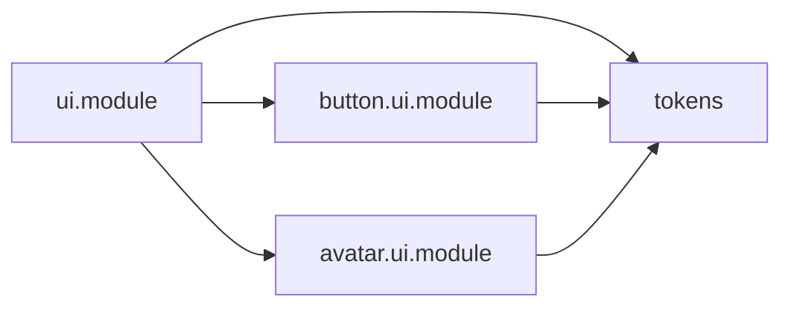
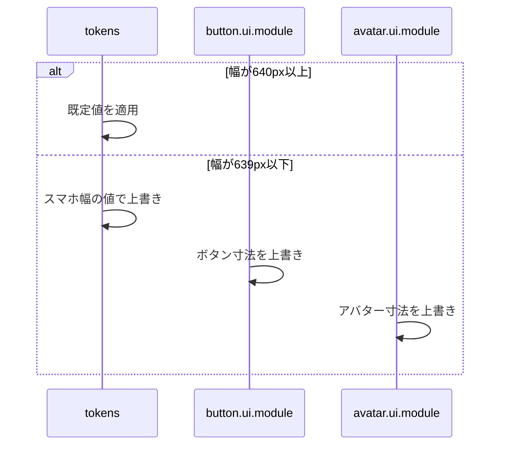

# Design Document

## Overview

**Purpose**: スマホ幅の画面でフォント・余白・ボタンを一回り大きくし、読みやすく押しやすくする。
**Users**: スマホ幅の画面で操作する利用者
**Impact**: スマホ幅でフォント・余白・ボタンを一回り大きくする。トークンの上書きで、参照するUIが個別の変更なしに追従する。

### Goals

- 幅639px以下でのフォントサイズ・余白・ボタン寸法・アバター寸法・トグル寸法の各トークン値。
- コンポーネントに直書きされたフォントサイズ・余白のトークン参照化。
- 幅639px以下で、ページ末尾がフッターナビゲーションに隠れないための余白。

### Non-Goals

- 幅640px以上の見た目。
- 色トークン、横幅トークン、ナビゲーションアイコンとフッターナビゲーション自体の寸法。

## Boundary Commitments

### This Spec Owns

- 幅639px以下でのフォントサイズ・余白・ボタン寸法・アバター寸法・トグル寸法の各トークン値。
- コンポーネントに直書きされたフォントサイズ・余白のトークン参照化。
- 幅639px以下で、ページ末尾がフッターナビゲーションに隠れないための余白。

### Out of Boundary

- 幅640px以上の見た目。
- 色トークン、横幅トークン、ナビゲーションアイコンとフッターナビゲーション自体の寸法。

### Allowed Dependencies

- 共通 UI スタイル（`@layer ui`。coding-conventions に従う）
- フッターナビゲーション（app-navigation）の高さ

### Revalidation Triggers

- スマホ幅の境界（639px）を変えるとき
- トークンの名前や段階を変えるとき（トークンを参照するすべての UI が影響を受ける）
- ボタン寸法トークンの下限（44px）を変えるとき

## Architecture

### Architecture Pattern & Boundary Map

スタイル定義ファイル間の依存方向を示す。



## File Structure Plan

| パス                              | 責務                                                       |
| --------------------------------- | ---------------------------------------------------------- |
| `src/styles/tokens.css`           | 余白・フォント・トグル寸法のトークン定義とスマホ幅の上書き |
| `src/styles/button.ui.module.css` | ボタン寸法トークンの定義とスマホ幅の上書き                 |
| `src/styles/avatar.ui.module.css` | アバター寸法トークンの定義とスマホ幅の上書き               |
| `src/styles/ui.module.css`        | フッターナビゲーション分の下余白クラス                     |

## System Flows

画面幅に応じたトークン値の上書きを示す。



## Requirements Traceability

| Requirement   | Summary                                | Components |
| ------------- | -------------------------------------- | ---------- |
| 1.1, 1.2, 1.3 | スマホ幅のトークンの上書き             | D-1, D-2   |
| 2.1, 2.2      | ボタンの操作領域                       | D-1        |
| 3.1, 3.2      | フッターナビゲーションとの重なりの回避 | D-3        |
| 4.1           | 横幅の限られたツールバー               | D-4        |

## Components and Interfaces

#### D-1: トークンの上書き

**Requirements**: 1.1, 1.2, 2.1, 2.2
境界はフッターナビゲーションとサイドバーの切り替え境界と同じ `max-width: 639px` とする。トークンは定義したファイル側で上書きし、import 順による上書きの取りこぼしを防ぐ。

| トークン                                             | 640px以上                       | 639px以下                        | 定義ファイル           |
| ---------------------------------------------------- | ------------------------------- | -------------------------------- | ---------------------- |
| `--font-size-xs` / `sm` / `md` / `lg` / `xl` / `2xl` | 12 / 14 / 16 / 18 / 20 / 24px   | 14 / 16 / 18 / 20 / 22 / 26px    | `tokens.css`           |
| `--space-0` 〜 `--space-6`                           | 2 / 4 / 8 / 12 / 16 / 24 / 32px | 3 / 6 / 10 / 16 / 20 / 28 / 36px | `tokens.css`           |
| `--size-icon-button`                                 | 18px                            | 26px                             | `tokens.css`           |
| `--font-size-input`                                  | `--font-size-md`                | `--font-size-lg`                 | `tokens.css`           |
| `--size-toggle-width` / `height` / `knob`            | 32 / 18 / 14px                  | 48 / 26 / 20px                   | `tokens.css`           |
| `--size-button-md` / `lg`                            | 40 / 60px                       | 44 / 64px                        | `button.ui.module.css` |
| `--size-avatar-sm` / `md` / `lg`                     | 36 / 48 / 60px                  | 42 / 52 / 70px                   | `avatar.ui.module.css` |
| `--size-avatar-footer`                               | 36px                            | 36px                             | `avatar.ui.module.css` |

`--btn-padding-x` / `--btn-padding-y` は `--space-*` を参照するため、上書きに追従する。

ボタンの高さは必ず `--size-button-md` / `lg` を参照する。アイコンボタンは幅と高さ、テキストボタン（`.text-button`）・折りたたみの開閉ボタン・サムネイルのバッジ・ライトボックスの操作ボタンは高さ（テキストボタンは `min-height`）に適用する。ボタン専用のコンポーネントCSSで `px` / `rem` の高さを直書きしない。

#### D-2: 直書きの置換

**Requirements**: 1.3

| 直書きの値                               | 置換先           |
| ---------------------------------------- | ---------------- |
| `0.85rem`                                | `--font-size-xs` |
| `0.9rem` / `0.95rem`                     | `--font-size-sm` |
| `16px`（フォント）                       | `--font-size-md` |
| `0.05rem` / `0.1rem` / `0.15rem` / `2px` | `--space-0`      |
| `0.25rem`                                | `--space-1`      |
| `0.6rem`                                 | `--space-2`      |
| `0.75rem`                                | `--space-3`      |

画像ギャラリーの画像間隔（2px）は寸法として固定し、置換しない。

#### D-3: フッターナビゲーション分の下余白

**Requirements**: 3.1, 3.2

```css
@media (max-width: 639px) {
  /* ナビゲーション付きページの body 末尾 */
  :local(.root.with-nav) {
    padding-bottom: var(--nav-bar-height);
  }
  /* 別スクロール文脈の一覧末尾・余白要素を持たないページ本文に個別付与する */
  :local(.footer-nav-spacing) {
    padding-bottom: var(--nav-bar-height);
  }
}
```

#### D-4: 横幅の限られたツールバーのボタン

**Requirements**: 4.1
`button.ui.module.css` に `.compact-button` を置き、`.text-button` と重ねたセレクタ（`.text-button.compact-button`）で詳細度を上げて、記述順に左右されずに上書きする。

| 対象                                         | 640px以上                | 639px以下                                        |
| -------------------------------------------- | ------------------------ | ------------------------------------------------ |
| 文字                                         | 変えない（折り返さない） | `--font-size-sm`                                 |
| 左右余白（青系統の背景のあるボタン）         | 変えない                 | `calc(var(--btn-padding-x) * 0.875)`（16/18 倍） |
| 左右余白（白系統。背景が見えず形に表れない） | 変えない                 | `--space-1`                                      |

投稿フォーム上部のキャンセル・下書き・予約・投稿と、セグメントのサムネ調整・リンクカードを取得のボタンに付ける。

## Error Handling

- なし

## Testing Strategy

- Unit / Build Tests:
  - `npm run build`
  - `npx vitest run tests/styles/hardcodedFontSize.test.ts`
  - `npx tsc --noEmit`
- E2E/UI Tests:
  - `tests/e2e/mobileScale.spec.ts` 幅390pxで投稿フォームを開く → 本文が18px、すべてのボタン高さが44px以上になる
  - `tests/e2e/mobileScale.spec.ts` 幅390pxでログインのページを開く → ボタンの左右余白が16pxになる
  - `tests/e2e/mobileScale.spec.ts` 幅390pxで設定ページを末尾までスクロールする → 末尾要素がフッターナビゲーションと重ならず、横スクロールが発生しない
  - `tests/e2e/draftListLayout.spec.ts` 幅390pxで投稿フォームを開く → 投稿のボタンの文字が16pxで左右余白が14px、キャンセルの左右余白が6pxになる
- テストの名前には、対応する基準 ID を `[design-tokens/<ID>]` の形で付ける（例: `[design-tokens/1.1]`）
