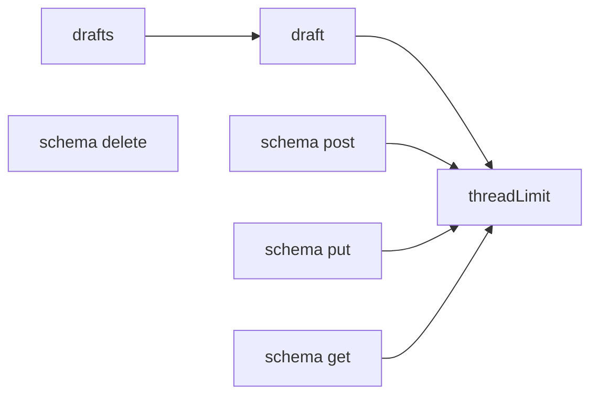
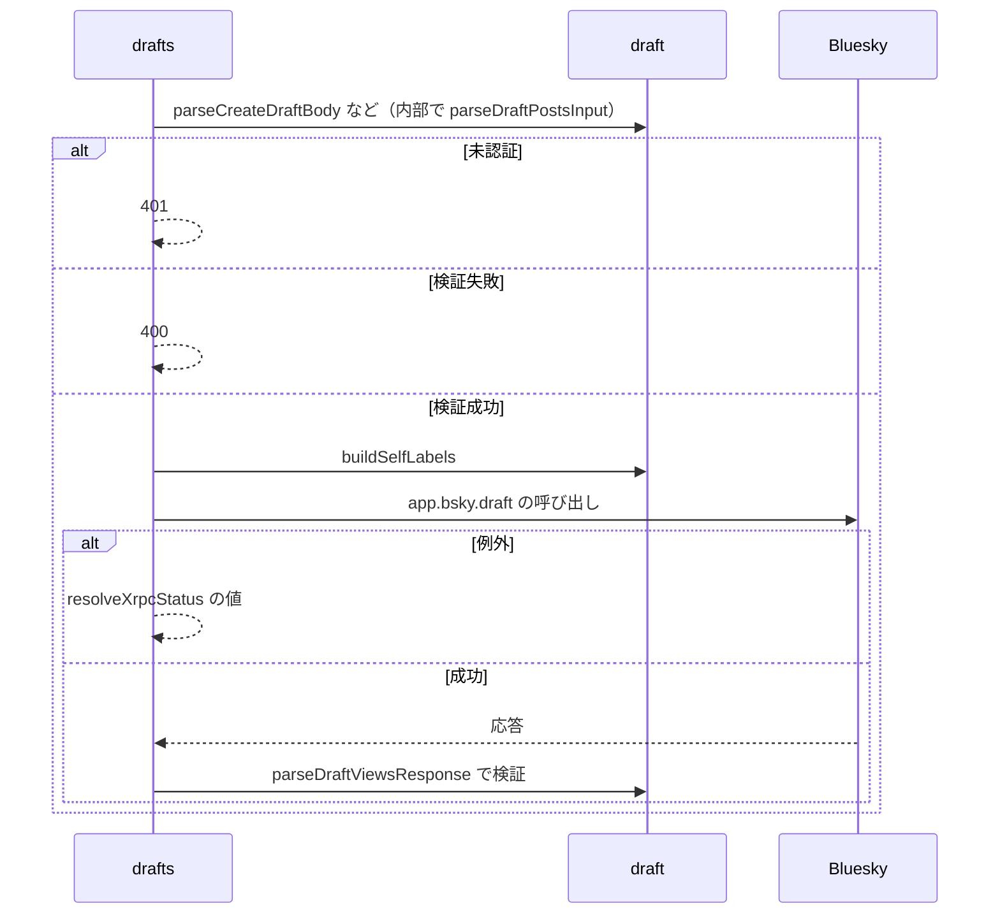

# Design Document

## Overview

**Purpose**: 1件の投稿とスレッドの下書きを、Blueskyの下書き機能に保存・取得・更新・削除できるようにする。
**Users**: 投稿を下書きとして残し、後で再開する利用者
**Impact**: Bluesky の下書き機能を、skyshare の API として保存・取得・更新・削除できるようにする。

### Goals

- 下書きの一覧取得・作成・更新・削除のAPI。
- 下書きの本文と自己ラベルの形式。

### Non-Goals

- 画像・動画・リンクカードの下書きへの保存。
- 投稿フォームでの下書きの表示と復元。

## Boundary Commitments

### This Spec Owns

- 下書きの一覧取得・作成・更新・削除のAPI。
- 下書きの本文と自己ラベルの形式。

### Out of Boundary

- 画像・動画・リンクカードの下書きへの保存。
- 投稿フォームでの下書きの表示と復元。

### Allowed Dependencies

- Bluesky の下書き機能（連携先）
- 投稿の作成と共通のスレッドの上限（post-record）
- API の認証の再開（account-session）

### Revalidation Triggers

- 下書きの本文と自己ラベルの形式を変えるとき
- スレッドの投稿数の上限の定数を変えるとき
- 連携先の下書きの応答の形が変わるとき

## Architecture

### Architecture Pattern & Boundary Map

下書きAPIの入力検証と連携先の依存方向を示す。ハンドラは `draft.ts` の手書きパーサで入力と応答を検証し、`schema/` 配下の zod スキーマは OpenAPI ドキュメントの生成と上限定数の共有確認テストが参照する（ハンドラは import しない）。



## File Structure Plan

| パス                                          | 責務                                       |
| --------------------------------------------- | ------------------------------------------ |
| `src/pages/v2/bsky/drafts.ts`                 | GET・POST・PUT・DELETE のハンドラ          |
| `src/lib/api/schema/v2/bsky/drafts/post.ts`   | 作成の入力スキーマ（OpenAPI 用）           |
| `src/lib/api/schema/v2/bsky/drafts/put.ts`    | 更新の入力スキーマ（OpenAPI 用）           |
| `src/lib/api/schema/v2/bsky/drafts/get.ts`    | 一覧のクエリと応答のスキーマ（OpenAPI 用） |
| `src/lib/api/schema/v2/bsky/drafts/delete.ts` | 削除の入力スキーマ（OpenAPI 用）           |
| `src/lib/atproto/draft.ts`                    | 入力と応答の検証、自己ラベルの変換         |

## System Flows

メソッドごとの検証と連携先の呼び出しの流れを示す。



## Requirements Traceability

| Requirement                       | Summary      | Components |
| --------------------------------- | ------------ | ---------- |
| 1.1, 1.2, 1.3, 1.4, 1.5           | 下書きの形式 | D-1        |
| 2.1, 2.2, 2.3, 2.4, 2.5, 2.6, 2.7 | 下書きの操作 | D-2        |
| 3.1, 3.2                          | エラー応答   | D-2        |

## Components and Interfaces

#### D-1: 下書きの形式

**Requirements**: 1.1, 1.2, 1.3, 1.4, 1.5

```ts
export const DraftPostSchema = z.object({ text: z.string(), labels: z.array(z.string()).optional() }).strict()
// 作成
export const RequestBodySchema = z.object({ posts: z.array(DraftPostSchema).min(1).max(MAX_THREAD_POST_COUNT) }).strict()
// 更新は { id: string, posts: 同上 }、削除は { id: string }
export const parseDraftPostsInput = (value: unknown): DraftPostPayload[] | undefined // 1〜MAX_THREAD_POST_COUNT 件
export const buildSelfLabels = (labels: string[] | undefined) // ラベル値から com.atproto.label.defs#selfLabels を組み立てる
```

上の zod スキーマ（`DraftPostSchema`・`RequestBodySchema`）は OpenAPI ドキュメントの生成用で、ハンドラの実行時の検証は `src/lib/atproto/draft.ts` の手書きのパーサ（`parseDraftPostsInput` など）が行う。このため実行時は未知のキーを拒否しない。`MAX_THREAD_POST_COUNT` の実体は `src/lib/atproto/threadLimit.ts` で、スキーマは直接、`draft.ts` は `post.ts` の再エクスポート経由で同じ定数を参照する。`posts` は `app.bsky.draft#draft.posts` にそのまま対応させる。

#### D-2: ハンドラ

**Requirements**: 2.1, 2.2, 2.3, 2.4, 2.5, 2.6, 2.7, 3.1, 3.2

| メソッド | 入力の検証                                             | 連携先の呼び出し                                       | 成功時                    |
| -------- | ------------------------------------------------------ | ------------------------------------------------------ | ------------------------- |
| GET      | `parseDraftQuery`（`limit` の範囲・空でない `cursor`） | `app.bsky.draft.getDrafts` → `parseDraftViewsResponse` | 200 `{ drafts, cursor? }` |
| POST     | `parseCreateDraftBody`                                 | `app.bsky.draft.createDraft`                           | 200 `{ id }`              |
| PUT      | `parseUpdateDraftBody`                                 | `app.bsky.draft.updateDraft`                           | 200（本文なし）           |
| DELETE   | `parseDeleteDraftBody`                                 | `app.bsky.draft.deleteDraft`                           | 200（本文なし）           |

- 認証が無ければ401、入力の検証に失敗すれば400を返す。
- `parseDraftViewsResponse` は各下書きを `parseDraft` で検証し、1件でも不正なら `undefined` を返す。ハンドラはこのとき500を返す。
- 連携先の例外は `resolveXrpcStatus` で変換する（`DraftLimitReached` は429）。

## Error Handling

| 事象                     | 処理                                     |
| ------------------------ | ---------------------------------------- |
| 連携先の応答が不正な形式 | 500                                      |
| 連携先の呼び出しの例外   | `resolveXrpcStatus` で変換したステータス |

## Testing Strategy

- Unit / Build Tests:
  - `npx vitest run tests/pages/v2/bsky/drafts.test.ts tests/lib/atproto/draft.test.ts tests/lib/api/schema/threadLimit.test.ts`
- テストの名前には、対応する基準 ID を `[draft-api/<ID>]` の形で付ける（例: `[draft-api/1.1]`）
