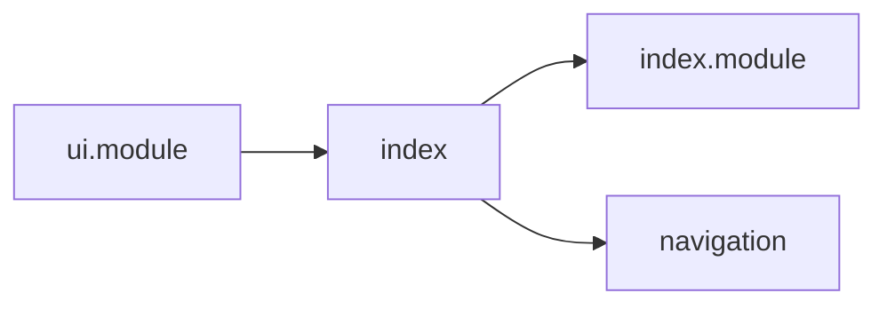
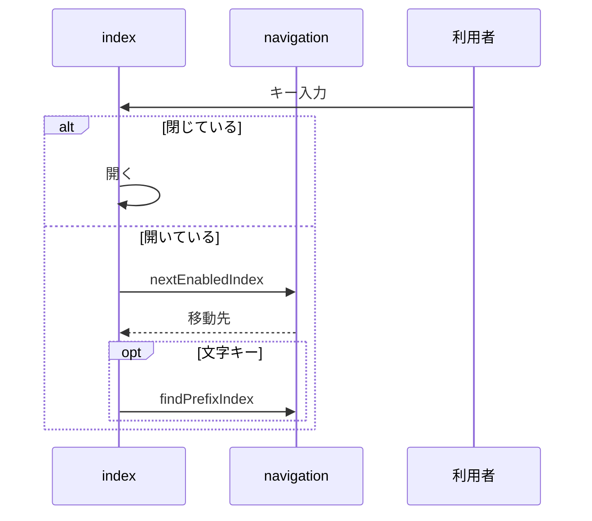

# Design Document

## Overview

**Purpose**: ブラウザ標準の選択欄に依存せず、選択肢の見た目・一覧の表示位置・操作をアプリ内で統一したプルダウンを提供する。
**Users**: アプリ内で選択肢から値を選ぶ利用者（キーボードやスクリーンリーダーを使う利用者を含む）
**Impact**: ブラウザ標準の選択欄に依存せず、見た目・表示位置・操作を統一した共通のプルダウンを提供する。

### Goals

- 共通プルダウンの開閉・表示位置・一覧のスクロール・キーボード操作。
- トリガーと選択肢の表示内容。

### Non-Goals

- 検索付きプルダウンの絞り込み。
- 複数選択と選択肢のグループ見出し。
- スマホ幅でのボトムシート表示。
- 選択肢の非同期取得。

## Boundary Commitments

### This Spec Owns

- 共通プルダウンの開閉・表示位置・一覧のスクロール・キーボード操作。
- トリガーと選択肢の表示内容。

### Out of Boundary

- 検索付きプルダウンの絞り込み。
- 複数選択と選択肢のグループ見出し。
- スマホ幅でのボトムシート表示。
- 選択肢の非同期取得。

### Allowed Dependencies

- 共通 UI スタイル（`@layer ui`。coding-conventions に従う）
- リストボックスの移動と先頭一致検索（`src/util/listbox/`）

### Revalidation Triggers

- 部品の入力（選択肢・トリガーの幅の指定）を変えるとき（利用側のすべての画面が影響を受ける）
- パネルの配置規則（前面表示・上への反転）を変えるとき
- キーボード操作とアクセシビリティの属性を変えるとき

## Architecture

### Architecture Pattern & Boundary Map

プルダウン本体と補助モジュールの依存方向を示す。



## File Structure Plan

| パス                                              | 責務                                 |
| ------------------------------------------------- | ------------------------------------ |
| `src/components/common/Dropdown/index.tsx`        | トリガー・開閉・配置・キーボード操作 |
| `src/components/common/Dropdown/index.module.css` | パネル・一覧・トリガーの見た目       |
| `src/util/listbox/navigation.ts`                  | 有効な選択肢間の移動と先頭一致検索   |
| `src/styles/ui.module.css`                        | プルダウンを含む要素のクリップ解除   |

## System Flows

開閉とキー操作による選択の流れを示す。



## Requirements Traceability

| Requirement             | Summary                        | Components |
| ----------------------- | ------------------------------ | ---------- |
| 1.1, 1.2, 1.3, 1.4, 1.5 | 開閉                           | D-3        |
| 2.1, 2.2, 2.3, 2.4, 2.5 | パネルの配置                   | D-2        |
| 3.1, 3.2, 3.3, 3.4, 3.5 | キーボード操作                 | D-3        |
| 4.1, 4.2, 4.3, 4.4      | 表示内容                       | D-1        |
| 5.1, 5.2                | アクセシビリティとサーバー描画 | D-4        |

## Components and Interfaces

#### D-1: インターフェース

**Requirements**: 4.1, 4.2, 4.3, 4.4

```ts
export type DropdownOption = {
  value: string // 空文字も有効な値
  label: string // アクセシビリティ名・先頭一致検索の対象
  content?: React.ReactNode // 一覧の表示内容。未指定なら label
  triggerContent?: React.ReactNode // トリガーの表示内容。未指定なら content ?? label
  disabled?: boolean
}
type Props = {
  value: string
  options: DropdownOption[]
  onChange: (value: string) => void
  disabled?: boolean
  placeholder?: string // 現在値が options に無いときの表示。未指定なら value
  autoWidth?: boolean // 既定は固定幅
  className?: string
  id?: string
  ariaLabel?: string
}
```

値は文字列のみとし、数値や列挙型への変換は呼び出し側のラッパーで行う。

#### D-2: 配置

**Requirements**: 2.1, 2.2, 2.3, 2.4, 2.5
パネルはトリガーと同じ外枠の中に `position: absolute` で置き、スクロールとソフトウェアキーボードへの追従はブラウザの描画に任せる。JavaScript は開いた直後に一度だけ向きと一覧の最大高さを決める。

```ts
const GAP_PX = 4, MAX_VISIBLE_ROWS = 5, MIN_LIST_HEIGHT_PX = 96, EDGE_MARGIN_PX = 8
const bounds = visibleVerticalBounds(trigger) // visualViewport と祖先のスクロール枠の共通部分
const below = bounds.bottom - rect.bottom - GAP_PX - EDGE_MARGIN_PX
const above = rect.top - bounds.top - GAP_PX - EDGE_MARGIN_PX
const maxListPx = 先頭 MAX_VISIBLE_ROWS 行の offsetHeight の合計
const wanted = chrome + Math.min(list.scrollHeight, maxListPx)
const vertical = below < wanted && above > below ? "top" : "bottom"
const maxHeight = Math.max(Math.min(MIN_LIST_HEIGHT_PX, maxListPx), Math.min(maxListPx, space - chrome))
const horizontal = rect.right - panel.offsetWidth < EDGE_MARGIN_PX &&
  rect.left + panel.offsetWidth <= innerWidth - EDGE_MARGIN_PX ? "left" : "right"
```

- 計測中のパネルは `visibility: hidden` で描画する。開いている間は再計算しない。iOS ではキーボード表示中の座標が遷移途中の値になり、計算した位置がトリガーとずれるため。
- `.panel { position: absolute; z-index: calc(var(--overlay-z, 60) + 5); width: max-content; min-width: 100%; max-width: min(24rem, calc(100vw - 16px)); display: grid }`。全選択肢を高さ0で描画する `.sizer` を一覧と同じグリッドセルに重ね、幅を最も広い選択肢に合わせる。
- `.list { overflow-y: auto; overscroll-behavior: contain; position: relative }` とし、`scrollIntoView` を使わずに `scrollTop` を直接調整して、選択中の項目とキー操作中のアクティブ項目を表示する。マウスホバーではスクロールしない。
- 外枠に `data-dropdown` を付け、`ui.module.css` で `.base-card:has([data-dropdown])` とその子孫のうち該当要素だけ `overflow: visible` にする。スクロール枠は解除しない。

#### D-3: 開閉とキーボード

**Requirements**: 1.1, 1.2, 1.3, 1.4, 1.5, 3.1, 3.2, 3.3, 3.4, 3.5

```
keydown: isComposing または keyCode === 229 なら何もしない
閉: Enter / Space / ↓ / ↑ → 開き、アクティブ項目を選択中の項目にする
開: ↓ / ↑ → nextEnabledIndex（端で止まり循環しない）、Home / End → 先頭・末尾の有効項目
    Enter / Space → 確定して close(true)
    Esc → preventDefault・stopPropagation（親モーダルを閉じない）して close(true)
    Tab → close(false)（フォーカスは自然に移動）
    文字キー → typeahead: 600ミリ秒以内の連続入力を1つの文字列として findPrefixIndex
```

- パネル外の `pointerdown` を `document` の capture で受けて `close(false)` する。フォーカスを戻さない閉じ方でトリガーにフォーカスが残る場合は `blur()` する。
- `findPrefixIndex` は同一文字の連打では現在位置の次から巡回し、それ以外は現在位置から先頭一致を探す。
- `disabled` が true になったら閉じる。

#### D-4: 描画とアクセシビリティ

**Requirements**: 5.1, 5.2

| 要素                 | 属性                                                                                                |
| -------------------- | --------------------------------------------------------------------------------------------------- |
| トリガー（`button`） | `role="combobox"` `aria-haspopup="listbox"` `aria-expanded` `aria-controls` `aria-activedescendant` |
| 一覧                 | `role="listbox"`                                                                                    |
| 選択肢               | `ListboxOption` による `role="option"` と、選択中を示す `aria-selected`                             |
| 0件のメッセージ      | `role="status"`                                                                                     |

- パネルは `open` の間だけ描画し、ポータルを使わないため、サーバー描画では閉じたトリガーのみを出力する。
- トリガーは既存の選択欄と同じ `ui["base-select"]` と、外枠の矢印を使う。`autoWidth` では選択中の表示内容を不可視のsizerに描画して幅を合わせる。

## Error Handling

- なし

## Testing Strategy

- Unit / Build Tests:
  - `npm run build`
  - `npx vitest run tests/util/listbox/navigation.test.ts`
- E2E/UI Tests:
  - `tests/e2e/dropdown.spec.ts` 画面下端付近の表示テーマのプルダウンを開く → パネルがトリガーの上に表示され、親要素に切られない
  - `tests/e2e/dropdown.spec.ts` キーボードで開いて移動し確定する → 値が変わり、フォーカスがトリガーに戻る
  - `tests/e2e/dropdown.spec.ts` プルダウンを開閉する → トリガーの開閉状態の属性が切り替わり、一覧にリストボックスの役割が付く
- テストの名前には、対応する基準 ID を `[dropdown/<ID>]` の形で付ける（例: `[dropdown/1.1]`）
