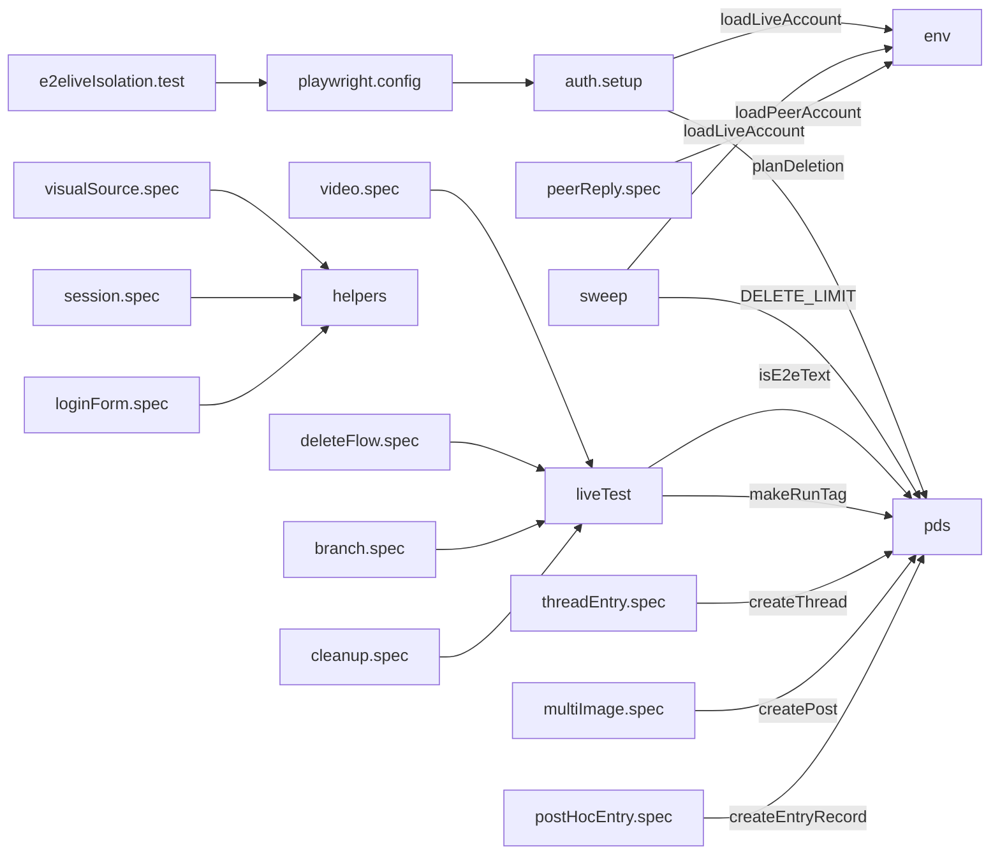
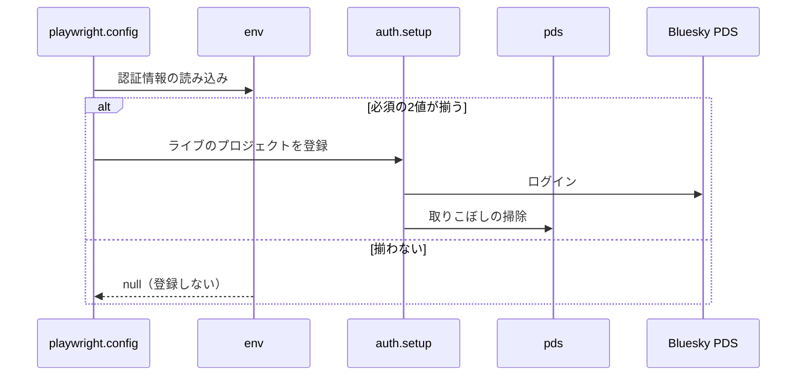

# Design Document

## Overview

**Purpose**: 実際のBlueskyアカウントでしか確認できない動作を、検証用アカウントの認証情報を与えたときだけ動くE2Eテストとして自動で検証し、作った投稿とentryをテストの後に残さないようにする。
**Users**: 実際の Bluesky アカウントでしか確認できない動作を検証する開発者
**Impact**: 検証用アカウントの認証情報を与えたときだけ動く E2E テストを加え、作った投稿と entry をテストの後に残さない。アプリ本体にはテスト用の自動ログインを置かない。

### Goals

- 検証用アカウントの認証情報の指定と、テスト開始前のログイン。
- 検証用アカウントのPDSへの直接の投稿・entryの作成と削除。
- テストが作った投稿とentryの後始末。
- スレッド投稿・複数画像・動画・事後entry作成・削除フローの実アカウントでの検証。

### Non-Goals

- アプリ本体への自動ログインの追加。
- 実機・他ブラウザ・見た目の目視の確認。
- Blueskyの検索基盤が投稿を欠落させる状況の再現。

## Boundary Commitments

### This Spec Owns

- 検証用アカウントの認証情報の指定と、テスト開始前のログイン。
- 検証用アカウントのPDSへの直接の投稿・entryの作成と削除。
- テストが作った投稿とentryの後始末。
- スレッド投稿・複数画像・動画・事後entry作成・削除フローの実アカウントでの検証。

### Out of Boundary

- アプリ本体への自動ログインの追加。
- 実機・他ブラウザ・見た目の目視の確認。
- Blueskyの検索基盤が投稿を欠落させる状況の再現。

### Allowed Dependencies

- 検証用アカウントと、その PDS（Bluesky）
- Playwright（`playwright.config.ts` のライブテストのプロジェクト）
- 検証対象の各機能（entry-api・thread-composer・image-picker・video-picker・entry-delete-dialog など）

### Revalidation Triggers

- 認証情報の指定方法（環境変数・設定ファイル）を変えるとき
- 後始末の3層（終了時の自動削除・開始時の回収・手動の掃除）を変えるとき
- 識別子と削除対象の選別の規則を変えるとき（検証用アカウントの既存の投稿を消さないことに影響する）

## Architecture

### Architecture Pattern & Boundary Map

ライブテストの各ファイルの依存方向を示す。



## File Structure Plan

| パス                                  | 責務                                                                           |
| ------------------------------------- | ------------------------------------------------------------------------------ |
| `tests/e2e/live/env.ts`               | 認証情報の読み込み（検証用アカウント・第三者アカウント）とログイン状態の保存先 |
| `tests/e2e/live/auth.setup.ts`        | テスト開始前のログインと、取りこぼしの掃除                                     |
| `tests/e2e/live/pds.ts`               | PDSの直接操作（作成・削除・掃除）と削除対象の選別                              |
| `tests/e2e/live/sweep.ts`             | 手動の掃除コマンド                                                             |
| `tests/e2e/live/liveTest.ts`          | テストごとの識別子と、終了時の自動削除                                         |
| `tests/e2e/live/helpers.ts`           | 画像の生成、公開APIでの確認、画素の判定                                        |
| `tests/e2e/live/threadEntry.spec.ts`  | スレッド投稿から削除までの検証                                                 |
| `tests/e2e/live/multiImage.spec.ts`   | 5枚の画像の投稿の検証                                                          |
| `tests/e2e/live/video.spec.ts`        | 動画投稿と動画の事後entry作成の検証                                            |
| `tests/e2e/live/postHocEntry.spec.ts` | 画像投稿の事後entry作成の検証                                                  |
| `tests/e2e/live/visualSource.spec.ts` | 事後entryのvisualの生成元の検証                                                |
| `tests/e2e/live/deleteFlow.spec.ts`   | 削除フローと旧実装のentryの検証                                                |
| `tests/e2e/live/branch.spec.ts`       | 分岐したスレッドの検証                                                         |
| `tests/e2e/live/peerReply.spec.ts`    | 第三者の返信の検証                                                             |
| `tests/e2e/live/cleanup.spec.ts`      | 後始末と掃除の検証                                                             |
| `tests/e2e/live/session.spec.ts`      | ログイン状態の検証                                                             |
| `tests/e2e/live/loginForm.spec.ts`    | ログインフォームの検証                                                         |
| `tests/repo/e2eliveIsolation.test.ts` | アプリ本体への混入と、設定ファイルの無視設定の検証                             |
| `playwright.config.ts`                | ライブテストのプロジェクトの登録                                               |

## System Flows

ライブテストを登録するかどうかが、認証情報の有無で分岐する流れを示す。



## Requirements Traceability

| Requirement                  | Summary                        | Components |
| ---------------------------- | ------------------------------ | ---------- |
| 1.1, 1.2, 1.3                | 認証情報の指定と実行対象       | D-1        |
| 2.1, 2.2                     | ログインと状態の共有           | D-2        |
| 3.1, 3.2, 3.3, 3.4, 3.5, 3.6 | PDS の直接操作と削除対象の選別 | D-3, D-4   |
| 4.1, 4.2, 4.3, 4.4           | 後始末                         | D-5        |
| 5.1, 5.2, 5.3                | 投稿から削除までの検証         | D-6        |
| 6.1, 6.2, 6.3, 6.4, 6.5      | 事後の entry 作成と削除フロー  | D-7, D-8   |
| 7.1, 7.2                     | アプリ本体への非混入           | D-9        |

## Components and Interfaces

#### D-1: 認証情報の指定

**Requirements**: 1.1, 1.2, 1.3

| 環境変数                         | 必須 | 内容                                   |
| -------------------------------- | ---- | -------------------------------------- |
| `SKYSHARE_E2E_IDENTIFIER`        | 必須 | 検証用アカウントのハンドル             |
| `SKYSHARE_E2E_APP_PASSWORD`      | 必須 | 検証用アカウントのアプリパスワード     |
| `SKYSHARE_E2E_SERVICE`           | 任意 | PDSのURL。既定は `https://bsky.social` |
| `SKYSHARE_E2E_PEER_IDENTIFIER`   | 任意 | 第三者アカウントのハンドル             |
| `SKYSHARE_E2E_PEER_APP_PASSWORD` | 任意 | 第三者アカウントのアプリパスワード     |

```ts
// リポジトリ直下の .env.e2e があれば読み込む（プロセス環境の値が優先される）。
// 必須の2値が揃わなければ null を返し、playwright.config.ts はライブテストのプロジェクトを登録しない。
export const loadLiveAccount = (env = process.env): LiveAccount | null
export const loadPeerAccount = (env = process.env): LiveAccount | null
```

#### D-2: ログインと状態の共有

**Requirements**: 2.1, 2.2

```ts
// live-setup プロジェクト: ログインAPIを1回だけ呼び、Cookieを含む状態を保存する
const res = await request.post("/v2/bsky/session/", {
  data: { identifier, password, service },
})
expect(res.status()).toBe(200)
await request.storageState({ path: LIVE_STORAGE_STATE })
```

| プロジェクト | 内容                                          |
| ------------ | --------------------------------------------- |
| `live-setup` | 上記のログインと、後始末の事前掃除を実行する  |
| `live`       | `live-setup` に依存し、保存した状態から始める |

ログインフォームのテストは、保存した状態を空にして `/login/` のフォームへ入力する。

#### D-3: PDSの直接操作

**Requirements**: 3.1, 3.2

```ts
export const isE2eText = (text?: string): boolean       // /^\[e2e ([0-9a-z]+)\] / に一致するか
export const makeRunTag = (now = Date.now()): string     // "[e2e <base36の時刻>]"
export const createPost(agent, { text, images?, reply?, createdAt? }): Promise<CreatedPost>
export const createThread(agent, items): Promise<CreatedPost[]>
export const createEntryRecord(agent, { source, visual, heading?, caption? }): Promise<{ uri }>
```

`createPost` は本文が `isE2eText` を満たさなければ例外にする。`createdAt` を指定できるため、分岐したスレッドの投稿日時の差を決定的に作れる。entryは、アプリのAPIでは作れない形式（sourceが返信投稿）を作るために直接のレコード作成を使う。

#### D-4: 削除対象の選別

**Requirements**: 3.3, 3.4, 3.5, 3.6

```ts
export const DELETE_LIMIT = 50

export const planDeletion = ({
  posts,
  entries,
  match,
  limit = DELETE_LIMIT,
  includePosts = true,
}) => {
  // 1. isE2eText(text) かつ match(text) の投稿だけを対象にする
  // 2. source.uri が対象の投稿を指すentryだけを対象にする
  // 3. 投稿とentryの合計が limit を超えたら何も返さず例外にする
}
```

| 操作                | 内容                                                                                     |
| ------------------- | ---------------------------------------------------------------------------------------- |
| `deleteByTag`       | 識別子が一致する投稿とentryを、entry→投稿の順に10件ずつ削除する                          |
| `deleteEntriesOnly` | 識別子が一致する投稿のentryだけを削除する                                                |
| `sweepStale`        | 識別子の時刻が `olderThanMs`（既定1時間）以上前のものを削除する。`dryRun` では削除しない |

#### D-5: 後始末の3層

**Requirements**: 4.1, 4.2, 4.3, 4.4

| 層               | 実行契機                           | 対象                                                                          |
| ---------------- | ---------------------------------- | ----------------------------------------------------------------------------- |
| 終了時の自動削除 | 各テストの終了時（成否を問わない） | そのテストの識別子                                                            |
| 事前掃除         | `live-setup` の末尾                | 1時間以上前の識別子付きの全て（第三者アカウントが設定されていれば、そちらも） |
| 手動の掃除       | `npm run e2e:live:sweep`           | `--dry-run`・`--older-than-ms` を指定できる                                   |

```ts
// liveTest.ts: テストごとの識別子。終了時に必ず削除する
tag: async ({ agent }, use) => {
  const tag = makeRunTag()
  try {
    await use(tag)
  } finally {
    await deleteByTag(agent, tag)
  }
}
```

#### D-6: 投稿から削除までの検証

**Requirements**: 5.1, 5.2, 5.3

| 検証      | 前提の作り方                         | 確認内容                                                                               |
| --------- | ------------------------------------ | -------------------------------------------------------------------------------------- |
| スレッド  | 投稿フォームから画像付きの3件を投稿  | entryが1件でsourceが先頭、公開APIで自己返信3件、Timeline・詳細・削除確認の表示         |
| 5枚の画像 | 色違いの5枚を投稿フォームから投稿    | gallery保存、公開ビューの `app.bsky.embed.gallery#view` が5件、visualに5枚目の色が無い |
| 動画      | mp4・mov・webmを投稿フォームから投稿 | 動画の埋め込みと縦横比、詳細ページの動画プレイヤー                                     |

#### D-7: 事後entry作成と削除フロー

**Requirements**: 6.1, 6.2, 6.3, 6.4

| 検証               | 前提の作り方                                                         | 確認内容                                                               |
| ------------------ | -------------------------------------------------------------------- | ---------------------------------------------------------------------- |
| 画像投稿の事後作成 | PDSへ画像付きの単発投稿を作る                                        | 作成ボタンの表示・押下・消滅、entryのsource                            |
| スレッドの事後作成 | ルートはテキストのみ、後続に画像のあるスレッドをPDSへ作る            | ルートに作成ボタン、entryのsourceがルート、visualが後続の画像の色      |
| 動画の事後作成     | 動画を投稿し、`deleteEntriesOnly` でentryだけを消す                  | 事後作成後の詳細ページにvisualと動画プレイヤー                         |
| 削除フロー         | PDSへ投稿とentryを作る                                               | 最終確認の一覧・キャンセル・再表示・確定、一覧とTimelineの両方の導線   |
| 旧実装のentry      | スレッドを作り、sourceを返信にしたentryを `createEntryRecord` で作る | 投稿ごとの削除がグレー表示で理由が出る。リンクのみの削除後も投稿が残る |
| 分岐したスレッド   | `createdAt` を指定して A→B→C と A→D→E を作る                         | 表示はA→B→Cのみ。ルートの削除でD・Eが残る                              |

#### D-8: 第三者の返信

**Requirements**: 6.5

```ts
const peer = loadPeerAccount()
test.skip(!peer, "第三者アカウントが未設定")
const peerAgent = await createPdsAgent(peer!, "peer")
// 検証用アカウントのルートへ peerAgent で返信を作り、ルートの削除後も返信が残ることを確認する
// 終了時に peerAgent でも識別子の投稿を削除する
```

#### D-9: アプリ本体へ自動ログインを置かない方式

**Requirements**: 7.1, 7.2

| 方式                                          | 採否   | 理由                                                  |
| --------------------------------------------- | ------ | ----------------------------------------------------- |
| ログイン画面のURLパラメータで認証情報を渡す   | 不採用 | URLの履歴・Referer・アクセスログから認証情報が漏れる  |
| サーバーの環境変数で自動ログインする          | 不採用 | URLを知る誰もが検証用アカウントとして入れる経路になる |
| テストが認証情報でログインAPIを呼び状態を保存 | 採用   | アプリ本体に経路を足さずに同じ目的を果たせる          |

```gitignore
/.env.e2e
/playwright/.auth
```

## Error Handling

| 事象                          | 処理                                                       |
| ----------------------------- | ---------------------------------------------------------- |
| ログインAPIが200以外          | HTTPステータスのみを示して失敗にする。認証情報は出力しない |
| 削除対象が上限を超える        | 何も削除せず例外にする                                     |
| 保存済みのPDSセッションが失効 | 再ログインして保存し直す                                   |
| 識別子で始まらない本文の作成  | 例外にする                                                 |

## Testing Strategy

- Unit / Build Tests:
  - `npx vitest run tests/lib/e2e tests/repo`
  - `npx vitest run tests/lib/e2e`
  - `npx playwright test --project=live-setup --project=live threadEntry multiImage video`
  - `npx playwright test --project=live-setup --project=live postHocEntry visualSource deleteFlow branch`
  - `npx playwright test --project=live-setup --project=live peerReply`
- E2E/UI Tests:
  - `tests/e2e/live/loginForm.spec.ts` ログイン画面のフォームに認証情報を入力して送信する → トップページへ遷移しセッションが確立される
  - `tests/e2e/live/cleanup.spec.ts` 識別子付きの投稿を作って終了時の削除と掃除を実行する → 古い投稿だけが削除される
  - `tests/e2e/live/threadEntry.spec.ts` 画像付きの3件のスレッドを投稿して削除する → entryが1件作られ、削除の確定で3件とも消える
  - `tests/e2e/live/deleteFlow.spec.ts` 削除の最終確認でキャンセルして再度開き確定する → 一覧が再表示され投稿が消える
  - `tests/e2e/live/peerReply.spec.ts` 第三者が返信した後にルートを削除する → 第三者の返信が残る
- テストの名前には、対応する基準 ID を `[e2elive/<ID>]` の形で付ける（例: `[e2elive/1.1]`）
