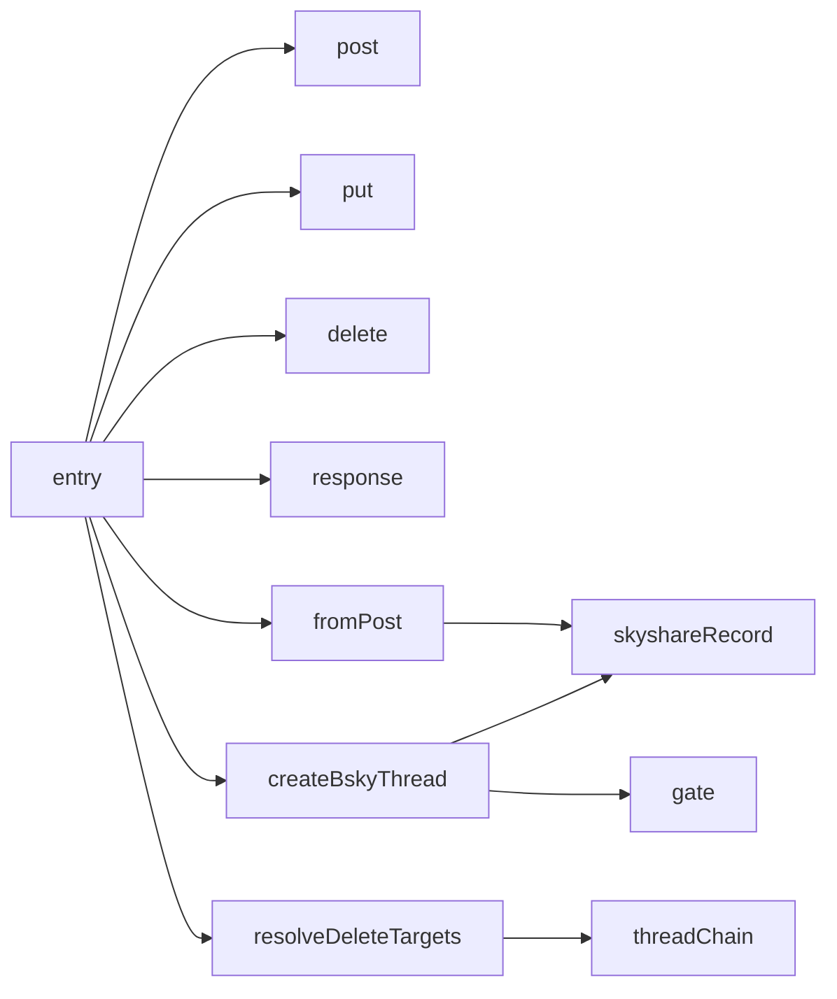
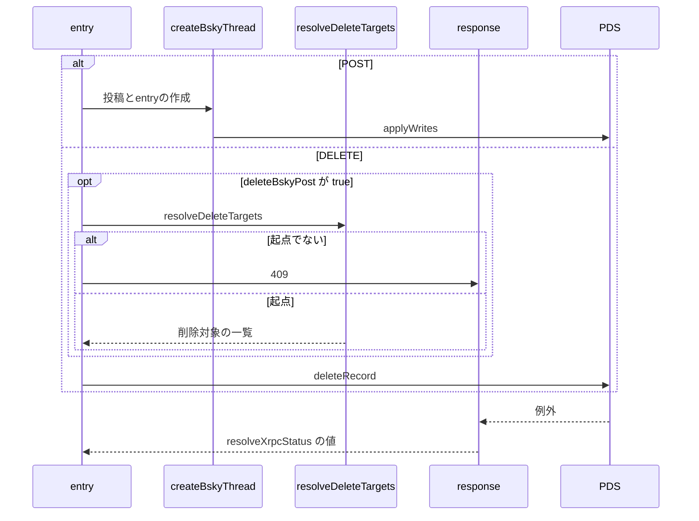

# Design Document

## Overview

**Purpose**: Bluesky投稿の作成と、投稿に紐づくskyshare entryの作成・編集・削除を、1つのAPIで所有権と整合性を保って行えるようにする。
**Users**: 投稿と entry を作成・編集・削除する利用者の画面
**Impact**: Bluesky 投稿と、それに紐づく skyshare entry の作成・編集・削除を、所有権と整合性を保つ1つの API にまとめる。

### Goals

- 1件またはスレッドのBluesky投稿の作成と、同時のentryの作成。
- 既存の投稿からのentryの作成。
- entryの見出しと説明文の編集。
- entryの削除と、紐づくBluesky投稿の削除。

### Non-Goals

- entryの一覧の取得。
- entryの作成対象とする投稿の選び方と、代表画像・見出し・説明文の生成。
- 本文中のリンク・メンション・ハッシュタグの自動検出。
- 動画のアップロードと変換、動画の再生（video 系の仕様が担う。本仕様は先行アップロード済みの動画の参照を投稿に載せるだけを扱う）。

## Boundary Commitments

### This Spec Owns

- 1件またはスレッドのBluesky投稿の作成と、同時のentryの作成。
- 既存の投稿からのentryの作成。
- entryの見出しと説明文の編集。
- entryの削除と、紐づくBluesky投稿の削除。

### Out of Boundary

- entryの一覧の取得。
- entryの作成対象とする投稿の選び方と、代表画像・見出し・説明文の生成。
- 本文中のリンク・メンション・ハッシュタグの自動検出。
- 動画のアップロードと変換、動画の再生（video 系の仕様が担う。本仕様は先行アップロード済みの動画の参照を投稿に載せるだけを扱う）。

### Allowed Dependencies

- Bluesky の PDS（認証済みのエージェントによる書き込み）
- API の認証の再開（account-session）
- lexicon（entry レコードの形式と見出し・説明文の上限）
- 投稿の作成と下書きで共通のスレッドの上限（post-record、draft-api）
- 先行アップロード済みの動画の参照と縦横比（video-upload、video-picker）

### Revalidation Triggers

- entry レコードの形式や lexicon の上限を変えるとき
- 派生元の決め方と削除範囲の導出（`resolveDeleteTargets`）を変えるとき（entry-delete-dialog の事前判定と一致が要る）
- エラー応答の分類やステータスを変えるとき（api-error-message）
- 原子的な書き込みの単位を変えるとき

## Architecture

### Architecture Pattern & Boundary Map

entry APIの構成要素の依存方向を示す。



## File Structure Plan

| パス                                    | 責務                                       |
| --------------------------------------- | ------------------------------------------ |
| `src/pages/v2/entry.ts`                 | POST・PUT・DELETE のハンドラ               |
| `src/lib/api/schema/v2/entry/post.ts`   | POST の入力スキーマ                        |
| `src/lib/api/schema/v2/entry/put.ts`    | PUT の入力スキーマ                         |
| `src/lib/api/schema/v2/entry/delete.ts` | DELETE の入力スキーマ                      |
| `src/lib/entry/createBskyThread.ts`     | 投稿・gate・entryの原子的な作成            |
| `src/lib/entry/fromPost.ts`             | 既存の投稿からのentryの作成                |
| `src/lib/entry/skyshareRecord.ts`       | entryレコードの組み立てと更新              |
| `src/lib/entry/resolveDeleteTargets.ts` | 削除対象の投稿の導出                       |
| `src/lib/atproto/threadChain.ts`        | スレッドの起点判定と自分の投稿の連鎖の抽出 |
| `src/lib/atproto/gate.ts`               | 簡略化したgate設定から公式レコードへの変換 |
| `src/lib/api/response.ts`               | エラー応答とatprotoの例外の変換            |

## System Flows

作成と削除の流れ、削除対象の導出での分岐を示す。



## Requirements Traceability

| Requirement                       | Summary            | Components         |
| --------------------------------- | ------------------ | ------------------ |
| 1.1, 1.2, 1.3, 1.4, 1.5, 1.6, 1.7 | 投稿の作成         | D-1, D-2           |
| 2.1, 2.2, 2.3, 2.4, 2.5, 2.6      | entry の作成       | D-1, D-2, D-3, D-4 |
| 3.1, 3.2, 3.3                     | entry の編集       | D-1, D-5           |
| 4.1, 4.2, 4.3, 4.4, 4.5, 4.6, 4.7 | entry と投稿の削除 | D-1, D-3, D-6      |
| 5.1, 5.2, 5.3, 5.4, 5.5           | 共通の検証とエラー | D-1                |

## Components and Interfaces

#### D-1: 共通の検証とエラー

**Requirements**: 1.6, 2.4, 3.2, 4.7, 5.1, 5.2, 5.3, 5.4, 5.5

| 段階                                                                     | 失敗時 |
| ------------------------------------------------------------------------ | ------ |
| `Common.CommonCookieSchema` によるヘッダ検証                             | 400    |
| `locals.agent` と `locals.session` の存在                                | 401    |
| 入力の Content-Type と解析                                               | 400    |
| `RequestBodySchema.safeParse()`                                          | 400    |
| `parseOwnedAtUri(uri, collection, did)` によるコレクションと所有者の検証 | 400    |

- エラー応答は `errorResponseFromStatus(status)` で `{ error: string }` と `cache-control: no-store` を返す。
- atprotoの例外は `resolveXrpcStatus` で変換する: 認証系→401、`RateLimitExceeded` `DraftLimitReached`→429、`BlobNotFound` `RepoNotFound` `RecordNotFound`→404、その他→500。
- 入力スキーマはZodで定義し、同じ定義からOpenAPIドキュメントを生成する。アプリ独自の頻度制限は持たない。

#### D-2: 新規投稿の入力

**Requirements**: 1.1, 1.2, 1.3, 1.4, 1.5, 1.6, 1.7, 2.1

```ts
// multipart/form-data。uri（既存の投稿から作成）か posts（新規投稿）の anyOf
type NewPostsBody = {
  posts: EntryPostItem[] // 1〜MAX_THREAD_POST_COUNT 件
  reply?: ReplyRef // スレッド全体の接続先。自分の投稿であることを isReplyRefOwnedBySelf で検証
  createEntry?: boolean
  visual?: Blob // createEntry が true のとき必須
  heading?: string // 100バイトまで（UTF-8）。サーバは生成しない
  caption?: string // 300バイトまで（UTF-8）
}
// テキストのみ・リンクカード付き・画像付き・動画付きの4分岐の union（各 .strict()）。動画付きは images・ogImage・ogMeta を持てない
type EntryPostItem = {
  text?: string
  facets?: Facet[]
  images?: Blob[]
  imagesMeta?: { width: number; height: number; alt?: string }[]
  ogImage?: Blob
  ogMeta?: { title: string; description: string; url: string; image?: string }
  video?: VideoBlob // 先行アップロード済みの動画の blob 参照（JSON）。videoMeta と対
  videoMeta?: { width: number; height: number; alt?: string }
  langs?: string[]
  selfLabels?: SelfLabel[]
  gate?: CommonGateSettings
}
```

- `formDataToObject` と `RequestBodyFieldKinds` で `posts[i][...]` を配列に復元する。空文字の `text` は未指定に正規化する。
- 各投稿で、画像の枚数と `imagesMeta` の件数の一致と、facets の終端が本文のバイト長以内であることを検証する。全件の検証が通るまで書き込まない。
- 埋め込みは動画を最優先とし（スキーマ上、動画は画像・リンクカードと排他で、`createVideoEmbed` が `app.bsky.embed.video` にする）、次に画像を優先し、画像が1〜4枚なら `app.bsky.embed.images`、5〜10枚なら `app.bsky.embed.gallery`、画像が無くリンクカードがあれば `app.bsky.embed.external` にする。11枚以上はスキーマで400にする。
- `createEntry` が true で `visual` が無ければ400にする。投稿が画像を含むかは検証しない。
- gate は公式の union 型を露出しない簡略化した `CommonGateSettings` で受け取り、`gate.ts` の builder が threadgate・postgate のレコード値に変換する。

#### D-3: 原子的な作成

**Requirements**: 2.2, 2.5, 2.6, 4.1

```
prevTid = undefined
for i in posts:
  rkey[i] = TID.next(prevTid); prevTid = rkey[i]
  record[i].reply = i == 0 ? request.reply
                            : { root: request.reply?.root ?? ref(0), parent: ref(i - 1) }
  cid[i] = cidForLex(record[i]) // 次の投稿の reply と entry の source をPDSの応答を待たずに組み立てる
  writes += create(post[i]) + gate(i)?
if createEntry: writes += create(entry { source: ref(0), manifest: { visual, heading?, caption? } })
results = applyWrites(writes) // PDSが全件成功か全件失敗を保証する
return results から組み立てた { posts: [{ url, uri, cid }], skyshareEntry? }
```

`MAX_THREAD_POST_COUNT`（100）は `src/lib/atproto/threadLimit.ts` の1か所で定義し、投稿の作成と下書きのスキーマが参照する。

#### D-4: 既存の投稿からの作成

**Requirements**: 2.3, 2.4

| 手順 | 内容                                                    | 失敗時 |
| ---- | ------------------------------------------------------- | ------ |
| 1    | `uri` が自分の `app.bsky.feed.post` か検証する          | 400    |
| 2    | `getRecord` で投稿の本文と cid を取得する               | 404    |
| 3    | `visual` の有無を検証する                               | 400    |
| 4    | `visual` をアップロードする                             | 500    |
| 5    | `source` を `uri` 自身としてentryを `createRecord` する | 500    |

投稿の画像の有無とスレッド上の位置は検証せず、返信の連鎖をたどって派生元を差し替えない。

#### D-5: 編集

**Requirements**: 3.1, 3.2, 3.3

```ts
// PUT application/json: { uri: string, heading: string(max 100), caption: string(max 300) }（.strict()）
const current = await agent.com.atproto.repo.getRecord({
  repo,
  collection: ENTRY_COLLECTION,
  rkey,
})
await agent.com.atproto.repo.putRecord({
  repo,
  collection: ENTRY_COLLECTION,
  rkey,
  record: {
    ...current.value,
    manifest: { ...current.value.manifest, heading, caption },
  },
  swapRecord: current.cid, // 読み取り時から変わっていれば失敗させる
})
```

#### D-6: 削除

**Requirements**: 4.1, 4.2, 4.3, 4.4, 4.5, 4.6

```ts
// DELETE application/json: { uri: string, deleteBskyPost?: boolean }（.strict()）
export type DeleteTargetsResult =
  | { kind: "targets"; rkeys: string[] } // source 自身を先頭に時系列順
  | { kind: "sourceGone" }
  | { kind: "notThreadRoot" }
export const resolveDeleteTargets = async (
  agent,
  ownerDid,
  sourceUri,
): Promise<DeleteTargetsResult> => {
  // getPostThread({ uri: sourceUri, depth: MAX_THREAD_POST_COUNT, parentHeight: 0 })
  // NotFound の例外・isNotFoundPost → sourceGone、それ以外の例外は投げ直す
  // !isThreadRootPost(thread.post) → notThreadRoot（record.reply を持つ投稿は起点でない）
  // extractOwnedLinearReplyChain(thread, ownerDid, MAX_THREAD_POST_COUNT) の各投稿を
  //   parseOwnedAtUri で所有者検証してから rkey にする
}
```

| 段階                     | 処理                                                                                                     |
| ------------------------ | -------------------------------------------------------------------------------------------------------- |
| `deleteBskyPost` が true | entryを `getRecord` して `source` を読む（失敗は404）。entryの削除より前に `resolveDeleteTargets` を呼ぶ |
| `notThreadRoot`          | 409 を返し、何も削除しない                                                                               |
| 導出の例外               | 500 を返し、何も削除しない                                                                               |
| entryの削除              | `deleteRecord`                                                                                           |
| `targets`                | 1件なら `deleteRecord`、2件以上なら1回の `applyWrites`。失敗しても200                                    |
| `deleteBskyPost` が偽    | スレッドを取得せずentryだけを削除する                                                                    |

`extractOwnedLinearReplyChain` は、直前の投稿への自分の返信を次の対象とし、自分の返信が複数ある場合は `createdAt` の差が最小のものを選ぶ。第三者の返信の先はたどらない。

## Error Handling

| 事象                                         | 処理                                  |
| -------------------------------------------- | ------------------------------------- |
| 画像・代表画像・サムネイルのアップロード失敗 | 500                                   |
| リンクカードの埋め込みの組み立て失敗         | 400                                   |
| `applyWrites` の失敗                         | 500（何も作成されない）               |
| 編集時の `swapRecord` の不一致               | atprotoの例外として変換したステータス |

## Testing Strategy

- Unit / Build Tests:
  - `npx vitest run tests/pages/v2/entry.test.ts tests/lib/api/schema/threadLimit.test.ts tests/lib/api/schema/entryTextBytes.test.ts`
  - `npx vitest run tests/pages/v2/entry.test.ts -t PUT`
  - `npx vitest run tests/pages/v2/entry.test.ts tests/lib/entry/resolveDeleteTargets.test.ts`
- テストの名前には、対応する基準 ID を `[entry-api/<ID>]` の形で付ける（例: `[entry-api/1.1]`）
