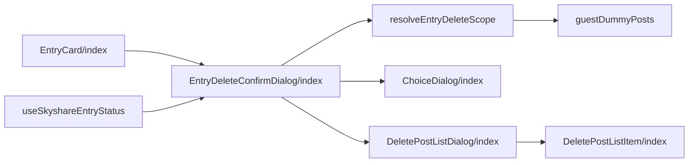
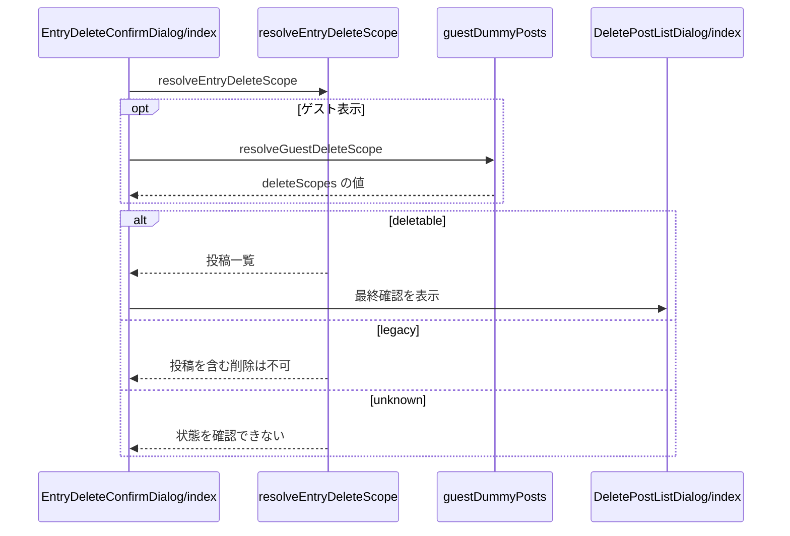

# Design Document

## Overview

**Purpose**: entryを削除するとき、Bluesky投稿まで消すかを利用者が選べるようにし、取り消せない投稿の削除を誤って実行しないよう、削除される投稿を事前に確認させる。
**Users**: entry を削除する利用者（投稿の削除まで行うか選ぶ）
**Impact**: 取り消せない Bluesky 投稿の削除を誤って実行しないよう、削除される投稿を事前に確認させる。

### Goals

- entryの削除方式の選択と、Bluesky投稿の削除の最終確認。
- 削除範囲の事前判定と、削除対象の投稿の一覧。
- ゲスト表示での削除の模擬。

### Non-Goals

- サーバーでの削除の処理。
- 削除の操作を置く画面の配置。

## Boundary Commitments

### This Spec Owns

- entryの削除方式の選択と、Bluesky投稿の削除の最終確認。
- 削除範囲の事前判定と、削除対象の投稿の一覧。
- ゲスト表示での削除の模擬。

### Out of Boundary

- サーバーでの削除の処理。
- 削除の操作を置く画面の配置。

### Allowed Dependencies

- 削除 API とその削除範囲の導出（entry-api）
- 共通のダイアログ（ChoiceDialog）
- ゲスト表示（app-navigation の判定）

### Revalidation Triggers

- 削除範囲の判定（連鎖の抽出）をサーバーと変えるとき（確認の一覧と実際の削除の差異が出る）
- 削除方式の選択肢を変えるとき
- 派生元の状態（返信・削除済み・判定不能）の扱いを変えるとき

## Architecture

### Architecture Pattern & Boundary Map

削除ダイアログの部品の依存方向を示す。



## File Structure Plan

| パス                                                      | 責務                                     |
| --------------------------------------------------------- | ---------------------------------------- |
| `src/lib/entry/resolveEntryDeleteScope.ts`                | 削除範囲の判定と一覧用の投稿の取得       |
| `src/components/entry/EntryDeleteConfirmDialog/index.tsx` | 削除方式の選択と最終確認への遷移         |
| `src/components/entry/DeletePostListDialog/index.tsx`     | 削除対象の投稿の一覧付きの最終確認       |
| `src/components/entry/DeletePostListItem/index.tsx`       | 一覧の1行                                |
| `src/components/common/ChoiceDialog/index.tsx`            | 選択肢の上に理由を表示する `description` |
| `src/components/entry/EntryCard/index.tsx`                | entry一覧からの呼び出し                  |
| `src/components/post/PostCard/useSkyshareEntryStatus.ts`  | タイムラインからの呼び出し               |
| `src/lib/entry/guestDummyPosts.ts`                        | ゲスト表示の削除範囲の模擬データ         |

## System Flows

削除範囲の判定結果による選択肢の分岐を示す。



## Requirements Traceability

| Requirement             | Summary                  | Components |
| ----------------------- | ------------------------ | ---------- |
| 1.1, 1.2, 1.3, 1.4, 1.5 | 削除方式の選択           | D-2        |
| 2.1, 2.2, 2.3, 2.4, 2.5 | 最終確認の一覧           | D-1, D-3   |
| 3.1, 3.2, 3.3           | 削除できない・不要な場合 | D-2        |
| 4.1                     | ゲスト表示での模擬       | D-4        |

## Components and Interfaces

#### D-1: 削除範囲の判定

**Requirements**: 2.4, 2.5

```ts
export type EntryDeleteScope =
  | { kind: "deletable"; posts: TimelinePost[] } // 古い順。単発は1件
  | { kind: "legacy" } // 派生元が返信の投稿
  | { kind: "unknown" } // 判定不能
export const resolveEntryDeleteScope = async (
  sourceUri: string,
): Promise<EntryDeleteScope> => {
  // parseAtUri が失敗 → unknown
  // publicAtpAgent.app.bsky.feed.getPostThread({ uri, depth: MAX_THREAD_POST_COUNT, parentHeight: 0 })
  // isThreadViewPost でない → unknown、!isThreadRootPost(thread.post) → legacy
  // extractOwnedLinearReplyChain(thread, parsed.repo, MAX_THREAD_POST_COUNT) を
  //   normalizePostViewToTimelinePost で変換し、1件でも変換できなければ unknown
  // 例外 → unknown
}
```

起点の判定と連鎖の抽出は、サーバーの削除対象の導出と同じ `isThreadRootPost` と `extractOwnedLinearReplyChain` を使う。呼び出し側は、ダイアログを開く前に判定を終え、判定中は削除ボタンを無効にする。

#### D-2: 削除方式の選択

**Requirements**: 1.1, 1.2, 1.3, 1.4, 1.5, 3.1, 3.2, 3.3

| key           | ラベル                    | variant                                   | 動作                                              |
| ------------- | ------------------------- | ----------------------------------------- | ------------------------------------------------- |
| `delete-link` | Skyshareリンクを削除      | `black`                                   | `onDeleteLink`                                    |
| `delete-post` | リンク・Bluesky投稿を削除 | `deletable` なら `red`、それ以外は `gray` | `deletable` なら最終確認へ。それ以外は `disabled` |
| `cancel`      | キャンセル                | `gray`                                    | `onCancel`                                        |

- `ChoiceDialog` の `description` に、`legacy` では派生元が返信の投稿のため投稿を含めて削除できない旨と取り得る手段を、`unknown` では状態を確認できない旨を渡す。
- 派生元が削除済みのentryは、`resolveEntryDeleteScope` を呼ばずに、entryだけの削除の確認にする。
- 削除APIには `{ uri, deleteBskyPost }` を送る。409とその他の失敗は削除のエラー表示に流す。
- `open` が false になったら段階を選択へ戻す。

#### D-3: 最終確認の一覧

**Requirements**: 2.1, 2.2, 2.3

```ts
type Props = {
  open: boolean
  posts: TimelinePost[] // 1件以上
  isDeleting?: boolean
  onConfirm: () => void | Promise<void> // 全て削除
  onCancel: () => void // ボタン・背景クリック・Escキー。選択の段階へ戻す
}
```

- 要約: 1件なら投稿1件を削除する旨、2件以上なら件数付きでスレッドを削除する旨と、取り消せない旨・第三者の返信が残る旨を表示する。
- 一覧は `ComponentList` と `DeletePostListItem` で描画する。2件以上のときは `height: min(40vh, 360px); overflow-y: auto` で高さを固定し、`tabIndex=0` を付ける。
- 1行: 日時、`-webkit-line-clamp: 3` で省略した本文（空なら本文なしの表示）、先頭4枚の一辺56pxのサムネイルと5枚目以降の「+N」。動画は poster に再生マークを重ねて1枚表示する。画像が無ければサムネイル欄を描画しない。
- 汎用の `ConfirmDialog` は使わず、`Overlay` と共通のダイアログクラスで構成する。

#### D-4: ゲスト表示の模擬

**Requirements**: 4.1

```ts
// 表示言語ごとに組み立ててキャッシュする。deleteScopes は単発・2件スレッド・legacy・unknown の4例
export const getGuestDummyData = (translator: Translator): { deleteScopes: Record<string, EntryDeleteScope> /* ほか */ }
export const resolveGuestDeleteScope = (
  sourceUri: string,
  translator: Translator,
): EntryDeleteScope =>
  getGuestDummyData(translator).deleteScopes[sourceUri] ?? { kind: "unknown" }
```

ゲスト表示では、判定に `resolveGuestDeleteScope` を使い、削除APIを呼ばずに成功時と同じ状態遷移だけを行う。削除ボタンには作成・共有ボタンと別の `deleteDisabled` を使う。

## Error Handling

| 事象                  | 処理                                        |
| --------------------- | ------------------------------------------- |
| 削除範囲の判定の失敗  | `unknown` として投稿の削除を選択不可にする  |
| 削除APIの409          | Bluesky投稿を含めて削除できない旨を表示する |
| 削除APIのその他の失敗 | 削除のエラーを表示し、entryを残す           |

## Testing Strategy

- Unit / Build Tests:
  - `npx vitest run tests/lib/entry/resolveEntryDeleteScope.test.ts`
  - `npm run build`
- E2E/UI Tests:
  - `tests/e2e/entryDeleteDialog.spec.ts` スレッドのentryでリンクとBluesky投稿を削除を選ぶ → 2件の一覧と注意が表示され、確定でスレッド全体が消える
  - `tests/e2e/entryDeleteDialog.spec.ts` ゲスト表示のentry一覧で単発のentryを削除する → 最終確認を経てカードが消える
- テストの名前には、対応する基準 ID を `[entry-delete-dialog/<ID>]` の形で付ける（例: `[entry-delete-dialog/1.1]`）
