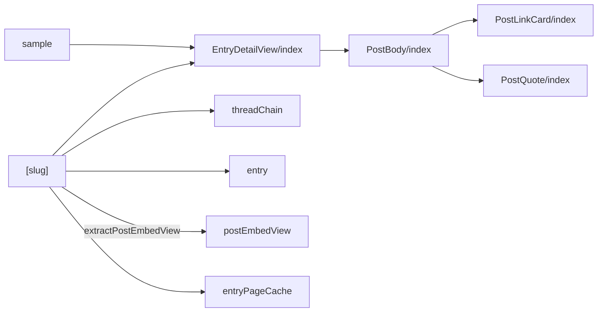
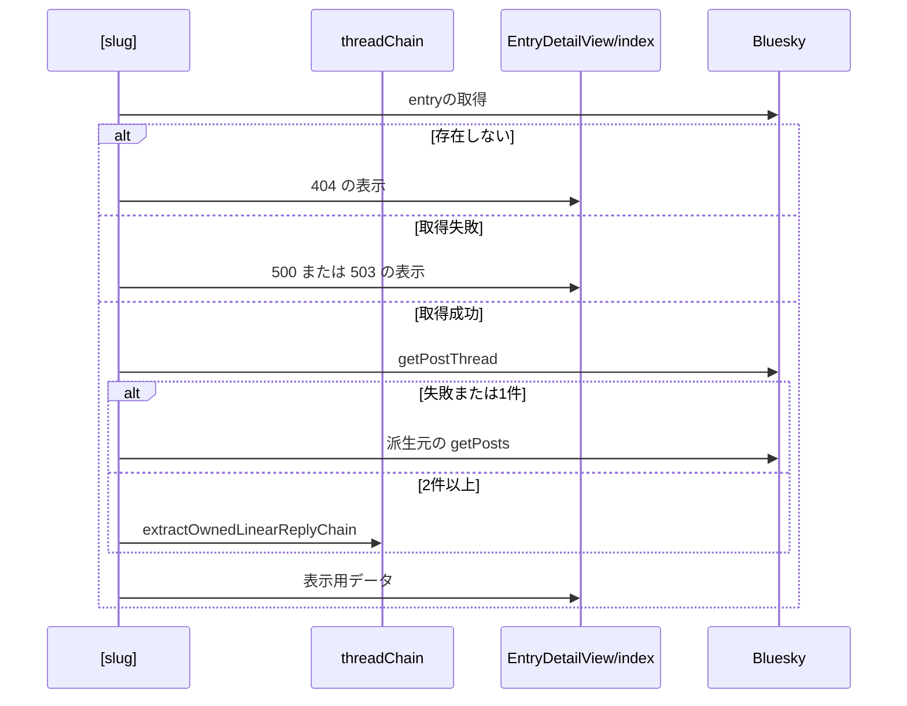

# Design Document

## Overview

**Purpose**: skyshare entryの詳細ページで、entryの情報と派生元の投稿を、タイムラインと同じ投稿カードの形式で表示する。
**Users**: 共有されたリンクから entry の詳細を見る閲覧者と、投稿者本人
**Impact**: entry の情報と派生元の投稿を、タイムラインと同じ投稿カードの形式で表示し、同じ表示言語の繰り返しの表示を保存して再利用する。

### Goals

- entry詳細ページのヘッダーカードと投稿カードの構成。
- 派生元から自分が続けて投稿したスレッドの表示。
- 投稿ごとのリアクション数とページ下部の余白。

### Non-Goals

- 画像のサムネイルと拡大表示の内部の動作。
- entryの編集と削除の操作。
- タイムラインでの投稿の表示。

## Boundary Commitments

### This Spec Owns

- entry詳細ページのヘッダーカードと投稿カードの構成。
- 派生元から自分が続けて投稿したスレッドの表示。
- 投稿ごとのリアクション数とページ下部の余白。

### Out of Boundary

- 画像のサムネイルと拡大表示の内部の動作。
- entryの編集と削除の操作。
- タイムラインでの投稿の表示。

### Allowed Dependencies

- entry と派生元のスレッドの取得（entry-api、atproto-access）
- 投稿カードの表示部（post-body-editor・PostBody）
- ページのキャッシュ（`entryPageCache`）

### Revalidation Triggers

- スレッドの連鎖の抽出（`threadChain`）を変えるとき（entry-delete-dialog の削除範囲と一致が要る）
- 保存したページの有効時間（5分）を変えるとき
- 埋め込み（リンクカード・引用）の表示形式を変えるとき

## Architecture

### Architecture Pattern & Boundary Map

詳細ページの表示に関わる依存方向を示す。



## File Structure Plan

| パス                                               | 責務                                               |
| -------------------------------------------------- | -------------------------------------------------- |
| `src/pages/entries/[slug].astro`                   | entryとスレッドの取得、表示用データの組み立て      |
| `src/components/entry/EntryDetailView/index.astro` | ヘッダーカード・投稿カードの並び・エラー表示・余白 |
| `src/components/post/PostBody/index.tsx`           | 投稿カードの表示部（タイムラインと共用）           |
| `src/lib/atproto/threadChain.ts`                   | 自分の投稿の直線的な連鎖の抽出                     |
| `src/lib/entry/entry.ts`                           | 投稿の画像の抽出                                   |
| `src/lib/entry/postEmbedView.ts`                   | 投稿の埋め込みのリンクカードと引用の抽出           |
| `src/components/post/PostLinkCard/index.tsx`       | リンクカードの表示                                 |
| `src/components/post/PostQuote/index.tsx`          | 引用の枠の表示                                     |
| `src/lib/entry/entryPageCache.ts`                  | 詳細ページのSSR結果の保存と再利用                  |
| `src/pages/entries/sample.astro`                   | 表示確認用のサンプルページ                         |

## System Flows

スレッド取得とフォールバックの流れを示す。



## Requirements Traceability

| Requirement             | Summary                | Components |
| ----------------------- | ---------------------- | ---------- |
| 1.1, 1.2, 1.3, 1.4, 1.5 | ページの構成           | D-2        |
| 2.1, 2.2, 2.3, 2.4      | スレッドとリアクション | D-1        |
| 3.1, 3.2                | 埋め込みの表示         | D-5        |
| 4.1                     | エラー表示             | D-2        |
| 5.1, 5.2, 5.3, 5.4      | 描画の性質と再利用     | D-3, D-4   |

## Components and Interfaces

#### D-1: 表示用データ

**Requirements**: 2.1, 2.2, 2.3, 2.4

```ts
export type EntryPostView = {
  webUrl: string
  author: { handle: string; displayName?: string; avatar?: string }
  createdAt: string
  text: string
  images: SourceImage[]
  engagement: {
    likeCount: number
    repostCount: number
    replyCount: number
    quoteCount: number
  } // 数値でなければ0
}
```

| 状況                            | `posts`                                                          |
| ------------------------------- | ---------------------------------------------------------------- |
| スレッドの抽出結果が2件以上     | `chain.map(...)`（各投稿の作者・作成日時・画像・自身のカウント） |
| 抽出結果が1件、または抽出の失敗 | 派生元の `getPosts` の1件                                        |
| 派生元が削除済み                | 空配列                                                           |

- `getPostThread({ uri: source.uri, depth: MAX_THREAD_POST_COUNT })` の結果に `extractOwnedLinearReplyChain(thread, ownerDid, MAX_THREAD_POST_COUNT)` を適用する。直前の投稿への自分の返信を次とし、複数ある場合は `createdAt` の差が最小のものを選ぶ。第三者の返信の先はたどらない。
- 画像は `extractSourceImages` で抽出し、`aspectRatio` が正の有限数のときだけ保持する。

#### D-2: ページの構成

**Requirements**: 1.1, 1.2, 1.3, 1.4, 1.5, 4.1

```
<article>
  <section class="header-card">代表画像（拡大なし） / caption / 作成日時 / 派生元削除時の案内文</section>
  <ol class="post-list">
    {posts.map(post => <li><div class="post-card">
      <PostBody client:load postUrl={post.webUrl} engagement={post.engagement} ... />
    </div></li>)}
  </ol>
</article>
<footer class="page-footer" aria-hidden="true"></footer>
```

- `manifestCaption` は entry自身の caption だけとし、メタ情報の説明文は `manifestCaption || sourceText.slice(0, 280)` を別に渡す。
- 連結線: `li:not(:last-child)::after { position: absolute; left: calc(var(--space-2) + var(--size-avatar-md) / 2 - 1px); top: 100%; width: 2px; height: var(--space-3) }`。
- `statusCode !== 200` のときは状態ごとのエラー表示を描画する。`page-footer` は状態によらず最後に描画し、`height: calc(6rem + env(safe-area-inset-bottom, 0px)); flex-shrink: 0` とする。
- `PostBody` は日時を `postUrl` へのリンク（`target="_blank"`）にし、`engagement` があるときだけ画像の下に `PostEngagementStats` を出す。

#### D-3: サーバー描画

**Requirements**: 5.1, 5.2

| 項目           | 内容                                                                         |
| -------------- | ---------------------------------------------------------------------------- |
| 描画           | Cloudflare Workers 上でSSRし、`PostBody` を `client:load` でハイドレートする |
| JavaScript依存 | 画像の拡大表示だけ                                                           |
| 横幅           | 横スクロールは画像5枚以上の帯の内部だけで発生させる                          |

#### D-4: SSR結果の再利用

**Requirements**: 5.3, 5.4

| 項目         | 内容                                                                                         |
| ------------ | -------------------------------------------------------------------------------------------- |
| 保存先       | Cloudflare の Cache API（`caches.default`）。データセンターごとに保存される                  |
| キー         | 末尾スラッシュ付きのパスと表示言語（`locals.locale`）。クエリ文字列は含めない                |
| 保存対象     | 200 の HTML のみ。404・500・Cookie を設定する応答は保存しない                                |
| 保存期間     | 300秒。entryの更新・削除は、最大でこの時間は保存済みのページに反映されない                   |
| 保存の流れ   | 未保存なら通常どおり描画し、`waitUntil` で保存する。保存済みなら後続の処理を呼ばずに返す     |
| 応答ヘッダー | `x-skyshare-cache` に `HIT` か `MISS` を入れる                                               |
| 対象外       | GET以外、事前描画のページ、Cache API が使えない環境（`workers.dev`）では保存も再利用もしない |
| 失敗時       | Cache API の失敗は握りつぶし、通常の描画にフォールバックする                                 |

#### D-5: 埋め込みの表示

**Requirements**: 3.1, 3.2

```ts
export type PostLinkCard = { uri: string; title: string; description: string; domain: string; thumb?: string }
export type PostQuote =
  | { kind: "post"; webUrl: string; author: { handle: string; displayName?: string; avatar?: string }
      createdAt: string; text: string; facets: PostFacet[]; images: SourceImage[] }
  | { kind: "unavailable" }
// PostView の embed（hydrate 済みの view）から取り出す。外部入力のため $type で形を確かめる
export const extractPostEmbedView = (embed: unknown): { linkCard?: PostLinkCard; quote?: PostQuote }
```

| embed の `$type`                      | 取り出すもの                                       |
| ------------------------------------- | -------------------------------------------------- |
| `app.bsky.embed.external#view`        | `external` からリンクカード（http と https だけ）  |
| `app.bsky.embed.record#view`          | `record` から引用                                  |
| `app.bsky.embed.recordWithMedia#view` | `record.record` から引用（画像と動画は既存の抽出） |

| 引用の `record` の `$type`                       | 表示                 |
| ------------------------------------------------ | -------------------- |
| `app.bsky.embed.record#viewRecord`（投稿）       | 作者・本文・画像の枠 |
| `#viewNotFound`・`#viewBlocked`・`#viewDetached` | 表示できない旨の枠   |
| それ以外（フィード・リスト）                     | 表示しない           |

`PostBody` は `linkCard` と `quote` を受け取り、画像・動画の下に `PostLinkCard`・`PostQuote` の順に置く。引用の枠は、全体を覆うリンク（`::after` の重ね）でBlueskyの引用元を開き、本文のリンクはその上に重ねて押せるようにする（リンクの入れ子を作らない）。

## Error Handling

| 事象                 | 処理                                |
| -------------------- | ----------------------------------- |
| entryが存在しない    | 404のエラー表示                     |
| entryの取得の失敗    | 500または503のエラー表示            |
| スレッドの取得の失敗 | 派生元1件の表示にフォールバックする |

## Testing Strategy

- Unit / Build Tests:
  - `npx vitest run tests/lib/atproto/threadChain.test.ts`
  - `npm run build` と `npm run test:astro`
  - `npm run build`
  - `npx vitest run tests/lib/entry/entryPageCache.test.ts`
  - `npx vitest run tests/lib/entry/postEmbedView.test.ts`
- E2E/UI Tests:
  - `tests/e2e/entryThreadDetail.spec.ts` スレッド由来のサンプルページを開く → 先頭から末尾まで古い順に表示される
  - `tests/e2e/entryPostCards.spec.ts` スレッドのサンプルページを開く → カードが順に並び、連結線と各カードのリアクション数が表示される
  - `tests/e2e/entryPostCards.spec.ts` JavaScriptを無効にしてサンプルページを開く → サムネイルが表示され、幅360pxで横スクロールが無い
  - `tests/e2e/entryEmbed.spec.ts` サンプルページを開く → リンクカードと引用の枠が表示され、それぞれ新しいタブでリンク先を開く
- テストの名前には、対応する基準 ID を `[entry-detail/<ID>]` の形で付ける（例: `[entry-detail/1.1]`）
