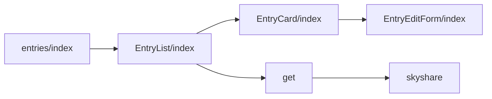
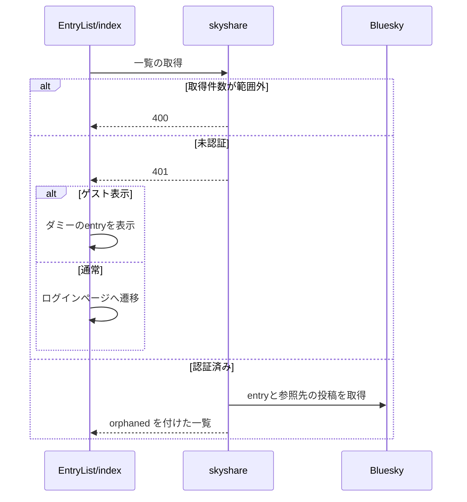

# Design Document

## Overview

**Purpose**: 作成したSkyshare entryを一覧で確認し、参照先の投稿が失われたentryを見分け、見出しとキャプションを後から編集できるようにする。
**Users**: 自分が作成した entry を一覧で確認・編集する利用者
**Impact**: 自分の entry の一覧を取得して表示し、参照先の投稿が失われた entry を見分け、見出しとキャプションを後から編集できるようにする。

### Goals

- 自分のentryの一覧の取得と、参照先の投稿が残っているかの判定。
- 一覧ページでのentryの表示。
- 見出しとキャプションの編集。

### Non-Goals

- entryの削除の確認。
- entryの作成。

## Boundary Commitments

### This Spec Owns

- 自分のentryの一覧の取得と、参照先の投稿が残っているかの判定。
- 一覧ページでのentryの表示。
- 見出しとキャプションの編集。

### Out of Boundary

- entryの削除の確認。
- entryの作成。

### Allowed Dependencies

- entry の編集 API（entry-api）
- Bluesky の PDS（entry レコードと参照先の投稿の取得）
- 削除ダイアログ（entry-delete-dialog）

### Revalidation Triggers

- 一覧 API の応答（削除済みの印）の形を変えるとき
- 見出しと説明文の上限（lexicon）を変えるとき
- 参照先の削除の判定を変えるとき

## Architecture

### Architecture Pattern & Boundary Map

一覧ページの構成要素の依存方向を示す。



## File Structure Plan

| パス                                            | 責務                                 |
| ----------------------------------------------- | ------------------------------------ |
| `src/pages/v2/entries/skyshare.ts`              | 自分のentryの一覧のハンドラ          |
| `src/lib/api/schema/v2/entries/skyshare/get.ts` | 一覧のクエリと応答のスキーマ         |
| `src/components/entry/EntryList/index.tsx`      | 一覧の取得とカードの並び             |
| `src/components/entry/EntryCard/index.tsx`      | 1件のカードの表示と操作              |
| `src/components/entry/EntryEditForm/index.tsx`  | 見出しとキャプションの編集ダイアログ |
| `src/pages/entries/index.astro`                 | 一覧ページ                           |

## System Flows

一覧の取得と、未認証・ゲスト表示での分岐を示す。



## Requirements Traceability

| Requirement        | Summary                    | Components |
| ------------------ | -------------------------- | ---------- |
| 1.1, 1.2, 1.3, 1.4 | 一覧の取得                 | D-1        |
| 2.1, 2.2, 2.3      | 一覧ページの表示           | D-2, D-3   |
| 3.1, 3.2, 3.3      | 見出しとキャプションの編集 | D-2        |

## Components and Interfaces

#### D-1: 一覧のAPI

**Requirements**: 1.1, 1.2, 1.3, 1.4

```ts
// GET /v2/entries/skyshare?limit=&cursor= → 200 { cursor?, entries: (TimelineSkyshareEntry & { orphaned: boolean })[] }
const GET_POSTS_BATCH_SIZE = 25
// 1. listRecords で自分の entry を limit 件（既定 20）取り、normalizeTimelineEntry で整形する
// 2. 各 entry の sourceUri を 25 件ずつ getPosts で引き、返らなかったものを orphaned: true にする
```

| 事象                  | 応答                                     |
| --------------------- | ---------------------------------------- |
| `limit` が範囲外      | 400                                      |
| `locals.agent` が無い | 401                                      |
| 連携先の例外          | `resolveXrpcStatus` で変換したステータス |

#### D-2: カードと編集

**Requirements**: 2.1, 2.2, 2.3, 3.1, 3.2, 3.3

```tsx
type EntryCardProps = {
  item: TimelineSkyshareEntry
  onDeleted: () => void
  onSaved: (next: { heading: string; caption: string }) => void
  guestMode?: boolean
}
type EntryEditFormProps = {
  open: boolean
  uri: string
  initialHeading?: string
  initialCaption?: string
  onClose: () => void
  onSaved: (next: { heading: string; caption: string }) => void
}
```

| 要素             | 内容                                                                                                                                            |
| ---------------- | ----------------------------------------------------------------------------------------------------------------------------------------------- |
| カード           | 作成日時・キャプション（無ければ案内文）・代表画像（拡大なし）・編集・削除・entryを開くリンク                                                   |
| 参照先が削除済み | `ui["card-muted"]` で中身のコントラストを下げる（面の色は変えない）。作成日時の横に「元投稿削除済み」のバッジを出す。削除は単純な確認だけを出す |
| 編集ダイアログ   | 見出し（上限100バイト）とキャプション（上限300バイト）の入力欄。文字数の表示はUTF-8のバイト数で数える。変更が無いとき保存を無効にする           |
| 保存             | `PUT /v2/entry` に `{ uri, heading, caption }` を送り、成功したら `onSaved` を呼ぶ                                                              |
| ゲスト表示       | 編集のボタンを `disabled` にし、削除は模擬の状態遷移だけを行う                                                                                  |

#### D-3: 一覧ページ

**Requirements**: 2.1

| 項目       | 内容                                                                              |
| ---------- | --------------------------------------------------------------------------------- |
| 生成       | 静的に生成し、実データは `EntryList` が `GET /v2/entries/skyshare` で取得する     |
| 続きの取得 | 無限スクロールで `cursor` を渡して取得する                                        |
| 未認証     | ゲスト表示でなければログインページへ遷移し、ゲスト表示ならダミーのentryを表示する |

## Error Handling

| 事象             | 処理                                     |
| ---------------- | ---------------------------------------- |
| 一覧の取得の失敗 | 一覧の読み込み失敗の文言を表示する       |
| 更新の失敗       | 編集ダイアログに更新失敗の文言を表示する |

## Testing Strategy

- Unit / Build Tests:
  - `npx vitest run tests/pages/v2/entries/skyshare.test.ts`
  - `npx tsc --noEmit`
- E2E/UI Tests:
  - `tests/e2e/entryList.spec.ts` ゲスト表示の一覧ページを開き、APIの応答を差し替えて見出しを編集して保存する → カードの表示と無効な編集ボタンを確認でき、更新の内容に新しい見出しが含まれる。削除済みのカードにだけバッジが表示される
- テストの名前には、対応する基準 ID を `[entry-list/<ID>]` の形で付ける（例: `[entry-list/1.1]`）
