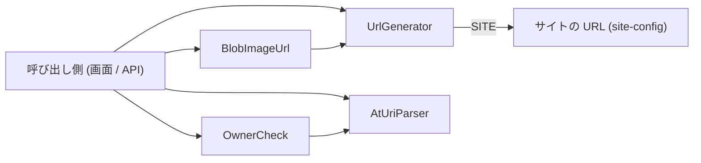

# Design Document

## Overview

**Purpose**: Bluesky の投稿・画像と Skyshare の entry の URL を一貫した形式で生成し、AT URI を安全に分解する部品を提供する。
**Users**: entry・投稿の表示、共有、削除、投稿の API を実装する開発者。
**Impact**: URL の生成と AT URI の検証を 1 つのモジュールに集約し、画面と API が同じ形式・同じ検証を使う状態を保つ。

### Goals

- 投稿・画像・entry の URL を常に同じ形式で生成する。
- サイト内リンクには相対パスを使えるようにし、絶対 URL は外部へ渡すときだけに限る。
- AT URI を、形式・コレクション・所有者のすべてが期待どおりのときだけ分解結果として返す。
- blob 参照の表現の違いを吸収して画像の URL にする。

### Non-Goals

- entry の NSID の導出。
- URL の短縮。

## Boundary Commitments

### This Spec Owns

- Bluesky の投稿ページと画像の URL の形式。
- entry ページのパスと絶対 URL の形式（`/entries/<handle>@<rkey>/`）。
- AT URI の分解規則と、コレクション・所有者の検証規則。
- blob 参照から識別子を取り出す規則と、画像 URL への変換。

### Out of Boundary

- entry の NSID の導出（`ENTRY_COLLECTION` の定義側）。
- URL の短縮。
- entry ページのルーティングの定義（`src/pages/entries/`）。
- 所有者の検証結果に対する処理（拒否の応答、削除の可否など。呼び出し側が持つ）。

### Allowed Dependencies

- ビルド時のサイトの URL（`import.meta.env.SITE`。site-config が定める）。
- 外部ライブラリ・ネットワーク・セッションには依存しない。

### Revalidation Triggers

- URL の形式（パス・クエリ）を変えるとき。共有されたリンクとの互換が要る。
- AT URI の分解規則や所有者の検証の基準を変えるとき。entry-api の所有権の検証と、AT URI を扱う各呼び出し側が影響を受ける。
- 識別子を取り出す規則を変えるとき。画像の表示に影響する。

## Architecture

### Existing Architecture Analysis

- `src/lib/entry/` は entry のドメイン処理を置く場所であり、本部品は副作用のない純粋関数だけで構成して他の部品から自由に参照できるようにしている。
- サイト内リンクは相対パスを基本とし、開発サーバー実行時に本番ドメインへ遷移する事故を構造的に防ぐ。絶対 URL は外部サービスへ渡すときだけ使う。

### Architecture Pattern & Boundary Map



- 選択したパターン: 状態を持たない関数群を 1 ファイルにまとめる。
- 既存パターンの維持: 失敗は例外でなく `undefined` で返す。

## File Structure Plan

### Directory Structure

```
src/lib/entry/
└── url.ts    # UrlGenerator・AtUriParser・OwnerCheck・BlobImageUrl（URL の生成、AT URI の分解と検証、blob 参照の識別子と画像 URL）
tests/lib/entry/
├── url.test.ts      # 生成と分解・検証の単体テスト
└── entry.test.ts    # blob 参照の識別子と画像 URL の単体テスト（entry の他の関数と同居）
```

## Requirements Traceability

| Requirement | Summary                                    | Components                 |
| ----------- | ------------------------------------------ | -------------------------- |
| 1.1         | 投稿ページの URL                           | UrlGenerator               |
| 1.2         | 符号化した画像の URL                       | UrlGenerator               |
| 2.1         | entry の相対パス                           | UrlGenerator               |
| 2.2         | サイトの URL を前置した entry の絶対 URL   | UrlGenerator               |
| 3.1         | AT URI の分解                              | AtUriParser                |
| 3.2         | 形式不正は結果なし                         | AtUriParser                |
| 3.3         | キーに `?` `#` を含むと結果なし            | AtUriParser                |
| 4.1         | コレクション・所有者が一致すれば結果を返す | OwnerCheck                 |
| 4.2         | コレクション不一致は結果なし               | OwnerCheck                 |
| 4.3         | 所有者不一致は結果なし                     | OwnerCheck                 |
| 4.4         | 形式不正は結果なし                         | OwnerCheck, AtUriParser    |
| 5.1         | 文字列の参照から識別子                     | BlobImageUrl               |
| 5.2         | `$link` を持つオブジェクトから識別子       | BlobImageUrl               |
| 5.3         | 取り出せない参照は識別子なし               | BlobImageUrl               |
| 5.4         | blob から画像の URL                        | BlobImageUrl, UrlGenerator |
| 5.5         | blob 未指定・識別子なしは画像の URL なし   | BlobImageUrl               |

## Components and Interfaces

| Component    | Domain/Layer | Intent                                             | Req Coverage            | Key Dependencies  | Contracts |
| ------------ | ------------ | -------------------------------------------------- | ----------------------- | ----------------- | --------- |
| UrlGenerator | URL          | 投稿・画像・entry の URL を生成する                | 1.1, 1.2, 2.1, 2.2      | SITE (P0)         | Service   |
| AtUriParser  | AT URI       | AT URI を 3 要素に分解する                         | 3.1, 3.2, 3.3, 4.4      | なし              | Service   |
| OwnerCheck   | AT URI       | 分解結果が期待するコレクションと所有者かを検証する | 4.1, 4.2, 4.3, 4.4      | AtUriParser (P0)  | Service   |
| BlobImageUrl | Blob         | blob 参照から識別子を取り出し、画像の URL にする   | 5.1, 5.2, 5.3, 5.4, 5.5 | UrlGenerator (P0) | Service   |

### URL

#### UrlGenerator

```ts
export const bskyPostUrlgen: (handle: string, rkey: string) => string
export const bskyCdnUrlgen: (repoDid: string, ref: string) => string
export const skyshareEntryPath: (handle: string, rkey: string) => string
export const skyshareEntryUrlgen: (handle: string, rkey: string) => string
```

- `bskyPostUrlgen`: `https://bsky.app/profile/<handle>/post/<rkey>`。
- `bskyCdnUrlgen`: `https://cdn.bsky.app/img/feed_fullsize/plain/<DID>/<ref>`。DID と ref は `encodeURIComponent` で符号化する。
- `skyshareEntryPath`: `/entries/<handle>@<rkey>/`。サイト内リンクはこれを使う。
- `skyshareEntryUrlgen`: `SITE` に `skyshareEntryPath` の結果を前置する。`SITE` は本番ドメイン固定のため、開発サーバー実行時も本番を指す。外部サービスへ渡すときだけ使う。

### AT URI

#### AtUriParser

```ts
type AtUriParts = { repo: string; collection: string; rkey: string }
export const parseAtUri: (uri: string) => AtUriParts | undefined
```

- 形式は `at://<repo>/<collection>/<rkey>` の 3 セグメント。repo と collection は `/` を含まず、rkey は `/` `?` `#` を含まない。一致しなければ `undefined`。

#### OwnerCheck

```ts
export const parseOwnedAtUri: (
  uri: string,
  expectedCollection: string,
  expectedRepo: string,
) => AtUriParts | undefined
```

- `parseAtUri` の結果が `expectedCollection` と `expectedRepo` の双方に一致するときだけ結果を返し、それ以外（形式不正・コレクション不一致・所有者不一致）は `undefined`。
- 呼び出し側はクライアントから渡された URI をこの検証を通してから扱う。

### Blob

#### BlobImageUrl

```ts
export const toCidString: (ref: unknown) => string | undefined
export const blobToCdnUrl: (
  repoDid: string,
  blob?: { ref?: unknown; mimeType?: string },
) => string | undefined
```

- `toCidString`: 文字列はそのまま、`$link` が文字列のオブジェクトはその値、それ以外は文字列表現が空や `[object Object]` でなければその値を返す。取り出せなければ `undefined`。
- `blobToCdnUrl`: blob が無い、または `toCidString` が `undefined` なら `undefined`。取り出せたら `bskyCdnUrlgen` で画像の URL を返す。

## Error Handling

| 事象                                        | 処理                        |
| ------------------------------------------- | --------------------------- |
| AT URI の形式が不正                         | 分解せず `undefined` を返す |
| コレクションまたは所有者が一致しない        | 分解せず `undefined` を返す |
| blob が無い、または参照から識別子を取れない | `undefined` を返す          |

いずれも例外は投げない。

## Testing Strategy

- Unit Tests（`tests/lib/entry/url.test.ts`）:
  - 投稿ページ・画像・entry の相対パス・絶対 URL の生成結果（1.1, 1.2, 2.1, 2.2）。画像は DID の `:` が符号化されることを確かめる。
  - 正しい AT URI の分解と、セグメント不足の文字列が `undefined` になること（3.1, 3.2）。
  - 所有者の検証が、一致・コレクション不一致・所有者不一致・形式不正の 4 通りで期待どおりに返ること（4.1, 4.2, 4.3, 4.4）。
  - キーに `?` または `#` を含む URI が `undefined` になること（3.3）。
- Unit Tests（`tests/lib/entry/entry.test.ts`）:
  - 識別子の取り出し（文字列・`$link`・null/undefined）と、blob から画像の URL への変換（blob 未指定・参照が解決できない場合を含む）（5.1, 5.2, 5.3, 5.4, 5.5）。
- テストの名前には、対応する基準 ID を `[entry-url/<ID>]` の形で付ける（例: `[entry-url/1.1]`）。
