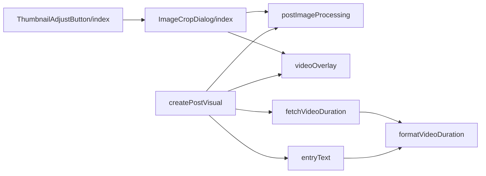
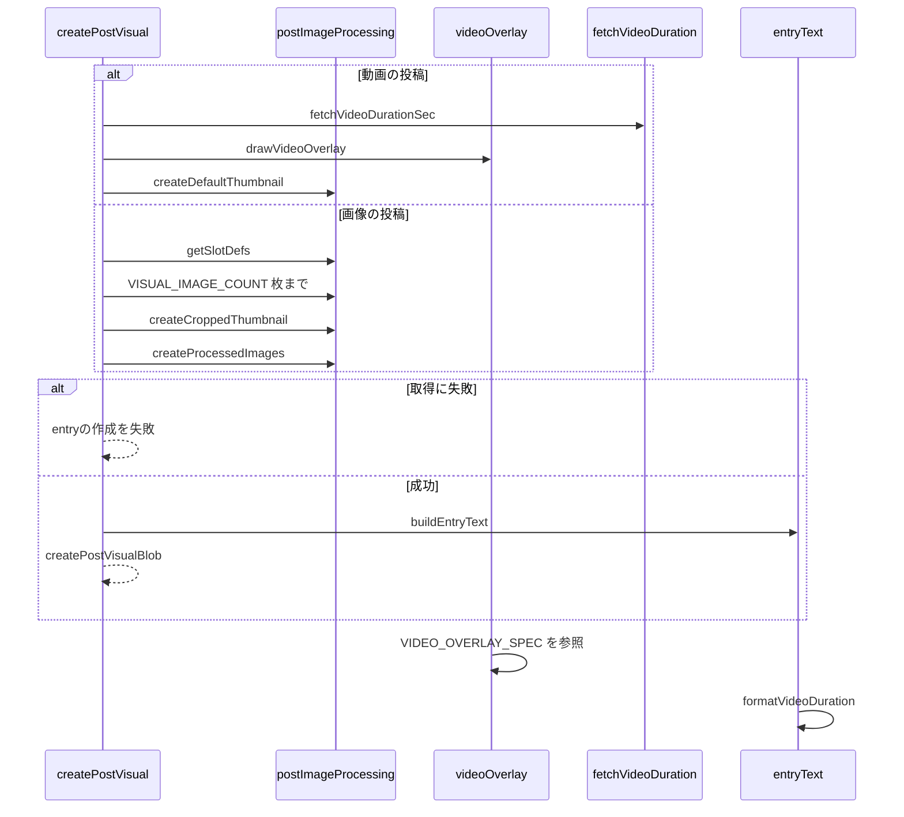

# Design Document

## Overview

**Purpose**: 投稿の画像や動画から、Xのリンクカードで投稿の内容が伝わるentryの代表画像と見出しを生成し、利用者が代表画像の切り抜きを調整できるようにする。
**Users**: 投稿から entry を作り、X のリンクカードで内容を伝えたい利用者
**Impact**: 投稿の画像や動画から代表画像・見出し・説明文を生成し、代表画像の切り抜きを調整できるようにする。

### Goals

- 画像と動画の投稿からの代表画像の合成。
- 代表画像の切り抜きの調整。
- entryの見出しと説明文の生成。
- 既存の投稿から作るentryの代表画像と見出し。

### Non-Goals

- 画像と動画の添付の操作。
- entryの作成のAPI。

## Boundary Commitments

### This Spec Owns

- 画像と動画の投稿からの代表画像の合成。
- 代表画像の切り抜きの調整。
- entryの見出しと説明文の生成。
- 既存の投稿から作るentryの代表画像と見出し。

### Out of Boundary

- 画像と動画の添付の操作。
- entryの作成のAPI。

### Allowed Dependencies

- 画像の選択と圧縮（image-picker、image-crop）
- 動画の poster と再生時間（video-picker、video-upload）
- entry の作成 API（entry-api）

### Revalidation Triggers

- 代表画像の寸法（1200×630）と合成の配置を変えるとき（共有先のカード表示に影響する）
- 再生ボタンの寸法・色の許容誤差を変えるとき
- 見出しと説明文の生成規則を変えるとき（entry-api の上限と整合が要る）

## Architecture

### Architecture Pattern & Boundary Map

代表画像の生成に関わる依存方向を示す。



## File Structure Plan

| パス                                                   | 責務                             |
| ------------------------------------------------------ | -------------------------------- |
| `src/lib/image/postImageProcessing.ts`                 | 区画の定義・切り抜き・合成・圧縮 |
| `src/lib/video/videoOverlay.ts`                        | 代表画像の再生ボタンの寸法と描画 |
| `src/lib/video/formatVideoDuration.ts`                 | 再生時間の整形                   |
| `src/lib/video/fetchVideoDuration.ts`                  | 既存の動画の再生時間の取得       |
| `src/lib/entry/entryText.ts`                           | 見出しと説明文の生成             |
| `src/lib/entry/createPostVisual.ts`                    | 既存の投稿からの代表画像の生成   |
| `src/components/image/ThumbnailAdjustButton/index.tsx` | サムネ調整のボタン               |
| `src/components/image/ImageCropDialog/index.tsx`       | 切り抜きの調整の画面             |

## System Flows

既存の投稿からの代表画像の生成と、失敗時の分岐を示す。



## Requirements Traceability

| Requirement        | Summary                  | Components |
| ------------------ | ------------------------ | ---------- |
| 1.1, 1.2           | 画像の投稿の代表画像     | D-1        |
| 2.1, 2.2, 2.3      | 動画の投稿の代表画像     | D-2        |
| 3.1, 3.2, 3.3, 3.4 | サムネ調整               | D-3        |
| 4.1, 4.2, 4.3      | 見出しと説明文           | D-4        |
| 5.1, 5.2, 5.3      | 既存の投稿から作る entry | D-4        |

## Components and Interfaces

#### D-1: 合成

**Requirements**: 1.1, 1.2

```ts
export const VISUAL_IMAGE_COUNT = 4
export const getSlotDefs = (count: number): SlotDef[] // min(4, count) 個。1:全面 2:左右 3:左1+右2 4:2×2
export type CompositeOverlay = (context: CanvasRenderingContext2D, scale: number) => void
export const createProcessedImages = async (imageUrls, cropStates) => {
  // 代表画像は先頭 VISUAL_IMAGE_COUNT 枚、投稿用の画像は全枚数を処理する
  const { thumbnailBlob } = await composeThumbnailBlob(imageUrls.slice(0, 4), cropStates.slice(0, 4))
  return { originalBlobs, thumbnailBlob }
}
export const createDefaultThumbnail = async (imageUrls: string[], overlay?: CompositeOverlay): Promise<Blob>
export const createCroppedThumbnail = async (imageUrls, cropStates, overlay?: CompositeOverlay): Promise<Blob>
```

出力は `TARGET_WIDTH` × `TARGET_HEIGHT`（1200×630）とし、容量の予算に収まるまで縮小して描き直す。`overlay` は描き直しのたびに `scale`（出力の長辺 / 1200）付きで呼ぶ。

#### D-2: 再生ボタン

**Requirements**: 2.1, 2.2, 2.3

```ts
export const VIDEO_OVERLAY_SPEC = {
  buttonDiameter: 59,
  buttonFill: "rgba(50, 50, 50, 0.6)",
  triangleWidth: 20,
  triangleHeight: 25,
  triangleFill: "#ffffff",
  triangleOffsetX: 2.5,
  referenceCardWidth: 342,
} as const
export const drawVideoOverlay =
  () =>
  (context: CanvasRenderingContext2D, scale: number): void => {
    const s = (TARGET_WIDTH / VIDEO_OVERLAY_SPEC.referenceCardWidth) * scale
    // 円: 中心 (width/2, height/2)、半径 buttonDiameter * s / 2
    // 三角: 外接矩形の中心を円の中心から右へ triangleOffsetX * s。頂点 (x0, y0), (x0, y0 + H), (x0 + W, y0 + H / 2)
  }
```

| 要素                          | 代表画像（1200×630）上の寸法 |
| ----------------------------- | ---------------------------- |
| 円の直径                      | 207.0px                      |
| 再生記号の幅×高さ・右へのずれ | 70.2 × 87.7px・8.8px         |

再生ボタンの寸法（直径59px・再生記号20×25px）は、Xの動画の実際の表示を、iPhone AirのXアプリのDPR 3のスクリーンショットで測った値を3で割ったCSS pxである。Xの再生ボタンはカードの幅によらず同じ寸法で表示される。一方、代表画像はスマホのXアプリで幅342px（カードの左右の端の間の1026pxを3で割った値）に縮小されるため、換算の基準幅を342pxとし、倍率 S は 1200 / 342 になる。

#### D-3: サムネ調整

**Requirements**: 3.1, 3.2, 3.3, 3.4

```ts
export type ImagePickerHandle = {
  addFiles: (files: File[]) => void | Promise<void>
  openCropDialog: () => void
}
export type VideoPickerHandle = { openCropDialog: () => void }
const onAdjustThumbnail = () =>
  segment.videoEntry
    ? videoPickerRef.current?.openCropDialog()
    : imagePickerRef.current?.openCropDialog()
// ThumbnailAdjustButton は imageEntry か videoEntry があるときだけ、動画の追加ボタンの後に描画する
// ImageCropDialog.handleConfirm:
//   overlay があれば createCroppedThumbnail(imageUrls, cropStates, overlay) だけを作り onConfirm([], blob, states)
//   無ければ createProcessedImages(imageUrls, cropStates)
```

- 画像は `imageUrls.slice(0, 4)` と先頭4件の切り抜きだけを渡し、確定結果を先頭4件にだけ反映する。
- 動画は `[posterPreview]` と `overlay={drawVideoOverlay()}` を渡す。調整の画面は overlay を描かず、確定時の生成にだけ使う。
- 動画の初期の切り抜きは `computeInitialCrop` の既定の配置とし、`createDefaultThumbnail` の結果と一致させる。

#### D-4: 見出しと既存の投稿

**Requirements**: 4.1, 4.2, 4.3, 5.1, 5.2, 5.3

```ts
export const formatVideoDuration = (sec: number): string // 四捨五入、最小 0:01、1時間以上は h:mm:ss
export const buildEntryText = ({ userName, postText, videoDurationSec }) => ({
  heading: videoDurationSec !== undefined ? formatVideoDuration(videoDurationSec) : `${userName} | Skyshare`, // 100バイトまで（超過時は投稿者名側を書記素単位で切る）
  caption: postText.trim() || undefined, // 300バイトまで（超過時は書記素単位で切る）
})
// マスターの最初のバリアントのメディアプレイリストの #EXTINF を合計する。取得失敗・0件は throw
export const fetchVideoDurationSec = async (playlistUrl: string): Promise<number>
export const createPostVisualBlob = async (post): Promise<{ blob: Blob; videoDurationSec?: number }>
```

既存の動画の投稿では、`thumbnail.jpg` の取得と `fetchVideoDurationSec` を並行して行い、Blobの `type` が空なら `image/jpeg` として `createDefaultThumbnail([url], drawVideoOverlay())` に渡す。どちらかが失敗したらentryの作成を失敗にし、APIを呼ばない。画像の投稿では先頭4枚だけを取得する。

## Error Handling

| 事象                           | 処理                            |
| ------------------------------ | ------------------------------- |
| 素材の画像・posterの取得の失敗 | entryの作成の失敗として通知する |
| 再生時間の取得の失敗           | entryの作成の失敗として通知する |
| 切り抜きの範囲の欠落           | 例外を投げ、代表画像を作らない  |

## Testing Strategy

- Unit / Build Tests:
  - `npx vitest run tests/lib/image/postImageProcessing.test.ts tests/lib/video/videoOverlay.test.ts`
  - `npm run build`
  - `npx vitest run tests/lib/entry/entryText.test.ts tests/lib/entry/createPostVisual.test.ts tests/lib/video/fetchVideoDuration.test.ts`
- E2E/UI Tests:
  - `tests/e2e/videoComposer.spec.ts` 動画を添付してサムネ調整で切り抜きを変える → アップロード中でも調整でき、プレビューの再生ボタンの位置が変わらない
- テストの名前には、対応する基準 ID を `[entry-visual/<ID>]` の形で付ける（例: `[entry-visual/1.1]`）
