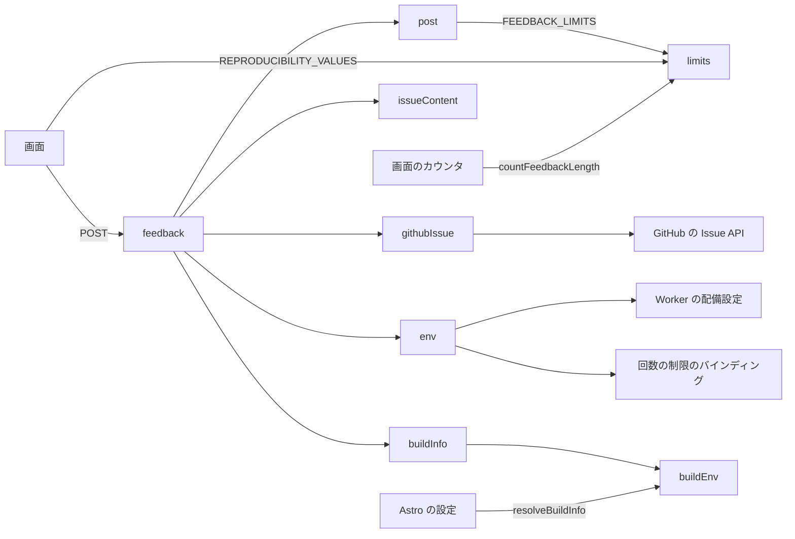
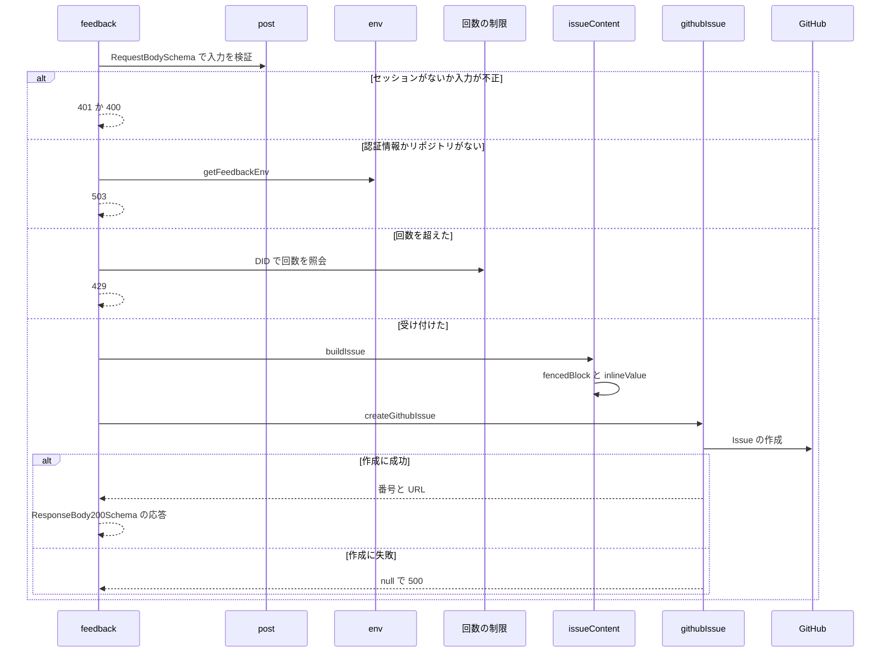

# Design Document

## Overview

**Purpose**: ログイン中の利用者から不具合の報告と新機能の提案を受け付け、報告者のアカウントと動作中の版と環境の情報を添えて、ソースコードのリポジトリに Issue として登録し、開発者が再現と検討に使えるようにする。
**Users**: 不具合の報告や新機能の提案を送るログイン中の利用者と、それを受け取る開発者
**Impact**: 報告と提案を受け付け、アカウントと版と環境の情報を添えてソースコードのリポジトリに Issue として登録する。

### Goals

- 報告と提案の入力の検証と、アカウントごとの送信回数の制限。
- Issue の件名・本文・ラベルの組み立てと、GitHub への登録。
- 動作中のビルドの版・コミット・リポジトリの埋め込み。

### Non-Goals

- 報告と提案の入力画面と、環境の情報の収集。
- スクリーンショットの添付。
- 登録した Issue の更新と削除。

## Boundary Commitments

### This Spec Owns

- 報告と提案の入力の検証と、アカウントごとの送信回数の制限。
- Issue の件名・本文・ラベルの組み立てと、GitHub への登録。
- 動作中のビルドの版・コミット・リポジトリの埋め込み。

### Out of Boundary

- 報告と提案の入力画面と、環境の情報の収集。
- スクリーンショットの添付。
- 登録した Issue の更新と削除。

### Allowed Dependencies

- GitHub の Issue 作成 API（認証情報は環境の Secret）
- 送信回数の制限のバインディング
- API の認証の再開（account-session）
- ビルドの版・コミット・リポジトリの埋め込み（`src/lib/site/`）

### Revalidation Triggers

- 入力の項目・上限・再現の頻度の値を変えるとき（feedback-form の入力と一致が要る）
- Issue の本文の形式や載せる情報を変えるとき（利用者の入力の無害化を再確認する）
- 送信回数の制限（60秒に1件）を変えるとき
- 登録先のリポジトリや認証情報の設定の方式を変えるとき

## Architecture

### Architecture Pattern & Boundary Map

受付の API と組み立ての部品の依存方向を示す。



## File Structure Plan

| パス                                     | 責務                                               |
| ---------------------------------------- | -------------------------------------------------- |
| `src/lib/api/schema/v2/feedback/post.ts` | 受付の入力と応答のスキーマ                         |
| `src/pages/v2/feedback.ts`               | 受付の API。検証・回数の制限・登録の順に処理する   |
| `src/lib/feedback/issueContent.ts`       | Issue の件名・本文・ラベルの組み立て               |
| `src/lib/feedback/githubIssue.ts`        | GitHub の Issue の作成の呼び出し                   |
| `src/lib/feedback/limits.ts`             | 件名と本文の文字数の上限と再現の頻度の値           |
| `src/lib/feedback/env.ts`                | 認証情報と回数の制限のバインディングの取得         |
| `src/lib/site/buildEnv.ts`               | ビルドの版・コミット・リポジトリの解決（純粋関数） |
| `src/lib/site/buildInfo.ts`              | 実行中のビルドの版・コミット・リポジトリ           |

## System Flows

受付の検証から登録までの流れと、失敗の分岐を示す。



## Requirements Traceability

| Requirement                  | Summary      | Components |
| ---------------------------- | ------------ | ---------- |
| 1.1, 1.2, 1.3, 1.4, 1.5      | 受付の条件   | D-2, D-4   |
| 2.1, 2.2, 2.3, 2.4, 2.5, 2.6 | 入力の検証   | D-1        |
| 3.1, 3.2, 3.3, 3.4, 3.5      | Issue の内容 | D-3, D-5   |
| 4.1, 4.2                     | ビルドの情報 | D-5        |

## Components and Interfaces

#### D-1: 入力のスキーマ

**Requirements**: 2.1, 2.2, 2.3, 2.4, 2.5, 2.6

```ts
// limits.ts（画面と共有する）
export const FEEDBACK_LIMITS = { title: 100, text: 2000 } as const
export const REPRODUCIBILITY_VALUES = [
  "always",
  "sometimes",
  "no",
  "untested",
] as const
// 書記素で数える。スキーマを読み込むコード生成（Node）で動くよう、依存を持たないこのファイルに置く
export const countFeedbackLength = (text: string): number
// POST /v2/feedback/ の JSON。種別で分岐し、strict で他の種別の項目と未知の項目を拒否する
const requiredText = (max: number) =>
  z
    .string()
    .refine(s => s.trim() !== "")
    .refine(s => countFeedbackLength(s) <= max)
const EnvironmentSchema = z
  .object({
    os: z.string().max(100),
    browser: z.string().max(100),
    userAgent: z.string().max(1000),
    standalone: z.boolean(),
    version: z.string().max(50),
    commit: z.string().max(64),
  })
  .strict()
const common = {
  title: requiredText(FEEDBACK_LIMITS.title),
  environment: EnvironmentSchema,
}
export const RequestBodySchema = z.discriminatedUnion("kind", [
  z
    .object({
      kind: z.literal("bug"),
      ...common,
      steps: requiredText(FEEDBACK_LIMITS.text),
      reproducibility: z.enum(REPRODUCIBILITY_VALUES),
    })
    .strict(),
  z
    .object({
      kind: z.literal("enhancement"),
      ...common,
      description: requiredText(FEEDBACK_LIMITS.text),
      technicalNotes: requiredText(FEEDBACK_LIMITS.text).optional(),
    })
    .strict(),
])
export const ResponseBody200Schema = z
  .object({ number: z.number().int(), url: z.string() })
  .strict()
```

- 応答の誤りは `Common.errorResponses(["400", "401", "429", "500", "503"])` で示す。
- 文字数は画面のカウンタと同じ `countFeedbackLength` で数える。

#### D-2: 受付の処理の順序

**Requirements**: 1.1, 1.2, 1.3, 1.4, 1.5

```ts
export const POST: APIRoute = async ({ request, locals }) => Response
export const getFeedbackEnv = async (): Promise<FeedbackEnv>
export type FeedbackEnv = {
  FEEDBACK_GITHUB_TOKEN?: string
  FEEDBACK_RATE_LIMITER: { limit(opts: { key: string }): Promise<{ success: boolean }> }
}
```

| 順  | 検査                                               | 失敗時 |
| --- | -------------------------------------------------- | ------ |
| 1   | cookie の見出しがある                              | 400    |
| 2   | `locals.session` がある                            | 401    |
| 3   | 入力が `RequestBodySchema` に合う                  | 400    |
| 4   | 認証情報と `buildInfo.repository` がそろう         | 503    |
| 5   | `FEEDBACK_RATE_LIMITER.limit({ key: did })` が成功 | 429    |
| 6   | `createGithubIssue` が番号を返す                   | 500    |

- 報告者は `locals.session` の `did` と `handle` だけを使う。
- 回数の制限は入力の検証の後に照会し、誤った入力で回数を消費させない。
- 回数の制限は Cloudflare の Rate Limiting のバインディングで、期間60秒・上限1件とする。`wrangler.template.jsonc` の `ratelimits` と `previews.ratelimits` の両方に宣言し、プレビューでも同じ制限を掛ける。
- `@atproto/*` を読み込まない。

#### D-3: Issue の組み立て

**Requirements**: 3.1, 3.2, 3.3, 3.4, 3.5

```ts
export type IssueReporter = { did: string; handle: string }
export type IssueBuild = { version: string; commit: string | null; repository: string }
export type IssueContent = { title: string; body: string; labels: ["bug"] | ["enhancement"] }
export const buildIssue = (input: RequestBodyType, reporter: IssueReporter, build: IssueBuild): IssueContent
// 入力の中で最も長いバッククォートの連続より1つ長い囲いで、言語 text のコードブロックにする（最短3つ）
export const fencedBlock = (text: string): string
// バッククォートと改行を除き、インラインコードにする
export const inlineValue = (text: string): string
```

| 本文の節     | 内容                                                                               |
| ------------ | ---------------------------------------------------------------------------------- |
| 見出し       | 「不具合の報告」か「新機能の提案」                                                 |
| 操作した内容 | `fencedBlock(steps)`                                                               |
| 再現するか   | 毎回起きる・ときどき起きる・起きない・試していない                                 |
| 機能の内容   | `fencedBlock(description)`                                                         |
| 技術的な補足 | `fencedBlock(technicalNotes)`。省いたときは節ごと載せない                          |
| 報告者       | `inlineValue("@" + handle)` と、`https://bsky.app/profile/{did}` への DID のリンク |
| 環境         | 版・コミットのリンク・OS・ブラウザ・PWA の可否・識別文字列                         |

- 本文の見出しと項目名は日本語に固定する。
- コミットは `https://github.com/{repository}/commit/{commit}` へのリンクにし、先頭7文字を表示する。null なら「不明」とする。
- 画面の版とコミットがサーバーと異なるときだけ、「画面の版」「画面のコミット」の項目を `inlineValue` で加える。
- ハンドルはインラインコードに入れ、GitHub のメンションとして解釈させない。
- 件名は空白の連続（改行を含む）を1つの空白にし、前後の空白を除く。

#### D-4: GitHub の Issue の作成

**Requirements**: 1.4, 1.5

```ts
export type CreatedIssue = { number: number; url: string }
// 201 以外と例外は null。失敗の状態はコンソールに記録する
export const createGithubIssue = async (
  opts: { token: string; repository: string; issue: IssueContent },
  fetchFn: typeof fetch = fetch,
): Promise<CreatedIssue | null>
```

| 項目     | 値                                                                                                                                 |
| -------- | ---------------------------------------------------------------------------------------------------------------------------------- |
| 要求     | `POST https://api.github.com/repos/{repository}/issues`                                                                            |
| 見出し   | `Authorization: Bearer {token}`・`Accept: application/vnd.github+json`・`X-GitHub-Api-Version: 2022-11-28`・`User-Agent: skyshare` |
| 本文     | `{ title, body, labels }`                                                                                                          |
| 応答     | 201 の `number` と `html_url`                                                                                                      |
| 認証情報 | Worker のシークレット `FEEDBACK_GITHUB_TOKEN`（Issues の読み書きだけを許す Fine-grained PAT）                                      |

#### D-5: ビルドの情報の埋め込み

**Requirements**: 3.5, 4.1, 4.2

```ts
export type BuildInfo = { version: string; commit: string | null; repository: string | null }
// CI（GITHUB_SHA・GITHUB_REPOSITORY）を優先し、なければ Git の値を使う。形式の違う値は null
export const resolveBuildInfo = (
  env: Record<string, string | undefined>,
  git: { sha?: string; remoteUrl?: string },
): BuildInfo
// git@github.com:o/r.git・https://github.com/o/r(.git) から "o/r" を取り出す。他は null
const parseRepositorySlug = (remoteUrl: string): string | null
export const buildInfo: BuildInfo
```

- `astro.config.mjs` は `git rev-parse HEAD` と `git remote get-url origin` を読み、失敗したら空にして `resolveBuildInfo` に渡す。
- 結果は Vite の `define` で `import.meta.env.PUBLIC_COMMIT_SHA`・`PUBLIC_SOURCE_REPOSITORY` に埋め込み、画面とサーバーの両方が同じ値を参照する。版は `PUBLIC_VERSION` を使う。
- コミットは40桁の16進、リポジトリは `owner/repo` の形式だけを受け入れる。

## Error Handling

| 事象                             | 処理                                                   |
| -------------------------------- | ------------------------------------------------------ |
| 入力の JSON が壊れている         | 400 を返す                                             |
| 認証情報かリポジトリが未設定     | 503 を返し、コンソールに未設定の項目を記録する         |
| 回数の制限の照会が例外を投げた   | 500 を返し、GitHub への登録を行わない                  |
| GitHub が201以外を返すか通信失敗 | 500 を返し、コンソールに状態を記録する                 |
| Git の値が読めない               | コミットとリポジトリを null として扱い、ビルドを続ける |

## Testing Strategy

- Unit / Build Tests:
  - `npx vitest run tests/lib/site/buildEnv.test.ts`
  - `npx vitest run tests/lib/feedback`
  - `npx vitest run tests/pages/v2/feedback.test.ts`
- テストの名前には、対応する基準 ID を `[feedback-api/<ID>]` の形で付ける（例: `[feedback-api/1.1]`）
