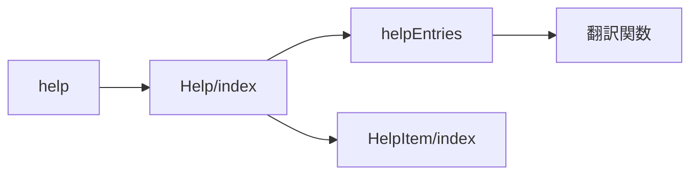
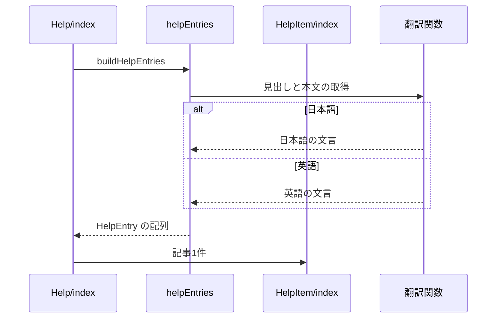

# Design Document

## Overview

**Purpose**: 過去に寄せられた問い合わせと対処を、利用者が自分で確認できるようにする。
**Users**: 過去の問い合わせの対処を自分で確認したい利用者
**Impact**: 問い合わせと対処の記事を、表示言語に合わせて一覧するヘルプのページを提供する。

### Goals

- 問い合わせと対処の記事の定義と、表示言語での組み立て。
- 記事を並べて表示するヘルプのページ。

### Non-Goals

- 問い合わせの受付。
- 記事の外部への配信。

## Boundary Commitments

### This Spec Owns

- 問い合わせと対処の記事の定義と、表示言語での組み立て。
- 記事を並べて表示するヘルプのページ。

### Out of Boundary

- 問い合わせの受付。
- 記事の外部への配信。

### Allowed Dependencies

- 表示言語の辞書（i18n-messages）
- 設定のページ（app-settings）からの導線

### Revalidation Triggers

- 記事の識別子と並びを変えるとき（外部から記事へ辿る場合に影響する）
- 単独のページの構成（サイドバーとフッターを出さない）を変えるとき

## Architecture

### Architecture Pattern & Boundary Map

ヘルプのページの構成要素の依存方向を示す。



## File Structure Plan

| パス                                     | 責務                   |
| ---------------------------------------- | ---------------------- |
| `src/components/help/helpEntries.tsx`    | 記事のデータの組み立て |
| `src/components/help/Help/index.tsx`     | 記事の一覧の表示       |
| `src/components/help/HelpItem/index.tsx` | 記事1件のカードの表示  |
| `src/pages/help.astro`                   | ヘルプのページ         |

## System Flows

記事の組み立てと、表示言語による分岐を示す。



## Requirements Traceability

| Requirement | Summary        | Components |
| ----------- | -------------- | ---------- |
| 1.1, 1.2    | 記事の定義     | D-1        |
| 2.1, 2.2    | ヘルプのページ | D-2, D-3   |

## Components and Interfaces

#### D-1: 記事の組み立て

**Requirements**: 1.1, 1.2

```ts
export type HelpEntry = {
  id: string // 表示順の変更に影響されない固定値
  title: string
  description: ReactNode // 文字列に加え、画像や一覧などの要素も置ける
  content?: ReactNode // 本文の下に置く手順の一覧など
}
export const buildHelpEntries = (t: Translator["t"]): HelpEntry[]
```

- 記事は外部のデータを持たず、`buildHelpEntries` に直接追記する。文言は辞書の `page.help.*` に置く。

#### D-2: 表示

**Requirements**: 2.1

| 要素         | 内容                                                                                        |
| ------------ | ------------------------------------------------------------------------------------------- |
| 一覧         | `ComponentList` で記事を縦に並べる。キーは `id`                                             |
| 記事のカード | 設定ページと同じカード（`base-card`・`base-padding`）に、見出し・本文・任意の内容を描画する |

#### D-3: 単独のページ

**Requirements**: 2.2

| 要素       | 内容                                                                                 |
| ---------- | ------------------------------------------------------------------------------------ |
| ページ     | 静的に生成し、サイドバーとフッターナビを表示しない単独のページとする                 |
| 戻るリンク | ナビゲーションの項目には加えず、記事の下に設定のページへのリンク（`page.help.back`） |

## Error Handling

- なし

## Testing Strategy

- Unit / Build Tests:
  - `npx vitest run tests/components/help/helpEntries.test.ts`
  - `npx tsc --noEmit`
- E2E/UI Tests:
  - `tests/e2e/helpPage.spec.ts` ヘルプのページを開く → 記事の見出しがカードごとに表示される
  - `tests/e2e/helpPage.spec.ts` ヘルプのページを開く → サイドバーとフッターナビがなく、設定のページへ戻るリンクがある
- テストの名前には、対応する基準 ID を `[help-page/<ID>]` の形で付ける（例: `[help-page/1.1]`）
