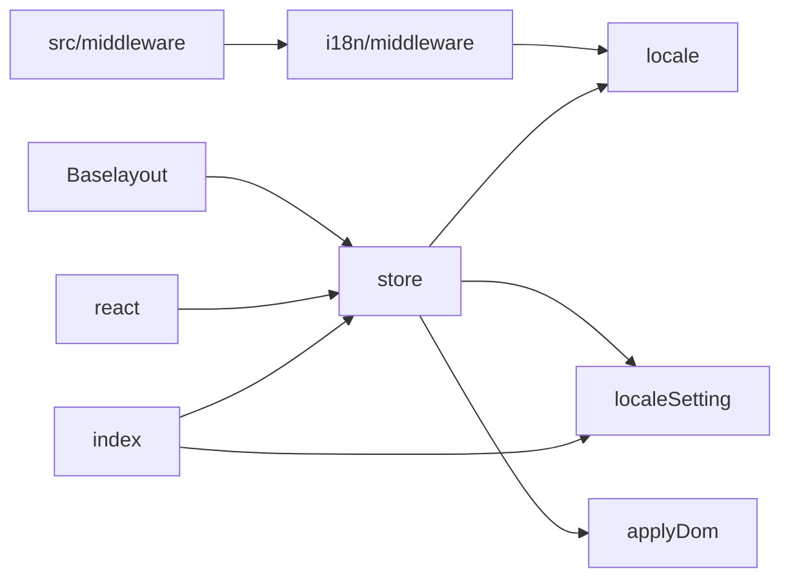
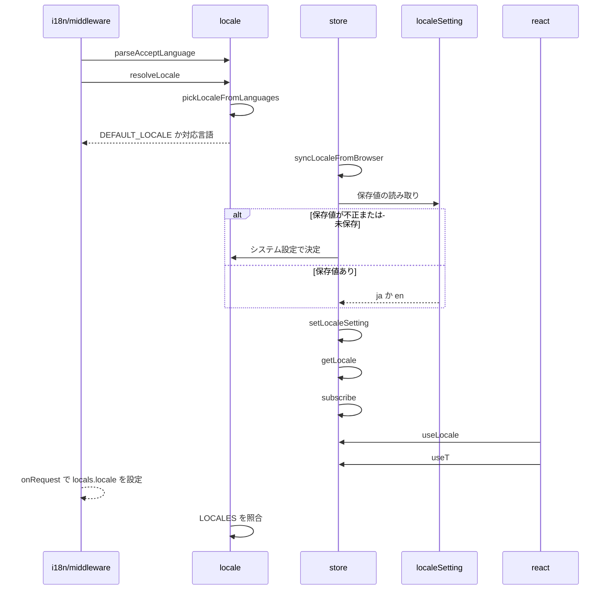

# Design Document

## Overview

**Purpose**: アプリを日本語と英語のどちらでも利用できるよう、表示言語を自動で決定し、利用者がいつでも切り替えられるようにする。
**Users**: 日本語または英語でアプリを使う利用者
**Impact**: 表示言語を自動で決め、いつでも切り替えられるようにする。切り替えはページを再読み込みせずに全文言へ反映し、設定はブラウザ内にのみ保持する。

### Goals

- 表示言語の自動判定と、利用者による選択・保持。
- 表示中の画面の文言と言語属性の切り替え。
- サーバーで描画するページの初回の表示言語。

### Non-Goals

- 文言の辞書と翻訳の規則。
- 投稿に付与する投稿言語。
- 言語ごとに異なるURLの提供。
- 旧版フロントエンドの表示言語。

## Boundary Commitments

### This Spec Owns

- 表示言語の自動判定と、利用者による選択・保持。
- 表示中の画面の文言と言語属性の切り替え。
- サーバーで描画するページの初回の表示言語。

### Out of Boundary

- 文言の辞書と翻訳の規則。
- 投稿に付与する投稿言語。
- 言語ごとに異なるURLの提供。
- 旧版フロントエンドの表示言語。

### Allowed Dependencies

- ブラウザの言語設定と保存領域
- リクエストの受け入れ言語（サーバー描画）
- 文言の辞書（i18n-messages）

### Revalidation Triggers

- 対応言語を追加するとき（判定の順序と既定の扱いを再確認する）
- 言語設定の保存先や形式を変えるとき（他タブへの追従に影響する）
- ミドルウェアでの言語の決定を変えるとき（並行リクエスト間で言語が混ざらないことを再確認する）
- 静的生成ページの出力を変えるとき（言語に依らず1種類を保つ）
- ミドルウェアの合成順やキャッシュの対象を変えるとき（`entryPageCache` は表示言語をキャッシュキーに使うため、言語ごとに結果が分かれることを再確認する）

## Architecture

### Architecture Pattern & Boundary Map

表示言語の決定と反映の依存方向を示す。



## File Structure Plan

| パス                                           | 責務                               |
| ---------------------------------------------- | ---------------------------------- |
| `src/lib/i18n/locale.ts`                       | 言語の型と判定、受け入れ言語の解析 |
| `src/lib/i18n/localeSetting.ts`                | 言語設定の保存                     |
| `src/lib/i18n/store.ts`                        | クライアントの表示言語ストア       |
| `src/lib/i18n/react.ts`                        | 表示言語のReactフック              |
| `src/lib/i18n/applyDom.ts`                     | 静的DOMの文言・タイトルの書き換え  |
| `src/lib/i18n/middleware.ts`                   | リクエストごとの表示言語の決定     |
| `src/middleware.ts`                            | ミドルウェアの合成                 |
| `src/layout/Baselayout.astro`                  | 言語属性とストアの読み込み         |
| `src/components/common/LocaleSelect/index.tsx` | 表示言語の選択欄                   |

## System Flows

サーバーとクライアントでの言語決定の流れを示す。



## Requirements Traceability

| Requirement             | Summary              | Components    |
| ----------------------- | -------------------- | ------------- |
| 1.1, 1.2, 1.3, 1.4      | 表示言語の決定       | D-1           |
| 2.1, 2.2, 2.3, 2.4, 2.5 | 言語設定の選択と保持 | D-1, D-2, D-4 |
| 3.1, 3.2, 3.3, 3.4      | 切り替え             | D-2           |
| 4.1, 4.2, 4.3, 4.4      | サーバーでの描画     | D-3           |

## Components and Interfaces

#### D-1: 言語の判定と保存

**Requirements**: 1.1, 1.2, 1.3, 1.4, 2.1, 2.2, 2.3

```ts
export const LOCALES = ["ja", "en"] as const
export type Locale = (typeof LOCALES)[number]
export type LocaleSetting = Locale | "system"
export const DEFAULT_LOCALE: Locale = "ja"
// "en-US,en;q=0.9" → q 降順の言語配列。q=0 と * は除外し、解釈できない q は1とする
export const parseAcceptLanguage = (header: string | null): string[]
// 主言語タグ（"en-US" → "en"）で照合し、最初に一致した対応言語
export const pickLocaleFromLanguages = (langs: readonly string[]): Locale | undefined
export const resolveLocale = (stored: string | null | undefined, languages: readonly string[]): Locale => {
  if (isLocale(stored)) return stored
  if (languages.length === 0) return DEFAULT_LOCALE
  return pickLocaleFromLanguages(languages) ?? "en"
}
```

- 保存キーは `uiLocale`、値は `"ja"` か `"en"`。システム設定に従うはキーの削除で表す。
- `readLocaleSetting()` は、`window` が無い・例外・不正値のとき `"system"` を返す。`writeLocaleSetting()` の例外は握りつぶす。

#### D-2: クライアントでの切り替え

**Requirements**: 2.5, 3.1, 3.2, 3.3, 3.4

```ts
let current: Locale = DEFAULT_LOCALE
export const getLocale = () => current
export const subscribe = (listener: () => void) => () => void
export const syncLocaleFromBrowser = () => void // 保存値とnavigator.languagesから決定し、強制で反映
export const setLocaleSetting = (setting: LocaleSetting) => void // 保存して反映（強制）
// commit(locale, force): current → documentElement.lang → applyDomTranslations を更新し、値が変わったときだけ購読者へ通知
//   force が偽で値が同じなら何もしない。force が真（初期化・ページ遷移後・設定変更）なら値が同じでも lang と静的DOMを更新する
//   （サーバーが別の言語で描画している場合があるため）
export const useLocale = () => useSyncExternalStore(subscribe, getLocale, () => DEFAULT_LOCALE)
export const useT = () => useMemo(() => createTranslator(useLocale()), [locale])
```

- Astroの各islandは同じバンドルのモジュール状態を共有するため、1つのストアで全islandが同期する。
- React は再描画のみで state とDOMを保持する。言語をコンポーネントの `key` に使って再マウントしない。
- `.astro` が出力する静的部分は `data-i18n`（本文）・`data-i18n-aria-label`（属性）・`title[data-i18n-title]` を付け、`applyDomTranslations` が書き換える。Reactが管理するDOMには付けない。
- `store.ts` はモジュールの読み込み時（ブラウザのみ）に `syncLocaleFromBrowser()` を呼び、自身で `astro:page-load` を購読して遷移のたびに再実行する。`Baselayout.astro` は `<script>import "@/lib/i18n/store"</script>` でストアを読み込むだけで、保存値を `lang` に反映する初回ペイント前のインラインスクリプトは持たない（初期描画後にストアが反映する）。
- `Baselayout.astro` のインラインスクリプトは `astro:before-swap` で遷移先文書へ `lang` を複製する。
- 他タブの変更は `storage` イベント（`key` が `uiLocale` または `null`）で受け、表示言語を再決定する。

#### D-3: サーバーでの判定

**Requirements**: 4.1, 4.2, 4.3, 4.4

```ts
export const onRequest = sequence(
  localeMiddleware,
  entryPageCache,
  refreshBskySession,
)
// localeMiddleware:
//   context.isPrerendered なら locals.locale = DEFAULT_LOCALE
//   それ以外は locals.locale = resolveLocale(undefined, parseAcceptLanguage(accept-language))
```

- `entryPageCache`（Entry 詳細ページの SSR 結果の再利用）は表示言語をキャッシュキーに使うため、`localeMiddleware` の後に置く。
- 表示言語はリクエストごとの `Astro.locals.locale` で受け渡し、モジュール状態を持たない。
- `Baselayout.astro` は `<html lang={Astro.locals.locale}>` を出力する。静的生成ページは常に日本語で出力し、クライアントで切り替える。
- 外部の翻訳ライブラリは使わず、型付き辞書と翻訳関数で実装する。

#### D-4: 選択欄

**Requirements**: 2.4

| 項目   | 内容                                                                                                       |
| ------ | ---------------------------------------------------------------------------------------------------------- |
| 部品   | `Dropdown` のラッパーで、設定の読み書きまで自身で行う                                                      |
| 選択肢 | `system`（翻訳したラベル）・`ja`（日本語）・`en`（English）。言語の自称は翻訳しない                        |
| 初期値 | サーバー描画とハイドレーション時は `system`。マウント後と表示言語の変化時に `readLocaleSetting()` へ揃える |
| 変更時 | `setLocaleSetting(value)` を呼ぶ                                                                           |
| 配置   | 設定画面の表示設定（表示テーマの隣）、ログイン画面のフォーム上に右寄せ                                     |

## Error Handling

| 事象                           | 処理                                 |
| ------------------------------ | ------------------------------------ |
| 保存領域の読み取り例外・不正値 | システム設定に従うとして扱う         |
| 保存領域の書き込み例外         | 表示言語は切り替え、保存だけを諦める |

## Testing Strategy

- Unit / Build Tests:
  - `npx vitest run tests/lib/i18n/locale.test.ts tests/lib/i18n/localeSetting.test.ts`
  - `npm run build`
  - `npx vitest run tests/lib/i18n/middleware.test.ts tests/lib/i18n/dependencies.test.ts`
- E2E/UI Tests:
  - `tests/e2e/i18n.spec.ts` 設定画面でEnglishを選び、再読み込みと別ページへの遷移をする → 文言と言語属性が英語のまま維持される。別のタブで開いていたログイン画面も英語に切り替わる
  - `tests/e2e/i18n.spec.ts` 受け入れ言語を英語にしてEntry詳細ページを開く → 初回HTMLの言語属性が英語になる
  - `tests/e2e/i18n.spec.ts` ログイン画面の選択欄でEnglishを選ぶ → フォームの文言が即座に英語になる
- テストの名前には、対応する基準 ID を `[i18n-locale/<ID>]` の形で付ける（例: `[i18n-locale/1.1]`）
