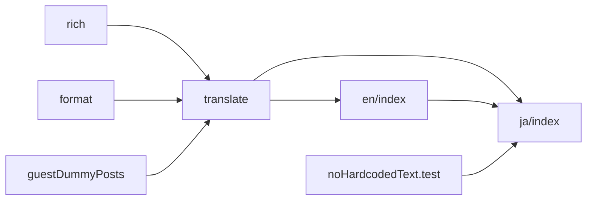
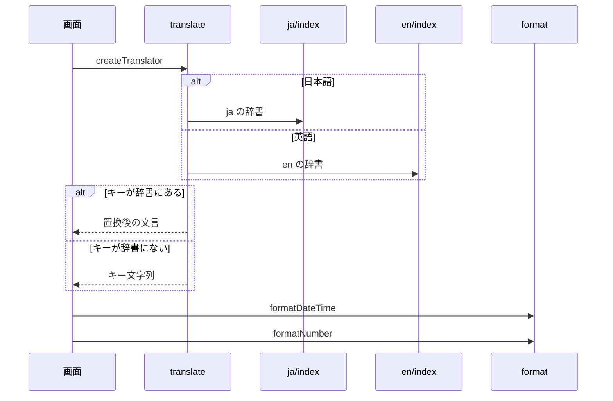

# Design Document

## Overview

**Purpose**: 利用者に見える全文言を日本語と英語の辞書で管理し、翻訳漏れと文言の直書きを機械的に防ぐ。
**Users**: 画面の文言を追加・変更する開発者と、日本語・英語で読む利用者
**Impact**: 利用者に見える全文言を型付きの辞書で管理し、翻訳漏れと文言の直書きを機械的に防ぐ。

### Goals

- UI文言・ヘルプ記事・ゲストモードのダミー投稿の日本語と英語の辞書。
- 置換パラメータと単数・複数の扱い。
- 日時と数値の書式。
- 辞書の整合性と文言の直書きの検出。

### Non-Goals

- 表示言語の決定と切り替え。
- APIエラーの文言の決定。
- 利用者が作成した投稿本文とプロフィールの翻訳。
- 開発者向けのAPI説明文の翻訳。

## Boundary Commitments

### This Spec Owns

- UI文言・ヘルプ記事・ゲストモードのダミー投稿の日本語と英語の辞書。
- 置換パラメータと単数・複数の扱い。
- 日時と数値の書式。
- 辞書の整合性と文言の直書きの検出。

### Out of Boundary

- 表示言語の決定と切り替え。
- APIエラーの文言の決定。
- 利用者が作成した投稿本文とプロフィールの翻訳。
- 開発者向けのAPI説明文の翻訳。

### Allowed Dependencies

- TypeScript の型検査（文言キーとパラメータの検査）
- テスト（辞書の整合性・直書きの検出）
- 表示言語の決定（i18n-locale）

### Revalidation Triggers

- 辞書のキー集合や置換パラメータの形を変えるとき（型と整合性テストが影響を受ける）
- 直書き検出の許可一覧を変えるとき（理由の記載が要る）
- 日時・数値の書式の規則を変えるとき
- 言語を追加するとき（DEVELOP.md の手順に従う）

## Architecture

### Architecture Pattern & Boundary Map

辞書・翻訳・書式の依存方向を示す。



## File Structure Plan

| パス                                     | 責務                                       |
| ---------------------------------------- | ------------------------------------------ |
| `src/lib/i18n/messages/ja/index.ts`      | 日本語辞書（ドメイン別ファイルの結合）     |
| `src/lib/i18n/messages/en/index.ts`      | 英語辞書（日本語と同じキー集合を型で強制） |
| `src/lib/i18n/translate.ts`              | 翻訳関数と文言キー・パラメータの型         |
| `src/lib/i18n/rich.tsx`                  | 文中へのReact要素の差し込み                |
| `src/lib/i18n/format.ts`                 | 日時と数値の書式                           |
| `src/lib/entry/guestDummyPosts.ts`       | 表示言語で組み立てるゲスト用ダミーデータ   |
| `tests/lib/i18n/noHardcodedText.test.ts` | 文言の直書き検出                           |

## System Flows

翻訳関数の生成と、キー未登録時の分岐を示す。



## Requirements Traceability

| Requirement             | Summary      | Components    |
| ----------------------- | ------------ | ------------- |
| 1.1, 1.2, 1.3, 1.4, 1.5 | 辞書と翻訳   | D-1, D-3, D-4 |
| 2.1, 2.2                | 書式         | D-2           |
| 3.1, 3.2, 3.3           | 機械的な検出 | D-1, D-4      |

## Components and Interfaces

#### D-1: 辞書と翻訳関数

**Requirements**: 1.1, 1.2, 3.1, 3.2

```ts
export const ja = { ...common, ...nav, ...account, ...post, ...entry, ... } as const
export type MessageKey = keyof typeof ja
type PluralBase = Extract<MessageKey, `${string}_other`> extends `${infer B}_other` ? B : never
export const en: Record<MessageKey, string> & Record<`${PluralBase}_one`, string>

type ParamNames<S extends string> = S extends `${string}{${infer P}}${infer R}` ? P | ParamNames<R> : never
export type MessageParams<K extends MessageKey> =
  ParamNames<(typeof ja)[K]> extends never ? undefined : Record<ParamNames<(typeof ja)[K]>, string | number>

export const createTranslator = (locale: Locale) => {
  const dict = locale === "ja" ? ja : en
  const plural = new Intl.PluralRules(locale === "ja" ? "ja-JP" : "en-US")
  const t = <K extends MessageKey>(key: K, ...args: ParamsArg<K>) => interpolate(dict[key] ?? key, args[0])
  // `${base}_${plural.select(count)}` を探し、無ければ `${base}_other`。count は params に自動で含める
  const tn = (base: PluralBase, count: number, params?: Record<string, string | number>) => string
  const raw = (key: MessageKey) => dict[key] // 置換しない値（renderSlots の入力）
  return { t, tn, raw, locale }
}
```

- キーは `<ドメイン>.<要素><用途>` とし、ドメインを辞書ファイル名と一致させる。複数形は日本語に `_other`、英語に `_one` と `_other` を置く。
- `PlainMessageKey` はプレースホルダの無いキーの型で、キーを変数に持つときに使う。
- 文中にアイコンや強調を置く文言は辞書値に `{name}` スロットを書き、`renderSlots(raw(key), { name: <Element /> })` で描画する。
- `tests/lib/i18n/messages.test.ts` が日本語・英語のキー集合とプレースホルダの一致を検査し、`tests/lib/i18n/types.check.ts` を `tsc --noEmit` で検査する。

#### D-2: 日時と数値

**Requirements**: 2.1, 2.2

```ts
const intlLocale = (l: Locale) => (l === "ja" ? "ja-JP" : "en-US")
export const formatDateTime = (value: string | number | Date, locale: Locale, options?: Intl.DateTimeFormatOptions): string // 不正な日付は ""
export const formatNumber = (value: number, locale: Locale): string
```

`useFormat()` が現在の表示言語に束縛した2関数を返す。文字数計数の `Intl.Segmenter("ja-JP")` は表示言語と無関係なため固定する。

#### D-3: 状態として保持する文言

**Requirements**: 1.3, 1.4

| 文言の種類                 | stateに保持する値                                         | 描画時の評価                        |
| -------------------------- | --------------------------------------------------------- | ----------------------------------- |
| プレースホルダ無し         | `PlainMessageKey`                                         | `t(key)`                            |
| パラメータ付き・連結       | `DeferredMessage = { format: (t: Translator) => string }` | `message.format(translator)`        |
| 取得コールバック内のエラー | `useRef` で参照する最新の翻訳関数                         | コールバックの依存に `t` を含めない |

- 翻訳済み文字列をstateに保持しない。`deferMessage(key)` がプレースホルダ無しのキーから `DeferredMessage` を作る。
- ヘルプ記事は `buildHelpEntries(t)` で組み立てる。ゲスト用データは `getGuestDummyData(translator)` で言語ごとに1回だけ組み立ててキャッシュし、表示言語の変化で再取得する。
- `.astro` は `createTranslator(Astro.locals.locale)` を使う。React外の純粋関数は翻訳関数を引数で受け取る。

#### D-4: 直書きの検出

**Requirements**: 1.5, 3.3

```ts
// TypeScript Compiler API で src/**/*.{ts,tsx} を走査する
// 検出: 文字列リテラル・テンプレートリテラル・JSXText のうち、ひらがな・カタカナ・漢字を含むもの
// 検出: JSXText と placeholder / aria-label / title / alt / label 属性の英字を含む文字列リテラル
// 除外パス: src/client/**、src/lib/i18n/messages/**、src/lib/api/schema/**
// .astro: フロントマターと本文のコメントを除いた後、日本語を含む行を検出する
const ALLOWED: { path: string; reason: string }[] // 言語の自称表記、静的生成のデモデータ
```

許可一覧のファイルが実在することも同じテストで検査する。

## Error Handling

| 事象                         | 処理                         |
| ---------------------------- | ---------------------------- |
| 辞書に無いキーを実行時に参照 | キー文字列をそのまま表示する |
| 不正な日付の書式化           | 空文字を返す                 |

## Testing Strategy

- Unit / Build Tests:
  - `npx vitest run tests/lib/i18n/translate.test.ts tests/lib/i18n/messages.test.ts`
  - `npx vitest run tests/lib/i18n/format.test.ts`
  - `npm run build`
  - `npx vitest run tests/lib/i18n/noHardcodedText.test.ts`
- E2E/UI Tests:
  - `tests/e2e/i18n.spec.ts` 英語で投稿フォームを開く → 日本語の文言が残っていない
  - `tests/e2e/i18n.spec.ts` 英語でヘルプとゲストモードのタイムラインを開く → 記事とダミー投稿が英語で、件数の単複が正しく表示される
  - `tests/e2e/i18n.spec.ts` 英語表示で設定画面の表示言語の選択欄を開く → 日本語という選択肢が表示される
- テストの名前には、対応する基準 ID を `[i18n-messages/<ID>]` の形で付ける（例: `[i18n-messages/1.1]`）
