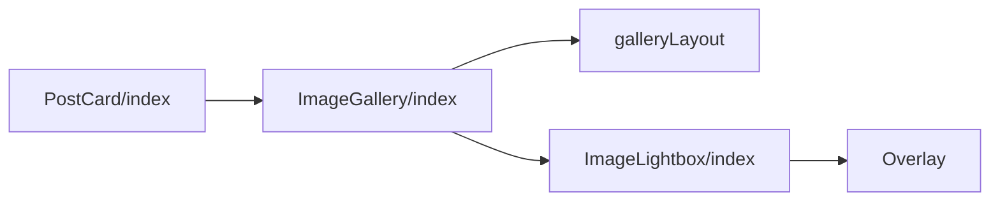
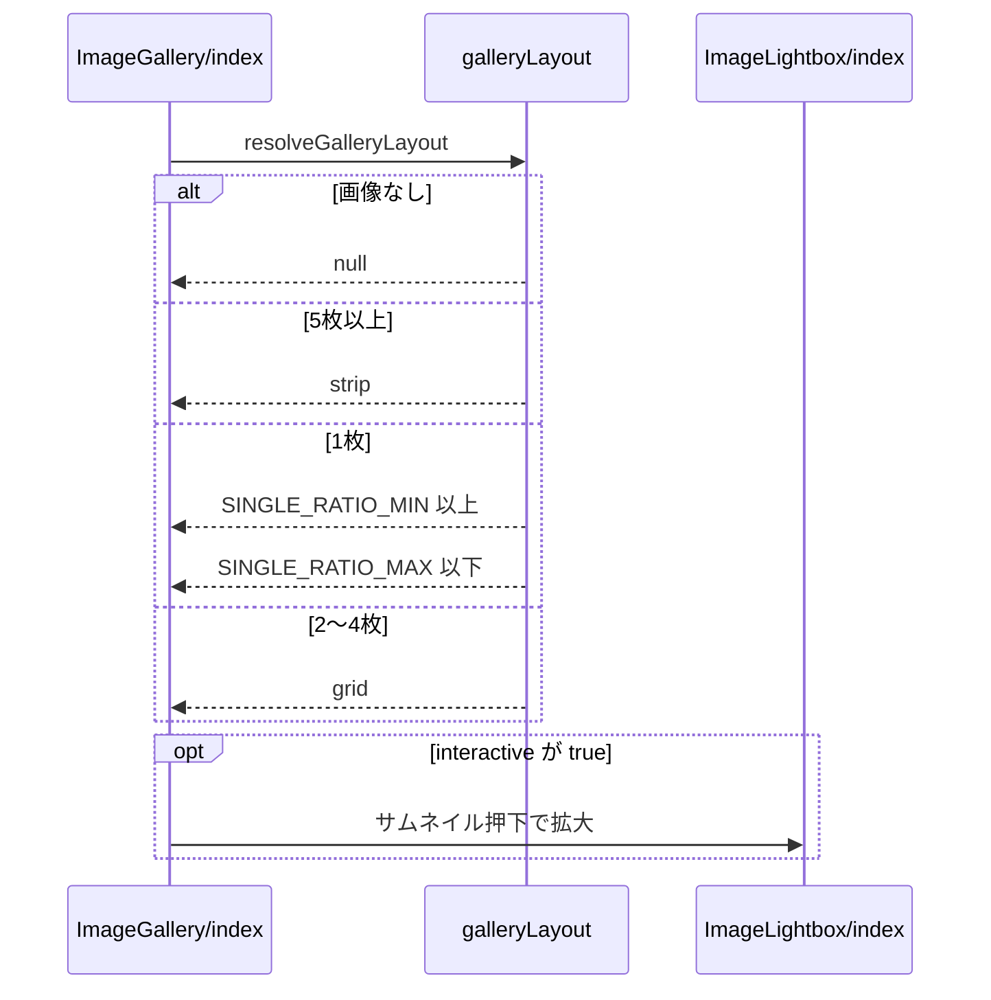

# Design Document

## Overview

**Purpose**: 投稿の画像をカード内でサムネイルとして一覧でき、タップで拡大して同じ投稿の画像を切り替えて閲覧できるようにする。
**Users**: 投稿の画像を見る利用者
**Impact**: 画像の枚数に応じたサムネイルの配置と、拡大表示での切り替えを、投稿カード以外の画面からも使える部品として提供する。

### Goals

- 画像の枚数に応じたサムネイルの配置。
- 画像の拡大表示と画像の切り替え。
- タイムラインの投稿カードで表示する画像の選択。

### Non-Goals

- 画像以外のメディアの表示。
- タイムラインのカード全体の高さと折りたたみ。

## Boundary Commitments

### This Spec Owns

- 画像の枚数に応じたサムネイルの配置。
- 画像の拡大表示と画像の切り替え。
- タイムラインの投稿カードで表示する画像の選択。

### Out of Boundary

- 画像以外のメディアの表示。
- タイムラインのカード全体の高さと折りたたみ。

### Allowed Dependencies

- 投稿カード（PostCard）での画像の選択
- スクロールの固定（browser-utils）
- 共通のモーダル基盤

### Revalidation Triggers

- 枚数ごとの配置規則（縦横比の範囲・領域の比）を変えるとき
- 拡大表示のキーボード操作とフォーカスの扱いを変えるとき
- タイムラインで表示する画像の選択規則を変えるとき

## Architecture

### Architecture Pattern & Boundary Map

タイムラインの画像表示に関わる依存方向を示す。



## File Structure Plan

| パス                                           | 責務                                     |
| ---------------------------------------------- | ---------------------------------------- |
| `src/lib/image/galleryLayout.ts`               | 枚数と縦横比からのサムネイルの配置の決定 |
| `src/components/image/ImageGallery/index.tsx`  | サムネイルの描画と拡大表示の起動         |
| `src/components/image/ImageLightbox/index.tsx` | 拡大表示と画像の切り替え                 |
| `src/components/post/PostCard/index.tsx`       | タイムラインで表示する画像の選択         |

## System Flows

配置の決定と拡大表示の起動までの流れを示す。



## Requirements Traceability

| Requirement             | Summary              | Components |
| ----------------------- | -------------------- | ---------- |
| 1.1, 1.2, 1.3, 1.4      | サムネイルの配置     | D-1        |
| 2.1, 2.2, 2.3, 2.4, 2.5 | 拡大表示             | D-2, D-3   |
| 3.1, 3.2, 3.3           | キーボードと支援技術 | D-2, D-3   |
| 4.1, 4.2, 4.3           | 利用の場面           | D-2, D-4   |

## Components and Interfaces

#### D-1: 配置の決定

**Requirements**: 1.1, 1.2, 1.3, 1.4

```ts
export type GalleryLayout =
  | { kind: "grid"; count: 1 | 2 | 3 | 4; singleRatio?: number }
  | { kind: "strip" }
export const SINGLE_RATIO_MIN = 0.75
export const SINGLE_RATIO_MAX = 2
export const resolveGalleryLayout = (
  images: SourceImage[],
): GalleryLayout | null => {
  if (images.length === 0) return null
  if (images.length > 4) return { kind: "strip" }
  if (images.length === 1) {
    const r = images[0].aspectRatio
    const raw = r ? r.width / r.height : 1.5
    return {
      kind: "grid",
      count: 1,
      singleRatio: Math.min(SINGLE_RATIO_MAX, Math.max(SINGLE_RATIO_MIN, raw)),
    }
  }
  return { kind: "grid", count: images.length as 2 | 3 | 4 }
}
```

| 配置        | CSS                                                                                                                               |
| ----------- | --------------------------------------------------------------------------------------------------------------------------------- |
| grid 1枚    | `aspect-ratio: singleRatio`                                                                                                       |
| grid 2〜4枚 | `aspect-ratio: 2 / 1; grid-template-columns: 1fr 1fr`。3枚と4枚は2行で、3枚の1枚目は `grid-row: 1 / span 2`                       |
| strip       | `display: flex; height: 10rem; overflow-x: auto`。各セルに画像の `aspect-ratio` を指定し、不明なら `width: auto; min-width: 5rem` |

画像は `object-fit: cover` とし、`` で描画する。領域の比率を先に決めるため、読み込みでカードの高さが変わらない。

#### D-2: サムネイルの部品

**Requirements**: 2.1, 3.2, 3.3, 4.3

```ts
type Props = {
  images: SourceImage[] // 10枚を超える分は描画しない
  interactive?: boolean // 既定 true。false で拡大表示を持たない <div> にする
}
```

`interactive` のときは各サムネイルを `<button aria-label="画像{i+1}/{N}を拡大">` とし、押すと `openIndex = i` にして `ImageLightbox` を描画する。閉じたらボタンの `ref` に `focus()` を戻す。

#### D-3: 拡大表示

**Requirements**: 2.2, 2.3, 2.4, 2.5, 3.1, 3.2, 3.3

```ts
type Props = {
  images: SourceImage[]
  index: number
  onIndexChange: (next: number) => void
  onClose: () => void
}
```

- `Overlay` を使い、Escキー・背景クリックでの閉鎖と背面のスクロールのロックを任せる。画像は `max-height: calc(100dvh - 7rem); object-fit: contain` で表示する。
- 複数枚のときだけ前後ボタン（端では `disabled`）・位置表示・`document` の左右の矢印キーを有効にする。
- 前・現在・次の画像を `transform: translateX(calc((i - index) * 100% + dragX))` で並べ、0.3秒で遷移させる。`prefers-reduced-motion: reduce` では遷移を無効にする。
- スワイプ: 8px以上の移動でドラッグを開始して指に追従させ、離したときに50px以上で隣へ切り替える。端の方向は追従量を0.3倍にする。画像領域は `touch-action: pan-y` とする。
- マウント時に閉じるボタンへフォーカスし、Tabキーを閉じる・前・次の間で循環させる。

#### D-4: タイムラインの画像の選択

**Requirements**: 4.1, 4.2

```ts
const entryVisualImages: SourceImage[] | undefined = activeEntry?.visualUrl
  ? [
      {
        url: activeEntry.visualUrl,
        alt: "",
        cid: activeEntry.visualUrl,
        aspectRatio: { width: TARGET_WIDTH, height: TARGET_HEIGHT },
      },
    ] // 1200×630
  : undefined
const galleryImages = hasVideoDisplay ? [] : (entryVisualImages ?? item.images)
const imagesInteractive = entryVisualImages === undefined
```

- `hasVideoDisplay` は、動画のサムネイルまたは利用不可の動画の表示を出すときに真になる。entryの代表画像があるときは動画投稿でも代表画像を表示し、動画の表示は出さない（`hasVideoDisplay` は偽）。entryが無い動画投稿・利用不可の動画では、ギャラリーの画像は空配列になる。

派生元が削除済みで添付画像の無いentryも、同じ規則で代表画像を表示する。

## Error Handling

- なし

## Testing Strategy

- Unit / Build Tests:
  - `npx vitest run tests/lib/image/galleryLayout.test.ts tests/components/image/ImageGallery.test.ts`
  - `npm run build`
- E2E/UI Tests:
  - `tests/e2e/imageGallery.spec.ts` 画像3枚と5枚の投稿を表示する → 3枚は2:1の左1枚右2枚、5枚は高さ固定の横スクロールになる
  - `tests/e2e/imageGallery.spec.ts` サムネイルを押して矢印キーとスワイプで切り替え、Escキーで閉じる → 位置表示が変わり、閉じるとサムネイルにフォーカスが戻る
  - `tests/e2e/imageGallery.spec.ts` タイムラインでentryを持つ投稿の画像を押す → 拡大表示が開かない
- テストの名前には、対応する基準 ID を `[image-gallery/<ID>]` の形で付ける（例: `[image-gallery/1.1]`）
