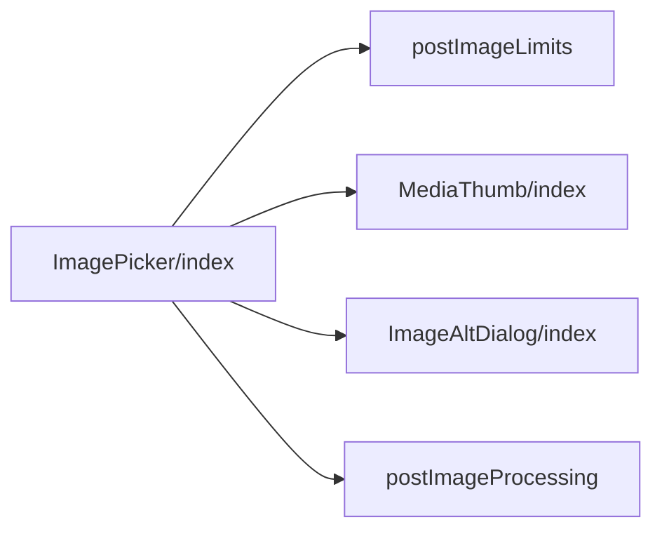
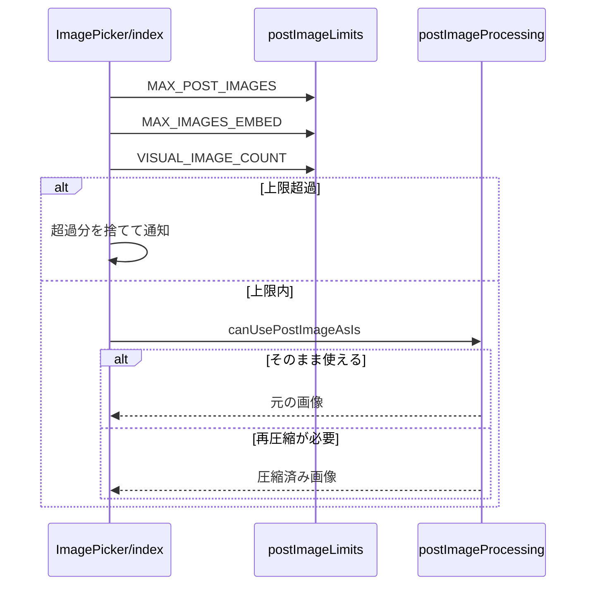

# Design Document

## Overview

**Purpose**: 投稿フォームの各セグメントに最大10枚の画像を添付し、代表画像の素材になる画像を利用者が区別できるようにする。
**Users**: 投稿に画像を添付する利用者
**Impact**: 投稿フォームの各セグメントに最大10枚の画像を添付できるようにし、代表画像の素材になる画像を区別できるようにする。

### Goals

- 画像の選択と枚数の上限。
- 添付した画像のプレビュー・取り外し・代替テキストの編集。
- 投稿に添付する画像の圧縮。

### Non-Goals

- 代表画像の合成と切り抜きの調整。
- 画像の並べ替えと、下書きへの画像の保存。

## Boundary Commitments

### This Spec Owns

- 画像の選択と枚数の上限。
- 添付した画像のプレビュー・取り外し・代替テキストの編集。
- 投稿に添付する画像の圧縮。

### Out of Boundary

- 代表画像の合成と切り抜きの調整。
- 画像の並べ替えと、下書きへの画像の保存。

### Allowed Dependencies

- 代表画像の合成（entry-visual）の素材の枚数（先頭4枚）
- 画像の圧縮（ブラウザの Canvas）
- 投稿の画像の上限（entry-api の10枚）

### Revalidation Triggers

- 画像の枚数の上限（10枚）と代表画像の素材の枚数（4枚）を変えるとき
- 圧縮後の容量の上限（2,000,000バイト）と内部の予算（1,900,000バイト）を変えるとき（Bluesky の上限に影響する）
- 下書きや外から渡された添付の組の扱いを変えるとき

## Architecture

### Architecture Pattern & Boundary Map

画像選択の部品間の依存方向を示す。



## File Structure Plan

| パス                                            | 責務                                           |
| ----------------------------------------------- | ---------------------------------------------- |
| `src/lib/image/postImageLimits.ts`              | 画像の枚数の定数                               |
| `src/components/image/ImagePicker/index.tsx`    | 画像の選択・プレビュー・通知                   |
| `src/components/common/MediaThumb/index.tsx`    | サムネイルの枠と取り外し・代替テキストのボタン |
| `src/components/image/ImageAltDialog/index.tsx` | 代替テキストの編集                             |
| `src/lib/image/postImageProcessing.ts`          | 投稿用の画像の圧縮                             |

## System Flows

画像の追加から圧縮までの流れを示す。



## Requirements Traceability

| Requirement   | Summary              | Components |
| ------------- | -------------------- | ---------- |
| 1.1, 1.2, 1.3 | 枚数の上限と通知     | D-1        |
| 2.1, 2.2, 2.3 | プレビューと編集     | D-2        |
| 3.1, 3.2      | 代表画像の素材の区別 | D-1        |
| 4.1, 4.2      | 圧縮                 | D-3        |

## Components and Interfaces

#### D-1: 枚数と通知

**Requirements**: 1.1, 1.2, 1.3, 3.1, 3.2

```ts
export const MAX_POST_IMAGES = 10
export const MAX_IMAGES_EMBED = 4
export const VISUAL_IMAGE_COUNT = 4
// addFiles: allowed = MAX_POST_IMAGES - slots.length。超えた分は捨てて overflowNotice を表示する
const def = defs[idx] // idx >= VISUAL_IMAGE_COUNT なら undefined
const cropPixels = def
  ? computeInitialCrop(size.width, size.height, def.w, def.h)
  : null
```

- 5枚目以降のスロットは `cropState.cropPixels = null` とし、代表画像の切り抜きの対象に含めない。
- `index >= VISUAL_IMAGE_COUNT` のサムネイルに `slot-excluded-badge` を重ねる。取り外しで順序が変わると、位置から判定し直す。
- 通知は次の追加と取り外しで消す。

#### D-2: プレビュー

**Requirements**: 2.1, 2.2, 2.3

```ts
type MediaThumbProps = {
  onRemove: () => void
  onEditAlt?: () => void // 省略時は代替テキストのボタンを出さない
  removeAriaLabel: string
  altAriaLabel?: string
  altFilled?: boolean // 代替テキストが入力済みなら強調色。既定は false
  disabled?: boolean
  style?: CSSProperties
  className?: string // 配置先ごとの追加クラス
  testId?: string
  children: ReactNode
}
```

| ボタン               | 見た目                                                                       |
| -------------------- | ---------------------------------------------------------------------------- |
| 取り外し（右上）     | 幅と高さ `--size-button-md` の円、文字 `--font-size-2xl`                     |
| 代替テキスト（右下） | 高さ `--size-button-md`、文字 `--font-size-lg`、左右の余白 `--space-3`       |
| 共通                 | `border: 2px solid #fff`、背景 `rgb(0 0 0 / 60%)`、hoverで `--color-bluesky` |

- `value` が null でなく内部のスロットが空のとき（予約の書き戻しのように外から渡されたとき）は、`originalBlobs` から object URL を作り、`meta` の寸法と代替テキストと `computeInitialCrop` の切り抜きでスロットを組み立てる。このときは `onChange` を呼ばず、渡された `thumbnailBlob` をそのまま使う。

#### D-3: 圧縮

**Requirements**: 4.1, 4.2

```ts
// JPEG か PNG で、容量が予算（POST_IMAGE_BYTE_BUDGET = 1,900,000 バイト）以下ならそのまま使う
export const canUsePostImageAsIs = (blob: Blob): boolean
// それ以外は compressToByteBudget で予算（1,900,000 バイト）以内に収まるまで縮小・再圧縮する
```

- 容量の上限は 2,000,000 バイト（Bluesky の `app.bsky.embed.images` の上限）で、内部の予算 1,900,000 バイトは安全マージンを引いた値。圧縮結果は常に上限以内に収まる。
- そのまま使う判定も予算以下で行うため、1,900,000 バイトを超え 2,000,000 バイト以下の JPEG・PNG は再圧縮される。

全画像（最大10枚）を個別に処理し、代表画像の合成とは独立させる。

## Error Handling

| 事象                 | 処理                     |
| -------------------- | ------------------------ |
| 上限を超えた選択     | 超えた分を捨てて通知する |
| 画像の読み込みの失敗 | そのファイルを追加しない |

## Testing Strategy

- Unit / Build Tests:
  - `npm run build`
  - `npx vitest run tests/lib/image/postImageProcessing.test.ts`
- E2E/UI Tests:
  - `tests/e2e/multiImage.spec.ts` 11枚の画像を選んで先頭を取り外す → 10枚で止まり通知が出て、繰り上がった5枚目のラベルが消える
- テストの名前には、対応する基準 ID を `[image-picker/<ID>]` の形で付ける（例: `[image-picker/1.1]`）
