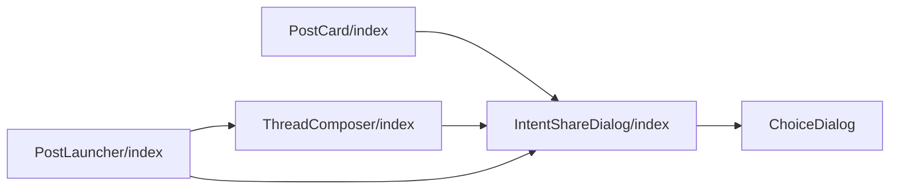
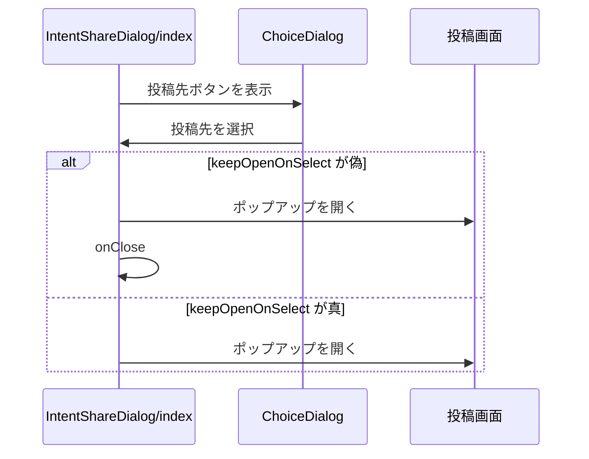

# Design Document

## Overview

**Purpose**: 投稿内容を共有するSNSを利用者がその場で選べるダイアログを提供し、投稿直後とタイムラインの投稿の両方から他SNSへ共有できるようにする。
**Users**: 投稿直後やタイムラインから他 SNS へ共有したい利用者
**Impact**: 共有先の SNS をその場で選べるダイアログを、投稿直後とタイムラインの投稿の両方から開けるようにする。

### Goals

- 投稿先選択ダイアログの選択肢と開閉。
- 投稿直後とタイムラインの投稿からのダイアログの表示。

### Non-Goals

- ダイアログを自動で開くかどうかの判断。
- 共有文の組み立てと省略の規則。

## Boundary Commitments

### This Spec Owns

- 投稿先選択ダイアログの選択肢と開閉。
- 投稿直後とタイムラインの投稿からのダイアログの表示。

### Out of Boundary

- ダイアログを自動で開くかどうかの判断。
- 共有文の組み立てと省略の規則。

### Allowed Dependencies

- 共有文の組み立て（share-text）と共有設定（share-settings）
- インスタンスドメインの検証（share-settings）
- ポップアップの事前オープン（auto-popup）
- 共通のダイアログ部品（ChoiceDialog）

### Revalidation Triggers

- 選択肢の種類（共有先 SNS）を変えるとき（auto-popup の選択肢と一致が要る）
- ダイアログの表示の契機（投稿直後・タイムライン）を変えるとき
- 共有文の省略の呼び出し方を変えるとき

## Architecture

### Architecture Pattern & Boundary Map

ダイアログを表示する側とされる側の依存方向を示す。



## File Structure Plan

| パス                                              | 責務                                             |
| ------------------------------------------------- | ------------------------------------------------ |
| `src/components/post/IntentShareDialog/index.tsx` | 投稿先選択ダイアログ                             |
| `src/components/post/ThreadComposer/index.tsx`    | 投稿直後のダイアログの表示と入力欄のクリア       |
| `src/components/post/PostLauncher/index.tsx`      | 投稿フォームのオーバーレイ外でのダイアログの表示 |
| `src/components/post/PostCard/index.tsx`          | タイムラインの投稿からのダイアログの表示         |

## System Flows

投稿先の選択から外部の投稿画面を開くまでの流れを示す。



## Requirements Traceability

| Requirement   | Summary                | Components |
| ------------- | ---------------------- | ---------- |
| 1.1, 1.2, 1.3 | 選択肢と開閉           | D-1        |
| 2.1, 2.2, 2.3 | 投稿直後の共有         | D-2        |
| 3.1, 3.2, 3.3 | タイムラインからの共有 | D-1, D-3   |

## Components and Interfaces

#### D-1: ダイアログ

**Requirements**: 1.1, 1.2, 1.3, 3.1, 3.2

```ts
export type IntentShareRequest = {
  postText: string
  entryUrl: string | null
  linkCardUrl: string
}
type Props = {
  request: IntentShareRequest | null // null なら非表示
  keepOpenOnSelect?: boolean // 既定 false
  onClose: () => void
}
```

- `ChoiceDialog` で「X に投稿」「タイッツーに投稿」「Mastodonに投稿」「Misskeyに投稿」「閉じる」を並べる。背景クリックとEscキーは `ChoiceDialog` の `onClose` が扱う。
- クリック時に `readTruncateIntentTextSetting(false)` を読み、`buildIntentText(postText, entryUrl ?? "", linkCardUrl, { truncateLimit: resolveTruncateLimit(target, truncate) })` を `openIntentPopupFor` に渡す。`keepOpenOnSelect` が偽のときだけ続けて `onClose()` を呼ぶ。
- `resolveMastodonInstanceDomain(readMastodonInstanceDomainSetting(""))` が `null` なら、Mastodonのボタンを `disabled` にする。Misskeyも `resolveMisskeyInstanceDomain(readMisskeyInstanceDomainSetting(""))` で同様に判定する。

#### D-2: 呼び出し側

**Requirements**: 2.1, 2.2, 2.3

| 呼び出し元                     | `keepOpenOnSelect` | 描画位置                                    |
| ------------------------------ | ------------------ | ------------------------------------------- |
| `PostCard`                     | 指定しない         | `PostCard` 内                               |
| `ThreadComposer`（固定表示）   | true               | `ThreadComposer` 内の `shareRequest` state  |
| `PostLauncher`（オーバーレイ） | true               | `Overlay` の外。`onShareRequest` で受け取る |

- `PostLauncher` は投稿成功で `Overlay` を閉じて `ThreadComposer` ごとアンマウントするため、`ThreadComposer` に `onShareRequest` を渡し、ダイアログを自身のstateで描画する。
- `ThreadComposer` は、共有の分岐結果で `openShareDialog` が true なら、先頭の投稿の本文・skyshare entryのURL・リンクカードのURLから `IntentShareRequest` を作る。`onShareRequest` があればそれを呼び、無ければ自身のstateに入れる。
- 入力欄のクリア（`resetInputFields`）は、ダイアログの有無によらず投稿成功後に必ず実行する。

#### D-3: entryの無い投稿のボタン

**Requirements**: 3.3

```tsx
// PostCardEntryActions: display.kind によらず先頭に描画する
<button disabled={display.kind === "creating"} onClick={onCrosspost} />
```

- `PostCard` のダイアログを開くボタンは `PostCardEntryActions` が `display` の種別によらず常に描画する（entryの作成中だけ操作不能）。ダイアログに渡す共有文は、entryが無ければURLを付けない。

## Error Handling

| 事象                   | 処理                                                         |
| ---------------------- | ------------------------------------------------------------ |
| ポップアップを開けない | ダイアログを開いたまま、利用者が別の投稿先を選べる状態を保つ |

## Testing Strategy

- Unit / Build Tests:
  - `npm run build`
  - `npx playwright test tests/e2e/intentShare.spec.ts`
- E2E/UI Tests:
  - `tests/e2e/intentShare.spec.ts` 不正なMastodonドメインを保存してタイムラインの投稿の共有ダイアログを開く → Mastodonの選択肢が操作不能で、他の4つは操作できる
  - `tests/e2e/intentShare.spec.ts` 投稿直後のダイアログでXとタイッツーを続けて選ぶ → ダイアログが閉じず、閉じる・背景クリック・Escキーで閉じる
  - `tests/e2e/intentShare.spec.ts` ゲスト表示でentryの無い投稿のカードを表示する → ダイアログを開くボタンが表示される
- テストの名前には、対応する基準 ID を `[intent-share-dialog/<ID>]` の形で付ける（例: `[intent-share-dialog/1.1]`）
