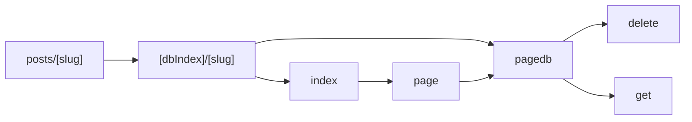
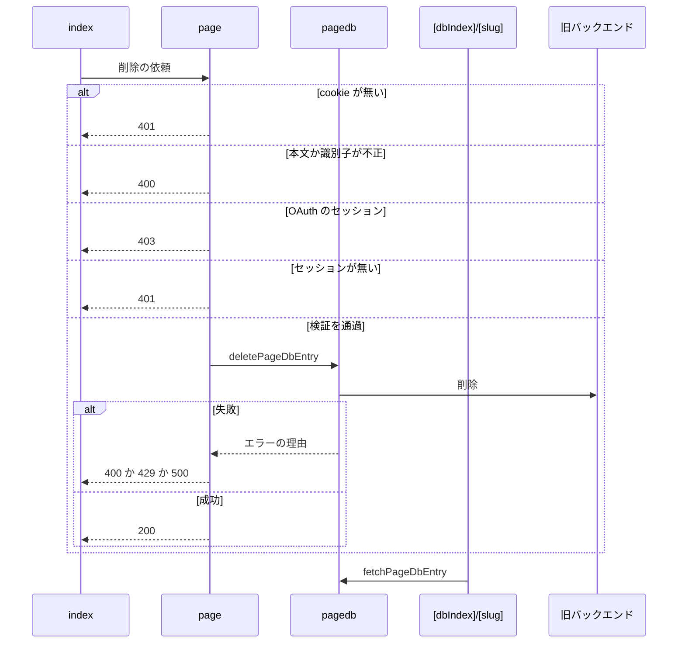

# Design Document

## Overview

**Purpose**: 旧バックエンドに保存された過去の投稿ページを、現行のデザインで表示し、投稿者本人が削除できるようにする。
**Users**: 過去に作成した旧形式の投稿ページを閲覧する人と、投稿者本人
**Impact**: 旧バックエンドに保存された過去の投稿ページを現行のデザインで表示し、投稿者本人が削除できるようにする。

### Goals

- 旧形式の投稿ページの表示と、識別子の検証。
- 旧バックエンドからの投稿情報の取得と、削除の依頼。
- 投稿者本人に限った削除の導線。

### Non-Goals

- 旧形式の投稿ページの新規作成。
- 旧バックエンド自体の実装。

## Boundary Commitments

### This Spec Owns

- 旧形式の投稿ページの表示と、識別子の検証。
- 旧バックエンドからの投稿情報の取得と、削除の依頼。
- 投稿者本人に限った削除の導線。

### Out of Boundary

- 旧形式の投稿ページの新規作成。
- 旧バックエンド自体の実装。

### Allowed Dependencies

- 旧バックエンド（取得と削除の依頼）
- ログインのセッション（account-session と oauth-session）
- API のスキーマ（`src/lib/api/schema/v1/page/`）

### Revalidation Triggers

- 旧バックエンドの応答の形や削除の依頼の形が変わるとき
- 識別子の形式（種別・キー）を変えるとき
- OAuth のセッションでの削除の扱いを変えるとき（旧バックエンドが OAuth を扱えない制約に依存する）

## Architecture

### Architecture Pattern & Boundary Map

旧形式の投稿ページに関わる依存方向を示す。



## File Structure Plan

| パス                                                    | 責務                               |
| ------------------------------------------------------- | ---------------------------------- |
| `src/pages/v1/page.ts`                                  | 削除のハンドラ                     |
| `src/lib/legacy/pagedb.ts`                              | 旧バックエンドへの取得と削除の依頼 |
| `src/lib/api/schema/v1/page/delete.ts`                  | 旧バックエンドの削除のスキーマ     |
| `src/lib/api/schema/v1/page/_dbIndex/_dbKey/get.ts`     | 旧バックエンドの取得のスキーマ     |
| `src/pages/posts/[dbIndex]/[slug].astro`                | 投稿ページ                         |
| `src/pages/posts/[slug].astro`                          | 種別を省略したURLの書き換え        |
| `src/components/entry/LegacyPageDeleteButton/index.tsx` | 削除のボタン                       |

## System Flows

削除の依頼の検証と、旧バックエンドの失敗の変換を示す。



## Requirements Traceability

| Requirement             | Summary                    | Components |
| ----------------------- | -------------------------- | ---------- |
| 1.1, 1.2, 1.3           | 旧形式の投稿ページの表示   | D-1, D-3   |
| 2.1, 2.2, 2.3, 2.4, 2.5 | 削除の対象と認証           | D-2, D-3   |
| 3.1, 3.2, 3.3, 3.4      | 削除の依頼と結果           | D-1, D-2   |
| 4.1, 4.2                | OAuth のセッションでの削除 | D-2, D-3   |

## Components and Interfaces

#### D-1: 旧バックエンドへの依頼

**Requirements**: 1.1, 1.2, 3.1, 3.2, 3.3

```ts
export type PageDbErrorReason = "BadRequest" | "RateLimitExceeded" | "InternalServerError" | "UnknownError"
export const deletePageDbEntry = async (params: { dbIndex: string; dbKey: string; did: string; accessJwt: string }): Promise<{ ok: true } | { error: PageDbErrorReason }>
export const fetchPageDbEntry = async (params: { dbIndex: string; dbKey: string }): Promise<PageDbEntry | { error: PageDbErrorReason }>
```

- 削除は `pageId = "<dbIndex>/<dbKey>"` で依頼する。取得は種別とキーを URL エンコードして渡す。
- 取得の成功は `{ ogp, handle, imgs: { thumb, alt }[] }` を返す。通信の例外は握りつぶして `UnknownError` にする。

#### D-2: 削除のハンドラ

**Requirements**: 2.1, 2.2, 2.3, 2.4, 2.5, 3.4, 4.1, 4.2

| 段階       | 条件                                                                             | 結果                                       |
| ---------- | -------------------------------------------------------------------------------- | ------------------------------------------ |
| cookie     | ヘッダに cookie が無い                                                           | 401                                        |
| 本文       | JSON として解釈できない                                                          | 400                                        |
| 識別子     | `dbIndex` が `legacy` か数字でない、`dbKey` が `^[^/@]+@[^/@]+$` でない          | 400                                        |
| セッション | `did` か `accessJwt` を持つセッションが無い                                      | 401                                        |
| 種類       | OAuth のセッション（アクセストークンが DPoP に結び付き旧バックエンドで使えない） | 403 `{ error: "OAuthSessionUnsupported" }` |
| 依頼       | `BadRequest` → 400、`RateLimitExceeded` → 429、その他 → 500                      | 上記                                       |
| 成功       | 本文なし                                                                         | 200                                        |

#### D-3: 投稿ページと削除のボタン

**Requirements**: 1.3, 2.1, 4.1, 4.2

| 項目               | 内容                                                                                                                                               |
| ------------------ | -------------------------------------------------------------------------------------------------------------------------------------------------- |
| 識別子の検証       | `dbIndex` が `legacy` か数字でなければ 404。キーを `@` で分けて 2 つ得られなければ識別子が不正な 404。通過したときだけ旧バックエンドへ問い合わせる |
| 取得の失敗         | `RateLimitExceeded` は 503、`BadRequest` は 404、その他は 500 で表示する                                                                           |
| 種別を省略した URL | `dbIndex = legacy` として同じページへ書き換える                                                                                                    |
| 削除のボタンの表示 | セッションを持つ投稿者本人にだけ表示する。`legacy` のときは handle、数字のときは DID で本人かを判定する。本人確認は旧バックエンドが行う            |
| 削除のボタンの動作 | 確認のうえ `DELETE /v1/page/` に `{ dbIndex, dbKey }` を送り、成功したらページを再読み込みする                                                     |
| 403 の表示         | `error` が `OAuthSessionUnsupported` なら、アプリパスワードでログインし直す旨の文言をボタンの下に出す                                              |

## Error Handling

| 事象           | 処理                                 |
| -------------- | ------------------------------------ |
| 削除の失敗     | ボタンの下に削除失敗の文言を表示する |
| 取得の通信失敗 | 500 のエラー表示にする               |

## Testing Strategy

- Unit / Build Tests:
  - `npx vitest run tests/lib/legacy/pagedb.test.ts`
  - `npx vitest run tests/pages/v1/page.test.ts`
  - `npx tsc --noEmit` と `npm run test:astro` と `npx vitest run tests/components/entry/LegacyPageDeleteButton.test.ts`
- E2E/UI Tests:
  - `tests/e2e/legacyPostPage.spec.ts` 識別子が不正な旧形式のURLを開く → 404が返る
- テストの名前には、対応する基準 ID を `[legacy-page/<ID>]` の形で付ける（例: `[legacy-page/1.1]`）
