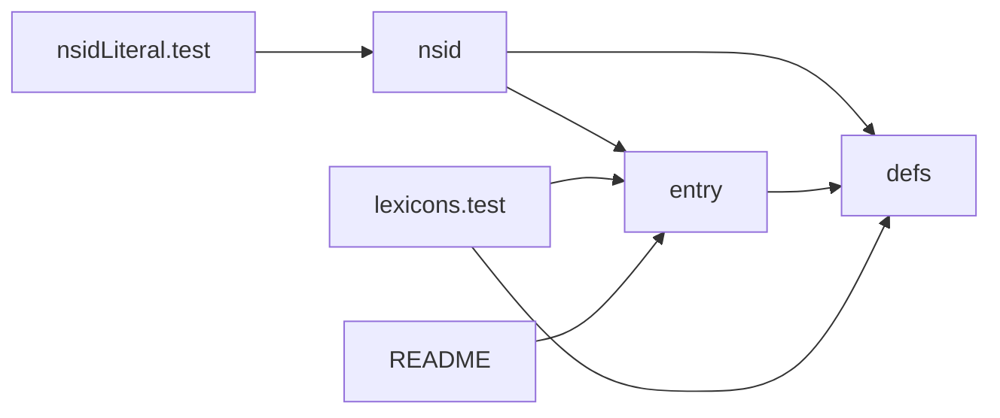
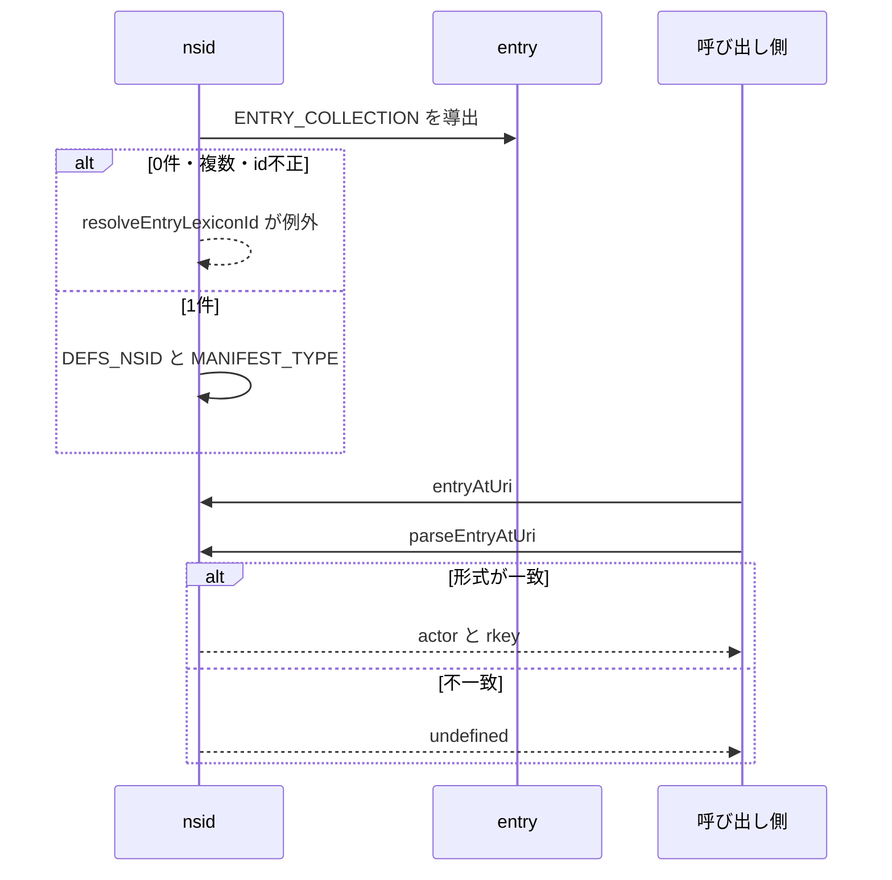

# Design Document

## Overview

**Purpose**: skyshare entryのレコード定義を管理し、フォークした運用者がコードを修正せずに自ドメインの名前空間識別子（NSID）でレコードを配信できるようにする。
**Users**: フォークして自ドメインで運用する運用者と、entry のレコードを扱う開発者
**Impact**: entry のレコード定義を lexicon として管理し、運用者がコードを修正せずに自ドメインの NSID でレコードを配信できるようにする。

### Goals

- entryレコードとマニフェストのlexicon定義。
- lexicon定義からのNSIDの導出と、コード中のNSIDの利用。
- lexicon定義の検証。

### Non-Goals

- lexicon定義を使うAPIの振る舞い。
- 仕様上固定の外部NSID。
- 旧NSIDで作成済みのレコードの移行と、DNSによる所有権の公開作業。
- 複数のNSIDの同時運用。

## Boundary Commitments

### This Spec Owns

- entryレコードとマニフェストのlexicon定義。
- lexicon定義からのNSIDの導出と、コード中のNSIDの利用。
- lexicon定義の検証。

### Out of Boundary

- lexicon定義を使うAPIの振る舞い。
- 仕様上固定の外部NSID。
- 旧NSIDで作成済みのレコードの移行と、DNSによる所有権の公開作業。
- 複数のNSIDの同時運用。

### Allowed Dependencies

- atproto の lexicon の仕様と検証ツール（`goat`）
- ビルド時の lexicon の取り込み（Cloudflare Workers では実行時にファイルを読まない）
- 公開済みの lexicon（後方互換の維持）

### Revalidation Triggers

- レコードのフィールドを追加・変更するとき（公開済みの lexicon の互換性を保つ）
- NSID の導出元（lexicon 定義の id と配置ディレクトリ）を変えるとき
- 見出しと説明文の上限を変えるとき（entry-api、entry-list の上限と一致が要る）

## Architecture

### Architecture Pattern & Boundary Map

定義・導出・検証の依存方向を示す。



## File Structure Plan

| パス                                      | 責務                                   |
| ----------------------------------------- | -------------------------------------- |
| `lexicons/dev/nekono/skyshare/entry.json` | entryレコードの定義                    |
| `lexicons/dev/nekono/skyshare/defs.json`  | マニフェストの定義                     |
| `lexicons/README.md`                      | 公開手順とドメイン変更の手順           |
| `src/lib/atproto/nsid.ts`                 | NSIDの導出とentryのURIの組み立て・解析 |
| `tests/lexicons/lexicons.test.ts`         | lexicon定義の検証                      |
| `tests/lib/atproto/nsidLiteral.test.ts`   | NSIDの直書きの検出                     |

## System Flows

モジュール評価時のNSID導出と、URI解析の分岐を示す。



## Requirements Traceability

| Requirement             | Summary              | Components |
| ----------------------- | -------------------- | ---------- |
| 1.1, 1.2, 1.3, 1.4, 1.5 | entry レコードの定義 | D-1        |
| 2.1, 2.2, 2.3, 2.4      | NSID の導出          | D-2, D-3   |
| 3.1                     | URI の解析           | D-3        |
| 4.1, 4.2, 4.3           | 検証                 | D-4        |

## Components and Interfaces

#### D-1: レコード定義

**Requirements**: 1.1, 1.2, 1.3, 1.4, 1.5

| NSID                     | 型                     | 項目        | 必須 | 制約                                                     |
| ------------------------ | ---------------------- | ----------- | ---- | -------------------------------------------------------- |
| `<prefix>.entry`         | `record`（`key: tid`） | `source`    | 必須 | `com.atproto.repo.strongRef`（参照先の種別を制約しない） |
|                          |                        | `manifest`  | 必須 | `<prefix>.defs#manifest`                                 |
|                          |                        | `createdAt` | 必須 | `datetime`                                               |
| `<prefix>.defs#manifest` | `object`               | `visual`    | 必須 | blob（`image/png` `image/jpeg` `image/webp`）            |
|                          |                        | `heading`   | 任意 | `maxLength: 100`                                         |
|                          |                        | `caption`   | 任意 | `maxLength: 300`                                         |

- 派生元の種別を投稿に限定する制約はAPI側で行い、lexiconには書かない。
- `maxLength` は文字数ではなくバイト数の上限である。APIの入力は文字数で制限するため、1文字が複数バイトになる文字では、lexiconの上限より緩い。
- `accept` は代表画像の形式の宣言であり、検証ライブラリは強制しない。代表画像はクライアントがJPEGかPNGで生成するため、形式はこの範囲に収まる。
- 公開には GoAT（`goat lex lint` / `goat lex check-dns` / `goat lex publish`）を使う。公開後は他のPDSからも解決されるため、追加するフィールドは任意にする。

#### D-2: NSIDの導出

**Requirements**: 2.1, 2.3, 2.4

```ts
const entryLexicons = import.meta.glob<{ id: string }>(
  "/lexicons/**/entry.json",
  { eager: true, import: "default" },
)
export const resolveEntryLexiconId = (
  lexicons: Record<string, { id: string }>,
): string => {
  const found = Object.entries(lexicons)
  if (found.length !== 1)
    throw new Error(
      `Exactly one entry.json is required under lexicons/ (found ${found.length}: ...)`,
    )
  const id = found[0][1].id
  if (typeof id !== "string" || !id.endsWith(".entry"))
    throw new Error(`The id of entry.json must end with ".entry": ${id}`)
  return id
}
export const ENTRY_COLLECTION = resolveEntryLexiconId(entryLexicons)
const NSID_PREFIX = ENTRY_COLLECTION.slice(0, -".entry".length)
export const DEFS_NSID = `${NSID_PREFIX}.defs`
export const MANIFEST_TYPE = `${DEFS_NSID}#manifest`
```

- `import.meta.glob` はビルド時に解決されるため、Workers上でファイルを読まない。
- defs は同名の `com.atproto.repo.defs` が存在して glob で特定できないため、entry と同じ prefix から規約で導出する。
- エラーメッセージは、ソースコードの日本語直書きを禁止する規約に合わせて英語で書く。

#### D-3: URIと呼び出し側

**Requirements**: 2.2, 3.1

```ts
export const entryAtUri = (did: string, rkey: string): string => `at://${did}/${ENTRY_COLLECTION}/${rkey}`
const ENTRY_AT_URI_PATTERN = new RegExp(`^at://([^/]+)/${escapeRegExp(ENTRY_COLLECTION)}/([^/?#]+)$`)
export const parseEntryAtUri = (uri: string): { actor: string; rkey: string } | undefined
```

| 呼び出し側                          | 利用する値                                                   |
| ----------------------------------- | ------------------------------------------------------------ |
| `src/lib/entry/skyshareRecord.ts`   | `ENTRY_COLLECTION` / `MANIFEST_TYPE`                         |
| `src/lib/entry/createBskyThread.ts` | `ENTRY_COLLECTION`                                           |
| `src/lib/entry/entry.ts`            | `parseEntryAtUri`                                            |
| `src/lib/entry/guestDummyPosts.ts`  | `entryAtUri`                                                 |
| `src/lib/api/schema/v2/entry/*.ts`  | NSIDを含めない説明文（tsx実行のため `nsid.ts` を参照しない） |

ドメインの変更手順（`lexicons/README.md`）: ディレクトリを新ドメインへ移す → `entry.json`・`defs.json` の `id` と `manifest` の `ref` を書き換える → `npm test` → `goat lex lint` と公開。

#### D-4: 検証

**Requirements**: 4.1, 4.2, 4.3

| テスト                                  | 内容                                                                                                                                                                      |
| --------------------------------------- | ------------------------------------------------------------------------------------------------------------------------------------------------------------------------- |
| `tests/lexicons/lexicons.test.ts`       | `import.meta.glob("/lexicons/**/*.json")` の全定義を `new Lexicons(docs)` で検証し、参照の解決・パスとidの対応・idの重複なし・正例と負例の `assertValidRecord` を確認する |
| `tests/lib/atproto/nsid.test.ts`        | 導出値とlexicon定義のidの一致、マニフェストの参照の一致、`resolveEntryLexiconId` の異常系、URIの往復と拒否                                                                |
| `tests/lib/atproto/nsidLiteral.test.ts` | `src/`（`src/client/` を除く）の `.ts` `.tsx` `.astro` からコメントを除いた本文にNSIDの prefix が含まれないこと                                                           |

CIの検証ジョブで vitest と `npm run test:lexicon`（goat）を両方実行する。

## Error Handling

| 事象                          | 処理                                                     |
| ----------------------------- | -------------------------------------------------------- |
| entry定義が0件・複数・id不正  | モジュール評価時に例外を投げ、ビルドとテストを失敗させる |
| URIが別コレクション・形式不正 | `parseEntryAtUri` が `undefined` を返す                  |

## Testing Strategy

- Unit / Build Tests:
  - `npm run test:lexicon` と `npx vitest run tests/lexicons/lexicons.test.ts`
  - `npx vitest run tests/lib/atproto/nsid.test.ts`
  - `npx vitest run tests/lexicons/lexicons.test.ts tests/lib/atproto/nsidLiteral.test.ts`
- テストの名前には、対応する基準 ID を `[lexicon/<ID>]` の形で付ける（例: `[lexicon/1.1]`）
