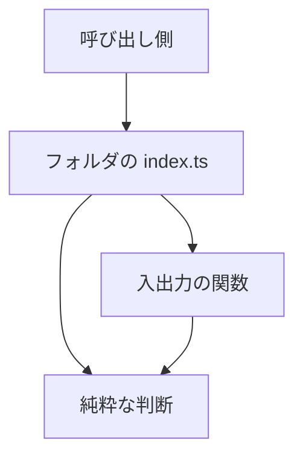

# Design Document

## Overview

**Purpose**: `src/lib/` と `src/util/` の 400 行を超える 7 件を、責務ごとのファイルに分割する。分割の前後で、外から見た export の名前・引数・戻り値・利用者に見える振る舞いは変えない。

**Users**: 開発者が、変更の影響範囲を責務の単位で読み取り、テストの対象を責務ごとに選べる。`structure-checks` が 400 行の上限を検査する場合の基準になる。

**Impact**: 7 件のうち 6 件が、それぞれ同名のフォルダに置き換わる。`contentEditableModel.ts` は `rules/` の子フォルダを作らず、同じフォルダの接頭辞付きの平置きファイルに分かれる（下の「分割の境界」と Modified Files を参照）。`lib/timeline/guest/posts.ts` は Phase 1（`src-folder-layout`）が配置した既存のファイルであり、本仕様はそれを Phase 5 の 400 行の基準で再分割する（配置の再編ではなく、行数の基準への適合）。フォルダの `index.ts` が元の export をすべて再エクスポートするため、呼び出し側の import 文は変わらない（例外は下の「Testing Strategy」の `vi.mock` の 1 件）。`guest/posts.ts` は、同じ領域の中の既存のファイルとして残し、ダミーデータだけを別ファイルに分ける。

### Goals

- 7 件のどのファイルも 400 行以下になる（各ファイルの実測値は Architecture の表に示す）
- 分割後の各ファイルは、一つの責務を持つ（ヘッダの「責務と処理概要」で一文で言える）
- 外向きの export の名前・引数・戻り値・投げる例外が変わらない
- `npm run test:all` が終了コード 0 で、通過件数が着手時の基準（2026-11-03）を下回らない
- 分割 1 件ごとに 1 コミットにする

### Non-Goals

- 振る舞いの変更、責務の再設計、新しい機能の追加
- `lib` の層の分類（`lib-layers`）と `util` の移動（`util-placement`）。本仕様は、それらの完了後のパスを前提にする
- 検査の規則の追加（`structure-checks`）。本仕様は検査の規則を変えない
- 生成物（`src/client/openapi/`）と API の入出力

## Boundary Commitments

### This Spec Owns

- 7 件の分割の方式（フォルダ化・兄弟ファイルの責務・`index.ts` の再エクスポートの内容）
- 分割に伴う import 文の更新（分割したモジュールを参照する箇所のうち、パスの解決先が変わるもの）
- 分割に伴うテストの mock パスと import パスの更新（テストの意味は変えない）
- `guest/posts.ts` のダミーデータの分割（データだけのファイル 2 件と、データの組み立てに使う関数 1 件）

### Out of Boundary

- 分割したモジュールの振る舞い、export の名前、引数と戻り値の型、投げる例外
- `lib-layers` の層の対応表（`scripts/architecture/libLayers.ts`）と `util-placement` の移動の対応表。本仕様は、それぞれの完了後の配置を読むだけで、その内容を変えない
- `structure.md` の規約の改訂（本仕様の分割は既存の規約（`./`・`@/`・`index.ts`）に従うため、規約の変更を伴わない）
- 検査の規則（`scripts/architecture/`・`config/architecture/import-allowlist.json`）。許容リストに新しい項目を追加しない

### Allowed Dependencies

- 分割後の兄弟ファイルは、同じフォルダの中で `./` により参照し合う。ただし、依存は一方向に限る（下の「依存の向き」）
- フォルダの外のモジュールは `@/` で参照する（`structure.md` の規約）
- `lib` の領域どうしの依存は、分割の前後で増やさない（閉路を作らない）
- 新しい外部パッケージを追加しない

依存の向き（分割後のフォルダ内。左が上流）:

- `image/postImageProcessing/`: `geometry` ← `encode` ← `compose`。`source` は独立。`index` は全件を再エクスポート
- `settings/shareSettings/`: `autoPopup`・`instanceDomain`・`toggles`・`textareaRows` は互いに参照しない。`toggles` の `readEffectiveLinkCardPriority` だけは同じファイル内の読み取りを使う
- `schedule/store/`: `rows` ← `schedules` ← `execution`、`rows` ← `credentials`、`oauthState` は独立。`index` は全件を再エクスポート
- `session/cookies/`: `codec` ← `model` ← `pool` ← `headers`。`index` は全件を再エクスポート
- `survey/gate/`: `state`（純粋な遷移） ← `check`（判定） ← `runtime`（画面の効果と送信・辞退）。`index` は全件を再エクスポート
- `components/composer/ThreadComposer/rules/contentEditableModel*.ts`（平置き）: `contentEditableModelParts`（純粋な平文モデル） ← `contentEditableModelDom`（DOM の走査・選択・キャレット） ← `contentEditableModelEdit`（削除の判定・画素位置の測定）。`contentEditableModel.ts` は全件を再エクスポートする入口として残る
- `timeline/guest/`: `postsBasic`・`postsThread`・`postFacets` は、`posts.ts` だけが参照する。`posts.ts` は `./assets`・`@/lib/timeline/posts` などの既存の import を保つ

### Revalidation Triggers

- フォルダ化したモジュールの `index.ts` の export 一覧（名前が増減すると、参照側の型が変わる）
- `lib/schedule/store` の `index.ts` の export（`vi.mock` の対象のため、テストの mock の内容に影響する）
- `components/composer/ThreadComposer/rules/contentEditableModel` の export（`util-placement` の移動先と一致させる）
- `lib/session/cookies` の export（認証の経路の全件が参照する）

## Architecture

### Existing Architecture Analysis

- 7 件は、いずれも「一つの `.ts` ファイルに、複数の責務の関数と定数と型が並ぶ」構成。ファイル先頭のコメントは、すでに責務の一覧（`責務と処理概要`）を持つものが多い。
- 既存の分割の方式（フォルダ化・`index.ts` の再エクスポート）は `structure.md` の規約（`./` は同じフォルダの内部、`@/` は領域をまたぐ import）と整合する。
- `guest/` はすでにフォルダであり、`index.ts` が `posts.ts`・`entries.ts`・`assets.ts` を参照する。

### 分割前後の行数（2026-11-03 の実測）

| 元のファイル                                                                                                                       | 行数 | 分割後のフォルダ                                      | 分割後の主要ファイル（行数の目安）                                                                                                                                    |
| ---------------------------------------------------------------------------------------------------------------------------------- | ---- | ----------------------------------------------------- | --------------------------------------------------------------------------------------------------------------------------------------------------------------------- |
| `lib/image/postImageProcessing.ts`                                                                                                 | 856  | `lib/image/postImageProcessing/`                      | `geometry.ts`（約 220）・`encode.ts`（約 260）・`compose.ts`（約 280）・`source.ts`（約 40）・`index.ts`                                                              |
| `lib/settings/shareSettings.ts`                                                                                                    | 716  | `lib/settings/shareSettings/`                         | `autoPopup.ts`（約 90）・`instanceDomain.ts`（約 230）・`toggles.ts`（約 290）・`textareaRows.ts`（約 60）・`index.ts`                                                |
| `lib/schedule/store.ts`                                                                                                            | 676  | `lib/schedule/store/`                                 | `rows.ts`（約 30）・`schedules.ts`（約 220）・`execution.ts`（約 160）・`credentials.ts`（約 230）・`oauthState.ts`（約 90）・`index.ts`                              |
| `lib/timeline/guest/posts.ts`                                                                                                      | 643  | `lib/timeline/guest/`（ファイルのまま）               | `posts.ts`（約 150）・`postsBasic.ts`（約 220）・`postsThread.ts`（約 250）・`postFacets.ts`（約 30）                                                                 |
| `lib/session/cookies.ts`                                                                                                           | 443  | `lib/session/cookies/`                                | `codec.ts`（約 110）・`model.ts`（約 160）・`pool.ts`（約 70）・`headers.ts`（約 230）・`index.ts`                                                                    |
| `lib/survey/gate.ts`                                                                                                               | 415  | `lib/survey/gate/`                                    | `state.ts`（約 170）・`check.ts`（約 70）・`runtime.ts`（約 190）・`index.ts`                                                                                         |
| `util/textarea/contentEditableModel.ts`（`util-placement` 後: `components/composer/ThreadComposer/rules/contentEditableModel.ts`） | 426  | `rules/` の平置き（`contentEditableModel.ts` は残す） | `contentEditableModelParts.ts`（約 80）・`contentEditableModelDom.ts`（約 270）・`contentEditableModelEdit.ts`（約 100）・`contentEditableModel.ts`（再エクスポート） |

行数は実装後に `wc -l` で確かめる（目安を超えるものがあれば、責務の境界で分け直す）。

### Architecture Pattern & Boundary Map



- 呼び出し側は、フォルダの `index.ts` だけを参照する（分割の内部は見えない）。
- 純粋な判断（型・遷移・計算）は、入出力に依存しない。入出力の関数が判断を呼ぶ。

**Architecture Integration**:

- Selected pattern: 同名フォルダ + `index.ts` の再エクスポート（`research.md` の比較を参照）
- Domain/feature boundaries: 責務の単位（判断・入出力・モデル・節）で分ける
- Existing patterns preserved: `@/` の import、`./` は同じフォルダの内部、`lib` の UI 非依存
- New components rationale: 各分割ファイルは、既存の関数の移動であり、新しい抽象は作らない
- Steering compliance: `structure.md` の import 規約・依存規則（`crossRegionRelative`・`relativeDepth`・`cycle`）に従う

### Technology Stack

新しい依存は追加しない。既存の TypeScript・Vitest の構成に従う。

## File Structure Plan

### Directory Structure

```
src/lib/image/postImageProcessing/
├── geometry.ts       # スロット定義・中心基準の切り抜き（純粋）
├── source.ts         # 画像 URL の読み込み（loadImage・loadImageSize）
├── encode.ts         # Canvas の Blob 化・圧縮（バイト予算）
├── compose.ts        # 合成サムネイル・原本の作成（公開の処理）
└── index.ts          # 元の export をすべて再エクスポート
src/lib/settings/shareSettings/
├── autoPopup.ts      # 自動ポップアップの設定（AutoPopupTarget は lib/share/autoPopupTarget から再エクスポート）
├── instanceDomain.ts # Mastodon・Misskey のインスタンスドメインの既定値・検証・保存
├── toggles.ts        # 真偽値の共有設定と、リンクカード優先の実効値
├── textareaRows.ts   # 本文欄の行数の設定
└── index.ts
src/lib/schedule/store/
├── rows.ts           # D1 の行の変換・変更件数（共通）
├── schedules.ts      # 予約の保存・取得・一覧・置き換え・削除・件数・カーソル
├── execution.ts      # 実行の取り出し・進捗・待機への戻し・完了・失敗・回収・削除
├── credentials.ts    # 予約用の認証情報の保管・状態・使われない認証情報の印への置き換え
├── oauthState.ts     # 認可の途中の状態の保存・取り出し・削除
└── index.ts
src/lib/timeline/guest/
├── posts.ts          # 既存のファイルとして残す: findGuestPost・buildGuestPosts（連結）・buildGuestThreads
├── postsBasic.ts     # ダミーデータ（単独の投稿。guest1〜guest-rich-text）
├── postsThread.ts    # ダミーデータ（スレッドの投稿と不明な投稿）
└── postFacets.ts     # 本文の中の文字列からリンクの範囲（UTF-8 のバイト範囲）を求める
src/lib/session/cookies/
├── codec.ts          # base64（UTF-8）・Cookie ヘッダの解析
├── model.ts          # セッションの型・検証・識別子・プールの項目への変換（SESSION_COOKIE_NAME を含む）
├── pool.ts           # プールの判断（upsertPooledAccount・admitSession・MAX_POOLED_ACCOUNTS）
├── headers.ts        # Set-Cookie の組み立て・Request からの解析（atp_session・atp_account_n）
└── index.ts
src/lib/survey/gate/
├── state.ts          # 判定の結果の型・planGateEntry・gateReducer・resolveSubmitOutcome（純粋）
├── check.ts          # runGateCheck（判定の依存を受け取る）
├── runtime.ts        # GateRuntime・enterPage・送信と辞退の振る舞い・createLiveRuntime・createDialogHandlers
└── index.ts
src/components/composer/ThreadComposer/rules/
├── contentEditableModel.ts        # 再エクスポートの入口（同じパスを保つ。呼び出し側の import は変えない）
├── contentEditableModelParts.ts   # TextPart・CARET_ANCHOR・平文の組み立て・オフセットの解決（純粋）
├── contentEditableModelDom.ts     # DOM の走査・平文の抽出・選択・キャレット・アンカー
└── contentEditableModelEdit.ts    # アンカーを考慮した削除の判定・画素位置の測定
```

### Modified Files

- `src/lib/image/postImageProcessing.ts` — 削除（`postImageProcessing/` へ分割）。import 元は変えない（パスが同じ）
- `src/lib/settings/shareSettings.ts` — 削除（`shareSettings/` へ分割）。`isValidInstanceDomain` の import 元は、`util-placement` 後の `@/lib/share/intent` とする。`AutoPopupTarget`・`AUTO_POPUP_TARGETS` の import 元は `@/lib/share/autoPopupTarget` とする（どちらも `util-placement` の出力）
- `src/lib/schedule/store.ts` — 削除（`store/` へ分割）。`./credentialCrypto`・`./types` の相対 import は、フォルダの外なので `@/lib/schedule/credentialCrypto`・`@/lib/schedule/types` に書き換える
- `src/lib/timeline/guest/posts.ts` — 分割後も同じパスに残す。ダミーデータの本体を `postsBasic.ts`・`postsThread.ts` に移す
- `src/lib/timeline/guest/index.ts` — ヘッダコメントのファイル一覧を更新する（処理は変えない）
- `src/lib/session/cookies.ts` — 削除（`cookies/` へ分割）
- `src/lib/survey/gate.ts` — 削除（`gate/` へ分割）
- `src/components/composer/ThreadComposer/rules/contentEditableModel.ts`（`util-placement` 後のパス） — 残す（再エクスポートの入口。実体を `contentEditableModelParts.ts`・`contentEditableModelDom.ts`・`contentEditableModelEdit.ts` に移す）。同じパスを保つため、呼び出し側の import（`useSuggest`・`PostBodyEditor`・`contentEditableReconcile`・`highlightNodeParts`）は変えない
- `tests/route/pages/bskySessionCompletion.test.ts` — `vi.mock("@/lib/session/cookies.js", …)` の文字列を `vi.mock("@/lib/session/cookies", …)` に変える。mock の内容は変えない
- `tests/route/pages/scheduleCleanup.test.ts`・`tests/route/schedule/*`・`tests/route/pages/*` — `@/lib/schedule/store` の参照は `index.ts` で解決されるため変更なし（確認のみ）

## System Flows

新しい実行時の流れは無い。分割は配置の変更であり、関数の呼び出し順は変えない。

## Requirements Traceability

| Requirement | Summary                                            | Components                                              | Interfaces                                      | Flows |
| ----------- | -------------------------------------------------- | ------------------------------------------------------- | ----------------------------------------------- | ----- |
| 1.1         | 400 行以下                                         | 7 件の分割（Architecture の表）                         | —                                               | —     |
| 1.2         | 同じ領域・フォルダに分割後のファイルを置く         | 各フォルダ（`index.ts` の再エクスポート）               | —                                               | —     |
| 1.3         | 新しく 400 行超のファイルを作らない                | 分割後のファイル（実測の確認）                          | —                                               | —     |
| 2.1         | 責務を分ける                                       | 「分割の境界」（各分割の節）                            | —                                               | —     |
| 2.2         | 投稿のダミーデータは判断を含まないファイルに分ける | `postsBasic.ts`・`postsThread.ts`・`postFacets.ts`      | `buildGuestBasicPosts`・`buildGuestThreadPosts` | —     |
| 2.3         | 各ファイルの責務を一文で言える                     | 各ファイルのヘッダコメント（実装時に書く）              | —                                               | —     |
| 2.4         | 分割したファイル間の循環を作らない                 | 「Allowed Dependencies」の依存の向き                    | —                                               | —     |
| 3.1         | 元の export の名前を、元のパスで参照できる         | 各 `index.ts`・`posts.ts`                               | 元の export の一覧                              | —     |
| 3.2         | 引数・戻り値・投げる例外を変えない                 | 分割の移動（ロジックは変えない）                        | —                                               | —     |
| 3.3         | 元のパスは `index.ts` の再エクスポートで保つ       | `index.ts`（6 件）・`guest/posts.ts`                    | —                                               | —     |
| 3.4         | import 変更は同じ変更で、`@/` の規約に従う         | 「Modified Files」の全件                                | —                                               | —     |
| 4.1         | 利用者に見える振る舞いを変えない                   | 全分割（テストと確認で検証）                            | —                                               | —     |
| 4.2         | `npm run apigen` の出力に差分を出さない            | 生成物に触れない（変更なし）                            | —                                               | —     |
| 4.3         | テストの import・mock パスを同じ変更で直す         | `bskySessionCompletion.test.ts`（`cookies.js` の mock） | —                                               | —     |
| 4.4         | `npm run test:all` が終了コード 0                  | 検証手順（Testing Strategy）                            | —                                               | —     |
| 4.5         | 通過件数が着手時の基準を下回らない                 | 基準の記録（Migration Strategy 0）                      | —                                               | —     |
| 5.1         | 分割 1 件ごとに 1 コミット                         | Migration Strategy の順序                               | —                                               | —     |
| 5.2         | 分割 1 件ごとに `test:type`・`test:imports` を通す | Migration Strategy                                      | —                                               | —     |

## Components and Interfaces

7 件とも、分割は「既存の関数・型・定数を、責務ごとのファイルへ移す」操作である。新しいインターフェースは作らない。以下は、各分割の境界と、`index.ts` が再エクスポートする名前を示す。

| Component（分割先）  | Domain/Layer             | Intent                                         | Req Coverage  | Key Dependencies                               | Contracts |
| -------------------- | ------------------------ | ---------------------------------------------- | ------------- | ---------------------------------------------- | --------- |
| postImageProcessing  | 画像（基盤）             | 切り抜き・圧縮・合成の公開の処理               | 1.1, 2.1, 3.1 | Canvas（外部）P0                               | Service   |
| shareSettings        | 設定（業務）             | 共有設定の読み書き                             | 1.1, 2.1, 3.1 | localStorage（外部）P0                         | Service   |
| schedule/store       | 予約（業務）             | D1 の予約・認証情報・認可の状態                | 1.1, 2.1, 3.1 | D1（外部）P0                                   | Service   |
| guest/posts          | 表示（業務）             | ダミーデータの参照と、スレッドの組み立て       | 1.1, 2.2, 3.1 | `@/lib/timeline/posts` P0                      | Service   |
| session/cookies      | 認証（基盤）             | セッションの Cookie の読み書きと、プールの判断 | 1.1, 2.1, 3.1 | `@/env` P1                                     | Service   |
| survey/gate          | アンケート（業務）       | 判定・状態遷移・送信と辞退                     | 1.1, 2.1, 3.1 | `survey/launchCheck`・`survey/deviceRecord` P0 | Service   |
| contentEditableModel | 投稿の編集（部品の判断） | contenteditable の平文の変換・キャレット       | 1.1, 2.1, 3.1 | DOM（外部）P0                                  | Service   |

### 分割の境界（7 件）

#### image/postImageProcessing

- `geometry.ts`: `TARGET_WIDTH`・`TARGET_HEIGHT`・`CropArea`・`SlotCropState`・`SlotDef`・`getSlotDefs`・`computeInitialCrop`・`computeCropAroundCenter`。依存なし（純粋）。
- `source.ts`: `loadImage`・`loadImageSize`（画像の読み込み）。
- `encode.ts`: 圧縮の定数（`MAX_SOURCE_SIDE`・JPEG 品質・予算）・`canvasToJpegBlob`・`canvasToPngBlob`・`renderImageAtLongSide`・`searchJpegQualityWithinBudget`・`compressToByteBudget`・`canUsePostImageAsIs`。`CanvasRenderer` 型を含む。
- `compose.ts`: `CompositeOverlay`・`createOgpThumbnailFromBlob`・`composeThumbnailBlob`（内部）・`createProcessedImages`・`createCroppedThumbnail`・`createDefaultThumbnail`。
- 注意: `encode.ts` は `compose.ts` から参照される。`compose.ts` が `encode.ts` を参照し、`encode.ts` は `compose.ts` を参照しない。
- `index.ts` の再エクスポート: 元の export（`TARGET_WIDTH`・`TARGET_HEIGHT`・`CropArea`・`SlotCropState`・`SlotDef`・`loadImage`・`loadImageSize`・`getSlotDefs`・`computeInitialCrop`・`computeCropAroundCenter`・`canUsePostImageAsIs`・`createOgpThumbnailFromBlob`・`CompositeOverlay`・`createProcessedImages`・`createCroppedThumbnail`・`createDefaultThumbnail`）。
- 既存の `@/lib/image/postImageLimits` の import は、`compose.ts` が持つ（`VISUAL_IMAGE_COUNT` を使う箇所）。

#### settings/shareSettings

- `autoPopup.ts`: `DEFAULT_AUTO_POPUP_TARGET`・`isAutoPopupTarget`・`readAutoPopupTargetSetting`・`writeAutoPopupTargetSetting`。`AUTO_POPUP_TARGETS`・`AutoPopupTarget` は `@/lib/share/autoPopupTarget`（`util-placement` 後は `@/lib/share/autoPopupTarget`）から再エクスポートする。
- `instanceDomain.ts`: `DEFAULT_MASTODON_INSTANCE_DOMAIN`・`DEFAULT_MISSKEY_INSTANCE_DOMAIN`・`resolveInstanceDomain`（内部）・`resolveMastodonInstanceDomain`・`resolveMisskeyInstanceDomain`・`resolveInstanceDomainFor`・Mastodon/Misskey の read/write/remove（`isValidInstanceDomain` を `@/lib/share/intent` から import）。
- `toggles.ts`: `DEFAULT_LINK_CARD_PRIORITY`・真偽値の read/write（ポップアップの代わりの Web Share・長さの切り詰め・固定フォーム・手動の画像添付・リンクカード優先）・`readEffectiveLinkCardPriority`。
- `textareaRows.ts`: `readTextareaRowsSetting`・`writeTextareaRowsSetting`。
- `index.ts`: 元の export をすべて再エクスポート（`AUTO_POPUP_TARGETS`・`AutoPopupTarget` を含む）。

#### schedule/store

- `rows.ts`: `DbRow`・`toScheduleRow`・`changesOf`（すべての節が使う共通の変換）。
- `schedules.ts`: `insertSchedule`・`getSchedule`・`listSchedules`（カーソルの `encodeCursor`・`decodeCursor` を含む）・`deleteSchedule`・`updatePendingSchedule`・`deleteSchedulesExceptRunning`・`parseKeys`・`countPending`。
- `execution.ts`: `claimDueSchedules`・`saveProgress`・`releaseSchedule`・`failSchedule`・`completeSchedule`・`requeueStale`・`purgeFinished`・`STALE_SECONDS`・`FINISHED_RETENTION_SECONDS`。
- `credentials.ts`: `saveCredential`・`loadCredential`・`CredentialStatus`・`getCredentialStatus`・`touchCredential`・`deleteCredential`・`markCredentialReauth`・`NO_ACTIVE_SCHEDULE`（内部）・`purgeIdleCredentials`・`purgeReauthMarkers`・`CREDENTIAL_IDLE_SECONDS`・`REAUTH_MARKER_KEEP_SECONDS`。`decryptToken`・`encryptToken` は `@/lib/schedule/credentialCrypto` から import する。
- `oauthState.ts`: `OAUTH_STATE_TTL_SECONDS`・`saveOAuthState`・`takeOAuthState`・`purgeOAuthStates`。
- `index.ts`: 元の export をすべて再エクスポートする。`vi.mock("@/lib/schedule/store")` の解決先になるため、`index.ts` だけを入口とする（内部の兄弟ファイルは、テストの mock の対象にしない）。

#### timeline/guest/posts

- `postsBasic.ts`: `GUEST_RICH_TEXT_URL` と、単独の投稿（`guest1`・`guest2`・`guest3`・`guest-video`・`guest-video-unsupported`・`guest-multi-image`・`guest-rich-text`）の配列を返す `buildGuestBasicPosts(t)`。判断の関数を含まない。
- `postsThread.ts`: スレッドの投稿（`guest-thread-a`〜`guest-thread-e` の root・mid・tail）と `guest-unknown` の配列を返す `buildGuestThreadPosts(t)`。判断の関数を含まない。
- `postFacets.ts`: `buildGuestFacets`（本文の中の文字列の UTF-8 バイト範囲を求める）。`postsBasic.ts` だけが参照する。
- `posts.ts`（残す）: `findGuestPost`（uri で取り出し、無ければ例外）・`buildGuestPosts(t)`（`[...buildGuestBasicPosts(t), ...buildGuestThreadPosts(t)]` の連結。現状と同じ順序）・`buildGuestThreads`（スレッドの構造）。
- 連結の順序は現状と同じにする（単独の投稿 → スレッドの投稿と不明な投稿）。

#### session/cookies

- `codec.ts`: `encodeBase64Utf8`・`decodeBase64Utf8`・`decodeCookieValue`（内部）・`parseCookies`・`getCookieFromHeader`・`decodeBase64Json`（内部）。
- `model.ts`: `SESSION_COOKIE_NAME`・`PasswordSession`・`OAuthTokens`・`OAuthSession`・`StoredSession`・`PooledAccount`・`sessionIdentity`・`isRecord`（内部）・`toStoredSession`（内部。`atpService` を `@/env` から import）・`toPooledAccount`。
- `pool.ts`: `MAX_POOLED_ACCOUNTS`・`upsertPooledAccount`・`admitSession`。
- `headers.ts`: `accountCookieName`（内部）・`buildSetCookie`（内部）・`parseSessionFromRequest`・`makeSessionSetCookie`・`parseAccountsFromRequest`・`makeClearSetCookie`・`makeAccountsSetCookies`。
- `index.ts`: 元の export をすべて再エクスポート。`bskySessionCompletion.test.ts` の mock は、`@/lib/session/cookies` を参照する（`.js` 付きを外す）。

#### survey/gate

- `state.ts`（純粋）: `SubmitOutcome`・`resolveSubmitOutcome`・`GateEntryPlan`・`planGateEntry`・`GateState`・`initialGateState`・`GateAction`・`gateReducer`。`@/lib/survey/launchCheck`・`@/lib/survey/deviceRecord` 等への依存は持たない（型の import は `@/lib/survey/definition`・`@/lib/survey/client` を使う）。
  - 決定（2026-11-04、利用者）: `planGateEntry` は除外の判定を行わず、入力 `excluded: boolean` を受け取る。除外の真偽値（`isSurveyPageExcluded(pathname, search)`）は呼び出し側の `enterPage`（`runtime.ts`）が計算して渡す。`excluded` が真なら従来どおり `reset`、偽なら従来どおり判定する（入力が同じなら結果は同じ）。`planGateEntry` の export と戻り値の型は変えない。
- `check.ts`: `GateCheckResult`・`GateDeps`・`runGateCheck`。`state.ts` の型を使う。
- `runtime.ts`: `SubmitAnswers`・`GateRuntime`・`DeclineRuntime`・`enterPage`（`isSurveyPageExcluded` を呼び、その結果を `planGateEntry` の `excluded` に渡す）・`applySubmitResult`・`applyDecline`・`handleDecline`・`handleSubmit`・`createLiveRuntime`・`createDialogHandlers`。`state.ts`・`check.ts` を使う。
- `index.ts`: 元の export をすべて再エクスポート（`@/lib/survey/gate` の参照は変わらない）。
- 注意: 元のヘッダコメント（「React に依存しない純粋な部分」）は、`state.ts` のヘッダに移し、`index.ts` のヘッダには分割の一覧を書く。

#### components/composer/ThreadComposer/rules/contentEditableModel

- フォルダ化しない理由: `structure.md` は `rules/` の子フォルダの名前を小文字に定め（`components` の部品フォルダの PascalCase と区別する）、`rules/` の判断は同じフォルダの `camelCase.ts` に置く。`contentEditableModel/` のような camelCase の子フォルダを作ると、この規則と合わない。そのため、同じフォルダに接頭辞 `contentEditableModel` を付けた平置きファイルに分け、元のファイルは再エクスポートの入口として残す（参照のパスが変わらない）。
- `contentEditableModelParts.ts`（純粋）: `TextPart`・`CARET_ANCHOR`・`hasLeadingAnchor`（内部）・`stripLeadingAnchor`（内部）・`partsToPlainText`・`resolvePartOffset`。
- `contentEditableModelDom.ts`: `CollectedPart`（内部）・`collectParts`（内部）・`extractPlainText`・`resolveIndexToNodeOffset`・`nodeOffsetToPlainTextIndex`（内部）・`getPlainTextSelection`・`setPlainTextCaret`・`findCaretAnchorNode`。`parts.ts` を使う。
- `contentEditableModelEdit.ts`: `resolveAnchorAwareDeleteText`・`measureIndexPixelPosition`。`contentEditableModelDom.ts` を使う。
- `contentEditableModel.ts`: 元の export をすべて再エクスポート（`contentEditableModelParts`・`contentEditableModelDom`・`contentEditableModelEdit` から）。
- 注意: 移動の前に `util-placement` が `contentEditableModel.ts` を `rules/` へ移す。本仕様は、その移動後の場所で平置きに分ける。移動の前に着手しない。

## Data Models

変更なし。D1・Cookie・localStorage の形と、キーの名前は変えない。

## Error Handling

### Error Strategy

- 分割で export を取りこぼした場合: `npm run test:type` が、参照側の型エラーで失敗する。`index.ts` の再エクスポートの一覧は、分割前の export 一覧と突き合わせて確かめる。
- 循環が生じた場合: `npm run test:imports` の `cycle` 規則が失敗する。その場合は境界を見直す（許容リストに追加しない）。
- 投げる例外の変更: 分割の移動は、例外の文言と条件を変えない。`cookies` の `invalid session cookie` などは、既存のテストで確かめる。

### Monitoring

本仕様は監視の挙動を変えない。

## Testing Strategy

### Unit Tests（既存のテストを、分割の前後で比べる）

- `tests/unit/lib/image/postImageProcessing.test.ts`: 切り抜きの幾何（`computeCropAroundCenter`）・スロット定義の結果が分割の前後で同じこと。
- `tests/unit/lib/session/cookies.test.ts`: Cookie の解析（`parseCookies`）・セッションの検証・プールの判断（`admitSession`・`upsertPooledAccount`）が同じ結果になること。
- `tests/unit/lib/settings/shareSettingsLegacyRead.test.ts`: 旧形式の設定の読み取り（自動ポップアップ・インスタンスドメイン）が変わらないこと。
- `tests/unit/lib/timeline/resolveEntryDeleteScope.test.ts`: 既存のまま通ること（guest の削除範囲は `@/lib/guestMode` 側の判断であり、本仕様では変えない）。

#### 既存テストの空白（リスク）

次の分割は、既存のテストが直接の単体テストを持たない。分割の前後の一致は、次の方法で確かめる（テストの新規追加は、本仕様では要求しない）。

- `survey/gate`（`gateReducer`・`planGateEntry`・`resolveSubmitOutcome`・`runGateCheck`）: 直接の単体テストは無い。`components/timeline/Timeline/SurveyGate` 経由の確認も、現状のテストでは確認できていない。
- `timeline/guest/posts`（`buildGuestPosts`・`buildGuestThreads`）: 直接の単体テストは無い。`tests/unit/lib/site/envValues.test.ts` は `GUEST_SAMPLE_ENTRY_PATH` の参照のみで、ダミーデータの中身は見ていない。
- `components/.../contentEditableModel`（`partsToPlainText`・`resolveAnchorAwareDeleteText` など）: 直接の単体テストは無い。DOM 依存のため、分割は関数本体を変えずに移動する。
- `schedule/store`・`shareSettings`・`contentEditable`・`gate` の export 一覧: 分割の前後で、`index.ts` が元の export をすべて含むことを、export 名の一覧の比較で確かめる（`grep -o "export \(const\|function\|type\) [A-Za-z_]*"` の差分が無いこと）。

これらは、行わない振る舞いの変更を検出できない。人のレビューの確認項目として、design の承認時に扱いを決める（Open Questions を参照）。

### Integration Tests（mock と経路）

- `tests/route/pages/bskySessionCompletion.test.ts`: `vi.mock` の文字列の更新後も、mock が効いていること（完了の経路が、mock の戻り値を返すこと）。
- `tests/route/schedule/*`・`tests/route/pages/schedule*.test.ts`: `@/lib/schedule/store` の `index.ts` 経由で、`insertSchedule`・`saveCredential` などが同じ結果になること。
- `tests/route/session/*`・`tests/route/pages/v1PageDelete.test.ts`: `@/lib/session/cookies` の `index.ts` 経由で、`encodeBase64Utf8` などが同じ結果になること。
- `tests/unit/scripts/pagesThin.test.ts`: 禁止 import の検査（`@/lib/schedule/store` の参照の扱い）が変わらないこと。

### Verification（完了条件）

1. 着手前に `npm run test:all` の結果（終了コード・通過件数）を記録する（基準）。
2. 分割 1 件ごとに `npm run test:type` と `npm run test:imports` を実行し、終了コード 0 を確かめる。
3. 分割 1 件ごとに、対象の単体テストと経路のテストを実行する。
4. `wc -l` で、分割後の全ファイルが 400 行以下であることを確かめる。
5. `npm run apigen` を実行し、`git status` で `src/client/openapi/` に差分が無いことを確かめる。
6. 最後に `npm run test:all` が終了コード 0 で、件数が基準を下回らないことを確かめる。

## Open Questions / Risks

- **既存テストの空白**（Testing Strategy）: `survey/gate`・`timeline/guest/posts`・`contentEditableModel` の振る舞いは、分割の前後で直接比べるテストが無い。本仕様は「テストを新規に追加する」ことを要求していない。承認時に、(a) 現状の確認（export の比較・型・既存テスト）で足りるとするか、(b) 分割の前に、各関数の単体テストを追加する段階を入れるかを決める。
- **`lib-layers`・`util-placement` の完了順**: 本仕様の `contentEditableModel` と `shareSettings` の分割は、移動後のパスを前提にする。移動が未完了なら、その 2 件の段階は着手しない。
- **行数の目安**: 分割後の行数は、Architecture の表の目安である。実装時の `wc -l` で超える場合は、責務の境界で分け直す（行数を理由に責務を混ぜない）。

## Migration Strategy

前提: `lib-layers` と `util-placement` が完了していること（`contentEditableModel` と `shareSettings` の import 先が、移動後のパスであること）。

0. 基準の記録（`npm run test:all` の件数と終了コード）
1. `schedule/store` → `store/`（コミット 1）
2. `session/cookies` → `cookies/`（コミット 2。`bskySessionCompletion.test.ts` の mock の文字列を同じコミットで直す）
3. `image/postImageProcessing` → `postImageProcessing/`（コミット 3）
4. `settings/shareSettings` → `shareSettings/`（コミット 4）
5. `timeline/guest/posts.ts` のデータ分割（コミット 5）
6. `survey/gate` → `gate/`（コミット 6）
7. `contentEditableModel.ts` → 接頭辞付きの平置きファイル 3 件と再エクスポートの入口（コミット 7。`util-placement` の移動の後）
8. 最後に `npm run test:all` と `wc -l` の確認

ロールバック: 各段階は独立したコミットで、そのコミットを戻せば元の 1 ファイルに戻る。段階の途中で `test:type` が失敗した場合は、その段階だけを戻す。
