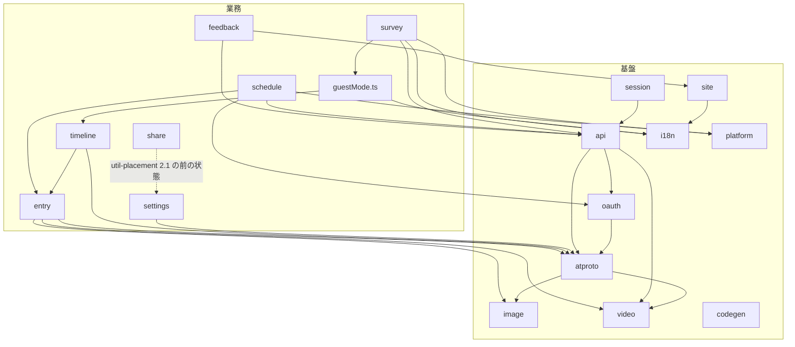

# Design Document

## Overview

**Purpose**: `src/lib/` を「基盤」と「業務」の二つの層に分け、依存の向きを「業務 → 基盤」の一方向にする。あわせて 1〜2 ファイルだけの領域を統合し、`structure.md` の依存表と `test:imports` の規則を新しい層に合わせる。

**Users**: 開発者が、新しい判断をどの層に置くかを決め、`test:imports` が層の逆流を検出する。

**Impact**: `lib/` の直下の構成（21 領域＋`guestMode.ts`）を、層の対応表で読めるようにする。利用者に見える振る舞い、API の入出力、生成物は変えない。

### Goals

- `lib/` の各領域（`guestMode.ts` を含む）が、基盤か業務のどちらかに一意に属する
- 基盤が業務を import しない（現状の 2 系統の違反を解消する）
- 1〜2 ファイルだけの領域を、統合するか、残す理由を `structure.md` に記録する
- `npm run test:imports` が層の逆流を検出する（許容リストは空のまま）
- 振る舞い・API の入出力・`npm run apigen` の出力は変わらない

### Non-Goals

- 400 行を超えるファイルの分割（`lib-large-files`）
- `src/util/` の配置（`util-placement`。`util/share` → `lib/share` の統合も同 spec）
- `src/components/` の配置（`components-small-areas`）
- 検査の追加全般（`structure-checks`）。本仕様は層の逆流の規則だけを加える

## Boundary Commitments

### This Spec Owns

- `src/lib/` の各領域の層の分類（対応表を `scripts/architecture/lib-layers.ts` に持ち、`structure.md` と一致させる）
- 基盤から業務への依存を解消するための移動（`lib/api/contract/` の新設を含む）
- 1〜2 ファイル領域の統合（`account`・`draft`・`privacy`・`legacy`）と、残す領域（`codegen`・`share`）の理由の記録
- `structure.md` の「領域の一覧」「`lib` の領域の依存の向き」「依存規則の検査」の節の改訂
- 依存規則 `libLayer`（基盤 → 業務の辺を違反にする）の追加

### Out of Boundary

- 利用者に見える振る舞い、API の入出力と DB スキーマ、OpenAPI の文書の内容
- `src/util/` の内容と配置（`util-placement`）
- 400 行超のファイルの分割（`lib-large-files`）
- `src/components/` の配置。ただし、移動したモジュールを import している部品の import 文の書き換えは含む
- `config/orval.config.ts` の出力先と生成物 `src/client/openapi/`（`lib/codegen` を動かさないため変更しない）
- `session → api` の辺（基盤どうしの依存として残す）

### Allowed Dependencies

- 基盤の領域: `util`・`src/env.ts`・`src/vars.ts`・基盤どうし（下表）
- 業務の領域: 基盤の領域・業務の領域（閉路を作らないこと）・`util`・`src/env.ts`・`src/vars.ts`
- `src/types/` は `lib` の層のどちらにも属さない外部の葉である（型だけを持ち、外の層を import しない）。許可された import 元は `lib`（基盤・業務のどちらも）と `components` である。上の基盤・業務の一覧には含めない
- `lib` から `pages/`・`components/` への import は禁止（既存の `layer` 規則）
- `lib` の領域は `react` 系のパッケージを import しない（既存の `uiInLib` 規則）

層の分類（決定の結果）:

| 層   | 領域                                                                                                                                                            | 備考                                         |
| ---- | --------------------------------------------------------------------------------------------------------------------------------------------------------------- | -------------------------------------------- |
| 基盤 | `api`（`api/contract/` を含む）・`atproto`・`codegen`・`i18n`・`image`・`oauth`・`platform`・`session`（`account` を含む）・`site`（`privacy` を含む）・`video` | `api` は基盤（決定 1）                       |
| 業務 | `entry`（`legacy` を含む）・`feedback`・`schedule`・`settings`・`share`・`survey`・`timeline`（`draft` を含む）・`guestMode.ts`                                 | `guestMode.ts` は `lib` 直下の業務のファイル |

`src/types/` は `lib` の領域ではない（`src/lib/` の外にある型の葉）。層の表には入れず、`libLayerOf` は `src/lib/` の外で `null` を返すため、`libLayer` 規則の対象外である（上の「許可された依存」の決定と同じ）。`util-placement` が作る `src/types/clientEnvironment.ts` を `lib/feedback` が参照する。

基盤どうしの許可された依存（`structure.md` に記録する）:

- `api` → `atproto`・`image`・`oauth`・`video`・`util`。`codegen` へは import が無い（`api/schema/v2/entry/post.ts` の `src/lib/codegen/openapiFormData.ts` への言及はコメントだけのため、辺に数えない）。`lib/feedback`・`lib/survey` への辺は無い（業務の型は `api/contract/` に下ろす）
- `atproto` → `image`・`video`・`util`・`util/emoji`
- `oauth` → `atproto`
- `video` → `image`・`i18n`（型）
- `session` → `api`・`atproto`・`oauth`・`util`
- `i18n`・`site`・`codegen` → `src/env.ts`・`src/vars.ts`（`privacy` 統合後の `site` は `i18n`（型）も参照する）

業務の領域の許可された依存（`structure.md`「lib の領域の依存の向き」の該当行と同じ内容。本仕様で行が変わる `feedback`・`survey`・`guestMode.ts`・`site` を挙げる）:

- `lib/feedback` → `lib/api`（契約 `contract/feedbackLimits`・`contract/feedbackSubmission`）・`lib/site`・`src/types`（`ClientEnvironment`・`Outcome` の型）。`util` は参照しない
- `lib/survey` → `lib/api`（契約 `contract/surveyPath`）・`lib/guestMode.ts`・`lib/platform`（型のみ）・`lib/i18n`（型のみ）・`util`（`util/http`）
- `lib/guestMode.ts` → `lib/timeline`・`lib/i18n`（型のみ）
- `lib/site` → `lib/i18n`（型のみ）。`lib/privacy` の行は統合により消える
- 上に挙げていない業務の領域（`lib/schedule`・`lib/timeline`・`lib/entry` など）の辺は、`structure.md` の一覧の行に従う

### Revalidation Triggers

- `lib/api/contract/` の型・識別子・定数の形（画面と API と業務が共有する。変わると三者の検査が変わる）
- 層の対応表（`lib-layers.ts`）の変更。`util-placement`・`lib-large-files` は移動先の決定に従う
- `lib/codegen` の移動（生成物の import 経路が変わる）
- `lib/share` の内容が `util-placement` で増えること（残す理由の記録を更新する）
- `src/types/` の追加（`util-placement`）。`lib` の層の表の対象外であり、`libLayerOf` の結果は変わらない

## Architecture

### Existing Architecture Analysis

- `src/lib/` は領域の単位（`lib/<領域>`）で分かれ、依存の向きは `structure.md` の「lib の領域の依存の向き」の表で規定されている。層の上下は表の上では示されていない。
- 既存の検査は `scripts/architecture/`（`rules.ts`・`regions.ts`・`cycles.ts`・`allowlist.ts`）。違反は `config/architecture/import-allowlist.json` に所有 spec 付きで記録する（現在は空）。
- 既存の閉路の検査は `tests/unit/scripts/libRegionPairs.test.ts`・`libCycles.test.ts`。
- 逆流している箇所（実測）: `lib/api` → `lib/feedback`（`submission`・`limits`）、`lib/api` → `lib/survey`（`definition`・`pathParams`）、`lib/api/typeCompat.ts` → `lib/feedback/submission`。`lib/api` は `lib/schedule` から import されており、入口とみなすと業務 → 入口の辺が残る。

### Architecture Pattern & Boundary Map



**Architecture Integration**:

- Selected pattern: 二層（基盤・業務）の一方向の依存。層の対応表を検査の定数として持つ
- Domain/feature boundaries: 業務は機能の単位、基盤は他の領域が土台にする単位。`lib/api/contract/` は、業務と画面と API が同じ制約を見るための基盤の置き場
- Existing patterns preserved: 領域の単位（`lib/<領域>`）、`@/` の import、相対 import の規則、`lib` の UI 非依存
- New components rationale: `lib/api/contract/`（三つのファイル）は、業務から基盤へ下ろした契約。`scripts/architecture/lib-layers.ts` は層の対応表
- Steering compliance: `structure.md` の依存の向き・領域の一覧・依存規則を同じ変更で改訂する

### Technology Stack

新しい依存は追加しない。既存の `zod`（スキーマ）と TypeScript の import 規則に従う。

## File Structure Plan

### Directory Structure

```
src/lib/
├── api/
│   ├── contract/                  # 新設: 業務から下ろした契約（基盤）
│   │   ├── feedbackLimits.ts      # 旧 feedback/limits.ts（文字数の上限・再現頻度・数え方）
│   │   ├── feedbackSubmission.ts  # 旧 feedback/submission.ts（送信内容の型）
│   │   └── surveyPath.ts          # 旧 survey/pathParams.ts と survey/definition.ts の識別子（idSchema）
│   └── ...                        # 既存のまま（response.ts・typeCompat.ts・schema/）
├── session/
│   └── activeAccountSession.ts    # 旧 account/activeAccountSession.ts
├── site/
│   └── policySections.ts          # 旧 privacy/policySections.ts
├── timeline/
│   └── draftList.ts               # 旧 draft/draftList.ts
├── entry/
│   └── legacyPagedb.ts            # 旧 legacy/pagedb.ts
└── codegen/                       # 変更なし（生成物の import 経路を保つ）
scripts/architecture/
└── lib-layers.ts                   # 新設: 領域の層の対応表と、層の逆流の判定
```

### Modified Files

- `src/lib/feedback/feedbackDraft.ts` — 本仕様では変更しない。`ClientEnvironment` の型の import 元（`@/util/clientEnvironment`）は、`util-placement` 4.2 が `@/types/clientEnvironment` へ変える（外部依存。本仕様の 2.2 の後に `util-placement` が行う）

- `src/lib/feedback/limits.ts` — 削除（`api/contract/feedbackLimits.ts` へ移動）。import 元: `components/feedback/FeedbackForm/index.tsx`・`lib/api/schema/v2/feedback/post.ts`・`lib/feedback/*`（`submitFeedback.ts`・`issueContent.ts`）
- `src/lib/feedback/submission.ts` — 削除（`api/contract/feedbackSubmission.ts` へ移動）。`./limits` の参照は `@/lib/api/contract/feedbackLimits` に変える
- `src/lib/feedback/issueContent.ts`・`submitFeedback.ts` — `submission`・`limits` の import 先を `@/lib/api/contract/…` に変える。`submitFeedback.ts` の「`lib/api` を参照しない」の注記を改める
- `src/lib/api/typeCompat.ts` — `FeedbackSubmission` の import 先を `./contract/feedbackSubmission` に変える（`@/` で書く）
- `src/lib/api/schema/v2/feedback/post.ts` — `limits` の import 先を `@/lib/api/contract/feedbackLimits` に変える
- `src/lib/survey/definition.ts` — 識別子（`ID_MAX_LENGTH`・`ID_PATTERN`・`idSchema`）を削除し、`@/lib/api/contract/surveyPath` から `idSchema` を import する
- `src/lib/survey/pathParams.ts` — 削除（`api/contract/surveyPath.ts` へ統合）。`survey/request.ts` の import 先を `@/lib/api/contract/surveyPath` に変える
- `src/lib/api/schema/v2/surveys/[surveyId]/path.ts`・`answers/post.ts` — import 先を `@/lib/api/contract/surveyPath` に変える
- `src/lib/survey/loadConfig.ts`・`answers.ts`・`answerDraft.ts`・`period.ts`・`gate.ts`・`request.ts`・`scripts/survey/render-survey-config.ts`・`tests/unit/fixtures/*` — `definition` の import は変わらない（`idSchema` を使う箇所だけ確認する）
- `src/lib/account/activeAccountSession.ts` → `src/lib/session/activeAccountSession.ts`（移動）。import 元 11 件（`components/account/*`・`components/timeline/*`・`components/feedback/FeedbackForm`・`components/composer/*`・`components/entry/EntryList`・`components/layout/nav/syncAccountAvatar.ts`・`components/schedule/CredentialDialog`）の import 先を `@/lib/session/activeAccountSession` に変える
- `src/lib/draft/draftList.ts` → `src/lib/timeline/draftList.ts`（移動）。import 元 2 件（`components/composer/ThreadComposer/DraftListPanel/index.tsx`・`hooks/useDraftFlow.ts`）を変える
- `src/lib/privacy/policySections.ts` → `src/lib/site/policySections.ts`（移動）。import 元 1 件（`components/privacy/PolicyCards/index.tsx`）を変える
- `src/lib/legacy/pagedb.ts` → `src/lib/entry/legacyPagedb.ts`（移動）。import 元: `src/pages/posts/[dbIndex]/[slug].astro`・`src/pages/v1/page.ts`・`tests/route/pages/v1PageDelete.test.ts`（`vi.mock` のパス）を変える。`lib/entry` の注記（`legacy` の扱い）を `structure.md` に記す
- `scripts/architecture/lib-layers.ts` — 新設。領域 → 層の対応表（`LIB_LAYER`）と、`libLayerOf(path)`（`src/lib/guestMode.ts` は業務）
- `scripts/architecture/rules.ts` — 規則 `libLayer` を追加（基盤 → 業務の辺）。`RuleId` の union に `libLayer` を加える。`RULE_BASIS` に根拠（`structure.md`「lib の領域の依存の向き」）を書く
- `scripts/architecture/allowlist.ts` — `RULE_IDS` 配列に `libLayer` を加え、`DEFAULT_OWNERS` に `libLayer: "lib-layers"` を加える（どちらも `RuleId` と同じ要素。structure-checks 2.1 が `RULE_IDS` を `rules.ts` へ一本化する）
- `scripts/architecture/check-imports.ts` — 変更なし（`evaluateImportRules` に規則が入る）
- `config/architecture/import-allowlist.json` — 変更なし（追加の違反を作らない。空のまま）
- `.kiro/steering/structure.md` — 領域の一覧・依存の向き・依存規則の表（`libLayer` の行）・`api/contract/` の説明・`lib/codegen` と `lib/share` が残る理由・`updated_at`
- `tests/unit/scripts/libLayers.test.ts` — 新設。対応表が `src/lib/` の全領域を覆うこと、対応表と `structure.md` の表が一致すること
- `tests/unit/scripts/importRules.test.ts` — `libLayer` の正例（基盤 → 業務が違反、業務 → 基盤が違反でない）を追加
- `tests/unit/lib/feedback/submitFeedback.test.ts` — import 先の変更

## System Flows

（新しい実行時の流れは無い。移動の順序を Migration Strategy に記す。）

## Requirements Traceability

| Requirement | Summary                                                               | Components                                                                              | Interfaces                                           | Flows |
| ----------- | --------------------------------------------------------------------- | --------------------------------------------------------------------------------------- | ---------------------------------------------------- | ----- |
| 1.1         | 各領域を基盤か業務に分類する                                          | `lib-layers.ts`（`LIB_LAYER`）                                                          | `LibLayer`・`libLayerOf`                             | —     |
| 1.2         | 層の分類を `structure.md` に記録する                                  | `structure.md` の層の表                                                                 | —                                                    | —     |
| 1.3         | 領域を追加したとき、一覧と層を同じ変更で更新する                      | `libLayers.test.ts`・`steeringRegions.test.ts`                                          | —                                                    | —     |
| 2.1         | 基盤は業務を import しない                                            | `rules.ts`（`libLayer`）                                                                | `evaluateImportRules`                                | —     |
| 2.2         | 業務は基盤を import してよい                                          | `rules.ts`（`libLayer` は業務 → 基盤を違反にしない）                                    | —                                                    | —     |
| 2.3         | 領域の閉路を作らない                                                  | `libRegionPairs.test.ts`・`cycles.ts`                                                   | —                                                    | —     |
| 2.4         | 既存の逆流（api → feedback・survey、typeCompat → feedback）を解消する | `api/contract/*`・`survey/definition.ts`・`feedback/*`                                  | `feedbackLimits`・`feedbackSubmission`・`surveyPath` | —     |
| 2.5         | 残る逆流は許容リストに所有 spec 付きで記録する                        | `allowlist.ts`（既存）                                                                  | —                                                    | —     |
| 3.1         | 許容されない基盤 → 業務の辺で `test:imports` が失敗する               | `rules.ts`（`libLayer`）・`check-imports.ts`                                            | `RuleId` に `libLayer` を追加                        | —     |
| 3.2         | 完了時に層の逆流の許容が無い                                          | `config/architecture/import-allowlist.json`（空）                                       | —                                                    | —     |
| 3.3         | `structure.md` の規則の節が検査と一致する                             | `structure.md`・`libLayers.test.ts`                                                     | `RULE_BASIS.libLayer`                                | —     |
| 4.1         | `account` を `session` へ統合し、export を保つ                        | `session/activeAccountSession.ts`                                                       | 既存の export（変更なし）                            | —     |
| 4.2         | 1〜2 ファイル領域は統合するか、残す理由を記録する                     | `draft`→`timeline`・`privacy`→`site`・`legacy`→`entry`、`codegen`・`share` は理由を記録 | —                                                    | —     |
| 4.3         | 統合後、領域の一覧が実在のフォルダと一致する                          | `structure.md`・`steeringRegions.test.ts`                                               | —                                                    | —     |
| 5.1         | 利用者に見える振る舞いを変えない                                      | 全移動（ロジックは変えず、import と配置だけを変える）                                   | —                                                    | —     |
| 5.2         | `npm run apigen` の出力に差分を出さない                               | `lib/codegen` を動かさない・`api/contract` は OpenAPI の内容を変えない                  | —                                                    | —     |
| 5.3         | 移動に伴う import とテストの更新を同じ変更で行う                      | 「Modified Files」の全件                                                                | —                                                    | —     |
| 5.4         | `npm run test:all` が 0 で終わり、件数が着手時の基準を下回らない      | 検証手順（Testing Strategy）                                                            | —                                                    | —     |

## Components and Interfaces

| Component                                                       | Domain/Layer | Intent                                                        | Req Coverage  | Key Dependencies (P0/P1)                | Contracts |
| --------------------------------------------------------------- | ------------ | ------------------------------------------------------------- | ------------- | --------------------------------------- | --------- |
| LibLayerTable (`scripts/architecture/lib-layers.ts`)            | 検査（基盤） | 領域 → 層の対応表と、ファイル → 層の判定                      | 1.1, 1.3, 3.3 | `regions.ts` (P1)                       | State     |
| libLayer rule (`scripts/architecture/rules.ts`)                 | 検査         | 基盤 → 業務の辺を違反にする                                   | 2.1, 2.2, 3.1 | `LibLayerTable` (P0), `ImportEdge` (P0) | Service   |
| API contract (`src/lib/api/contract/`)                          | 基盤         | 業務と画面と API が共有する制約（上限・識別子・送信内容の型） | 2.4           | `zod` (P1)                              | Service   |
| Layer consistency test (`tests/unit/scripts/libLayers.test.ts`) | 検査         | 対応表・`src/lib/` の領域・`structure.md` の一致を確かめる    | 1.2, 1.3, 4.3 | `structure.md` (P0)                     | —         |

### 検査（scripts/architecture）

#### LibLayerTable

| Field        | Detail                                                               |
| ------------ | -------------------------------------------------------------------- |
| Intent       | 領域の層を一箇所に持ち、規則と `structure.md` の表の両方の根拠にする |
| Requirements | 1.1, 1.3, 3.3                                                        |

**Responsibilities & Constraints**

- `LIB_LAYER: Record<LibRegionName, "基盤" | "業務">` を持つ。キーは `src/lib/` の直下の領域名（フォルダ名と `guestMode.ts` の名前）
- `libLayerOf(modulePath: string): "基盤" | "業務" | null` を持つ。`src/lib/` の外は `null`、`src/lib/guestMode.ts` は `業務`、その他は領域名から引く
- 対応表に無い領域は `null` を返す（検査側で未分類として失敗させる）。`LibRegionName` の型は対応表から導く

**Contracts**: State [x]

**Implementation Notes**

- 判定は文字列だけで行う（`regions.ts` の `regionOf` と同じ方式）。`regionOf` は `src/lib/guestMode.ts` を `lib` と返すため、`libLayerOf` は `guestMode.ts` を個別に扱う。

#### libLayer rule

| Field        | Detail                                           |
| ------------ | ------------------------------------------------ |
| Intent       | 基盤の領域から業務の領域への import を違反にする |
| Requirements | 2.1, 2.2, 3.1                                    |

**Responsibilities & Constraints**

- 辺の `from` と `target` がともに `src/lib/` のモジュールで、`libLayerOf(from) === "基盤"` かつ `libLayerOf(target) === "業務"` のとき違反（`ruleId: "libLayer"`）
- 同じ領域内の辺は対象外。型だけの辺も対象（既存の規則と同じ扱い）
- `RULE_BASIS.libLayer` は `structure.md`「lib の領域の依存の向き」を指す

**Contracts**: Service [x]

##### Service Interface

```typescript
type LibLayer = "基盤" | "業務"

// 辺が基盤 → 業務の逆流なら違反を返す。それ以外は null
type LibLayerRule = (edge: ImportEdge) => Violation | null
```

- Preconditions: `edge.target.kind === "module"` の辺だけを対象にする
- Postconditions: 違反の `message` は「基盤は業務を import しない（層の逆流）」
- Invariants: 業務 → 基盤、基盤 → 基盤、業務 → 業務は違反にしない

### API contract（src/lib/api/contract）

#### feedbackLimits.ts・feedbackSubmission.ts・surveyPath.ts

| Field        | Detail                                                                                       |
| ------------ | -------------------------------------------------------------------------------------------- |
| Intent       | 業務（feedback・survey）が持っていた「入力の制約」と「送信内容の型」を、契約として基盤に置く |
| Requirements | 2.4                                                                                          |

**Responsibilities & Constraints**

- `feedbackLimits.ts`: `FEEDBACK_LIMITS`・`REPRODUCIBILITY_VALUES`・`Reproducibility`・`countFeedbackLength`（旧 `feedback/limits.ts` の内容をそのまま移す）。依存は持たない
- `feedbackSubmission.ts`: `FeedbackEnvironment` などの送信内容の型（旧 `feedback/submission.ts` の内容）。`./feedbackLimits` の型だけを参照する
- `surveyPath.ts`: `idSchema`（識別子の検証、`ID_MAX_LENGTH`・`ID_PATTERN` を含む）、`PathParamsSchema`・`PathParamsType`（旧 `survey/pathParams.ts`）。`zod` は既存の指定子 `zod` で読む（`definition.ts` と同じ解決先にそろえる）

**Contracts**: Service [x]

##### Service Interface

```typescript
// surveyPath.ts（既存の型と値を変えない）
export const idSchema: z.ZodString
export const PathParamsSchema: z.ZodObject<{ surveyId: typeof idSchema }>
export type PathParamsType = z.infer<typeof PathParamsSchema>
```

- Preconditions: 呼び出し側は値の形（識別子の文字数・形式）を変えない
- Postconditions: `idSchema` の受理・拒否の結果は、移動前の `survey/definition.ts` の `idSchema` と同じ
- Invariants: `api/contract/` のファイルは `lib/feedback`・`lib/survey`・`lib/schedule`・`lib/timeline`（業務）を import しない

**Implementation Notes**

- 各ファイルの先頭コメントの「責務と処理概要」は、移動後の所在（基盤の契約）に合わせて書き換える。「`api` は参照しない」「`survey` は api を import しない」などの移動前の前提の記述は、移動後の事実に合わせて直す。
- 画面 `components/feedback/FeedbackForm/index.tsx` の import（`@/lib/feedback/limits`）は、新しい契約の場所へ変える。`components/timeline/Timeline/SurveyGate/SurveyDialog/index.tsx` は `@/lib/survey/definition` から `localize`・`Survey`（型）だけを import しており、移動する識別子（`idSchema`・`ID_MAX_LENGTH`・`ID_PATTERN`）を含まないため、import は変えない（`Modified Files` には加えない。grep で確認済み）。

## Data Models

変更なし。DB・R2・Cookie の形は変えない。

## Error Handling

### Error Strategy

- 移動の取りこぼし（import 先の欠落）: `tsc`（`npm run test:type`）と `test:imports` の「解決できない import」で失敗させる。
- 層の逆流の再発: `libLayer` 規則が `test:imports` で失敗させる。許容リストで隠さない（空のまま）。
- 対応表の欠落（新しい領域が未分類）: `libLayers.test.ts` が失敗させる。

### Monitoring

本仕様は運用上の挙動を変えないため、監視の変更は無い。

## Testing Strategy

### Unit Tests

- `tests/unit/scripts/importRules.test.ts`: `libLayer` の正例（`src/lib/session/x.ts` → `src/lib/api/y.ts` は違反にしない、`src/lib/api/x.ts` → `src/lib/feedback/y.ts` は違反、`src/lib/entry/x.ts` → `src/lib/timeline/y.ts` は違反にしない、`src/lib/guestMode.ts` → 業務は違反にしない）
- `tests/unit/scripts/libLayers.test.ts`（新設）: `src/lib/` の直下の全領域が対応表にあること（要件 1.1）、対応表と `structure.md` の層の表が一致すること（要件 1.2・3.3）、`libLayerOf("src/lib/guestMode.ts")` が `業務` を返すこと
- `tests/unit/scripts/steeringRegions.test.ts`（既存）: 統合後の領域の一覧が実在のフォルダと一致すること（要件 4.3）
- `tests/unit/scripts/libRegionPairs.test.ts`・`libCycles.test.ts`（既存）: 統合後も領域どうしの閉路が 0 件であること（要件 2.3）

### Integration Tests

- `tests/unit/lib/feedback/submitFeedback.test.ts`（import 先の変更）: 送信の判定と Issue 本文の組み立てが変わらないこと
- `tests/unit/fixtures/surveyConfigFixture.test.ts`・`e2eSurveyFixture.test.ts`（既存）: `idSchema` の移動後も、アンケート設定の検証結果が同じこと
- `tests/route/pages/v1PageDelete.test.ts`（`vi.mock` のパス変更）: 旧投稿の削除の経路が変わらないこと

### Verification（完了条件）

1. 着手前に `npm run test:all` の結果（終了コード・通過件数）を記録する（基準。2026-11-03 の時点の件数）
2. 各段階で `npm run test:type` と `npm run test:imports` を実行する。`test:imports` は許容リストを空のままで終了コード 0
3. `npm run apigen` を実行し、`git status` で `src/client/openapi/` と OpenAPI 文書に差分が無いことを確かめる
4. 最後に `npm run test:all` が終了コード 0 で、件数が基準を下回らないことを確かめる

## Migration Strategy

1. 基準の記録（`npm run test:all` の件数）
2. `api/contract/` の新設: `feedback/limits.ts`・`feedback/submission.ts`・`survey/pathParams.ts`・`survey/definition.ts` の識別子を移し、import を変える（`test:type`・`test:imports`）
3. 統合: `account` → `session`、`draft` → `timeline`、`privacy` → `site`、`legacy` → `entry`（ファイル移動と import の変更）
4. 検査: `lib-layers.ts`・`rules.ts`（`libLayer`）・テスト（正例と対応表の一致）を追加し、許容リストが空のまま `test:imports` が 0 で終わることを確かめる
5. `structure.md` の改訂（層の表・領域の一覧・依存の向き・依存規則の表・残す理由）を、検査と同じ変更で行う
6. `npm run apigen` の差分確認、最後に `npm run test:all`

ロールバック: 各段階は独立したコミットにできる。段階 2 で `test:type` が失敗した場合は、その段階の import の変更だけを戻す。
