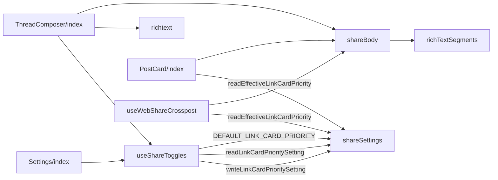
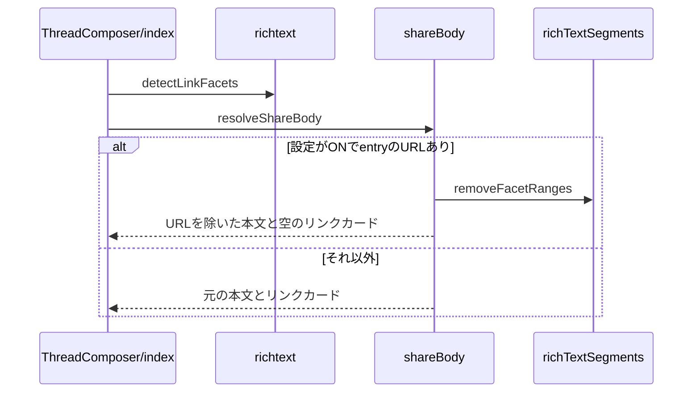

# Design Document

## Overview

**Purpose**: リンクを含む画像や動画の投稿からskyshare entryを作って他のSNSへ共有するとき、共有文に残すURLをskyshare entryのURLだけにし、共有先でskyshareのリンクカードが優先して表示されるようにする。他のURLはBluesky側の投稿に任せる。
**Users**: リンクを含む画像・動画の投稿を他 SNS へ共有する利用者
**Impact**: 共有文に残す URL を skyshare entry の URL だけにし、共有先で skyshare のリンクカードが優先して表示されるようにする。他の URL は Bluesky 側の投稿に任せる。

### Goals

- 「Skyshareのリンクカードを優先表示」の設定の保持と切り替えの表示。
- 投稿フォームの投稿直後の共有と、タイムラインのカードからの共有の共有文。

### Non-Goals

- Blueskyへ投稿する本文と埋め込み。
- 共有文の長文の省略の規則。

## Boundary Commitments

### This Spec Owns

- 「Skyshareのリンクカードを優先表示」の設定の保持と切り替えの表示。
- 投稿フォームの投稿直後の共有と、タイムラインのカードからの共有の共有文。

### Out of Boundary

- Blueskyへ投稿する本文と埋め込み。
- 共有文の長文の省略の規則。

### Allowed Dependencies

- 共有文の組み立てと省略（share-text）
- 共有設定の保持（share-settings）
- 「画像を自分で添付する」の設定（share-settings）
- 共有の経路（auto-popup、intent-share-dialog）

### Revalidation Triggers

- 共有文の組み立ての呼び出し元（共有の経路）を増やすとき（設定の適用先に加えるか確認が要る）
- URL の検出の規則（richtext の注釈）を変えるとき
- 設定の既定値（ON）を変えるとき

## Architecture

### Architecture Pattern & Boundary Map

共有文の本文の決定の依存方向を示す。



## File Structure Plan

| パス                                                   | 責務                                       |
| ------------------------------------------------------ | ------------------------------------------ |
| `src/lib/share/shareBody.ts`                           | 共有文の本文とリンクカードのURLの決定      |
| `src/lib/atproto/richtext.ts`                          | 投稿フォームの本文のURLの注釈の検出        |
| `src/lib/atproto/richTextSegments.ts`                  | 注釈の範囲の文字の除去                     |
| `src/lib/settings/shareSettings.ts`                    | 設定の保存と読み取り                       |
| `src/lib/settings/useShareToggles.ts`                  | 設定の状態と画像を自分で添付との連動       |
| `src/components/post/ThreadComposer/index.tsx`         | 投稿フォームの切り替えと投稿直後の共有文   |
| `src/components/settings/Settings/index.tsx`           | 設定ページの切り替え                       |
| `src/components/post/PostCard/index.tsx`               | タイムラインの投稿先選択ダイアログの共有文 |
| `src/components/post/PostCard/useWebShareCrosspost.ts` | タイムラインのWebShareの共有文             |

## System Flows

共有の直前に本文のURLを取り除くかを決める流れを示す。



## Requirements Traceability

| Requirement        | Summary              | Components |
| ------------------ | -------------------- | ---------- |
| 1.1, 1.2, 1.3, 1.4 | 設定の保持と切り替え | D-1        |
| 2.1, 2.2, 2.3, 2.4 | 共有文の本文         | D-2        |
| 3.1                | 適用先               | D-3        |

## Components and Interfaces

#### D-1: 設定の保持と切り替え

**Requirements**: 1.1, 1.2, 1.3, 1.4

```ts
const PREFER_SKYSHARE_LINK_CARD_KEY = "preferSkyshareLinkCard"
export const DEFAULT_LINK_CARD_PRIORITY = true
export const readLinkCardPrioritySetting = (defaultValue: boolean) => boolean
export const writeLinkCardPrioritySetting = (value: boolean) => void
// 共有の時点で読む実効値。画像を自分で添付が ON なら false
export const readEffectiveLinkCardPriority = () => boolean

// useShareToggles: 初期値は SSR と同じ既定値（true）。マウント後の reload で保存値を反映する
preferSkyshareLinkCard: boolean
onPreferSkyshareLinkCardChange: (next: boolean) => void
```

| 画面         | 位置                           | 操作不能の条件       |
| ------------ | ------------------------------ | -------------------- |
| 投稿フォーム | 画像を自分で添付の次の行       | 送信中、手動添付がON |
| 設定ページ   | 画像を自分で添付の次の設定項目 | 手動添付がON         |

手動添付をONにしても保存値は書き換えず、表示の値を保ったまま操作不能にする。

#### D-2: 共有文の本文の決定

**Requirements**: 2.1, 2.2, 2.3, 2.4

```ts
export const resolveShareBody = (params: {
  text: string
  facets: PostFacet[]
  entryUrl: string | null
  linkCardUrl: string
  preferSkyshareLinkCard: boolean
}): { text: string; linkCardUrl: string }
// 設定 ON・entryUrl あり・link の facet ありのときだけ、link の範囲を除いた本文と linkCardUrl "" を返す
export const removeFacetRanges = (text: string, facets: PostFacet[]): string
```

| 整形                | 処理                         |
| ------------------- | ---------------------------- |
| 行末の空白          | `/[ \t　]+$/gm` を除く       |
| 3行以上の連続の改行 | `/\n{3,}/g` を `\n\n` にする |
| 前後の空白          | `trim()`                     |

#### D-3: 共有の経路への適用

**Requirements**: 3.1

| 経路                     | 本文の注釈                           | 渡す先                                    |
| ------------------------ | ------------------------------------ | ----------------------------------------- |
| 投稿直後の共有           | `detectLinkFacets(rootSegment.text)` | `runShareDispatch` と投稿先選択ダイアログ |
| タイムラインのダイアログ | `item.facets`                        | `IntentShareDialog` の `postText`         |
| タイムラインのWebShare   | `item.facets`                        | `buildWebShareText` の本文                |

投稿フォームの設定の値は `useShareToggles` の値を、タイムラインは共有の時点で `readEffectiveLinkCardPriority` を使う。

## Error Handling

| 事象                    | 処理                                |
| ----------------------- | ----------------------------------- |
| 保存領域が使えない      | 既定値（ON）として扱う              |
| URLの検出が例外を投げる | URLを取り除かず、元の本文で共有する |

## Testing Strategy

- Unit / Build Tests:
  - `npx vitest run tests/lib/share/shareBody.test.ts`
  - `npx vitest run tests/lib/settings/shareSettings.test.ts`
  - `npm run build`
- E2E/UI Tests:
  - `tests/e2e/linkCardPriority.spec.ts` 投稿フォームで画像を自分で添付をONにする → 直下の切り替えが操作不能になる
  - `tests/e2e/linkCardPriority.spec.ts` ゲスト表示でURLを含むentryの投稿の共有ダイアログからXを選ぶ → 共有文にentryのURLだけが残る
- テストの名前には、対応する基準 ID を `[link-card-priority/<ID>]` の形で付ける（例: `[link-card-priority/1.1]`）
