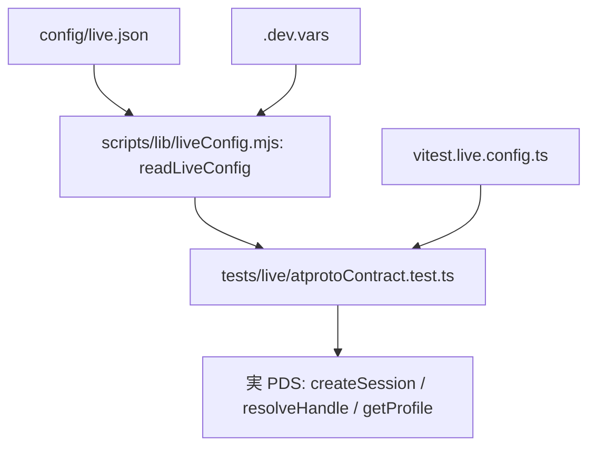

# Design Document

## Overview

**Purpose**: 実 Bluesky（PDS・AppView）との契約を、開発者がローカルで任意に確かめる。
**Users**: 開発者（ローカルでの任意の実行）。CI と pre-push は対象外。
**Impact**: `.env.e2e`・`.env.e2e.template`・`E2E_ENV` の参照を廃止し、設定を `config/live.json`（非秘密）と `.dev.vars`（秘密）に分配する。

### Goals

- `npm run test:live` で `tests/live/` だけを実行する
- 設定が無いときは全てスキップする（終了コード 0）
- 読み取り専用の契約（セッション・ハンドル解決・プロフィール）を確かめる

### Non-Goals

- 書き込みを伴う検証、CI での実行、第三者アカウント

## Architecture

### Existing Architecture Analysis

- 設定の方針（test-foundation の決定）: 非秘密は設定ファイル（`config/<名前>.json`）、秘密は `.dev.vars`。`.env` は使わない。
- 共通の解析: `scripts/lib/dotenv.mjs`（`parseDotenv`）、`scripts/lib/jsonc.mjs`（`parseJsonc`）。
- 既存の vitest 設定: `vitest.unit.config.ts` などが別々の `include` を持つ。live も同じ形で分ける。

### Architecture Pattern & Boundary Map

## Components and Interfaces

| Component                                 | Intent                                                                             | Req  |
| ----------------------------------------- | ---------------------------------------------------------------------------------- | ---- |
| `readLiveConfig({ configPath, devVars })` | 設定と秘密を読み、`null`（未設定）か `{ identifier, service, appPassword }` を返す | 2, 3 |
| `liveSkipReason(config)`                  | スキップの理由（1 行）を返す。未設定なら理由、設定済みなら `null`                  | 3.1  |
| `expectSessionContract(response, config)` | 応答の DID・ハンドルを確かめる純粋な判定                                           | 4.1  |
| `atprotoContract.test.ts`                 | 実 PDS への読み取り専用の呼び出しと判定                                            | 4    |
| `vitest.live.config.ts`                   | `tests/live/**/*.test.ts` だけを対象にする                                         | 1, 5 |

### scripts/lib/liveConfig.mjs

**Contract**:

- `readLiveConfig({ configPath, devVars })`: `configPath` が無ければ `null`。あれば JSON を読み、`identifier`（必須）・`service`（任意。既定 `https://bsky.social`）を取る。`devVars` の `SKYSHARE_E2E_APP_PASSWORD` が空なら `null`（スキップ）。
- 形式が不正（JSON でない、`identifier` が無い）なら `Error`。メッセージに項目名だけを含め、値は含めない。
- 戻り値に `appPassword` を含むが、テストは値を表示しない。

**Why**: 純粋な関数にして、単体テストで「無い・空・不正」を確かめる。`process.env` は読まない（`.env` を使わない方針）。

## 追補（実装での確認）

- `com.atproto.server.createSession`・`com.atproto.identity.resolveHandle` は PDS（`service`）に送る。
- `app.bsky.actor.getProfile` は PDS では 401 になる（認証が要る）ため、公開の AppView（`PUBLIC_APPVIEW`）に送る。実装で確かめた。

## Data Models

- `config/live.json`: `{ "identifier": "<ハンドル>", "service": "<PDS の URL。省略可>" }`
- `.dev.vars`: `SKYSHARE_E2E_APP_PASSWORD=<アプリパスワード>`

## Error Handling

- 設定の不足: スキップ（テストは `skip`）。形式の不正: 読み取りの失敗（テストは失敗し、項目名だけ示す）。
- 実 PDS の応答が想定外: 判定の失敗として、応答のステータスとエラーコードだけを示す（トークンは示さない）。

## Testing Strategy

- **Unit**（`tests/unit/scripts/liveConfig.test.ts`）: `readLiveConfig` の無い・空・不正・正常。`liveSkipReason` の理由の有無。`expectSessionContract` の一致と不一致（応答は固定の値）。
- **Live**（`tests/live/atprotoContract.test.ts`）: 設定が揃っているときだけ実 PDS に問い合わせる。設定が無ければ全て skip。
- 実通信は、利用者の認証情報が無いこの環境では行えない。skip の経路と単体テストで確かめる。

## Risks and Open Questions

- 実 PDS の既定（`https://bsky.social`）は利用者の環境に依存する。`service` を設定で変えられるようにした。
- 認証情報を持つ開発者の数だけ、実アカウントへの呼び出しが増える。読み取り専用に限定して影響を抑える。
