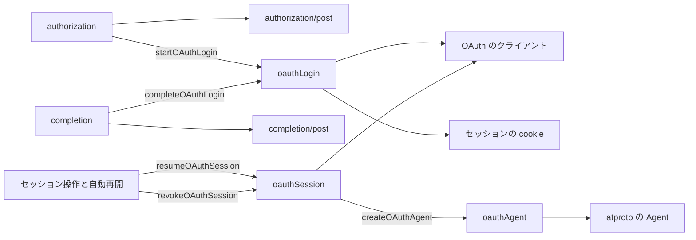
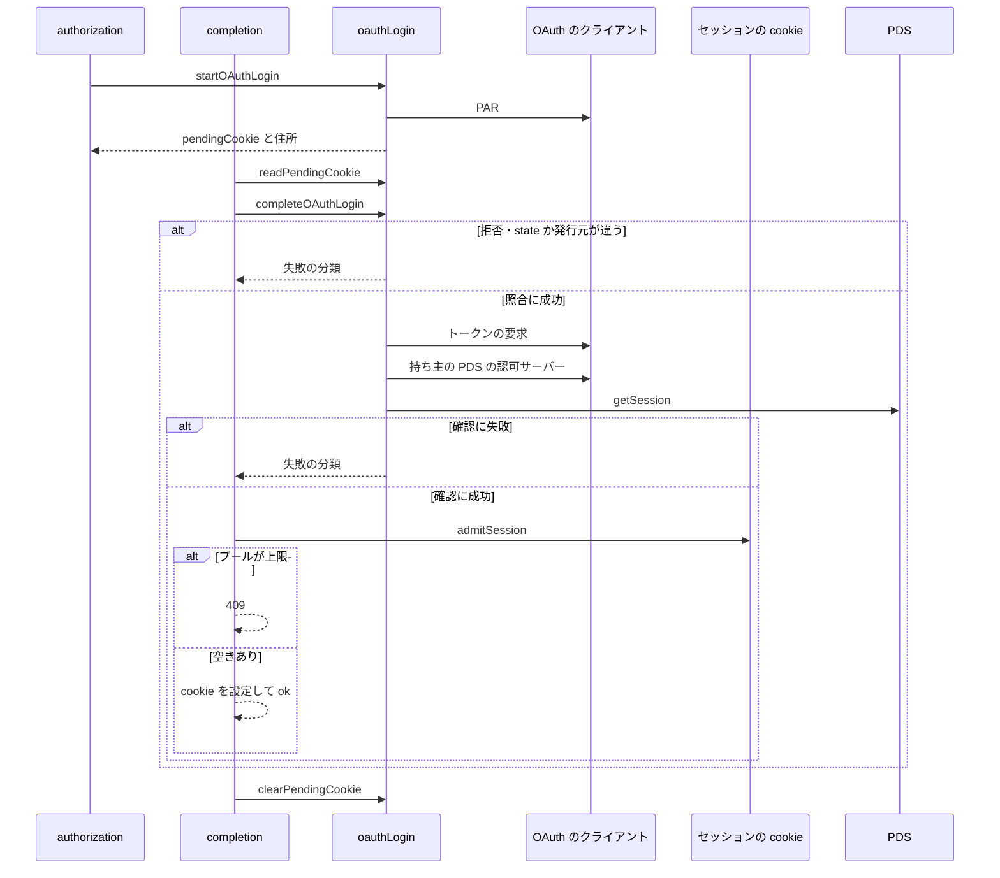
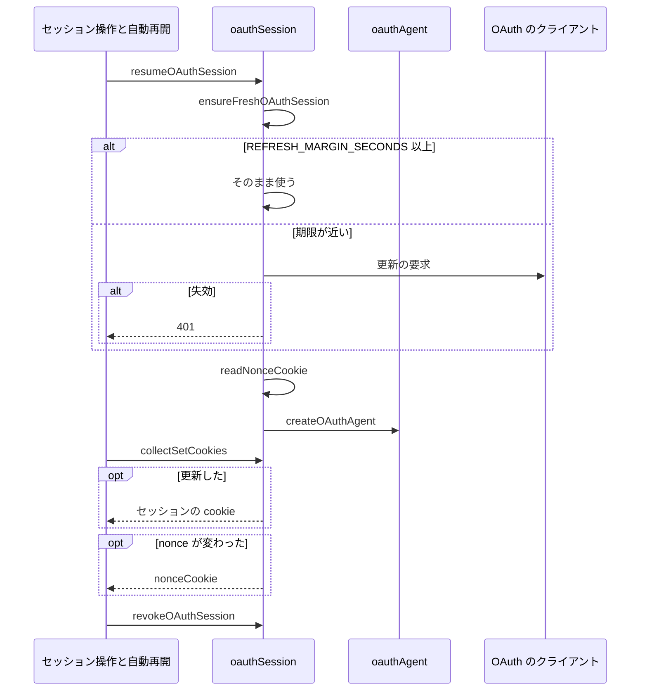

# Design Document

## Overview

**Purpose**: 利用者がパスワードを入力せずに Bluesky の OAuth でログインでき、得たセッションで、API の利用・アカウントの切り替え・ログアウトを、アプリパスワードのセッションと同じように扱えるようにする。
**Users**: パスワードを入力せずに OAuth でログインする利用者と、そのセッションで API を呼ぶ処理
**Impact**: OAuth で得たセッションを、アプリパスワードのセッションと同じように API・切り替え・ログアウトで扱えるようにする。

### Goals

- OAuth によるログインの開始と完了の API。
- v2 の API での OAuth のセッションの再開と、期限の前の更新。
- OAuth のセッションでの DPoP の証明を付けた PDS への要求。
- OAuth のアカウントへの切り替えと、ログアウトでの取消。

### Non-Goals

- ログインの画面と、認可の画面からの戻りの表示。
- アプリパスワードのセッションの扱い。
- Bluesky がホスティングしないアカウントの OAuth によるログイン。

## Boundary Commitments

### This Spec Owns

- OAuth によるログインの開始と完了の API。
- v2 の API での OAuth のセッションの再開と、期限の前の更新。
- OAuth のセッションでの DPoP の証明を付けた PDS への要求。
- OAuth のアカウントへの切り替えと、ログアウトでの取消。

### Out of Boundary

- ログインの画面と、認可の画面からの戻りの表示。
- アプリパスワードのセッションの扱い。
- Bluesky がホスティングしないアカウントの OAuth によるログイン。

### Allowed Dependencies

- OAuth のクライアント処理（oauth-client）
- セッションの cookie の形式とプールの規則（account-session）
- Bluesky の認可サーバーと PDS

### Revalidation Triggers

- 途中の状態の cookie（照合用）の形や有効期間を変えるとき（login-accounts の戻りの処理が影響を受ける）
- アクセストークンの更新の閾値（期限の60秒前）を変えるとき
- 要求する権限を変えるとき（oauth-client のメタデータと一致が要る）
- 全リクエストで読み込まれる経路への atproto のライブラリの追加（動的 import を保つ）

## Architecture

### Architecture Pattern & Boundary Map

ハンドラと処理のモジュールの依存方向を示す。



## File Structure Plan

| パス                                                                  | 責務                                         |
| --------------------------------------------------------------------- | -------------------------------------------- |
| `src/lib/session/oauthLogin.ts`                                       | ログインの開始と完了、途中の状態の cookie    |
| `src/lib/session/oauthSession.ts`                                     | 再開・期限の前の更新・取消と nonce の cookie |
| `src/lib/session/oauthAgent.ts`                                       | DPoP つきの要求で動くエージェントの生成      |
| `src/pages/v2/bsky/session/authorization.ts`                          | ログインの開始のハンドラ                     |
| `src/pages/v2/bsky/session/authorization/completion.ts`               | ログインの完了のハンドラ                     |
| `src/lib/api/schema/v2/bsky/session/authorization/post.ts`            | ログインの開始の入力と応答のスキーマ         |
| `src/lib/api/schema/v2/bsky/session/authorization/completion/post.ts` | ログインの完了の入力と応答のスキーマ         |

## System Flows

ログインの開始から完了までの照合の順序と、失敗と上限の分岐を示す。



v2 の API での再開と、期限の前の更新と書き戻しの分岐を示す。



## Requirements Traceability

| Requirement                                 | Summary                  | Components |
| ------------------------------------------- | ------------------------ | ---------- |
| 1.1, 1.2, 1.3                               | ログインの開始           | D-1        |
| 2.1, 2.2, 2.3, 2.4, 2.5, 2.6, 2.7, 2.8, 2.9 | ログインの完了           | D-1, D-2   |
| 3.1, 3.2, 3.3, 3.4                          | セッションの再開と更新   | D-3        |
| 4.1, 4.2, 4.3                               | PDS への要求とログアウト | D-4, D-5   |

## Components and Interfaces

#### D-1: ログインの開始

**Requirements**: 1.1, 1.2, 1.3, 2.8

```ts
// POST /v2/bsky/session/authorization { returnTo?: string; loginHint?: string } -> 200 { url }
const RequestBodySchema = z.object({
  returnTo: z.string().refine(isSafeReturnPath).optional(), // 戻り先のページ。安全なパス（oauth-client の isSafeReturnPath）のみ。不正は 400。省略時は /login/
  loginHint: z.string().min(1).max(253).optional(), // 再ログインのハンドル
})
const SESSION_AUTHORIZATION_SERVER = "https://bsky.social"
export type PendingLogin = {
  state: string
  verifier: string
  dpopJwk: EcPrivateJwk
  issuer: string
  tokenEndpoint: string
  revocationEndpoint?: string
  clientId: string
  redirectUri: string
}
export const startOAuthLogin = (input: { origin: string; loginHint?: string; now: number }, fetchImpl?: typeof fetch):
  Promise<{ ok: true; url: string; pending: PendingLogin } | { ok: false; status: 500 | 502 }>
export const pendingCookie = (pending: PendingLogin): string
const PENDING_COOKIE = "oauth_login_pending"
```

| 手順 | 処理                                                                                                                        | 失敗時 |
| ---- | --------------------------------------------------------------------------------------------------------------------------- | ------ |
| 1    | 秘密鍵のシークレットを読み、配信元から識別子と戻り先を決める。開発用の公開クライアントでなく秘密鍵が無ければ失敗            | 500    |
| 2    | `SESSION_AUTHORIZATION_SERVER` の認可サーバーのメタデータを読む（Bluesky がホスティングするアカウントの共通の認可サーバー） | 502    |
| 3    | DPoP の鍵・`state`・verifier を作り、権限 `SESSION_SCOPE` と、あれば `loginHint` を `login_hint` に入れて PAR を送る        | 502    |
| 4    | 応答に `pendingCookie` と、用途 `session` の戻り先の cookie を付け、`{ url }` を返す                                        | -      |

- 途中の状態の cookie は、値を `PendingLogin` の JSON の base64 とし、`Path=/v2/bsky/session/authorization/`・`Max-Age=600`・`HttpOnly`・`SameSite=Strict`・本番のみ `Secure` とする。完了は同じサイトのページから呼ぶため、Strict で届く。
- 途中の状態をサーバーに保管しないのは、ログインの前で利用者を特定できず、セッションと同じく端末の cookie だけで完結させるためである。

#### D-2: ログインの完了

**Requirements**: 2.1, 2.2, 2.3, 2.4, 2.5, 2.6, 2.7, 2.8, 2.9

```ts
// POST /v2/bsky/session/authorization/completion { code?, state?, iss?, error? }
//   -> 200 { result: "ok" | LoginFailure }、プールの上限は 409
type LoginFailure = "Denied" | "StateInvalid" | "IssuerMismatch" | "TokenFailed" | "AccountUnverified" | "NotConfigured"
export const readPendingCookie = (cookieHeader: string | null): PendingLogin | null
export const clearPendingCookie = (): string
export const completeOAuthLogin = (input: {
  pending: PendingLogin | null
  query: { code?: string; state?: string; iss?: string; error?: string }
  now: number
}, fetchImpl?: typeof fetch): Promise<{ ok: true; session: OAuthSession } | { ok: false; code: LoginFailure }>
```

| 手順 | 処理                                                                                                             | 失敗の分類                     |
| ---- | ---------------------------------------------------------------------------------------------------------------- | ------------------------------ |
| 1    | `error` が付いていれば終える                                                                                     | `Denied`                       |
| 2    | 途中の状態が無い・`state` が違う・`code` が無ければ終える                                                        | `StateInvalid`                 |
| 3    | `iss` が途中の状態の発行元と違えば終える                                                                         | `IssuerMismatch`               |
| 4    | 秘密鍵を読み、途中の状態の DPoP の鍵と識別子と戻り先と verifier で認可コードをトークンに替える                   | `TokenFailed`・`NotConfigured` |
| 5    | トークンの `sub` の DID から PDS を解決し、その PDS の認可サーバーが発行元と一致することを確かめる               | `AccountUnverified`            |
| 6    | PDS の `com.atproto.server.getSession` を DPoP つきで呼び、`did` が `sub` と一致することを確かめてハンドルを得る | `AccountUnverified`            |
| 7    | `OAuthSession`（did・ハンドル・PDS・アクセストークン・期限・更新用トークン・DPoP の鍵・端点・識別子）を返す      | -                              |

- ハンドラは、成否によらず `clearPendingCookie` を応答に付ける。成功なら `admitSession` でプールを決め、null なら409、そうでなければセッションの cookie とプールの cookie を付けて `{ result: "ok" }` を返す。
- 手順5は、ユーザー名を事前に渡さず発行元を固定して始めるため、持ち主の DID に対して発行元が正当な認可サーバーであることを確かめる（別の認可サーバーが発行した主張を受け付けないため）。
- ログには失敗の分類と端点の応答のステータスだけを出す。

#### D-3: 再開と期限の前の更新

**Requirements**: 3.1, 3.2, 3.3, 3.4

```ts
export const REFRESH_MARGIN_SECONDS = 60
export const ensureFreshOAuthSession = (s: OAuthSession, now: number, fetchImpl?: typeof fetch):
  Promise<{ ok: true; session: OAuthSession; refreshed: boolean } | { ok: false; status: 401 | 429 | 500 | 502 }>
export const resumeOAuthSession = (s: OAuthSession, cookieHeader: string | null, now: number, fetchImpl?: typeof fetch):
  Promise<
    | { ok: true; agent: Agent; identity: { did: string; handle: string }; pds: string; collectSetCookies: () => string[] }
    | { ok: false; status: 401 | 429 | 500 | 502 }
  >
```

| 更新の結果           | 状態 |
| -------------------- | ---- |
| `Expired`・`Invalid` | 401  |
| `RateLimited`        | 429  |
| `NotConfigured`      | 500  |
| `Transient`          | 502  |

- `expiresAt - now` が `REFRESH_MARGIN_SECONDS` 以上なら更新しない。更新は保管した識別子・発行元・トークンの端点・DPoP の鍵で行い、回転した更新用トークンと新しいアクセストークンと期限に置き換える。
- `collectSetCookies` は応答の直前に呼び、更新したときだけセッションの cookie を、nonce が読み込み時と変わったときだけ nonce の cookie を返す。毎回書き戻さないのは、古い更新用トークンを並行する応答で書き戻すと、認可サーバーが再利用とみなしてセッションを失効させるためである。
- 自動再開の経路は全リクエストで読み込まれるため、`oauthAgent.ts` は `resumeOAuthSession` の中で動的に読み込む。
- アカウントの切り替えは `ensureFreshOAuthSession` で更新してからアクティブにし、失敗の状態をそのまま返す。

#### D-4: PDS への要求と nonce の持ち越し

**Requirements**: 4.1

```ts
const NONCE_COOKIE = "atp_dpop_nonce"
export const readNonceCookie = (cookieHeader: string | null): { origin: string; nonce: string } | null
export const nonceCookie = (origin: string, nonce: string): string
// oauthAgent.ts
export const createOAuthAgent = (did: string, fetchHandler: (path: string, init?: RequestInit) => Promise<Response>): Agent
```

- `resumeOAuthSession` は、nonce の cookie のオリジンがセッションの PDS と同じなら、DPoP の状態の nonce の初期値にする。要求は `createDpopFetch` で送り、`new Agent({ did, fetchHandler })` で包む。
- nonce の cookie は、値を `<オリジン> <nonce>` の URL 符号化とし、`Path=/`・`Max-Age=86400`・`HttpOnly`・`SameSite=Strict`・本番のみ `Secure` とする。トークンを含まないため、並行する応答で古い値が書かれても、やり直しが1回増えるだけである。
- `locals.session` には `{ did, handle }`、`locals.service` には PDS の URL を入れる。

#### D-5: ログアウトでの取消

**Requirements**: 4.2, 4.3

```ts
export const revokeOAuthSession = (s: OAuthSession, now: number, fetchImpl?: typeof fetch): Promise<void>
```

- 保管した取消の端点へ更新用トークンの取消を送る。秘密鍵が無い・通信が失敗した・端点が無いときは何もせずに終え、例外を投げない。
- ログアウトのハンドラは、取消の完了を待ってから cookie を除く。

## Error Handling

| 事象                             | 処理                              |
| -------------------------------- | --------------------------------- |
| 開始の本文が不正                 | 400                               |
| 認可サーバーの探索・PAR の失敗   | 502                               |
| 秘密鍵のシークレットが無い       | 開始は500、完了は `NotConfigured` |
| 途中の状態の cookie が壊れている | 無いものとして `StateInvalid`     |
| 想定外の例外                     | 500                               |

## Testing Strategy

- Unit / Build Tests:
  - `npx vitest run tests/lib/session/oauthLogin.test.ts tests/pages/v2/bsky/sessionAuthorization.test.ts`
  - `npx vitest run tests/lib/session/oauthSession.test.ts tests/lib/coldStart.test.ts`
- テストの名前には、対応する基準 ID を `[oauth-session/<ID>]` の形で付ける（例: `[oauth-session/1.1]`）
