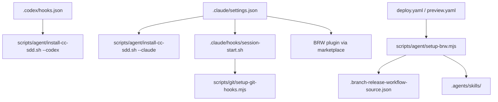
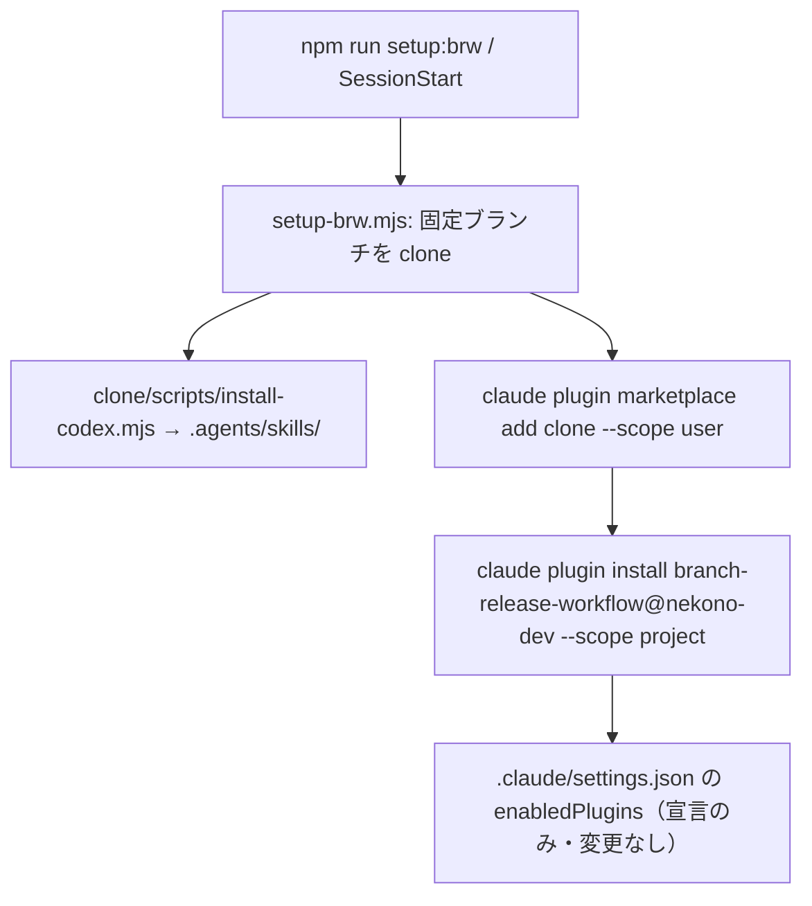

# Design Document

## Overview

**Purpose**: エージェントの導入（cc-sdd・BRW）を、1 つの入口と 1 つの正本に集約する。
**Users**: 運用者（導入の確認）、開発者（セッションの開始）、CI（BRW の取得）。
**Impact**: `.claude/settings.json` と `.codex/hooks.json` の SessionStart の中身が共有スクリプトの呼び出しに変わる。`@latest` の導入が固定版になる。

### Goals

- cc-sdd の導入の処理を 1 箇所（`scripts/agent/install-cc-sdd.sh`）に置き、Claude と Codex の両方がそれを呼ぶ
- cc-sdd 3.1.0 固定。導入の結果をコミットに含め、セッション開始で差分が出ない
- BRW の正本（`.branch-release-workflow.json`）と取得元（`.branch-release-workflow-source.json`）を復元する

### Non-Goals

- cc-sdd・BRW の中身の変更
- 配置の移動（ops-tooling-layout で `scripts/agent/` の既存ファイルを移す）

## Architecture

### Existing Architecture Analysis

- SessionStart: Claude は `settings.json` で `npx cc-sdd@latest` と `session-start.sh` を並べる。Codex は `hooks.json` で `npx cc-sdd@latest --codex-skills` を直接書く。
- BRW の 3 つの利用者: Claude（`enabledPlugins`）、Codex（`npm run setup:brw` → `.agents/skills/`）、CI（`setup-brw.mjs` の出力を `BRW_PLUGIN_DIR` へ）。
- 欠落: `0ffaa17` で `.branch-release-workflow-source.json`・`.branch-release-workflow.json`（ルート）が削除された。`.claude/branch-release-workflow.json` は通常ファイルとして残り、正本と内容の複製になっている。

### Architecture Pattern & Boundary Map

- **導入の入口**: `install-cc-sdd.sh` が唯一の cc-sdd の呼び出し元。引数で `--claude`・`--codex` を受ける。
- **BRW の取得**: `setup-brw.mjs` が唯一の clone の処理。Codex 用の導入は `--codex` のときだけ。

### Technology Stack

| Layer | Choice / Version         | Role in Feature            | Notes                         |
| ----- | ------------------------ | -------------------------- | ----------------------------- |
| 導入  | `cc-sdd@3.1.0`（npx）    | スキル・テンプレートの導入 | 固定版。`--yes --lang ja`     |
| 取得  | git（`fetch --depth 1`） | BRW の clone               | 既存の `setup-brw.mjs` を維持 |

## Components and Interfaces

| Component                     | Domain         | Intent                                                   | Req  |
| ----------------------------- | -------------- | -------------------------------------------------------- | ---- |
| install-cc-sdd.sh             | 導入           | cc-sdd を固定版で、引数の対象（Claude・Codex）へ導入する | 1, 2 |
| settings.json / hooks.json    | 入口           | SessionStart から導入スクリプトを呼ぶ                    | 1    |
| setup-brw.mjs                 | BRW            | 取得元の読み取り、指定ブランチの clone、Codex への導入   | 3, 4 |
| .branch-release-workflow.json | BRW            | ブランチ運用の宣言（正本）                               | 4    |
| session-start.sh              | クラウド初期化 | クラウドだけで依存を整える                               | 5    |

### scripts/agent/install-cc-sdd.sh

**Responsibilities**: `npx --yes cc-sdd@3.1.0 --yes --lang ja` を、対象に応じたフラグ（`--claude-skills`・`--codex-skills`）で実行する。
**Contract**: 引数 `--claude` または `--codex`（どちらか 1 つ）。不正な引数・失敗は非ゼロで終了し、標準エラーに出す。
**Preconditions**: カレントはリポジトリのルート（`CLAUDE_PROJECT_DIR` があればそこへ移動）。
**Postconditions**: 固定版の導入物が作られる。コミット済みの導入物と一致していれば、追跡ファイルは変わらない。

### 導入の版の固定

- `.claude/settings.json` と `.codex/hooks.json` は、スクリプト以外の cc-sdd の版を書かない。版はスクリプトの 1 行だけに置く（変更の入口を 1 箇所にする）。
- 版を上げるときは、スクリプトの版を変え、導入結果を再生成してコミットに含める。

### .branch-release-workflow.json（正本）と取得元

- 正本: ルートの `.branch-release-workflow.json`（BRW の現行の文書が示す場所）。内容は `0ffaa17^` の版（`workBranches`・`protectedBranches`・`baseBranch` など）を復元する。
- `.claude/branch-release-workflow.json`: BRW の旧パスの利用者向けに、正本へのシンボリックリンクにする（内容の複製をやめる）。
- 取得元: `.branch-release-workflow-source.json`（`repository`・`branch`）を復元する。内容は `0ffaa17^` の版（`main`）。

## Data Models

- `.branch-release-workflow-source.json`: `{ "repository": "https://github.com/…git", "branch": "main" }`。`setup-brw.mjs` の検査規則（HTTPS の URL・ブランチ名）に合う。

## Error Handling

- 導入の失敗: スクリプトが非ゼロで終わり、SessionStart の失敗として見える。Claude と Codex の両方が同じ終了コードを受ける。
- 取得元の欠落・不正: `setup-brw.mjs` は、ファイル名と不正な項目を含むエラーを投げる（既存の `throw` を維持し、欠落時は「ファイルが無い」と分かる文言に変える）。

## Testing Strategy

- **Unit**: `setup-brw.mjs` の取得元の検査（HTTPS・ブランチ名）を、関数として切り出して既存の規則を確かめる（`tests/unit/scripts/`）。
- **Integration（手元）**: `scripts/agent/install-cc-sdd.sh --claude` を実行し、固定版の導入後に `git status` で追跡ファイルの差分が無いことを確かめる。
- **CI**: `npm run setup:brw` が取得元の欠落で失敗しないこと（deploy・preview のジョブのステップ `Fetch branch-release-workflow` で確かめる）。

## Risks and Open Questions

- Codex が `.claude/` 側の正本を読むかどうかは、BRW 側の Codex 導入（`scripts/install-codex.mjs`）で確かめる。ルートの正本を読む前提で進める（BRW の現行文書に従う）。
- 旧版の Claude プラグインが `.claude/branch-release-workflow.json` を実体として読む場合、シンボリックリンクで足りるかを確かめる（BRW の `references/setup.md` の「旧パスを正本へのリンクに」の記述に従う）。

## 改訂（2026-10-31）: BRW の導入の入口を 1 つにする

利用者の決定により、Claude と Codex の BRW は同じ入口（`npm run setup:brw`）と同じ commit から導入する。BRW 本体は既に Codex 用の導入スクリプト（`scripts/install-codex.mjs`）を持つため、BRW リポジトリの変更は不要である。

### 導入の流れ

- `scripts/agent/setup-brw.mjs --install`: 上の流れを行う。CI は引数なしで clone のパスだけを得る（従来どおり）。
- 取得元の clone は 1 つ。Claude と Codex が同じ commit を使う（版のずれを作らない）。
- Claude の marketplace は、同名（`nekono-dev`）の既存の登録があるとき、ユーザースコープの登録を一度外してから clone を登録する。
- `.claude/settings.json`: `extraKnownMarketplaces` を外す。`enabledPlugins` は宣言として残す。プロジェクトのスコープの導入が書く内容と同じため、導入で差分は出ない。
- `claude` が無い環境（Codex だけの運用者）では、Claude の手順を飛ばす。

### 検証の制約

- Claude の marketplace 登録は利用者の Claude 設定（ユーザースコープ）を変える。開発セッションの自動の安全判定で拒否されたため、この環境では実行していない。実機での確認は利用者が `npm run setup:brw` を実行して行う（手順は DEVELOP.md）。
- Codex の導入（symlink）と取得の部分は、この環境で確認する。

### Risks

- 同名の marketplace（`nekono-dev`）を他のリポジトリの作業でも使っている場合、ユーザースコープの登録の入れ替えが影響する。外す前に `claude plugin marketplace list` で確認する手順を DEVELOP.md に書く。
