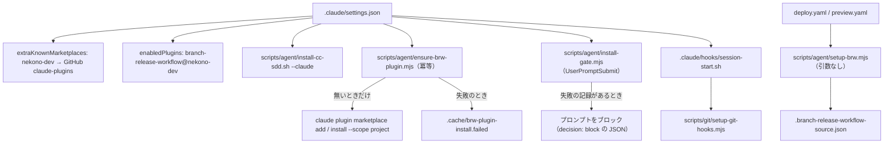

# Design Document

## Overview

**Purpose**: エージェントの導入（cc-sdd・BRW）を、Claude Code の 1 つの入口と、プロジェクトの設定という 1 つの正本に集約する。Codex への導入は取り消す。
**Users**: 運用者（導入の確認）、開発者（セッションの開始）、CI（BRW の取得）。
**Impact**: `.claude/settings.json` に marketplace の宣言を戻し、SessionStart から `ensure-brw-plugin.mjs` を呼ぶ（無いものだけを CLI で導入する冪等な処理）。`setup-brw --install`（起動のたびにユーザーの marketplace を入れ替える処理）は廃止する。`.codex/hooks.json`・`AGENTS.md`・`.codex/agents/` を削除する。`@latest` の導入は固定版になる。

### Goals

- cc-sdd の導入の処理を 1 箇所（`scripts/agent/install-cc-sdd.sh`）に置き、Claude からだけ呼ぶ
- cc-sdd 3.1.0 固定。導入物は gitignore し、セッション開始で追跡ファイルの差分が出ない
- BRW は `.claude/settings.json` の宣言と、SessionStart の冪等な導入（`ensure-brw-plugin.mjs`）で有効にする。宣言だけでは入らないため（2026-11-08 の確認）、導入はスクリプトが行う。端末に BRW の clone を置かず、ユーザーの設定を起動のたびに書き換えない
- BRW の正本（`.branch-release-workflow.json`）と CI 用の取得元（`.branch-release-workflow-source.json`）を保つ
- Codex 向けの導入物（AGENTS.md・`.codex/hooks.json`・`.codex/agents/`・`.agents/skills/` の生成物）を残さない

### Non-Goals

- cc-sdd・BRW の中身の変更
- Codex の MCP 連携（`codex-mcp-subagent` が扱う）
- 配置の移動（`ops-tooling-layout` が扱う）
- `.agents/skills/survey-run/`（Codex 用の複製。扱いは別途決める）
- 利用者のユーザー設定（`~/.claude/settings.json`）の整理（利用者の承認が要る。タスクとして別に記す）

## Architecture

### Existing Architecture Analysis

- （改訂前）SessionStart（Claude）: `.claude/settings.json` が `install-cc-sdd.sh --claude`・`setup-brw.mjs --install`・`session-start.sh` を呼ぶ。`--install` は起動のたびに、ユーザーの marketplace を外して登録し直していた（改訂で廃止）。
- （改訂前）SessionStart（Codex）: `.codex/hooks.json` が `install-cc-sdd.sh --codex` と `setup-brw.mjs --install` を呼ぶ。本改訂で取り消した。
- BRW の利用者: Claude（プラグイン）、CI（`setup-brw.mjs` の出力を `BRW_PLUGIN_DIR` へ）。
- marketplace の名前 `nekono-dev` は、GitHub の `nekono-dev/claude-plugins` が持つ。この marketplace には `branch-release-workflow` が含まれる（取得元は `nekono-dev/branch-release-workflow`）。vpngateway-gui も同じ取得元を宣言している。
- `.branch-release-workflow.json`（正本）と `.branch-release-workflow-source.json`（CI 用の取得元）は追跡されている。`.claude/branch-release-workflow.json` は正本へのシンボリックリンク。

### Architecture Pattern & Boundary Map

- **cc-sdd の導入**: `install-cc-sdd.sh` が唯一の cc-sdd の呼び出し元。受け付けるのは `--claude` だけ。
- **BRW の有効化**: プロジェクトの宣言（`.claude/settings.json`）と、SessionStart の `ensure-brw-plugin.mjs`（無いものだけを CLI で導入する）。
- **BRW の取得（CI）**: `setup-brw.mjs` の引数なしだけ。clone のパスを出す。開発機には clone を置かない。
- **Codex の役割**: 本 spec の範囲外。`codex-mcp-subagent` が MCP で定める。

### Technology Stack

| Layer  | Choice / Version           | Role in Feature              | Notes                                                                 |
| ------ | -------------------------- | ---------------------------- | --------------------------------------------------------------------- |
| 導入   | `cc-sdd@3.1.0`（npx）      | スキル・テンプレートの導入   | 固定版。`--yes --lang ja --claude-skills`                             |
| 取得   | git（`fetch --depth 1`）   | CI 用の BRW の clone         | `setup-brw.mjs` の既存の処理を維持                                    |
| 有効化 | Claude の marketplace 宣言 | BRW プラグインの取得と有効化 | `.claude/settings.json` の `extraKnownMarketplaces`・`enabledPlugins` |

## Components and Interfaces

| Component                     | Domain         | Intent                                                                                                 | Req     |
| ----------------------------- | -------------- | ------------------------------------------------------------------------------------------------------ | ------- |
| install-cc-sdd.sh             | 導入           | cc-sdd を固定版で Claude 向けに導入する（`--claude` のみ）                                             | 1, 2, 5 |
| settings.json                 | 入口           | SessionStart から cc-sdd の導入を呼ぶ。BRW の宣言を持つ                                                | 1, 4, 6 |
| ensure-brw-plugin.mjs         | BRW（開発機）  | SessionStart で、marketplace とプラグインが無いものだけを CLI で導入する（冪等）。失敗の状態を記録する | 4       |
| install-gate.mjs              | BRW（開発機）  | UserPromptSubmit で、失敗の状態があればプロンプトをブロックし、再試行の方法を示す                      | 4       |
| setup-brw.mjs                 | BRW（CI）      | 取得元の読み取りと、指定ブランチの clone（引数なし）                                                   | 3       |
| .branch-release-workflow.json | BRW            | ブランチ運用の宣言（正本）                                                                             | 4       |
| session-start.sh              | クラウド初期化 | クラウドだけで依存を整える                                                                             | 6       |

### scripts/agent/install-cc-sdd.sh

**Responsibilities**: `npx --yes cc-sdd@3.1.0 --yes --overwrite force --manifest <一覧> --claude-skills --lang ja` を実行する。一覧は、スキルと設定の雛形だけを含み、`CLAUDE.md` を含まない。
**Contract**: 引数は `--claude` のみ。他の引数・引数なしは使い方を標準エラーに出し、非ゼロで終了する。
**Preconditions**: カレントはリポジトリのルート（`CLAUDE_PROJECT_DIR` があればそこへ移動）。
**Postconditions**: 固定版の導入物（`.claude/skills/kiro-*`・`.kiro/settings/`）が作られる。どちらも gitignore の対象で、追跡ファイルは変わらない。

### 導入の版の固定

- `.claude/settings.json` は cc-sdd の版を書かない。版はスクリプトの `CC_SDD_VERSION` の 1 箇所だけに置く。
- 版を上げるときは、スクリプトの版を変え、導入物を入れ直して動作を確かめる（導入物はコミットしない）。

### BRW の有効化（`.claude/settings.json` の宣言と、SessionStart の冪等な導入）

- `extraKnownMarketplaces`: `nekono-dev` を GitHub の `nekono-dev/claude-plugins` として宣言する（vpngateway-gui と同じ取得元）。
- `enabledPlugins`: `branch-release-workflow@nekono-dev` を有効にする。
- **宣言だけでは、プラグインは入らない**（2026-11-08 の headless の確認。対話のセッションでの扱いは未確認）。そのため、SessionStart が `scripts/agent/ensure-brw-plugin.mjs` を呼ぶ。
- `ensure-brw-plugin.mjs` の動き（冪等）:
  1. `claude` が無ければ、飛ばして標準エラーに出し、正常終了する（Req 4.7）。
  2. `claude plugin marketplace list --json` を取得し、配列内に名前が `nekono-dev` と完全一致する項目が無ければ、`claude plugin marketplace add nekono-dev/claude-plugins --scope project` を行う。project スコープなので、書き込むのは `.claude/settings.json` の宣言（既にあれば変化しない）。
  3. `claude plugin list --json` に、このプロジェクト（`projectPath`）の `branch-release-workflow@nekono-dev`（scope project）が無ければ、`claude plugin install branch-release-workflow@nekono-dev --scope project --yes` を行う。
  4. 両方とも既にあれば、導入の操作（2・3）は行わない。この段階ではネットワークを使わない（更新は 6 で、毎回試す）。
  5. 2 または 3 の CLI が失敗したら、失敗の内容を標準エラーに出し、`.cache/brw-plugin-install.failed` を書いて、終了コード 0 で終わる（Req 4.8）。SessionStart は、この仕様では止められない（2026-11-08 に公式の仕様で確認）。停止は、次の `install-gate.mjs` が行う。
  - 導入が成功したら、このファイルを消す（Req 4.12）。
  - 導入を始める前に、記録（「導入中（完了していない）」）を書く。時間切れなどで途中で中断されても、記録が残り、次の入力まで止まる（Req 4.8）。
  6. 更新（`claude plugin update`）は、1〜4 の後に試す。失敗しても続行する（Req 4.9）。
  7. 導入を行った場合は、セッションを開き直す案内を出す（Req 4.10）。
- 削除（`marketplace remove`・`uninstall`）は行わない。ユーザーの設定（`~/.claude/settings.json`）と、他のプロジェクトの登録には触れない（Req 4.3）。
- 版は main に追従する。インストール後は記録された版（1.1.0 等）が使われるため、6 の `claude plugin update` で新しい main を取り込む（決定。下の Risks）。
- **時間制限（予算）**: `.claude/settings.json` の `ensure-brw-plugin.mjs` の行は、時間制限 180 秒（決定）。CLI の呼び出しは 1 回あたり 60 秒で打ち切る。CLI は最大 5 回（一覧の取得 2 回・add・install・update）呼ぶため、スクリプト全体の時間の予算を 170 秒とし、各 CLI の上限を「60 秒と予算の残りの小さい方」にする。予算が尽きたとき、導入に要る CLI は失敗として扱い（記録を残す）、更新は飛ばして標準エラーに出す（記録は書かない）。これで合計は 180 秒に収まる。時間切れで中断されても、導入の前に書いた記録が残るため、次の入力まで止まり、次の起動で再試行される。
- **一覧の取得の失敗**: `claude plugin marketplace list --json` が失敗したら、導入の操作はせず、失敗の記録を書く（理由: 既存の状態が確かめられないため）。成功時は JSON 配列を解析し、要素の `name` が完全一致するかで判定する。JSON として解析できない場合や配列でない場合は、名前が無いものとして扱う。`claude plugin list --json` が失敗したら、プラグインは未導入として扱い、導入を試みる（導入の CLI の失敗は、上の 5 のとおり記録する）。

### 失敗の状態による停止（`install-gate.mjs`・UserPromptSubmit）

- SessionStart は、終了コードでは止められない（公式の仕様: SessionStart は「Can block? No」。終了コード 2 は stderr を表示するだけ）。そのため、停止は UserPromptSubmit で行う（「Can block? Yes」）。
- `ensure-brw-plugin.mjs` が導入に失敗すると、`.cache/brw-plugin-install.failed` を書く（`/.cache/` は gitignore の対象）。
- `install-gate.mjs user-prompt-submit`: 失敗の記録（cc-sdd・BRW のどちらか）があれば、標準出力に `decision: "block"` の JSON を出す。理由に、再試行の方法を書く（`install-cc-sdd.sh --claude`・`ensure-brw-plugin.mjs`）。記録が無ければ、何もせず 0 で終わる。
- **回復の第一の手段は、新しいセッションを開くこと**（ローカルとクラウドの両方）。SessionStart で `install-cc-sdd.sh` と `ensure-brw-plugin.mjs` が再試行され、成功すると記録が消えて、ブロックが解ける。クラウドには通常のターミナルが無いため、この手段が唯一の回復になる。
- **補助の手段（ローカルのみ）**: すぐに直したい場合は、Claude の外（通常のターミナル）で `scripts/agent/install-cc-sdd.sh --claude` や `node scripts/agent/ensure-brw-plugin.mjs` を実行する。成功すると記録が消える。ブロックの理由には、この両方を書く（Req 1.6・4.11）。
- **`!` で始める直接のシェル入力**: UserPromptSubmit を通るかは、公式の文書に書かれていない（2026-11-08 に確認。記載なし）。そのため、回復の手順として使わない。
- 次の SessionStart でも、導入が無ければ再試行される。
- 注意（公式の仕様）: ブロックされたプロンプトの本文は、ブロックの理由に付いて表示され、会話の記録にも残る。`hookSpecificOutput.suppressOriginalPrompt: true` で、表示からは外せる（記録からは外れない）。機密を含むプロンプトを避けるよう、利用者に示す。
- ブロックは、導入が失敗している間だけ起きる。導入の済んでいる開発機と、`claude` が無い環境では、ブロックしない。

### .branch-release-workflow.json（正本）と取得元

- 正本: ルートの `.branch-release-workflow.json`（BRW の現行の文書が示す場所）。追跡されている。
- `.claude/branch-release-workflow.json`: 正本へのシンボリックリンク（`../.branch-release-workflow.json`）。旧パスの利用者向け。
- CI 用の取得元: `.branch-release-workflow-source.json`（`repository`・`branch`）。CI の `setup-brw.mjs`（引数なし）が使う。開発機では使わない。

## Data Models

- `.branch-release-workflow-source.json`: `{ "repository": "https://github.com/…git", "branch": "main" }`。`setup-brw.mjs` の検査規則（HTTPS の URL・ブランチ名）に合う。

## Error Handling

- **cc-sdd の導入の失敗（Req 1.5・1.6）**: スクリプトは非ゼロで終わり、失敗の内容を標準エラーに出す。失敗の記録（`.cache/cc-sdd-install.failed`）を書く。SessionStart は止められないため、プロンプトを `install-gate.mjs` が止める。成功すると記録を消す（Req 1.8）。クラウドでも同じく止める（Req 1.9。利用者の決定。クラウドでネットワークと `npx` が使えることを前提とする）。
- **cc-sdd が導入されていない（Req 1.7）**: 導入の物（`.claude/skills/<名前>/SKILL.md`）が無い `/kiro-*` のスラッシュコマンドは、`kiro-gate.mjs` の UserPromptSubmit がブロックする。理由に、`scripts/agent/install-cc-sdd.sh --claude` の実行を書く。導入の失敗の記録が無くても、この動きは起きる（導入されていない状態の利用者の案内のため）。
- 取得元の欠落・不正（CI）: `setup-brw.mjs` は、ファイル名と不正な項目を含むエラーを投げる（欠落時は「ファイルが無い」と分かる文言にする）。
- **BRW の導入の失敗（`ensure-brw-plugin.mjs`・Req 4.8）**: `marketplace add` または `install` が失敗したら、標準エラーに失敗した操作・CLI の出力・再試行の方法を出し、失敗の状態のファイルを書く。SessionStart は止めない（止められないため）。プロンプトは、`install-gate.mjs` がブロックして止める（Req 4.11）。回復は、導入の成功（手動の再試行を含む）で、ファイルが消えること（Req 4.12）。
- **BRW の更新の失敗（Req 4.9）**: `claude plugin update` の失敗は、標準エラーに出して続行する。作業は止めない。導入済みの版で作業できるため。
- **`claude` が無い（Req 4.7）**: 導入を飛ばして正常終了する。この場合、BRW は使えない。Claude Code を動かせない環境の扱いとして、停止はさせない。
- **導入直後のセッション（Req 4.10）**: 導入が成功したセッションでは、スキルが使えない場合がある。SessionStart の出力に、セッションを開き直す案内を出す。

## Testing Strategy

- **Unit**: `setup-brw.mjs` の取得元の検査（HTTPS・ブランチ名）は `scripts/agent/brwSource.mjs` に切り出し、`tests/unit/scripts/brwSource.test.ts` で既存の規則を確かめる（2026-11-08 に通過）。
- **Unit（設定）**: `.claude/settings.json` に、`extraKnownMarketplaces.nekono-dev` が GitHub の `nekono-dev/claude-plugins` を指すこと、`enabledPlugins` に `branch-release-workflow@nekono-dev` があることを確かめる。`SessionStart` に `setup-brw` の呼び出しが無いことも確かめる。
- **Unit（冪等な導入の判断）**: `ensure-brw-plugin.mjs` の判断（marketplace の有無・プラグインの有無から、行う操作を決める関数）を、CLI の出力の文字列を与えて確かめる。両方が有るときは何もしない、無いものだけを行う、`claude` が無いときは飛ばす、の 3 つ（`tests/unit/scripts/ensureBrwPlugin.test.ts`、2026-11-08 に実装し通過）。
- **Integration（偽の claude）**: PATH の先頭に偽の `claude` を置き、スクリプトを実行する。導入の失敗で記録が残り終了コードが 0、導入の成功で記録が消えることを確かめる（同じテストファイル、2026-11-08 に通過）。`marketplace remove`・`uninstall` が呼ばれないことは、単体テストで確かめる。
  - 失敗の確認: `marketplace add` または `install` を失敗させ、失敗の状態のファイルが書かれること（Req 4.8）。`plugin update` だけを失敗させ、ファイルが書かれず、スクリプトが正常終了すること（Req 4.9）。
- **Integration（停止の確認）**: 失敗の記録を置き、`install-gate.mjs user-prompt-submit` が `decision: "block"` と、理由（再試行の方法）を返すこと（Req 4.11）。記録を消すと、何も出さずに 0 で終わること。
- **Integration（cc-sdd の失敗）**: 偽の `npx`（失敗する）で `install-cc-sdd.sh --claude` を実行し、終了コードが非ゼロで、`.cache/cc-sdd-install.failed` が書かれること（Req 1.5）。成功したら記録が消えること（Req 1.8）。導入の前に記録が書かれること（中断への備え）。自動の試験は `tests/unit/scripts/cc-sddInstallRecord.test.ts`（2026-11-08 に通過）。一時ディレクトリにスクリプトを複製して行い、リポジトリの `.cache` には触れない。`ensure-brw-plugin.mjs` が成功すると、ファイルが消えること（Req 4.12）。
- **Integration（手元）**: `scripts/agent/install-cc-sdd.sh --claude` を 2 回実行し、`git status` で追跡ファイルの差分が無いことを確かめる。`--codex` と引数なしが非ゼロで終わることを確かめる。
- **Integration（削除の確認）**: `AGENTS.md`・`.codex/hooks.json`・`.codex/agents/` が無いこと、`.agents/skills/kiro-*` と `.agents/skills/branch-release-workflow` が作られないこと、`.gitignore` にその 2 行が無いことを確かめる。
- **時間予算の試験**: 偽の `claude` を、CLI が上限を超えるように遅らせ（試験では `SKYSHARE_BRW_CLI_TIMEOUT_MS` で上限を 1 秒にする）、スクリプトが打ち切り、失敗の記録を残して終了コード 0 になることを確かめる（`tests/unit/scripts/ensureBrwPlugin.test.ts`、2026-11-08 に通過）。
- **実機（手作業）**: 次の 3 点を確かめる。
  1. 導入の無い状態から対話のセッションを開き、`ensure-brw-plugin.mjs` が導入し、案内（Req 4.10）が出ること。
  2. 1 の後に、同じセッションでスキルが使えるか。使えなければ、開き直した後に使えること。
  3. 導入済みの状態でセッションを開き、導入の操作が行われないこと（更新だけが試されること）。
  - 2026-11-08 の headless セッションの結果: スキル `branch-release-workflow:branch-release-workflow` は読み込まれた。フックは `startup` で成功した。ただしプラグインの取得元は clone のまま（`Read from: /home/ubuntu/.cache/skyshare/brw`）だった。移行の後（2026-11-08）は、GitHub 由来であることを確認済み（「移行の実施結果と方針」）。
- **CI**: deploy・preview の `Fetch branch-release-workflow` が `BRW_PLUGIN_DIR` を得ること。

## Risks and Open Questions

- **版の方針（決定）**: BRW は main に追従する（利用者の決定）。版の固定はしない。開発機と CI は、どちらも main の先頭を使う（「移行の実施結果と方針」）。
- **Codex の project rules**: AGENTS.md を削除するため、Codex を直接使うセッションは、プロジェクトの規則を自動では読まなくなる。Codex の使い方は `codex-mcp-subagent` で定める。
- **`.agents/skills/survey-run/SKILL.md`**（追跡されている Codex 用の複製）は、本改訂の対象外。残すか消すかを別途決める。
- **既存の導入からの移行（実施済み・2026-11-08。結果は「移行の実施結果と方針」）**: 旧い clone を指していたプラグインの記録は、「既存の導入からの移行」の手順で外し、GitHub 由来で入れ直した。
- **main 追従の更新（決定・2026-11-08）**: インストール後は、記録された版（1.1.0 等）が使われる。main の新しいコミットを取り込むため、`ensure-brw-plugin.mjs` は SessionStart で `claude plugin update branch-release-workflow@nekono-dev` を試す（利用者の決定）。更新が失敗しても、作業は止めず、失敗を標準エラーに出す。ネットワークを使うのは、この更新の時だけ。
- **利用者のユーザー設定**: `~/.claude/settings.json` の `extraKnownMarketplaces.nekono-dev` は GitHub の `nekono-dev/claude-plugins` に揃えた（2026-11-08）。`~/.claude/plugins/known_marketplaces.json` の同名の登録（directory 型で clone を指す）は、移行の手順で整理する。
- **名前の衝突**: `nekono-dev` は、利用者の設定の中で 1 つの取得元にしか対応しない。本 spec の方式では、この名前は `nekono-dev/claude-plugins` に統一される。BRW の単独のリポジトリを同じ名前で別に登録しない。
- **停止の方法（決定・2026-11-08）**: 導入の失敗では、SessionStart は止められない。プロンプトを止める（UserPromptSubmit）。利用者の決定（案 A）。
- **クラウドでの停止（決定・2026-11-08）**: cc-sdd の導入の失敗は、クラウドでも記録して止める（Req 1.9）。クラウドで、ネットワークや `npx` が使えない場合は、作業できない。利用者の決定（(a)）による。ただし、この前提が崩れた場合（クラウドでの導入の失敗が頻発する場合）は、この決定を見直す。
- **停止の回復（未確認）**: `!` で始める直接のシェル入力が、ブロックの対象になるかは未確認（公式の文書に記載なし）。回復は Claude の外のターミナルで行う（上の「失敗の状態による停止」）。
- **導入したセッションでのスキル（未確認）**: `ensure-brw-plugin.mjs` は SessionStart の中でプラグインを導入する。導入したセッションのスキル一覧に載るかは、未確認。載らない場合は、Req 4.10 の案内に従い、セッションを開き直す。対話のセッションでの確認を、実機の確認項目に加える。

## 既存の導入からの移行

旧い方式（`setup-brw --install`）で入ったプラグインと登録を、宣言の方式に切り替える手順。利用者の Claude 設定（ユーザースコープ）とプラグインの記録を変えるため、各手順の前に利用者の承認を得る。

1. **現状の確認（読み取りのみ）**: `claude plugin list` の `Read from` と、`claude plugin marketplace list` の `nekono-dev` の取得元を記録する。
2. **プラグインの記録を外す**: `claude plugin uninstall branch-release-workflow@nekono-dev --scope project`。外すとプラグインは読み込まれなくなる。
3. **旧い marketplace の登録を外す**: 登録の取得元が clone（directory 型）のままなら、`claude plugin marketplace remove nekono-dev`。この登録は、同じ名前を使う他のプロジェクトにも影響するため、手順 1 の一覧で他に使われていないかを確かめてから行う。
4. **導入（CLI で行う）**: 宣言だけでは入らないため、`scripts/agent/ensure-brw-plugin.mjs` が SessionStart で、無いものだけを CLI で導入する（「BRW の有効化」）。手作業で行うなら、同じ 2 行の CLI（`marketplace add ... --scope project` と `install ... --scope project --yes`）を使う。
5. **確認**: `claude plugin list` の `Read from` が GitHub 由来（clone のパスではない）であることを確かめる。スキル `branch-release-workflow:branch-release-workflow` が使えること、SessionStart のフックにエラーが無いことを確かめる。
6. **揃わないとき**: 手順 5 が揃わないなら、手順 2 と 3 の結果を利用者に示し、手作業の整理を承認を得て行う。失敗の原因を記録してから再試行する。

この手順の結果（手順 5 の確認）は、tasks.md の末尾の「利用者の確認と後片付け」に記録する。利用者の操作を含むため、タスクには含めない。

## 移行の実施結果と方針（2026-11-08）

### BRW の版の方針（決定）

- BRW は **main に追従する**（利用者の決定）。プラグインは `nekono-dev/claude-plugins` の marketplace 経由で、その中の `branch-release-workflow`（取得元 `nekono-dev/branch-release-workflow`、既定ブランチ `main`）から入る。版の固定はしない。
- CI は `.branch-release-workflow-source.json`（`main`）を、実行のたびに clone する。開発機と CI は、どちらも main の先頭を使う。

### 実施した移行の手順と結果

1. 現状の確認: プラグインは `Read from: /home/ubuntu/.cache/skyshare/brw`、登録は directory 型。他のプロジェクト（`vpngateway-gui`・`ytdlpServer`）は、どちらも GitHub の `nekono-dev/claude-plugins` を宣言していた。旧い登録を外しても、他への影響は無い。
2. プラグインの記録を外す（`claude plugin uninstall ... --scope project`）: 成功。
3. 旧い登録を外す（`claude plugin marketplace remove nekono-dev`）: 成功。
4. 新しいセッション: **宣言だけでは、headless のセッションでプラグインは入らなかった**（`plugin list` が空のまま）。このため、導入を CLI で明示した（次の 2 つ）。
   - `claude plugin marketplace add nekono-dev/claude-plugins --scope project`（プロジェクトの宣言を書き、取得元を登録）
   - `claude plugin install branch-release-workflow@nekono-dev --scope project --yes`
5. 確認: `claude plugin list --json` の `installPath` は `~/.claude/plugins/cache/nekono-dev/branch-release-workflow/1.1.0`（GitHub 由来）。`known_marketplaces.json` の `nekono-dev` は `github` の `nekono-dev/claude-plugins`。新しいセッションで、スキル `branch-release-workflow:branch-release-workflow` が使えた。

### 手順の副作用（記録）

- 手順 2・3 の CLI は、プロジェクトの `.claude/settings.json` の `enabledPlugins` と `extraKnownMarketplaces` を空にした。宣言を戻し、手順 4 の `marketplace add --scope project` で再び書かれたことを確認した。
- 手順 3 の CLI は、ユーザー設定の `extraKnownMarketplaces.nekono-dev` も外した。設計は、ユーザー設定に依存しないため、この状態を正とする。

### 未確認の事項（条件）

- **対話のセッションでの扱い**: headless では、宣言だけでは入らなかった。対話のセッションで、案内や自動導入が起きるかは未確認。`ensure-brw-plugin.mjs` は、対話の有無に関わらず動くため、この確認は設計の前提に影響しない。
- **クラウドセッション**: `ensure-brw-plugin.mjs` が、クラウドで `claude` と git の認証を使えるかは未確認。使えない場合は、Req 4.7 により飛ばされる（BRW 無しで作業する）。
- **設計の訂正（2026-11-08 の検証後）**: 前節の旧い手順 4 は「宣言から自動で入る」としていた。実際は CLI の導入が必要だった。現在は `ensure-brw-plugin.mjs` が行う。DEVELOP.md（develop-docs）には、この動きを書く。

### 後片付け（未実施）

- `~/.cache/skyshare/brw`（旧い BRW の clone）は、どの設定からも参照されていない。しかし、この削除は自動の安全判定で拒否された。利用者が削除を承認すれば、片付けられる。

## 改訂の記録（2026-11-08）

1. **Codex の取り消し**: Codex 向けの cc-sdd 導入・BRW の Codex 側・`.codex/hooks.json`・AGENTS.md・`.codex/agents/` を取り消す（利用者の決定）。
2. **BRW の有効化の方式を変更**: 起動のたびに `marketplace remove`・`add` する方式（`setup-brw --install`）をやめ、プロジェクトの設定で `nekono-dev/claude-plugins` を宣言する方式にする（利用者の決定。設計レビューの重大な問題 1・3 への対応）。2026-10-31 の決定（`extraKnownMarketplaces` を外す）は、この改訂で逆になる。
3. 旧 Req 2.2（導入の結果を `.kiro/settings/` としてコミットに含める）は、`.gitignore` と CLAUDE.md の定め（導入物はコミットしない）と食い違っていたため、gitignore の定めに合わせた。
