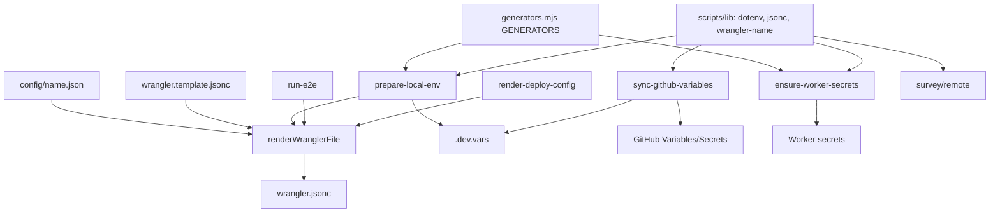

# Design Document

## Overview

**Purpose**: 設定（config → wrangler.jsonc）と秘密（`.dev.vars`・GitHub・Worker）の処理を、共通の解析と責務の分担で 1 通りにする。
**Users**: 運用者（`npm run dev`・`sync:github`・配備）、CI（deploy・preview）。
**Impact**: wrangler.jsonc の生成は同じプロセスの関数呼び出しになる。`jsonc-parser` への依存が消える。秘密の生成の定義が 1 箇所になる。

### Goals

- wrangler.jsonc の生成を `renderWranglerFile` の 1 つの入口にする（子プロセスをやめる）
- dotenv・JSONC・wrangler の `name` の読み取りを `scripts/lib/` の 1 通りにする
- 秘密の生成（GENERATORS）を 1 箇所に置き、登録（sync・ensure）と書き込み（prepare）の責務を分ける

### Non-Goals

- pre-push の挙動（既知の論点）、CI の処理内容、ファイルの配置（ops-tooling-layout）

## Architecture

### Existing Architecture Analysis

- wrangler.jsonc の生成は `scripts/render-wrangler.mjs` が持つ（`readConfig`・`buildWranglerConfig` は export 済み、CLI は main ガード付き）。呼び出しは子プロセス 5 箇所（`prepare-local-env`・`run-e2e` の 2 回・`render-deploy-config`）。
- dotenv: `scripts/lib/dotenv.mjs` と `prepare-local-env` の `RegExp`。
- JSONC: `scripts/lib/jsonc.mjs` と `hack/survey-cli/remote.ts` の `jsonc-parser`（宣言なし）。
- `name` の読み取り: `ensure-worker-secrets.mjs` と `sync-github-variables.mjs` の正規表現。
- GENERATORS: `prepare-local-env.mjs` に定義し、`ensure-worker-secrets.mjs` が import している（スクリプトの間の依存）。

### Architecture Pattern & Boundary Map

- 設定の生成と秘密の準備・登録は、依存の向きを一方向にする（生成 → 準備 → 登録）。
- 共通の解析は `scripts/lib/` だけに置き、スクリプトから別のスクリプトを import しない（GENERATORS を除く）。

### Technology Stack

| Layer | Choice / Version         | Role in Feature                          | Notes                                       |
| ----- | ------------------------ | ---------------------------------------- | ------------------------------------------- |
| 解析  | `scripts/lib/jsonc.mjs`  | JSONC の読み取り（コメント・末尾カンマ） | 既存。survey の `jsonc-parser` を置き換える |
| 解析  | `scripts/lib/dotenv.mjs` | `.dev.vars` の読み取り                   | 既存                                        |

## Components and Interfaces

| Component                              | Domain | Intent                                               | Req |
| -------------------------------------- | ------ | ---------------------------------------------------- | --- |
| renderWranglerFile                     | 設定   | 設定と雛形から wrangler.jsonc を書く（同じプロセス） | 1   |
| scripts/lib/wrangler.mjs（新規）       | 共通   | wrangler 設定の `name` を読む                        | 2   |
| scripts/secrets/generators.mjs（新規） | 秘密   | シークレットの生成関数（GENERATORS）の唯一の定義     | 3   |
| prepare-local-env                      | 秘密   | `.dev.vars` の未設定を埋める（登録はしない）         | 3   |
| sync-github-variables                  | 秘密   | GitHub と Worker への登録（生成はしない）            | 3   |
| ensure-worker-secrets                  | 秘密   | 未登録の Worker のシークレットを登録する             | 3   |

### renderWranglerFile（`scripts/config/render-wrangler.mjs`）

**Contract**: `renderWranglerFile({ name, develop, root? }) → { outputPath, message }`。失敗は例外（`Error`）で投げる。CLI の `main` は、この関数を呼んで結果を出し、例外を終了コードに変える。
**Notes**: `develop` のとき D1 の ID を `wrangler d1 list --json` で引く既存の処理を `resolveD1Ids(template, develop)` として切り出す。`process.exit` を関数の中で呼ばない（呼び出し側が失敗を扱えるように）。

### scripts/lib/wrangler.mjs（新規）

**Contract**: `workerNameFrom(source: string) → string`。`parseJsonc` で読み、トップレベルの `name` を返す。無い・空なら例外。
**Why**: 正規表現は `d1_databases` などの入れ子の `"name"` にも当たりうるため、構造で読む。

### scripts/secrets/generators.mjs（新規）

**Contract**: `GENERATORS`（名前 → 非同期の生成関数）を export する。`generateOauthKey` は `scripts/secrets/generate-oauth-key.mjs` から import する。
**Notes**: CLI（`generate-oauth-key.mjs`）は `| npx wrangler secret put` の用途のため残す。

### prepare-local-env

- `.dev.vars` の読み取りは `parseDotenv` を使い、「値が空または無い」名前だけを埋める。行の書き換えは、該当行（`^NAME=.*$`）だけを対象にする（既存の書き換え規則を保つ）。
- 生成の失敗・既設定の値は上書きしない（既存の規則）。

## Data Models

- `.dev.vars`（dotenv）と `config/<名前>.json`（非秘密）の形式は変えない。
- wrangler.jsonc の出力内容は変えない（テストで同一性を確かめる）。

## Error Handling

- 設定の不足（vars・siteHost・D1 の ID）は、`renderWranglerFile` が例外で投げ、CLI は非ゼロで終わる（既存の文言を保つ）。
- 秘密の登録の失敗は、どの名前で失敗したかだけを標準エラーに出す（値は出さない）。

## Testing Strategy

- **Unit**（既存 `tests/unit/scripts/renderWrangler.test.ts`）: `buildWranglerConfig` の出力（develop・production）が変わらないことを確かめる。
- **Unit**（新規）: `workerNameFrom` が入れ子の `"name"` を取らないこと、`renderWranglerFile` が `process.exit` を呼ばないこと。
- **Unit**（既存 `syncGithubVariables.test.ts`）: `parseDotenv`・`repositoryFromRemote` の期待値を保つ。
- **Integration（手元）**: `npm run setup:local` の前後で `.dev.vars` の項目名が同じことを確かめる（値は見ない）。

## Risks and Open Questions

- `survey/remote.ts` の `jsonc-parser` は、エラー時に `errors` を集める動作。`parseJsonc` は例外で失敗するため、「パース失敗」の扱い（`RemoteError("parse")`）を例外の捕捉で保つ。
- `run-e2e.mjs` は子プロセスの終了コードで後始末を分けている。関数呼び出しに変えるときは、後始末の経路（`finally` 相当）を崩さない。
