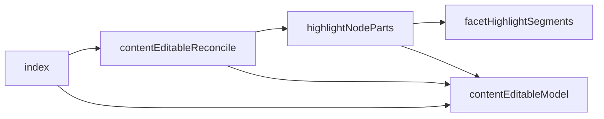
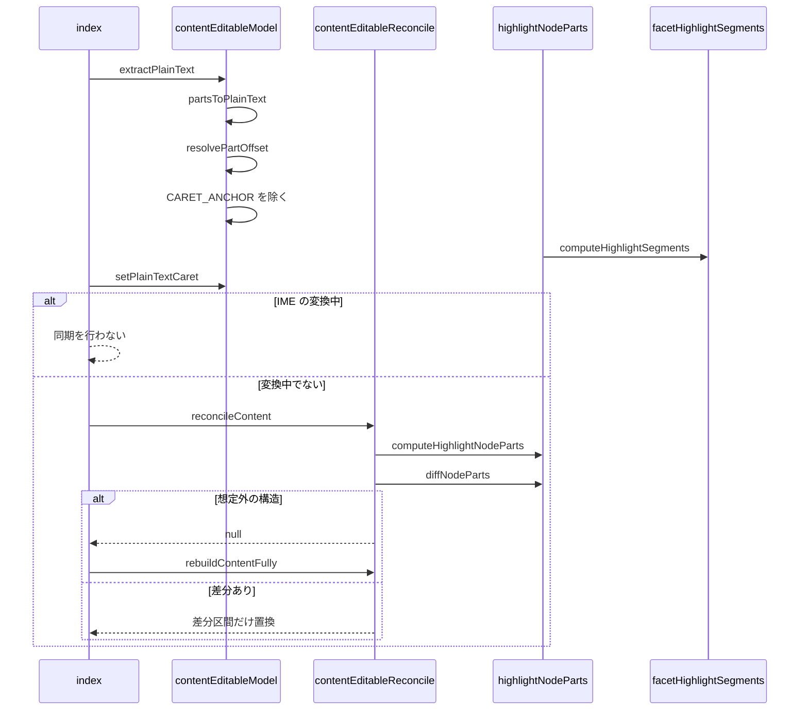

# Design Document

## Overview

**Purpose**: 投稿の本文を、ハッシュタグ・メンション・URLを入力と同時に色付けしながら、通常の入力欄と同じ操作感で編集できるようにする。
**Users**: 投稿の本文を入力する利用者
**Impact**: 本文を、ハッシュタグ・メンション・URL を色付けしながら、通常の入力欄と同じ操作感で編集できるようにする。

### Goals

- 本文からの色付け対象の検出と、表示用の部品への分割。
- 編集欄のDOMと本文の文字位置の相互変換。
- 入力のたびのDOMの差分更新。

### Non-Goals

- 候補の提示。
- 文字数カウンタの表示。

## Boundary Commitments

### This Spec Owns

- 本文からの色付け対象の検出と、表示用の部品への分割。
- 編集欄のDOMと本文の文字位置の相互変換。
- 入力のたびのDOMの差分更新。

### Out of Boundary

- 候補の提示。
- 文字数カウンタの表示。

### Allowed Dependencies

- ブラウザの contenteditable と選択範囲
- twitter-text 等による URL の検出規則（`src/util/` と `src/lib/atproto/richtext.ts`）
- 既知のトップレベルドメインの一覧（tlds）

### Revalidation Triggers

- 色付け対象の検出規則（開始位置の条件・スキームなしの URL）を変えるとき（post-rich-text と一致が要る）
- 編集欄のDOMの構造（部品の種類）を変えるとき
- 文字位置の変換（改行の1文字扱い）を変えるとき（文字数カウントに影響する）

## Architecture

### Architecture Pattern & Boundary Map

編集欄とその部品の依存方向を示す。



## File Structure Plan

| パス                                                          | 責務                                        |
| ------------------------------------------------------------- | ------------------------------------------- |
| `src/util/textarea/facetHighlightSegments.ts`                 | 本文からの色付け対象の検出と分割            |
| `src/util/textarea/highlightNodeParts.ts`                     | DOMの子ノード単位の部品への展開と差分の算出 |
| `src/util/textarea/contentEditableModel.ts`                   | 編集欄のDOMと平文の文字位置の相互変換       |
| `src/util/textarea/contentEditableReconcile.ts`               | 現在のDOMから理想の構造への差分更新         |
| `src/components/post/ThreadComposer/PostBodyEditor/index.tsx` | 編集欄の描画・入力の取り込み・同期          |

## System Flows

入力から差分更新までの流れと、変換中や構造不明の分岐を示す。



## Requirements Traceability

| Requirement             | Summary                | Components |
| ----------------------- | ---------------------- | ---------- |
| 1.1, 1.2, 1.3, 1.4, 1.5 | 色付けの検出           | D-1, D-4   |
| 2.1, 2.2, 2.3           | 部品への展開と差分更新 | D-2        |
| 3.1, 3.2, 3.3           | 平文との相互変換       | D-3        |
| 4.1                     | 入力操作               | D-4        |

## Components and Interfaces

#### D-1: 色付け対象の検出

**Requirements**: 1.1, 1.2, 1.3, 1.4

```ts
export type HighlightSegment = { text: string; highlighted: boolean }
// ハッシュタグ: (?<=^|[\s(])[#＃][\p{L}\p{N}\p{M}_]+
// メンション:   (?<=^|[\s(])@[a-zA-Z0-9.-]+
// URL:          スキームあり、またはドメインらしき文字列（スキームなしは既知 TLD で終わるものだけ）
export const computeHighlightSegments = (text: string): HighlightSegment[]
```

- 3種の一致を開始位置の昇順に並べ、先に採用した範囲と重なるものを捨てる。URL 内の `#` は URL の一部になる。
- `RichText.detectFacets` はハンドルが既知 TLD で終わるまでメンションと判定しないため使わない。スキームなしのドメインだけ、同じ TLD の一覧で検証して投稿時にリンクになる範囲と一致させる。

#### D-2: 部品への展開と差分

**Requirements**: 2.1, 2.2, 2.3

```ts
export type NodePart =
  | { type: "text"; value: string; highlighted: boolean }
  | { type: "br" }
  | { type: "anchor" }
// 末尾が改行のときだけ末尾に anchor（不可視の目印）を付ける
export const computeHighlightNodeParts = (text: string): NodePart[]
export const diffNodeParts = (oldParts: NodePart[], newParts: NodePart[]): { prefix: number; suffix: number }
```

先頭と末尾の共通区間を数えるとき、共通の要素が1つだけの場合は先頭区間にだけ数える。

#### D-3: 平文との相互変換

**Requirements**: 3.1, 3.2, 3.3

```ts
export type TextPart = { type: "text"; value: string } | { type: "br" }
export const CARET_ANCHOR = "​"
export const partsToPlainText = (parts: TextPart[]): string // br は "\n"
export const extractPlainText = (root: HTMLElement): string
export const resolvePartOffset = (parts: TextPart[], index: number) // 範囲外は端へ丸める。境界は直前の部品の末尾
export const setPlainTextCaret = (root: HTMLElement, index: number): void
```

#### D-4: 差分更新と編集欄

**Requirements**: 1.5, 4.1

```ts
// 一致する区間には触れず、差分の区間だけを置き換える。想定外の構造なら null
export const reconcileContent = (root: HTMLElement, text: string, highlightClassName: string): boolean | null
export const rebuildContentFully = (root: HTMLElement, text: string, highlightClassName: string): void
```

- 入力時点でブラウザは実 DOM を編集済みなので、現在の DOM と本文から計算した理想の構造を比べ、一致していれば触らない。ネイティブの取り消しを保つため。
- Enter と Shift+Enter は `insertParagraph` と `insertLineBreak` を横取りして `<br>` の挿入に統一する。
- IME の変換中（`compositionstart` から `compositionend`）は同期を止める。

## Error Handling

| 事象               | 処理               |
| ------------------ | ------------------ |
| 想定外のDOM構造    | 全置換に切り替える |
| 本文の位置が範囲外 | 端に丸める         |

## Testing Strategy

- Unit / Build Tests:
  - `npx vitest run tests/util/textarea/facetHighlightSegments.test.ts tests/util/textarea/highlightNodeParts.test.ts`
  - `npx vitest run tests/util/textarea/contentEditableModel.test.ts`
  - `npx tsc --noEmit`
- E2E/UI Tests:
  - `tests/e2e/postBodyEditor.spec.ts` ゲスト表示の投稿ページで本文欄へ「#tag」と入力しEnterを押す → 「#tag」が色付けされた要素になり、改行が入って入力済みの本文が残る
- テストの名前には、対応する基準 ID を `[post-body-editor/<ID>]` の形で付ける（例: `[post-body-editor/1.1]`）
