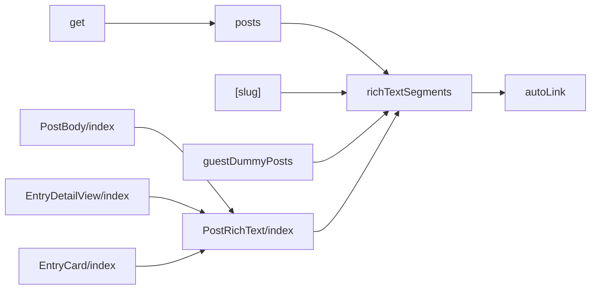
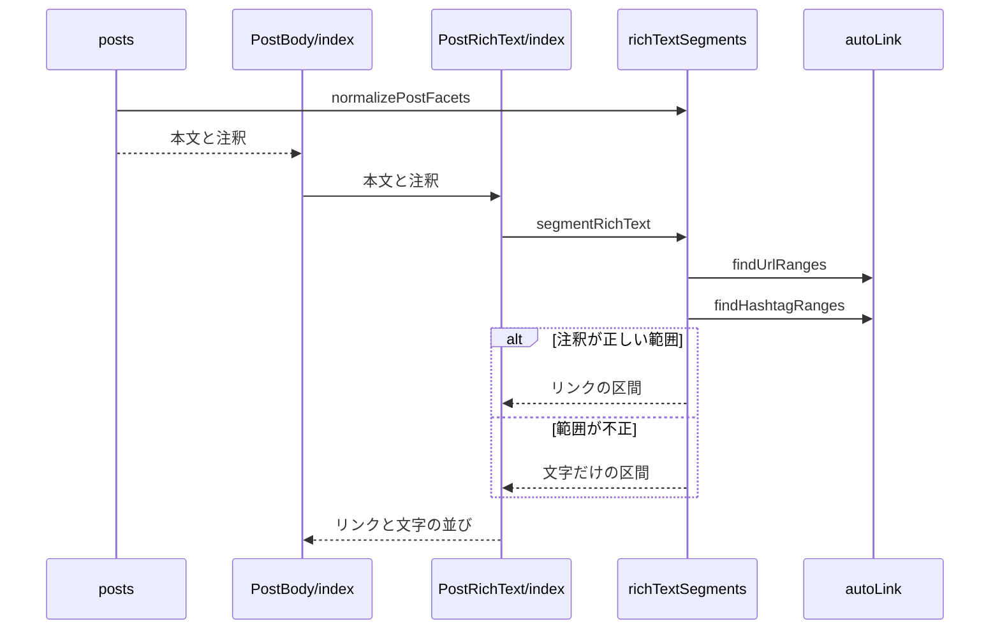

# Design Document

## Overview

**Purpose**: タイムライン・entry詳細ページ・entry一覧の文章で、メンション・ハッシュタグ・URLをリンクとして表示し、押すとBlueskyのプロフィール・ハッシュタグの検索・リンク先を開けるようにする。
**Users**: タイムライン・entry 詳細ページ・entry 一覧で投稿の文章を読む閲覧者
**Impact**: 投稿の文章中のメンション・ハッシュタグ・URL をリンクとして表示し、注釈の無い部分のリンクも補う。

### Goals

- 投稿の本文の注釈からのリンクの区間の切り出し。
- タイムライン・entry詳細ページ・entry一覧の文章のリンクの表示。
- 一覧APIの応答への本文の注釈の追加。

### Non-Goals

- 投稿フォームでの注釈の検出。
- 引用とリンクカードの埋め込みの表示。

## Boundary Commitments

### This Spec Owns

- 投稿の本文の注釈からのリンクの区間の切り出し。
- タイムライン・entry詳細ページ・entry一覧の文章のリンクの表示。
- 一覧APIの応答への本文の注釈の追加。

### Out of Boundary

- 投稿フォームでの注釈の検出。
- 引用とリンクカードの埋め込みの表示。

### Allowed Dependencies

- Bluesky の投稿の facet（注釈）
- URL とタグの検出（`src/util/autoLink.ts`）
- 一覧 API の応答（entries の一覧の定義）

### Revalidation Triggers

- 注釈の正規化（範囲の検証）の規則を変えるとき（post-body-editor の色付けと整合が要る）
- 平文からの URL とタグの検出規則を変えるとき
- 一覧 API の応答の注釈の形を変えるとき

## Architecture

### Architecture Pattern & Boundary Map

本文のリンク表示の依存方向を示す。



## File Structure Plan

| パス                                               | 責務                          |
| -------------------------------------------------- | ----------------------------- |
| `src/lib/atproto/richTextSegments.ts`              | 注釈の正規化と区間の切り出し  |
| `src/util/autoLink.ts`                             | 平文の中のURLとタグの検出     |
| `src/components/entry/EntryCard/index.tsx`         | entry一覧のキャプションの表示 |
| `src/components/post/PostRichText/index.tsx`       | 区間のリンクの描画            |
| `src/components/post/PostBody/index.tsx`           | 本文へのリンク表示の組み込み  |
| `src/lib/entry/posts.ts`                           | 一覧の投稿への注釈の付与      |
| `src/lib/api/schema/v2/entries/get.ts`             | 一覧APIの応答の注釈の定義     |
| `src/pages/entries/[slug].astro`                   | entry詳細の投稿への注釈の付与 |
| `src/components/entry/EntryDetailView/index.astro` | entry詳細の説明文のリンク表示 |
| `src/lib/entry/guestDummyPosts.ts`                 | ゲスト表示の投稿の注釈        |

## System Flows

本文を区間に分けてリンクを描画する流れを示す。



## Requirements Traceability

| Requirement                  | Summary                  | Components    |
| ---------------------------- | ------------------------ | ------------- |
| 1.1, 1.2, 1.3, 1.4, 1.5      | 注釈に基づくリンクの表示 | D-1, D-2      |
| 2.1, 2.2                     | 注釈の受け渡し           | D-2, D-3      |
| 3.1, 3.2, 3.3, 3.4, 3.5, 3.6 | 注釈の無い部分のリンク   | D-4, D-5, D-6 |

## Components and Interfaces

#### D-1: 注釈の正規化と区間の切り出し

**Requirements**: 1.1, 1.3, 1.4, 1.5

```ts
export type PostFacetFeature =
  | { $type: "app.bsky.richtext.facet#mention"; did: string }
  | { $type: "app.bsky.richtext.facet#link"; uri: string }
  | { $type: "app.bsky.richtext.facet#tag"; tag: string }
export type PostFacet = {
  index: { byteStart: number; byteEnd: number }
  features: PostFacetFeature[]
}
export type RichTextSegment = { text: string; href?: string }

// 未知の feature を落とし、feature の無い facet を除く（外部入力の最小要件の検査）
export const normalizePostFacets = (input: unknown): PostFacet[]
// UTF-8 のバイト列で切り出す。範囲外・重なり・文字の途中で切れる facet は無視する
export const segmentRichText = (text: string, facets: PostFacet[]): RichTextSegment[]
```

| feature | `href`                                                                                                 |
| ------- | ------------------------------------------------------------------------------------------------------ |
| mention | `https://bsky.app/profile/<did>`                                                                       |
| tag     | `https://bsky.app/hashtag/<encodeURIComponent(tag)>`                                                   |
| link    | `uri`（`http:` と `https:` のときだけ。スキームを省略したドメインで始まる `uri` は `https://` を補う） |

文字の途中の判定は、境界のバイトが UTF-8 の継続バイト（`0b10xxxxxx`）かどうかで行う。

#### D-2: リンクの描画

**Requirements**: 1.2, 2.2

```tsx
<PostRichText text={text} facets={facets} />
// segments.map((segment, index) => segment.href
//   ? <a key={index} href={segment.href} target="_blank" rel="noopener noreferrer">{segment.text}</a>
//   : <Fragment key={index}>{segment.text}</Fragment>)
```

`PostBody` は `facets` を受け取り、本文の `<p>` の中身を `PostRichText` にする。entry詳細ページの `PostBody` はサーバーで描画されるため、JavaScriptの実行なしでもリンクが表示される。リンクの色は `--color-link` とし、`card-muted` の中では文字と同じ色にする。

#### D-3: 注釈の受け渡し

**Requirements**: 2.1

| 経路           | 処理                                                                    |
| -------------- | ----------------------------------------------------------------------- |
| 一覧API        | `normalizeTimelinePost` が `record.facets` を正規化して `facets` に置く |
| 応答のスキーマ | `TimelinePostSchema` に `facets: Common.CommonFacetsSchema.optional()`  |
| entry詳細      | `toEntryPostView` が `record.facets` を正規化して `facets` に置く       |
| ゲスト表示     | 翻訳後の本文の中の位置から、注釈のバイトの範囲を組み立てる              |

#### D-4: 注釈の無いURLの検出

**Requirements**: 3.1, 3.2, 3.3

```ts
export type UrlRange = { start: number; end: number; href: string }
// 平文の中のURLの範囲（UTF-16の位置）とリンク先を出現順に返す
export const findUrlRanges = (text: string): UrlRange[]
```

`segmentRichText` は、注釈の範囲外の文字の区間を `findUrlRanges` で更に分け、URLの区間にリンク先を付ける。

| 対象           | 判定                                                                                   |
| -------------- | -------------------------------------------------------------------------------------- |
| URLの切れ目    | URLに使えるASCII文字（RFC 3986 の文字と `%`）が続く範囲。日本語・空白で終わる          |
| 始まり         | 直前が英数字・`.`・`-`・`@`・`/`・`_` でない位置（メールアドレス・メンションを除く）   |
| スキームの省略 | 最後のラベルが既知のトップレベルドメイン（`tlds`）のときだけURLとし、`https://` を補う |
| 末尾の記号     | `.,;:!?` と、対応する `(` の無い `)` を範囲から除く                                    |

entry詳細ページの説明文は注釈を持たないため、`PostRichText` に本文だけを渡して描画する。

#### D-5: entry一覧のキャプションの表示

**Requirements**: 3.4
`EntryCard` のキャプションは注釈を持たないため、`<p>` の中身を `PostRichText` に本文だけを渡して描画する。

```tsx
<p className={styles.caption}>
  <PostRichText text={item.caption} />
</p>
```

#### D-6: 注釈の無いタグの検出

**Requirements**: 3.5, 3.6

```ts
export type HashtagRange = { start: number; end: number; tag: string }
// 平文の中のハッシュタグの範囲（UTF-16の位置）と、`#` を除いたタグを出現順に返す
export const findHashtagRanges = (text: string): HashtagRange[]
```

`segmentRichText` は、注釈の範囲外の文字の区間で、`findUrlRanges` の範囲と重ならないタグを `https://bsky.app/hashtag/<encodeURIComponent(tag)>` のリンクの区間にする。

| 対象       | 判定                                                                                |
| ---------- | ----------------------------------------------------------------------------------- |
| 始まり     | `#` の直前が文頭・空白・`(`・`（` の位置だけ（単語の途中・URLのフラグメントを除く） |
| タグの文字 | `#` の後ろの空白と `#` で切れる範囲。末尾の句読点（`\p{P}`）は範囲から除く          |
| 除外       | 数字と句読点だけのタグ。64文字を超えるタグ                                          |

## Error Handling

| 事象                 | 処理                                     |
| -------------------- | ---------------------------------------- |
| 注釈の形式が不正     | その注釈を捨て、本文を文字のまま表示する |
| 注釈が無い・空の配列 | 本文全体を1つの文字の区間として表示する  |

## Testing Strategy

- Unit / Build Tests:
  - `npx vitest run tests/lib/atproto/richTextSegments.test.ts`
  - `npm run build`
  - `npx vitest run tests/lib/entry/posts.test.ts`
  - `npx vitest run tests/util/autoLink.test.ts tests/lib/atproto/richTextSegments.test.ts`
  - `npx vitest run tests/util/autoLink.test.ts`
- E2E/UI Tests:
  - `tests/e2e/postRichText.spec.ts` ゲスト表示とサンプルのentry詳細ページを開く → 本文のメンション・ハッシュタグ・URLが新しいタブで開くリンクになる
  - `tests/e2e/postRichText.spec.ts` サンプルのentry詳細ページを開く → 説明文のスキームを省略したURLが https を補った新しいタブで開くリンクになる
  - `tests/e2e/postRichText.spec.ts` ゲスト表示の一覧ページを開く → キャプションのスキームを省略したURLとタグが新しいタブで開くリンクになる
- テストの名前には、対応する基準 ID を `[post-rich-text/<ID>]` の形で付ける（例: `[post-rich-text/1.1]`）
